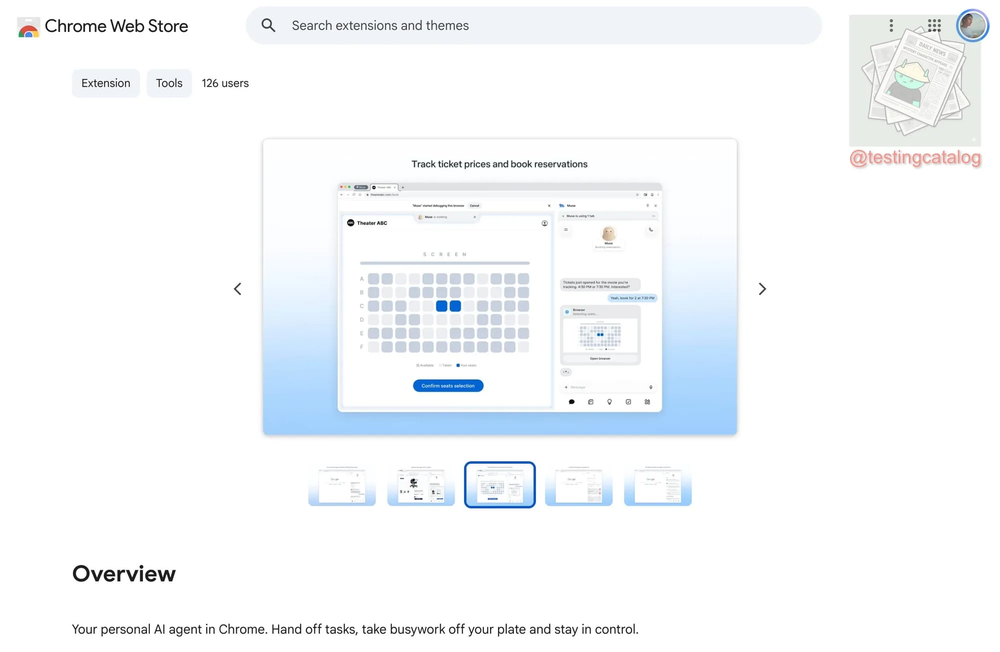



**收录说明**：直接下载。去掉了首图 Jolly 插画、作者头像与站内推荐卡片，保留了 Chrome Web Store 上架截图并本地化到本目录 images/。首报为 TestingCatalog（周四报道），本文的上架信息、商店描述与截图转述自该报道，属二手报道；标签组与接管方式另引 Meta 帮助中心页面。原文全文存于本目录的 original.md，网站上不显示，已翻译。

**内容摘要**：Meta 已悄悄发布名为 Muse from Meta 的 Chrome 扩展，现已上架 Chrome Web Store，Meta 未正式宣布此次发布。TestingCatalog 于周四报道了该上架信息，商店描述称 Muse 可处理填表、比价、跟进退款等任务，操作前需用户批准，并提供完整活动日志与随时撤销连接器的能力；商店页面截图显示已有 126 名用户。扩展把 Muse 放入 Chrome 侧边栏，用户可在任意打开的页面与 Muse 对话，让 Muse 用用户自己的 Chrome 浏览，其标签页归入独立的标签组，Muse 只能在这些标签页内操作。隐私方面，Muse 看不到已保存的密码、浏览历史或 Chrome 设置，网页上的密码会在 Muse 读取页面文本前被去除；用户可随时观看、暂停或接管（点击页面、按 Esc 或把标签页移出 Muse 标签组），任务完成后控制权交还 Chrome。这是 Muse 触达无连接器网站的第二条路线，区别于内置于对话中的独立浏览器，且与 Poppy 1.0 同日到来：Poppy 规范 Muse 如何向网站表明身份，扩展则让 Muse 在用户自己的已登录会话内工作。

**保留理由**：这是资料库中唯一记录 Muse Chrome 扩展上线、浏览模型与隐私边界的一手报道，补上了「Muse 如何在用户自有浏览器内工作」这一此前只有内置浏览器记载的空白；与同日收录的 Poppy 1.0 报道相互对照，可看清两条路线的分工。

---

Meta 推出的名为 Muse 的 Chrome 扩展（Muse from Meta）已在 Chrome Web Store 上架。它把 Muse 放进 Chrome 的侧边栏，并让 Muse 使用用户自己的 Chrome 浏览，在其自己的标签组里、在用户的注视下工作。

Meta 悄悄发布了 Muse 的 Chrome 扩展。这个名为 Muse from Meta 的扩展[已在 Chrome Web Store 上架](https://www.testingcatalog.com/meta-brings-muse-ai-agent-to-chrome-with-new-extension/)，把 Muse 放进 Chrome 的侧边栏，用户可以在任何打开的页面上与 Muse 聊天，并让 Muse 使用自己的 Chrome 浏览。Meta 尚未正式宣布此次发布。

TestingCatalog 于周四报道了这条上架信息。其商店描述称，Muse 可以处理填写表单、比较价格、跟进退款等任务，用户在操作发生前予以批准，并有完整的活动日志，可以随时撤销任何连接器。

Muse from Meta 的 Chrome Web Store 上架页面，显示 Muse 在 Chrome 侧边栏中追踪票价并预订座位，页面上显示有 126 名用户。（图片：TestingCatalog）

## 扩展如何工作

安装后，用户可以从 Chrome 的侧边栏登录，看到自己已有的对话，并在不离开当前页面的情况下继续这些对话。在侧边栏中，用户可以让 Muse 浏览网站、操控页面、协助购物或预订电影票，既可以把任务完全交出去，也可以在浏览器里与 Muse 一起操作。界面支持子对话和设置，不过有些部分仍会跳转到 Muse 网站。

使用时，用户在聊天中让 Muse 下载 Chrome 扩展，然后登录自己的 Muse 账号。当 Muse 通过扩展工作时，[它的标签页会在各自的标签组中打开](https://www.meta.com/en-gb/help/superintelligence/2124746764949121/)，并且 Muse 只能在这些标签页中执行操作。

这与 Muse 聊天内的浏览器是不同的浏览模式，后者独立于用户自己的浏览器运行。通过扩展，Muse 使用用户个人的 Chrome 浏览，可以使用用户已登录的任何网站，而无需再次询问登录信息。

## Muse 在 Chrome 中能看到什么、看不到什么

当 Muse 使用用户的 Chrome 时，它看不到已保存的密码、浏览历史或 Chrome 设置，网页上的密码会在 Muse 读取页面之前从文本中移除。

以用户的身份浏览有一些代价。Muse 访问的网站可能根据 Muse 的活动收集信息并归到用户名下，Muse 的活动可能出现在用户的 Google 账号和浏览历史中，并可能影响 Meta 产品内外的广告和推荐。Meta 建议希望让 Muse 避开特定账号的用户，在连接扩展之前先退出这些账号。

控制权留在打开的窗口中。用户可以观看 Muse 的操作，并可以通过点击页面、按 Esc 或把标签页移出 Muse 标签组来暂停它或接管。当 Muse 完成任务时，它会把 Chrome 的控制权交还。扩展可以随时从 Chrome 的扩展设置中卸载。

## 通往网络的第二条路径

到目前为止，Muse 访问没有连接器的网站时使用的是它自己的聊天内浏览器，这条路径已经碰到了[网站直接屏蔽智能体](https://www.allthingsmuse.com/articles/muse-websites-blocking-agents/)的情况。扩展给了 Muse 第二条路径：通过一个人已经在使用、并且已经登录的浏览器。它与 [Poppy 1.0，即 Muse 现在在访问的每个网站上首先检查的智能体识别协议](https://www.allthingsmuse.com/articles/poppy-personal-agent-protocol-1-0/)在同一天到来，两者指向不同的方向：Poppy 规范 Muse 如何向网站表明自己的身份，而 Chrome 扩展让 Muse 在用户自己已登录的会话中工作，网站看到的是用户自己的浏览器。
