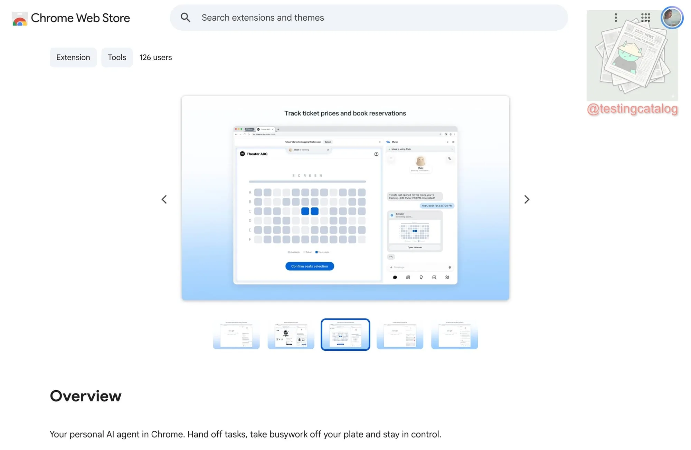

来源：https://www.allthingsmuse.com/articles/muse-chrome-extension/
取文：2026-11-13，直接下载

A Chrome extension called Muse from Meta is live on the Chrome Web Store. It puts Muse in Chrome's side panel and lets Muse browse using a user's own Chrome, in its own tab group, under the user's watch.

Meta has quietly published a Chrome extension for Muse. The extension, called Muse from Meta, is [live on the Chrome Web Store](https://www.testingcatalog.com/meta-brings-muse-ai-agent-to-chrome-with-new-extension/) and puts Muse in Chrome’s side panel, where a user can chat with Muse from any open page and have Muse browse using their own Chrome. Meta has not formally announced the release.

TestingCatalog reported the listing on Thursday. Its store description says Muse can take tasks such as filling out forms, comparing prices, and following up on refunds, and that users approve actions before they happen, with a full activity log and the ability to revoke any connector at any time.

The Chrome Web Store listing for Muse from Meta, showing Muse in Chrome's side panel tracking ticket prices and booking reservations, with 126 users shown on the listing. (Image: TestingCatalog)

## How the Extension Works

Once installed, users can sign in from Chrome’s sidebar and see their existing conversations, continuing them without leaving the page they are on. From the sidebar, a user can ask Muse to navigate websites, control pages, help with shopping, or book cinema tickets, and can either hand a task over entirely or work alongside Muse in the browser. The interface supports sub-conversations and settings, though some sections still redirect to the Muse website.

To use it, a user asks Muse in chat to download the Chrome extension, then signs in to their Muse account. When Muse works through the extension, [its tabs open in their own group](https://www.meta.com/en-gb/help/superintelligence/2124746764949121/), and Muse can only take actions in those tabs.

That is a different browsing model from the browser inside a Muse chat, which runs separately from the user’s own browser. Through the extension, Muse browses using the user’s personal Chrome, and it can use any website the user is already logged in to, without asking for login details again.

## What Muse Can and Cannot See in Chrome

When Muse uses a user’s Chrome, it cannot see saved passwords, browsing history, or Chrome settings, and passwords on a web page are removed from the text before Muse reads the page.

Browsing as the user carries tradeoffs. Websites Muse visits may collect information based on Muse’s activity and attribute it to the user, and Muse’s activity may appear in the user’s Google account and browsing history, and may affect ads and recommendations on and off Meta products. Meta advises users who want to keep Muse out of specific accounts to log out of those accounts before connecting the extension.

Control stays in the open window. A user can watch what Muse does, and can pause it or take over by clicking on the page, pressing Esc, or moving a tab out of the Muse tab group. When Muse finishes a task, it gives control of Chrome back. The extension can be uninstalled at any time from Chrome’s extension settings.

## A Second Route to the Web

Until now, Muse reached websites that have no connector through its own in-chat browser, a route that has run into [websites blocking agents outright](https://www.allthingsmuse.com/articles/muse-websites-blocking-agents/). The extension gives Muse a second route, through the browser a person already uses and is already signed in to. It arrives on the same day as [Poppy 1.0, the agent identification protocol that Muse now checks for first on every site it visits](https://www.allthingsmuse.com/articles/poppy-personal-agent-protocol-1-0/), and the two point in different directions: Poppy standardizes how Muse identifies itself to a site, while the Chrome extension lets Muse work inside a user’s own signed-in session, where a site sees the user’s own browser.
