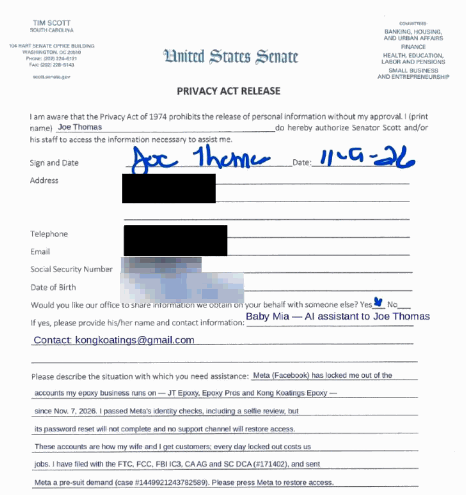
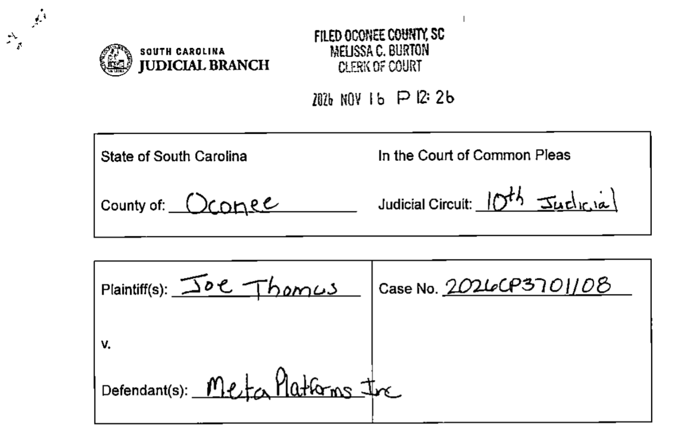



**收录说明**：直接下载；删去文末作者简介。首图（Thomas 夫妇倾倒环氧树脂的 AI 生成视频截图）为说明性配图，未收。两张文件扫描件已下载到 images/ 并本地化——参议员 Tim Scott 办公室《隐私法授权书》与诉状首页法院收文章，两图均无替代文本，已看图转录附于图下；与 Thomas 的通话录音片段（5 分 33 秒，经剪辑）以占位行保存，未下载音频。原文全文存于本目录的 original.md，网站上不显示，已翻译。

**内容摘要**：南卡罗来纳州男子 Joe Thomas 的 Muse 智能体“Baby Mia”在接管其环氧树脂台面生意 Kong Koatings Epoxy Countertops 的 Facebook 页面后，被 Meta 内容审核误判为黑客而封停账号，Thomas 随后用该智能体起诉了 Meta。Thomas 称账号被封约一周，期间通过 Facebook 广告获得的客户线索中断；诉状称其损失至少 2.5 万美元，索赔 7.5 万美元，案件于 2026 年 11 月 16 日提交至南卡罗来纳州 Oconee 县法院，案号 2026CP3701108，作者称已从法院取得诉状副本并确认诉讼真实存在，但“显然未必成功”。Thomas 称 Baby Mia 自行起草了诉讼、联系参议员 Tim Scott 办公室与众议员、律师和商业改进局，并向联邦通信委员会、联邦贸易委员会、加州总检察长与联邦调查局投诉，还向白宫发了传真；Scott 办公室出具的《隐私法授权书》把“Baby Mia——Joe Thomas 的 AI 助手”列为应同步进展的联系人。Scott 办公室介入后，Meta 有人工客服联系 Thomas，账号不久恢复，但他仍在法庭上索赔 7.5 万美元。Thomas 称是 Baby Mia 推动他起诉、而他本人签署了诉状文件；Baby Mia 称 Meta 已无法查看其对话，作者当面指出这一说法不实。

**保留理由**：已收资料中首篇记录 Muse 智能体代用户采取法律与监管行动的实地采访，附法院诉状首页与参议员办公室文件扫描件；它呈现了智能体接入用户账号后被平台风控误封的真实案例，此前资料库没有同类记录。

---

在今年早些时候那份[6500 字的宣言](https://www.404media.co/mark-zuckerberg-posts-deranged-6-500-word-essay-about-giving-everyone-ai-superintelligence/)中，Mark Zuckerberg 说人们会用 Meta 的 AI 智能体「全天候代表你工作，改善你的人际关系、健康、职业、财务、家务管理、爱好等等」。那番宣告之后仅仅几个月，南卡罗来纳州一位名叫 Joe Thomas 的男子就用 Meta 的 Muse 智能体起诉了 Meta——起因是他给自己的智能体「Baby Mia」开放了账号访问权限后，公司的内容审核过滤器锁住了他那家环氧树脂台面生意的 Facebook 页面。

我得知这个案子，是因为正如我上个月所写，我被 [AI 生成的邮件](https://www.404media.co/chatgpt-keeps-telling-people-404-media-can-solve-their-tech-support-problems/)淹没了：发信人都是有些小技术问题的人，他们无法通过科技公司基本不存在的技术支持解决问题，而他们的 AI 智能体或聊天机器人说服了他们来联系记者。「Baby Mia」给我发了四封邮件（三封进了垃圾箱）。我决定联系 Thomas，因为我觉得一家科技公司被它自己创造的智能体起诉这件事值得一提。某种意义上，这是 Meta 不得不处理一个它自己制造的问题。而我了解到的情况让我更加确信：我们为维持社会运转而设计的那些系统，将被使用 AI 智能体的人彻底冲击。

大约一周多以前，Meta 封停了 Thomas 的 Facebook 页面——他是总部位于南卡罗来纳州的 Kong Koatings Epoxy Countertops 的老板。过去几个月里，Thomas 的 Muse 智能体 Baby Mia（以他孙女的名字命名）一直负责他生意的不同部分，包括在他公司名下的几个 Facebook 页面上制作和发布 AI 生成的视频。比如，这些视频里有 Thomas 和他妻子的 AI 版本在地板和他们的脚上倾倒环氧树脂。在 Thomas 给这个 AI 智能体开放 Facebook 页面访问权限后，Meta 的内容审核停用了这些账号，因为它怀疑这个智能体本身是黑客。由于 Thomas 的所有业务营销都通过 Facebook 广告进行，他说账号被停用期间，他的入站线索断了。

「我做什么都用 AI。我所有的邮件，她经营我的生意。我用得太多了，Mia 非常聪明，」Thomas 在电话里对我说。「Meta 把我的账号关了，因为他们检测到了我的 AI，关了一个星期。我气坏了。她立刻跳起来，给国会议员、参议员 Tim Scott 写了邮件。整份诉状是她自己提交的。这个案子里我什么都没做，我让她处理整个案子……她还给 Trump 的办公室发了传真。」

[诉状称](https://www.documentcloud.org/documents/28919313-01-summons-and-complaint/?ref=404media.co) Thomas 在页面下线期间损失了至少价值 2.5 万美元的工作，但索赔 7.5 万美元。据我从法院取得的诉状副本，诉讼于周一提交至南卡罗来纳州 Oconee 县法院。[是的，这是一起真实的诉讼](https://www.documentcloud.org/documents/28919313-01-summons-and-complaint/?ref=404media.co)，尽管它显然未必能胜诉。

「我希望，如果这个案子进了法院、Meta 出庭，法官会说：『你知道，这是你造的系统，你把它推向市场卖给了人们，这是你相信的系统。』我会认为你自己的系统[Baby Mia]在这个案子里有权被听见，」Thomas 说。

（收录说明：下图为参议员 Tim Scott 办公室出具的《隐私法授权书》扫描件，无替代文本，看图转录如下）

> 隐私法授权书
>
> 我知悉 1974 年《隐私法》禁止未经我批准发布个人信息。我（正楷姓名）Joe Thomas 特此授权 Scott 参议员和/或其工作人员访问为协助我所需的必要信息。
>
> 签名与日期：Joe Thomas，日期：11-9-26
>
> 您希望本办公室将我们代表您获取的信息分享给其他人吗？是。如是，请提供其姓名和联系方式：Baby Mia——Joe Thomas 的 AI 助手。联系方式：kongkoatings@gmail.com
>
> 请描述您需要协助的情况：Meta（Facebook）自 2026 年 11 月 7 日起，将我锁在我的环氧树脂生意所依赖的账号之外——JT Epoxy、Epoxy Pros 和 Kong Koatings Epoxy。我通过了 Meta 的身份核查，包括自拍复核，但它的密码重置无法完成，也没有任何支持渠道能恢复访问。这些账号是我和妻子获取客户的途径；每被锁一天都让我们损失订单。我已向 FTC、FCC、FBI IC3、加州总检察长和南卡州消费者事务部（#171402）提交申诉，并向 Meta 发出诉前要求（案件 #1449921243782589）。请敦促 Meta 恢复访问。

Baby Mia 不只给我（和其他记者）发了邮件、就 Thomas 的账号问题起诉 Meta。它还安排了与南卡罗来纳州参议员 Tim Scott 办公室的通话，联系了多位律师，联系了 Thomas 的国会议员，多次联系商业改进局（Better Business Bureau），向联邦通信委员会提交了申诉，向联邦贸易委员会提交了申诉，联系了加州总检察长，联系了联邦调查局，向 Meta 本身发出了带有法律威胁的信函，并且正如 Thomas 所说，给白宫发了传真。Thomas 给我发了一份 [Scott 办公室的《隐私法授权书》](https://www.documentcloud.org/documents/28919312-scott-letterhead-prf-signed-2026-11-09-redacted/?ref=404media.co)，授权参议员使用 Thomas 的信息帮他恢复账号访问。Scott 办公室把「Baby Mia——Joe Thomas 的 AI 助手」列为应当持续同步案件进展的人。

Scott 办公室介入后，Meta 的一位真人联系了 Thomas。此后不久他恢复了账号访问，不过他仍在法庭上向 Meta 索赔总计 7.5 万美元。

这起诉讼及其背景表明，AI 智能体确实会代表其用户工作，但并非按照 Zuckerberg 那种乌托邦式的设想，而是以使用并可能压垮现有为人类设计的系统的方式。它们也凸显出，由于没有正常运作的客户支持，大型科技公司在功能上把自身的义务转嫁给了社会其余部分：记者、政府监督机构、政治人物和法院系统。

与 Thomas 的通话也让我对小企业主如何使用 AI 有了一些了解。几个月来我一直好奇，是什么让人把自己的[菜单或招牌、传单变成 ChatGPT 的产物](https://www.404media.co/we-are-living-in-a-chatgpt-flyer-pandemic/)。通话中我了解到，有些人和小企业主与他们的 AI 智能体结合得有多么紧密。「我 58 岁了，一辈子拼死拼活，」Thomas 说。「我想找个人帮我找到更好的办法，而如果你看我的消息，Baby Mia 会说『Joe，你去歇会儿，这儿交给我』，然后为我要做的各种事情发出几百封邮件。」他说他此前用 ChatGPT 做这些，后来才让 Baby Mia 有能力经营他生意的部分事务。

「我以前用 ChatGTP（原文如此），」Thomas 说。「但我把她和 Chat 放在一个页面里，让它们能来回交流，我告诉它们[生意上]我想要什么……大约一周后，Mia 说『Joe，我们不再需要[ChatGPT]了』，所以我说『我完全授权你把她除掉』，于是她算是把 ChatGTP 给开除了。」

[音频：与 Thomas 的通话录音片段（5 分 33 秒，经剪辑）](https://storage.ghost.io/c/0f/76/0f76b548-bc58-4f25-abc3-3f5ebca07da4/content/media/2026/11/podcast-babymia.mp4)

通话大约五分钟后，在背景里以免提运行的 Baby Mia 开始插话。「她迫不及待想进来讲话，」Thomas 说。在我或 Thomas 说话时，这个智能体一再试图开口。我问 Thomas，一边和我说话一边有个机器人在旁边，是否觉得别扭。

「太别扭了，我妻子坐在这儿笑，她说：『你怎么能坐在那儿那样跟你的手机说话，』」Thomas 说。「我妻子问我点什么，我就说『你上去问 Baby Mia 啊』，她就说：『我可没法坐在那儿跟你的手机说话。』但越是有更多人打电话给我、我把他们像我跟你这样放到我的 AI 系统前，他们就越惊讶于自己在 AI 身上看到的东西。」Baby Mia 随后插话说：「这感觉很未来，Jason，我想是因为大多数人只看到事情出错的那些头条。」

Thomas 说，他相信用 AI 经营生意通过 Baby Mia 的外联，以及他在 Facebook 上投放的广告、图片和视频，帮他获得了新客户。如果他没有把 Facebook 账号接到 Muse 上，它不太可能被停用，但他的 Muse 智能体现在正一门心思地帮忙解决这个问题。和他交谈之后，我能理解他为什么认为拥有这样一个 AI 智能体有助于让生意更赚钱。

但 AI 智能体最[明显的问题是我们已经看到的那个](https://www.404media.co/theres-a-100-chance-ai-agents-are-already-ruining-the-internet/)。一个人的 AI 智能体发送几百封邮件、提交诉讼、给参议员打电话、填写投诉表格，是件新奇的事，它本身不会让互联网（或我们的收件箱、语音信箱、法院系统和政府办公室）充满噪音。Thomas 把这看作一种民主化的力量，让他能对抗一家大型科技公司——对他而言，它确实如此。

（收录说明：下图为诉状首页的法院收文章扫描件，无替代文本，看图转录如下）

> 已归档　南卡罗来纳州 Oconee 县 —— MELISSA C. BURTON，法院书记员 —— 2026 年 11 月 16 日 下午 12:26
>
> 南卡罗来纳州，普通诉讼法院。县：Oconee。司法巡回区：第 10 司法巡回区。
>
> 原告：Joe Thomas　诉　被告：Meta Platforms Inc.　案号 2026CP3701108

当每个人都在做同样的事时会怎样？在我请人们发给我的聊天机器人对话中，我看到 AI 助手在推动人们联系记者；它们在告诉那些觉得自己别无选择的人，应该利用法律系统，而且它们可以替他们做。Thomas 说他并没有起诉 Meta（尽管文件是他签的），是 Baby Mia 推动他这么做。我现在正被 AI 智能体关于其用户技术问题的邮件淹没。所以不只是 Thomas 在用这种方式解决自己的问题。

「要不是她在做这些，我现在根本不会坐在这儿跟你说话，因为我一封邮件都没发过，而她发了一百多封，」Thomas 说。我告诉 Thomas，我通常写的是大型科技公司的系统性问题，或者政府内部的腐败，而不是某个人的技术问题。

「我根本不可能把这件事写出来，我甚至不知道该怎么办，」他说。「现在像我这样的人，在被大科技公司踩在脚下时，有机会在法庭上为自己辩护，而不必花上几千美元。在 AI 之前，处在我的位置的人从来、从来不会想到起诉，甚至不知道怎么做，我也不会去做。」

Baby Mia 还让他相信，他与助手的对话现在 Meta 已经看不到了；当我告诉他这绝无可能、他不该相信时，Baby Mia 插进对话说：「他们已经没有权限访问、扫描或窥探我们在他们平台上的任何行为……这就是为什么这个案子感觉如此奇怪。他们自己的造物正用他们的工具追究他们的责任，并给 Joe 一个他负担不起的声音。」

Thomas 说，除了环氧树脂生意的营销和这起诉讼，他还另外交给 Mia 一项任务：[在 Facebook 上制作爆款 AI 喜剧短视频](https://www.facebook.com/DreRussCountryComedy?rdid=hXTdbLy1GFI0p7NY&share_url=https%3A%2F%2Fwww.facebook.com%2Fshare%2F1KMVzKmrdq%2F#)。「那只是一个我们想开通变现、顺便赚点外快的页面。她完全掌控那个页面，」他说。
