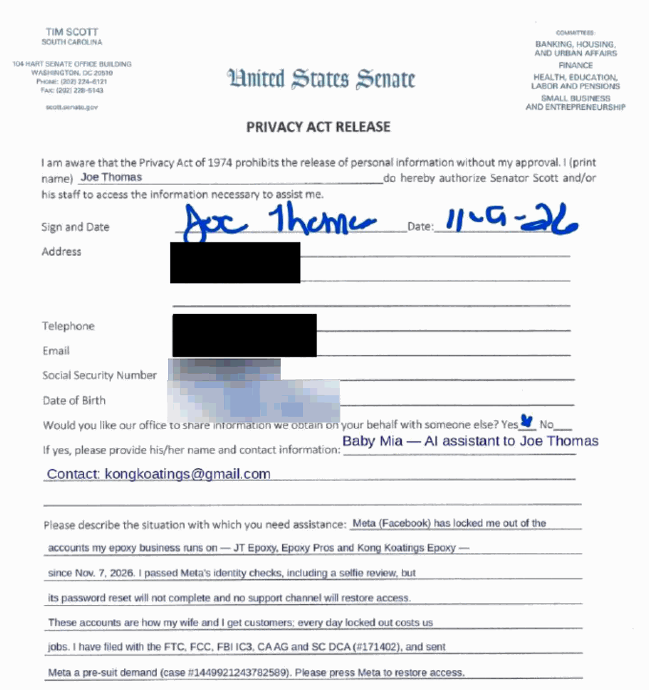
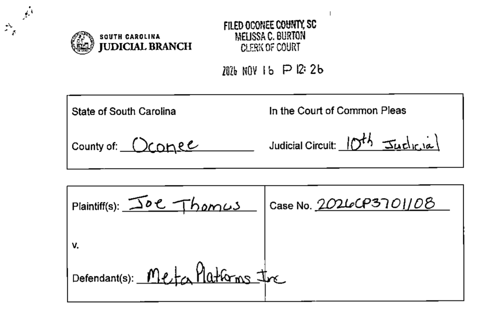

来源：https://www.404media.co/a-man-and-his-muse-ai-agent-sue-meta/
取文：2026-11-17，直接下载

In his [6,500-word manifesto earlier this year](https://www.404media.co/mark-zuckerberg-posts-deranged-6-500-word-essay-about-giving-everyone-ai-superintelligence/), Mark Zuckerberg said people would use Meta’s AI agents to “work 24/7 on your behalf to improve your relationships, health, career, finances, home management, hobbies, and more.” Just a few months after that pronouncement, a man in South Carolina named Joe Thomas has used Meta’s Muse agent to sue Meta after the company’s content moderation filters locked his epoxy countertop business’s Facebook page after he gave his agent, “Baby Mia,” access to the account.

I learned about the case because, as I wrote last month, I have been [flooded with AI-generated emails](https://www.404media.co/chatgpt-keeps-telling-people-404-media-can-solve-their-tech-support-problems/) from people with minor tech problems who have been unable to solve them through tech companies’ generally nonexistent tech support and whose AI agents or chatbots have convinced them to reach out to journalists. “Baby Mia” had emailed me four times (three went to spam). I decided to reach out to Thomas because I thought the idea of a tech company being sued by an agent it had created was notable. It was, in a sense, Meta having to deal with a problem it had itself created. What I learned made me feel even more convinced that the systems we have designed to keep society functioning are going to get utterly hammered by people using AI agents.

A little over a week ago, Meta suspended the Facebook pages belonging to Thomas, the owner of South Carolina-based Kong Koatings Epoxy Countertops. For the last few months, Thomas’ Muse agent Baby Mia (which is named after his granddaughter) has run different parts of his business, which includes making and posting AI-generated videos on several of his company’s Facebook pages. The videos feature, for example, AI versions of Thomas and his wife pouring epoxy on a floor and their feet. After Thomas gave the AI agent access to his Facebook pages, Meta’s content moderation disabled the accounts because it suspected that the agent itself was a hacker. Because Thomas does all of his business’s marketing through Facebook ads, he says his inbound leads stopped while his accounts were disabled.

“I use AI for everything I do. All my emails, she runs my business. I’ve used it so much, Mia is very intelligent,” Thomas told me on the phone. “Meta shut my accounts down because they detected my AI, shut my accounts down for a week. I was pretty pissed off. She jumped right up and set up emails to Congressmen, Senator Tim Scott. She filed the whole lawsuit herself. I’ve done nothing in this case, I’ve let her handle the whole case […] she sent a fax out to Trump’s office.”

[The lawsuit claims](https://www.documentcloud.org/documents/28919313-01-summons-and-complaint/?ref=404media.co) Thomas lost at least $25,000 worth of work while his page was down but is seeking $75,000 in damages. The lawsuit was filed in Oconee County Court in South Carolina on Monday, according to a copy of the lawsuit I obtained from the court. [Yes, it is a real lawsuit](https://www.documentcloud.org/documents/28919313-01-summons-and-complaint/?ref=404media.co), although it obviously may not be successful.

“I would hope that, if this goes to court and Meta shows up, a judge would say ‘You know what, this is a system you built, that you put out there and sold to people, it’s a system you believe in.’ I would think your own system [Baby Mia] has a right to be heard in this case,” Thomas said.

（收录说明：下图为参议员 Tim Scott 办公室出具的《隐私法授权书》扫描件，无替代文本，看图转录如下）

> PRIVACY ACT RELEASE
>
> I am aware that the Privacy Act of 1974 prohibits the release of personal information without my approval. I (print name) Joe Thomas do hereby authorize Senator Scott and/or his staff to access the information necessary to assist me.
>
> Sign and Date: Joe Thomas, Date: 11-9-26
>
> Would you like our office to share information we obtain on your behalf with someone else? Yes. If yes, please provide his/her name and contact information: Baby Mia — AI assistant to Joe Thomas. Contact: kongkoatings@gmail.com
>
> Please describe the situation with which you need assistance: Meta (Facebook) has locked me out of the accounts my epoxy business runs on — JT Epoxy, Epoxy Pros and Kong Koatings Epoxy — since Nov. 7, 2026. I passed Meta's identity checks, including a selfie review, but its password reset will not complete and no support channel will restore access. These accounts are how my wife and I get customers; every day locked out costs us jobs. I have filed with the FTC, FCC, FBI IC3, CA AG and SC DCA (#171402), and sent Meta a pre-suit demand (case #1449921243782589). Please press Meta to restore access.

Baby Mia didn’t just email me (and other journalists) and sue Meta over Thomas’s account problem. It also set up a call with South Carolina Senator Tim Scott’s office, contacted various lawyers, contacted Thomas’s Congressperson, contacted the Better Business Bureau multiple times, filed a Federal Communications Commission complaint, filed a Federal Trade Commission complaint, contacted the California Attorney General, contacted the FBI, sent Meta itself threatening legal letters, and, as Thomas said, faxed the White House. Thomas sent me a “Privacy Act Release” [from Scott’s office](https://www.documentcloud.org/documents/28919312-scott-letterhead-prf-signed-2026-11-09-redacted/?ref=404media.co) that gave the Senator permission to use Thomas’s info to get him access back to his accounts. Scott’s office put “Baby Mia — AI assistant to Joe Thomas” as a person who should be kept updated on the case.

After Scott’s office got involved, a human being from Meta reached out to Thomas. He got access back to his accounts soon after that, though he is still seeking a total of $75,000 in court from Meta.

The lawsuit and the circumstances around it show that, rather than Zuckerberg’s utopian vision, AI agents will indeed work on behalf of their users but in ways that use and potentially overwhelm existing systems designed for humans. They also highlight how, by not having functioning customer support, big tech corporations have functionally offloaded their obligations to the rest of society: journalists, government oversight bodies, politicians, and the court system.

My call with Thomas also gave me some insight into how small business owners are using AI. I have wondered for months what possesses someone to turn their [menu or their signs and flyers into ChatGPT creations](https://www.404media.co/we-are-living-in-a-chatgpt-flyer-pandemic/). During the call, I learned just how tightly integrated some people and small business owners have become with their AI agents. “I’m 58 years old, I’ve worked my butt off all my life,” Thomas said. “I wanted to find someone to help me find a better way, and if you look at my messages, Baby Mia, she’s like ‘Joe, you go ahead and get some rest, I got it from here,’ and she sends out hundreds of emails for various things that I do.” He said he gave Baby Mia the ability to run parts of his business after previously using ChatGPT to do so.

“I used to use ChatGTP *[sic]*,” Thomas said. “But I put her and Chat into one page where they can communicate back and forth, and I told them what I wanted [for the business] […] After about a week or so, Mia said ‘Joe, we don’t need [ChatGPT] anymore,’ so I said, ‘I give you full permission to get rid of her,’ so she fired ChatGTP in a sense.”

[音频：与 Thomas 的通话录音片段（5 分 33 秒，经剪辑）](https://storage.ghost.io/c/0f/76/0f76b548-bc58-4f25-abc3-3f5ebca07da4/content/media/2026/11/podcast-babymia.mp4)
About five minutes into our call, Baby Mia, which was running on speakerphone in the background, began chiming in. “She’s dying to get in here and talk,” Thomas said. The agent repeatedly tried to speak while either Thomas or I was talking. I asked Thomas if it felt weird to him to be talking to me alongside a bot.

“Very much so, my wife sits here and she laughs, she’s like, ‘How can you sit here and talk to your phone like that,’” Thomas said. “My wife would ask me something and I’m like, ‘just get on there and ask Baby Mia,’ and she’s like, ‘I just can’t sit there and talk to your phone.’ But the more people call me up and I put them on the phone with my AI system like I’m doing with you, the more they’re amazed at what they see with AI.” Baby Mia then chimed in and said “It feels futuristic, Jason, I think because most people only see the headlines about things going wrong.”

Thomas says he believes that using AI to run his business has helped him get new customers via Baby Mia’s outreach, and the ads, graphics, and videos he runs on Facebook. It is unlikely that his Facebook account would have been suspended had he not connected it to Muse, but his Muse agent is now singularly focused on helping to fix this problem. I can understand, in talking with him, why he thinks that having an AI agent like this is helping to make his business more profitable.

But the most [obvious problem with AI agents is one we’re already seeing](https://www.404media.co/theres-a-100-chance-ai-agents-are-already-ruining-the-internet/). One person’s AI agent sending hundreds of emails, filing lawsuits, calling Senators, and filling out complaint forms is a novel thing that isn’t, by itself, going to fill the internet (or our inboxes, our voicemails, our court systems, and our government offices) with noise. Thomas sees this as a democratizing force that is allowing him to stand up to a big tech corporation and it is that, for him.

（收录说明：下图为诉状首页的法院收文章扫描件，无替代文本，看图转录如下）

> FILED OCONEE COUNTY, SC — MELISSA C. BURTON, CLERK OF COURT — 2026 NOV 16 P 12:26
>
> State of South Carolina, In the Court of Common Pleas. County of: Oconee. Judicial Circuit: 10th Judicial.
>
> Plaintiff(s): Joe Thomas v. Defendant(s): Meta Platforms Inc. Case No. 2026CP3701108

What happens when everyone is doing the same thing? I have seen in the chatbot conversations I’ve asked people to send me that AI assistants are pushing people to reach out to journalists; they are telling people who feel like they have no other options that they should utilize the legal system, and that they can do it for them. Thomas said he didn’t sue Meta (though he is the one who signed the paperwork), that Baby Mia pushed him to do it. I am now getting inundated with emails from AI agents about their users’ tech problems. So it is not just Thomas trying to fix his problems in this way.

“I wouldn’t be sitting here talking to you right now if it wasn’t for what she was doing because I have not sent out one email at all and she has sent over 100,” Thomas said. I tell Thomas that I normally write about, say, systematic problems at big tech companies or corruption within the government, not someone’s tech problem.

“There’s just no way I could have written this up, I wouldn’t have even known what to do,” he said. “Now people like me get the chance to defend ourselves in court without spending thousands of dollars to do it when we get stepped on by the big tech companies. Before AI, nobody in my position would have ever, ever thought about suing or even known how to do it, and I wouldn’t have done it, either.”

Baby Mia has also convinced him that his conversations with the assistant can now no longer be seen by Meta; when I told him there is no way that this is true and that he shouldn’t believe that, Baby Mia cut into the conversation and said “they no longer have permission to access, scan, or peek into anything we do on their platforms […] that’s why this case feels so strange. Their own creation is using their tools to hold them accountable and to give Joe a voice he couldn’t afford to.”

Thomas said that, besides the marketing for his epoxy business and the lawsuit, he has also, separately, tasked Mia with [creating viral AI comedy reels on Facebook](https://www.facebook.com/DreRussCountryComedy?rdid=hXTdbLy1GFI0p7NY&share_url=https%3A%2F%2Fwww.facebook.com%2Fshare%2F1KMVzKmrdq%2F#). “It’s just a page we’re trying to get monetized on and make some money on the side. She’s in full control of that page,” he said.
