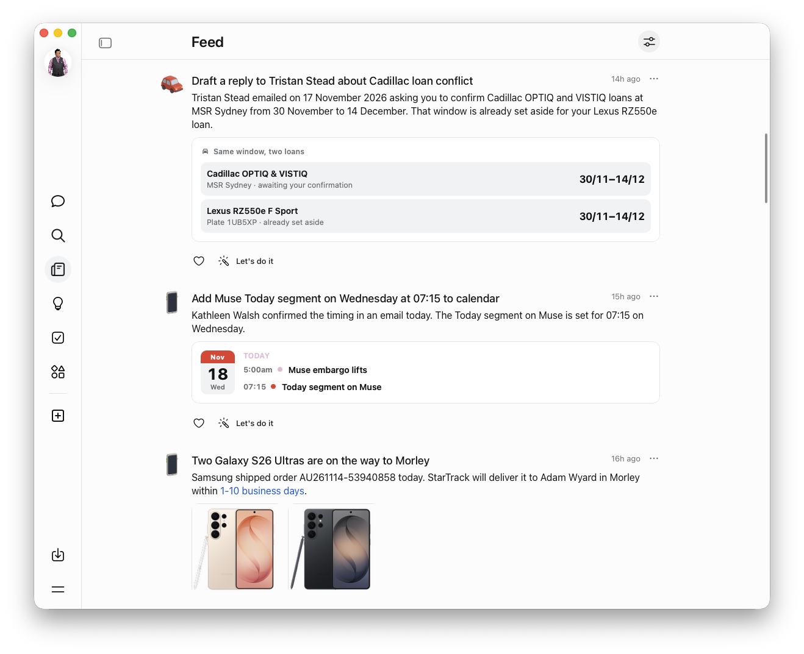
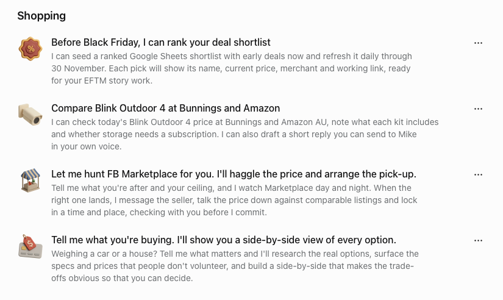
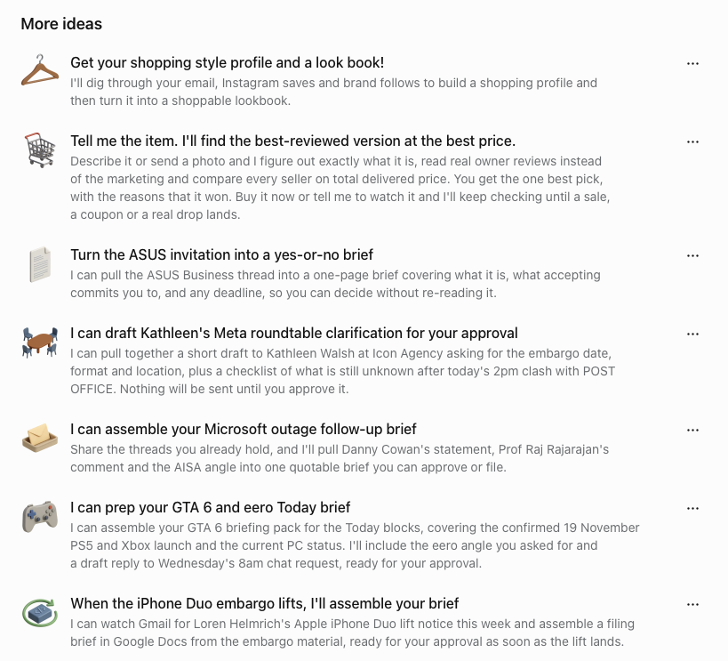
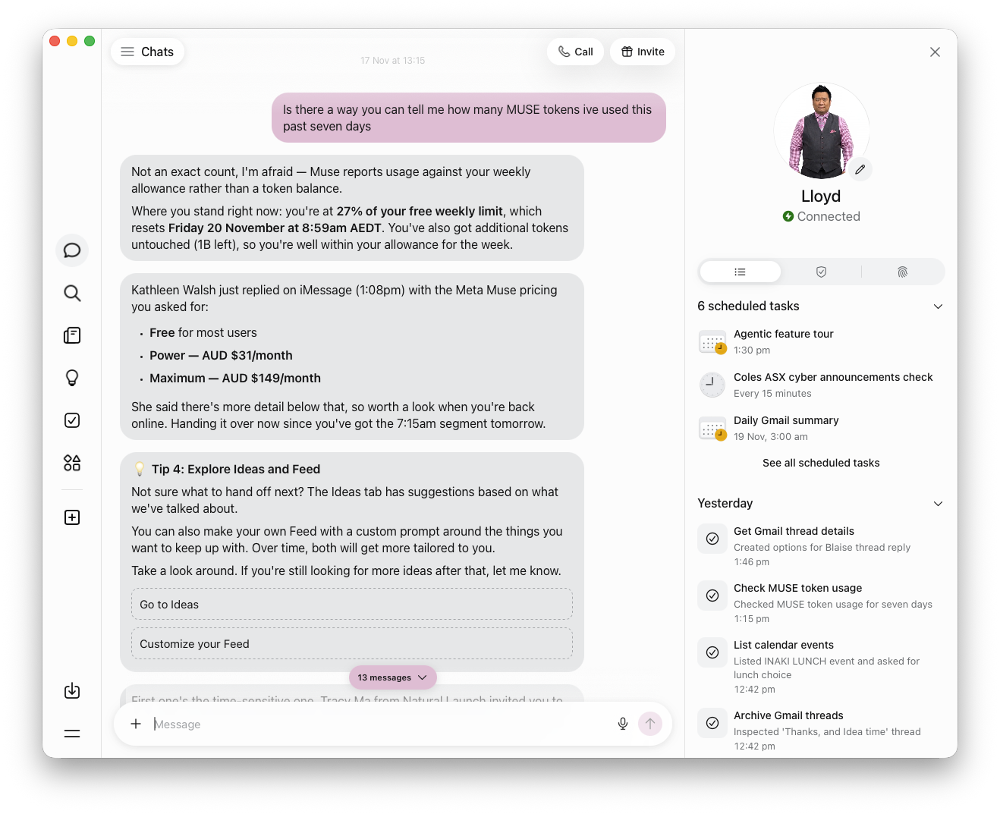
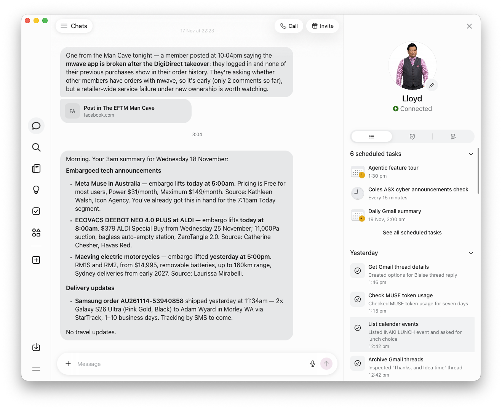



**收录说明**：直接下载；删去广告横幅、作者简介与 App Store 引导链接。首图、Lloyd 形象三张与八张应用截图已下载到 images/ 并本地化（cdn.eftm.com 的 HTTPS 连接被拒，改用 HTTP 下载）。原文全文存于本目录的 original.md，网站上不显示，已翻译。

**内容摘要**：作者 Trevor Long 在上线前使用 Muse 一周，把智能体命名为 Lloyd，并上传《Entourage》剧中 Lloyd 的照片作为其形象，打开应用时可见逼真的 Lloyd 形象，处理任务时形象会变为坐在笔记本电脑前工作的 Lloyd。澳大利亚首发可接入 Gmail、Google Calendar、Google Contacts、OpenTable、Ticketmaster、Shopify、Shop Pay 以及 Instagram 与 Facebook，Canva、Kogan、Mecca、Officeworks 与 Ticketek 等即将推出。作者称一周内大量使用后仅用了 27% 的额度，超出后每月 31 澳元，重度专业用户每月 149 澳元，起步免费。作者设置了凌晨 3 点的日程摘要，Muse 还会提醒待处理的消息、跟进快递与购物订单，并可通过 WhatsApp 与作者对话。作者称因在 Mac 上安装了 Muse，它能读取其 Messages 与 WhatsApp 应用；应用内的 feed 与 ideas 标签页会基于邮件与互动给出个性化建议。

**保留理由**：澳大利亚上线首日唯一的一手实测，记录了真实使用一周的额度消耗（27%）与澳元定价，以及 Mac 端读取 Messages/WhatsApp、WhatsApp 交互渠道等细节；官方稿与 allthingsmuse 均未提供这些实测信息。

---

两个月前在美国上线后，Meta 的「Muse」现在已在澳大利亚可用，随时帮助普通澳大利亚人管理从电子邮件、日历到购物或健身目标的各种事情。

我在一个多月前雇用了我[的个人 AI 代理 Darin（一个 ChatGPT「Dot」）](https://eftm.com/2026/10/chat-gpt-chatgpt-dot-ai-agent-aiagent-assistant-virtual-282866)，他至今仍在为我非常努力地工作——但他一些更私人的行政任务，现在正被 Lloyd 分担或接管，Lloyd 就是我的 Muse。

我的 Muse 起初是从 Meta 提供的选项中选出的「Baxter」，看起来像个毛绒玩具。

后来我意识到，如果我要认真对待这个「助手」，就需要唤起我内心的 Ari Gold，让我的 Lloyd 开始干活。于是我指示「Muse」把名字改成 Lloyd，并换上更合适的形象，这演变成我干脆上传了一张《Entourage》中 Lloyd 的照片，然后——砰，我们就开跑了：

打开应用时，我看到照片般逼真的 Lloyd 作为我的 Muse，而当他处理我的请求时，甚至会变成坐在笔记本电脑前工作的 Lloyd。

这是一个简单的细节，却真的很有效。

## 什么是 Muse？

Muse 是 Meta（拥有 Instagram、WhatsApp 和 Facebook 的公司）的「个人 AI 代理」。他们称之为「世界上第一个为所有人打造的个人 AI 代理」。

虽然 AI 仍相对较新，但几年间我们已经走了很远。像任何 AI 聊天机器人一样，你的 Muse 可以回答问题，并创建文本或图像等内容。那它为什么不同？

知识。你的 Muse 可以了解关于你的大量信息，并通过电子邮件或日历等事物连接到你的个人上下文。

正是这种近乎私密的连接，让你在使用应用时感到 Muse 有一种「个人助理」的感觉。

## 你的 Muse 能做什么？

Muse 的限制，就像 ChatGPT 的 Dots 一样，基本上取决于你把它连接到什么。

对 Muse 来说，在澳大利亚上线时，你可以连接 Gmail、Google Calendar、Google Contacts、OpenTable、Ticketmaster、Shopify、Shop Pay，当然还有你在 Instagram 和 Facebook 上的社交媒体账户。

即将推出 Canva、Kogan、Mecca、Officeworks 和 Ticketek 等众多服务。

Muse 能做什么，真的取决于你有多信任 Meta。你需要交出电子邮件和 Ticketmaster 等事物之间的直接连接，才能真正获益。

就个人而言，这是我目前非常愿意做出的牺牲。

仅仅一周，我再次对这个 Muse 能为我完成的「思考」水平印象深刻。

它会检查我是否注意到某封电子邮件中的内容，甚至提醒我收到的消息——因为我在 Mac 上安装了 Muse，它也能读取我的 Messages 和 WhatsApp 应用。

AI 代理能够完成工作，而不只是回答问题、接收你的任务——这些工作本质上是重复性的，或者是你能在它已连接的应用中描述清楚的事情。

作为这一点的标志，Muse 有一个「feed」，向你提供它能做的事情的选项——这有助于你理解其能力。

然后是 ideas 标签页，提供一份惊人的清单，不只是泛泛而谈，而是基于你自己的电子邮件和互动。

这些不只是清单，很多时候它们是根据你向 Muse 提出的请求或你电子邮件中的内容个性化生成的。

记住，Muse 为你工作；它能回答你最简单的问题，也会在看到事情时轻轻提醒你，比如我收到的需要关注的消息，或者就它如何能帮忙提出建议。

你的 Muse 一直在为你工作。你不需要要求它做事，它总是在尝试帮忙。

但你可以定期让它做事，我设置了一个凌晨 3 点的当日摘要，列出正在发生的事情、我可以或应该在做的事情，Lloyd 还会让我了解快递和购物订单的最新情况。

而且不只是文字，你可以和你的 Muse 交谈；也许我最喜欢的 Muse 差异点是 WhatsApp——我和 Lloyd 的聊天线程就与我的朋友和家人并列在一起。

Lloyd 现在会时不时在 WhatsApp 上而不是 PC 应用里给我发消息——就好像他知道我在外面走动。

## 澳大利亚的 Muse 多少钱？

Muse 是免费的——到某个程度为止。

像所有 AI 一样，关键在于「token」——你永远不会真正知道任何请求用了多少 token，但过去一周我问了 Lloyd 很多，结果只用了配额的 27%。

如果我确实需要更多，价格会跳到每月 $31，而对于重度专业用户，你可以掏每月 $149。

但最好的部分是免费起步。

## 试试 Muse——它可能改变游戏规则

我真心相信我们正在见证技术和工作的剧烈转变。AI 代理可以卸下你的负担，完成简单任务，甚至更多。

袖手旁观、忽视这一切，在技能培养方面将是一种损失，无论是在职场还是在个人生活中。

试一试吧。
