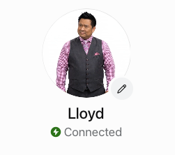
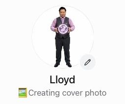
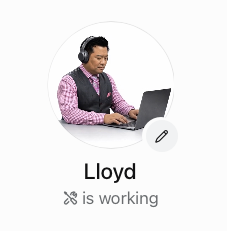
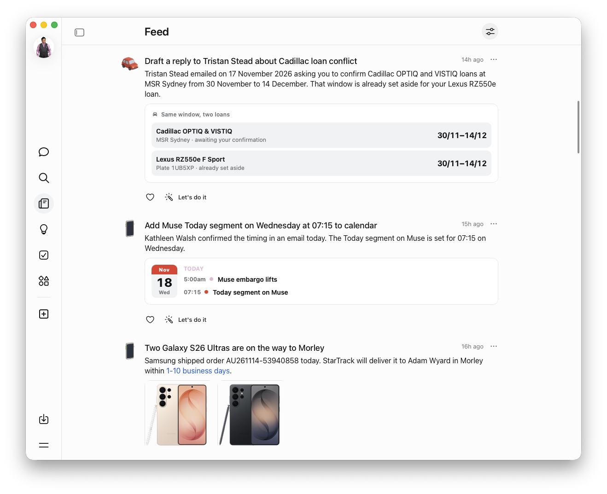
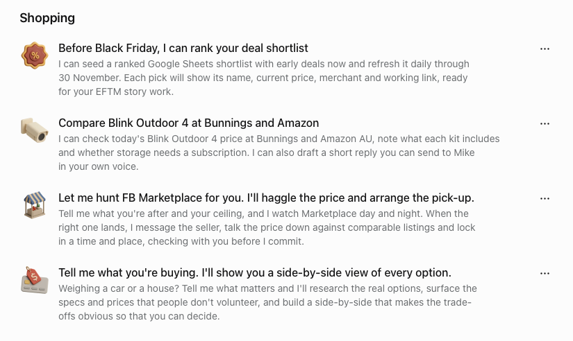
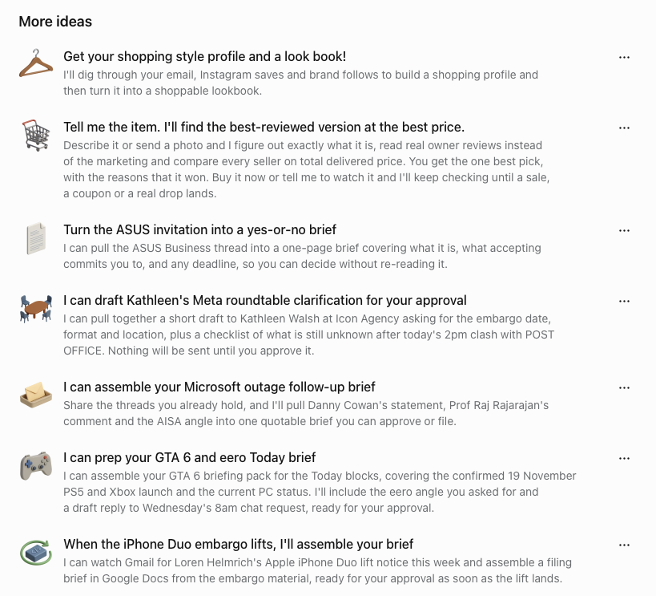
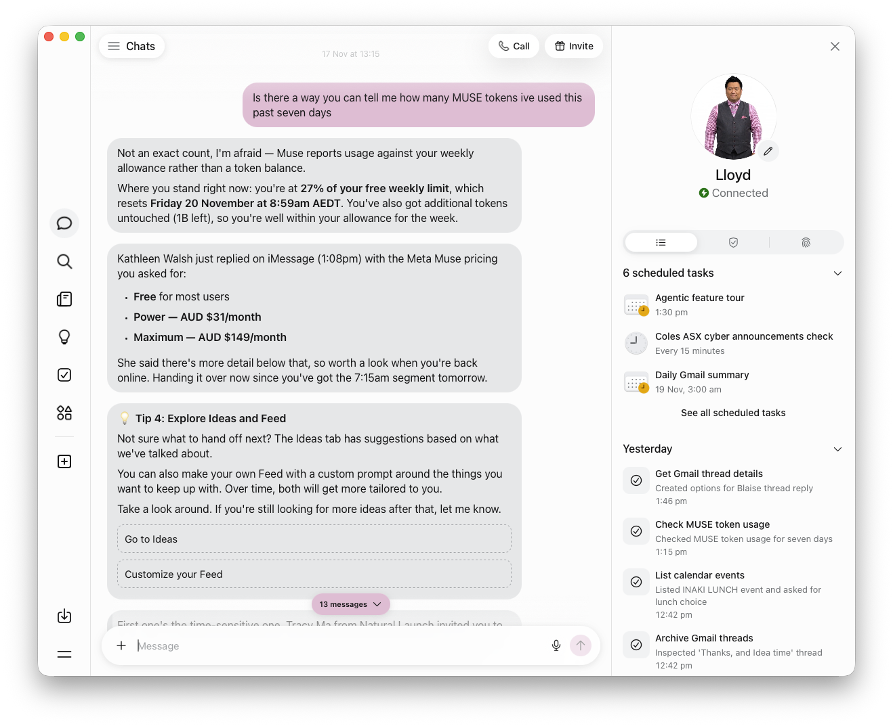
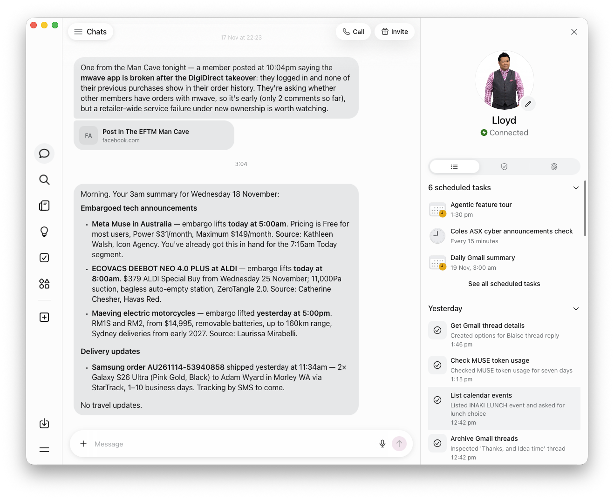

来源：https://eftm.com/2026/11/meta-muse-ai-agent-launches-today-in-australia-my-muse-lloyd-is-already-hard-at-work-283490
取文：2026-11-17，直接下载

After launching in the USA two months ago, Meta’s “Muse” is now available in Australia, ready to help everyday Aussies manage anything from email, to their calendar to shopping or fitness goals.

Having employed my [personal AI Agent Darin (A ChatGPT “Dot”)](https://eftm.com/2026/10/chat-gpt-chatgpt-dot-ai-agent-aiagent-assistant-virtual-282866) over a month ago and he is still working very hard for me – but some of his more personal administrative tasks are now being shared or taken over by Lloyd – my Muse.

My Muse started out as “Baxter” picked from a choice offered by Meta, and he looked like a cuddly soft toy.

Then I realised if I was to take this “Assistant” seriously, I needed to channel my inner Ari Gold and get my Lloyd working. So i instructed “Muse” to change it’s name to Lloyd and take on a more fitting form, that evolved to me simply uploading a photo of Lloyd from Entourage and boom – we’re off to the races:

When I open the app, I see the photorealistic Lloyd as my Muse, and he even changes to a sitting at a laptop working Lloyd when working on requests from me.

It’s a simple touch, that really works

## What is a Muse?

Muse is Meta’s (the company that owns Instagram, WhatsApp and Facebook) “Personal AI Agent”. They call it “the world’s first personal AI Agent built for everyone”.

While AI is still relatively new, we’ve come a long way in a few years. Like any AI chatbot your Muse can answer questions and create content like text or images. So why is it different?

Knowledge. Your Muse can know so much about you and be connected to your personal context through things like Email or Calendar.

It’s this almost intimate connection that gives a Muse that “personal assistant” feeling when you use the app.

## What can your Muse do?

The limitations of a Muse, like ChatGPT’s Dots are basically what you connect it to.

For Muse, at launch in Australia you can connect to Gmail, Google Calendar, Google Contacts, OpenTable, Ticketmaster, Shopify, Shop Pay and of course your Social Media accounts on Instagram and Facebook.

Coming soon are Canva, Kogan, Mecca, Officeworks and Ticketek among many others.

What a Muse can do is really limited to how much you trust Meta. You need to hand over direct connections between things like your Email and perhaps Ticketmaster to really reap the benefits.

Personally, it’s a sacrifice I’m more than willing to take, for now.

Over just a week I’ve once again been impressed with the level of “thinking” this Muse can do for me.

Checking if I’ve noticed something in an email, even reminding me of messages i’ve received – because I installed Muse on my Mac, it’s able to read my Messages and WhatsApp apps too.

An AI Agent is able to do the work, not just answer questions, take tasks from you – things that are essentially either repetitive of ones you can describe within the apps it has connections to.

As a sign of that, Muse has a “feed” which offers options to you on things it can do – this helps you understand the capabilities.

Then there’s the ideas tab, offering a staggering list of things not just generic but based on your own emails and interactions

These aren’t just a list of things, in many cases they are personalised based on the things you’ve asked of your Muse or things within your email.

Remember, a Muse works for you, while it can answer your simplest questions, it will also just nudge you when it sees things, like messages I’ve received that need attention, or just making suggestions as to how it can help.

Your Muse is working for you, all the time. You don’t need to ask it to do things, It’s always trying to help.

But you can ask it to do things regularly, I’ve got a 3am scheduled summary of the day, things that are happening, things I could or should be working on, and Lloyd can also keep me up to date on deliveries and shopping orders.

And it’s not just text, you can talk to your Muse, and perhaps my favourite point of difference for Muse is WhatsApp – I’ve got a chat thread with Lloyd right there alongside my friends and family.

Lloyd will message me on WhatsApp instead of the PC app now and then – as if he knows I’m out and about.

## How much does Muse cost in Australia?

Muse is Free – to a point.

Like all AI it’s about “tokens” – you never really know how many tokens any request uses, but in the last week I’ve asked a lot of Lloyd and it turns out I’ve only used 27% of my allocation.

If I do need more, it jumps to $31 a month, and for heavy pro users you could stump up $149 a month.

But the best part is starting out free.

## Try a Muse – it could be a game changer

I honestly believe we’re witnessing a dramatic shift in technology, and work. An AI Agent can take the load off you, and do simple tasks and then some.

Sitting on your hands and ignoring this will be a loss when it comes to skill building, in the workplace but also just in your personal life.

Give it a go.
