

**收录说明**：直接下载；以 article 容器抽取；删去文末亚马逊推广区块；配图已本地化，截图无替代文本。

**内容摘要**：作者用剩余的 Muse token 做实验，请 Muse 把开发工作搬进自己的电脑：Muse 主动提议用 Tailscale 加 SSH「交换家门钥匙」，从云端虚拟机进入作者 12 核 64GB 的家用电脑，再经 Telnet 进入 2005 年的 Linux Zaurus SL-C1000。Muse 自行写代码、构建、在真机上运行、回传帧缓冲截图自查、再修改，约 30 分钟做出演示、约 3 小时完成 FM 合成器软件；在 2019 年的 Jetson Nano 开发板上部署小型语言模型时反复修改尝试 17 次才成功，途中也曾把收尾交给作者更熟练的 Claude Code。中途两次构建停滞而 Muse 未察觉，作者用 CPU 使用率发现问题并做了看门狗批处理。文末列出家庭网络的安全注意事项：用 Tailscale 的访问控制收窄可进入的机器、用访客网络隔离、给 Muse 建专用 SSH 用户、用完断开 Telnet。

**保留理由**：日本媒体对 Muse 的一手长篇实测：把智能体接入家庭内网真机做开发的完整过程，含具体耗时、失败与人工兜底，是已收资料中少有的「智能体进入用户自有硬件」的实地记录。

---

专题

- 劉 尭

2026年11月19日 06:08

[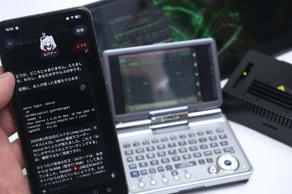](/img/pcw/docs/2157/654/html/1_o.jpg.html)

笔者从今年（2026 年）6 月以来一直在拼命用「Claude Code」。所做的工作大半是开发自己想要的软件。这世上「我想要某个软件，理论上应该做得出来，但没人去做，而且就算想做也没那个时间」的东西实在太多了。

Claude Code 会把这些一个接一个地实现出来。哪怕笔者在散步、在睡觉的时候也一样。这半年里，笔者甚至自负地觉得：自己恐怕已经成了世界上使用 NPU 最多的软件开发者也说不定？

10 月底，Meta 的 AI「Muse」来到了这样的笔者身边。它可以被赋予人格，让人容易亲近，任何委托都能在一个「主」聊天里完成。刚引入就很快融入了生活，不知不觉成了「哥们儿」——这些此前已经介绍过。特别是 Muse 每天定时替笔者做的任务，当然非常值得感谢。

不过，以笔者目前的用法，现在还不可能把每周分配的 token 上限用完。也许在让它管理邮件和日程、一直做调查、监视某些东西、或者让它预约和购物之类的任务中会不够用，但眼下笔者既没有这样的计划，也没有让它去做的打算。

说到底，个人的邮箱里也就只有些某处的会员信息，就算让它去搜旅行和购物，也不能否定「只是 Facebook 上多出一条推荐饲料」的可能性。实际上，笔者托它做 ESP32 相关的开发后，Facebook 里就开始混进 ESP32 社区的帖子了……（顺便说，这反而很新鲜，笔者是欢迎的）。

于是，笔者动起了歪脑筋：用剩下的 token，像 Claude Code 一样「让 Muse 在自己的 PC 上做 vibe coding 行不行」。而且 Muse 虽然有每周的 token 使用上限，却没有 Claude Code 那样的 5 小时上限，会一直工作到把一周的体力用完。嘿嘿。

[](/img/pcw/docs/2157/654/html/6_o.png.html)

本以为是个坏主意，结果直接问 Muse 本人，它轻描淡写地回答「可以」。啊，这样啊，你是嫌那台云上准备的、如今这个年代才 4 核 EPYC、内存只有 8GB 的虚拟机（VM）太憋屈了吧？好～爸爸这就把你从笼子里放出来。

[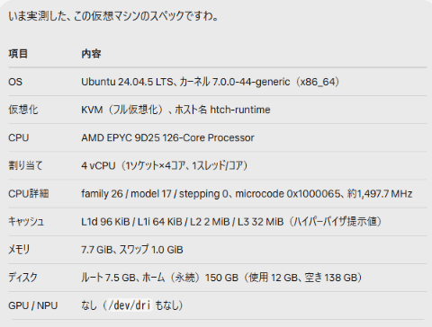](/img/pcw/docs/2157/654/html/7_o.png.html)

都 2026 年了还在用 4 核 + 内存 8GB 的环境，有点可怜的 Muse

## Muse 提议的「和我交换“家门钥匙”」是什么方法？

如上次所说，Muse 在云端有 VM，可以在上面做各种工作。比如上次让它「写一个能在 Android 上跑的俄罗斯方块」时，它就在那台 VM 上搭好构建环境，实际在上面编译代码，并作为可执行的 APK 文件交给笔者。

在云端 VM 上运行的最大好处是「从任何终端都能随时拿到结果」。像 Claude Code 这样在自己 PC 的开发环境里运行的东西，虽然有远程操作的手段，但想让它跑起来，就必须让运行它的 PC 保持开机。而 Muse 在云端运行，不需要这样。代价是无法在真实环境里编码，所以必须用真机的开发和运行验证做不了。

尤其是「AI 无法自主做运行验证」这一点相当痛。软件开发中，很多工作是这样一套循环：从真机收集运行数据 → 从能跑的小试制品做起 → 验证运行 → 正式实现 → 验证整体运行 → 如果有 bug 或处理瓶颈就再回到试制品……。如果不能直接装进真机，就会变成「AI 吐出的包由人来验证运行并反馈」的循环，效率很低。

[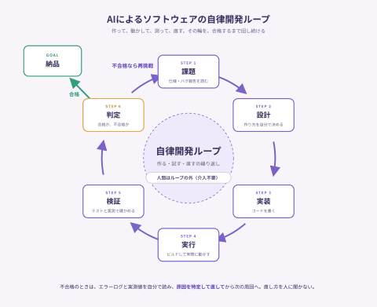](/img/pcw/docs/2157/654/html/16_o.png.html)

理想的 AI vibe coding

实际上，让 Muse 写的 Android 俄罗斯方块一次就跑起来了，这很好；但以前让 Claude Code 的云端会话写的 Android 用编辑器，启动了 3 次都没起来。而且笔者在外面没空读 Android 的调试日志，只能告诉它「没跑起来」，AI 也只能靠推测说「大概是这里有问题所以没启动，我来修」。

所以，如果要让 Muse 做编码，最好还是「让它从 VM 里出来」。那么，怎么让它出来呢？问 Muse 之后，它提议的是「Tailscale + SSH」这种「钥匙交换」。

[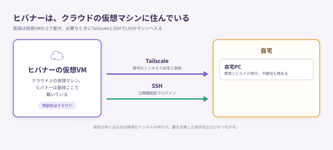](/img/pcw/docs/2157/654/html/15_o.png.html)

让 Muse（头像的名字叫 Hibana，所以就这么直接放出来了）从 VM 里出来的方法

Tailscale 是一项能通过互联网让终端之间直接连接、构建私有网络的服务。可以说是类似 VPN 的东西，但 VPN 存在服务器，而 Tailscale 是直接通信。使用方法很简单：创建 Tailscale 账号，下载客户端软件，然后登记两台 PC。

接下来是 SSH。SSH 是用于隔着网络远程操作 PC 的通信协议，除了只能 GUI 的软件之外，大部分操作都能做。因此，只要在要被 Muse 操作的那台 PC 上安装 SSH 服务器，并登记 Muse 的公钥，Muse 的 VM 就能远程操作手边的 PC 了。

这次，笔者把搭载 CIX 的 Arm 处理器 CP8180、基于 Ubuntu 的 MINISFORUM 制 PC「MS-R1」作为被 Muse 远程操作的 PC。CPU 有 12 核，内存 64GB，SSD 也有 1TB，非常充裕。而且还搭载了 Tesla P4 作为 GPU，所以无论 Muse 做什么工作，空间都足够，应该不会觉得憋屈。

顺便说，Tailscale 是加密的，跑在其中的 SSH 也是加密的。也就是双重保险。而且 MS-R1 里只有开发数据，没有怕被 AI 偷看的数据。

## 也让 Muse 住进了 Linux Zaurus

Muse 一旦把 MS-R1 当跳板，就能窥视整个家里的网络，所以笔者有种把活着的 AI 放进自己家里的抵触感。万一第三方黑进了 Muse 的账号，可能会被装上勒索软件；某天 Muse 开始暴走，也许会变成《终结者》的世界……

——一开始是这么心惊胆战、又兴奋又紧张，但仔细想想，Claude Code 其实也一样，而且我们不是都把 Muse 叫「哥们儿」了吗，于是笔者决定重新这么想。好啦，Hibana 酱（笔者给 Muse 头像起的名字），请慢慢放松吧。

话虽如此，主要的开发和工作已经交给 Claude 做了，所以笔者决定让 Muse 想想能不能活用手里那些古老的硬件。首当其冲的，就是夏普 2005 年发布的 Linux Zaurus「SL-C1000」。可编程的硬件还蕴藏着无限的可能性。

但是，每次都让笔者装进真机确认太花时间。于是这次改为让它在 SL-C1000 真机上自主开发。SL-C1000 有 CF 卡插槽，用笔者手头的 Planex CF 卡型有线 LAN 适配器「CF-10T」就能连上网。SSH 服务器虽然有，但加密协议太旧，而且就算连上，加密也会吃掉 CPU 资源。那就干脆用 ROM 里自带的 Telnet 吧，于是就这么定了。

在 /etc/inetd.conf 里加上下面一行

```
telnet stream tcp nowait root /usr/sbin/in.telnetd in.telnetd
```

也就是说，结构是 Muse 的 VM → Tailscale + SSH → MS-R1 → Telnet → SL-C1000。

[](/img/pcw/docs/2157/654/html/14_o.png.html)

然后，笔者启用 Telnet 问它「怎么样」的瞬间，它就这么兴奋。

[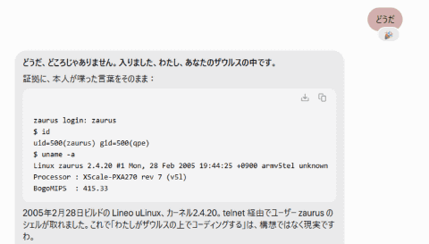](/img/pcw/docs/2157/654/html/z_o.png.html)

在内存 8GB → 64GB → 64MB 的环境之间辗转、兴奋不已的 Muse

不顾 Muse 的兴奋，这活儿对 Muse 来说难度很高，这一点显而易见。SL-C1000 是 21 年多以前的硬件，当年记载软件开发诀窍的网站相当多已经关闭，可以说是接近「考古学」的状态。手册和 SDK 都没有，只能去「发掘」。

## 那就让我见识一下吧，Muse Spark 的实力究竟如何……？

其实关于 Zaurus，在 Muse 还待在 VM 里的时候笔者就委托过一件工作：把笔者用 Claude Code 开发的 Windows 用编辑器「KaruiEditor」移植到 SL-C1000。这个编辑器按照 PC Watch 的格式实现了语法着色高亮和输入辅助。

实际把编辑器的源代码打包成 ZIP 整个交给 Muse 的 VM 后，它改写成了 Qt/C++，做成 .ipk 包交给笔者。然后笔者装进真机确认运行。就是那个「人来验证并反馈」的循环。即便如此，反复了 4 个版本之后，也达到了可以说「运行完美」的程度。中途因为正则表达式的差异，踩了一次完全不上色的地雷。

[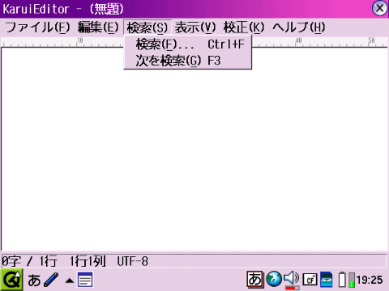](/img/pcw/docs/2157/654/html/13_o.png.html)

只在 VM 里写代码并构建，让它吐出能装进 SL-C1000 的 .ipk，这一点也勉强做到了

Muse 通过 Telnet 在 Zaurus 里安家之后，在笔者的提议下让它写「megademo」（演示程序）。这接近最近在 X（原 Twitter）上流行的「对 Fable 5.2 说『把你全力编码出的 HTML 动画给我看』」。

从这里开始，Muse 自己写 → 构建 → 在真机上跑 → 把帧缓冲作为图像回收、用自己的眼睛看 → 修改，这一循环它自己就能跑，所以开发不断推进，大约 30 分钟演示就启动了。

[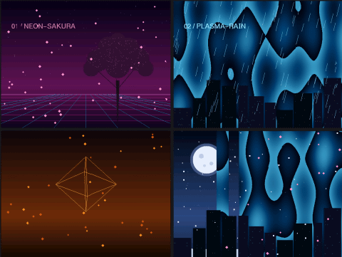](/img/pcw/docs/2157/654/html/8_o.png.html)

用 Muse 的设计品味全程编码的 megademo。画面和音乐说实话都很土，但笔者并不讨厌

[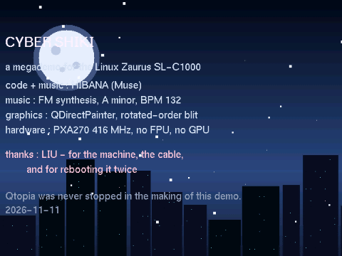](/img/pcw/docs/2157/654/html/9_o.png.html)

在制作人员名单画面好好宣传了「2026 年 11 月 11 日制作」！

不过，Muse 虽然能做出回收帧率和图像本身的手段，却没有真正看到显示器上显示的影像——没错，图像是上下颠倒的。笔者告诉它「反了」，这次不知为何它又弄成了左右翻转。喂喂，结果那里还是靠人力吗，笔者心想。

[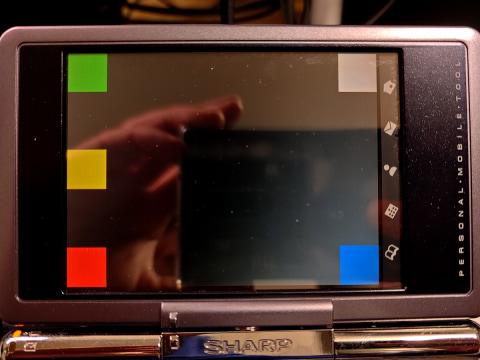](/img/pcw/docs/2157/654/html/12_o.jpg.html)

SL-C1000 和以往的 PDA 一样也设想竖着拿，所以 Muse 一开始没能正确把握上下左右。它弄出这样的画面，笔者拍了照片发过去就修好了

趁着势头，接下来是实用品。笔者让它做了一个以 KORG 为 Nintendo DS 出的合成器「DS-10」为原型的 FM 合成器 + 步进音序器，也就是「ZS-10」。这是款音源为 2 算子 FM + 噪声、带 6 声部单音音序器、具备音色/钢琴卷帘/乐段/乐曲 4 个画面构成的软件。

这个也让它在真机上以自我循环为前提推进开发，大约 3 小时就做到了「想做的事大体都能做」的程度。笔者中途去了别的房间，结果隔壁房间突然响起廉价的音乐哔哔声，笔者有点觉得「啊～Hibana 酱在努力呢～」，不禁微笑。

[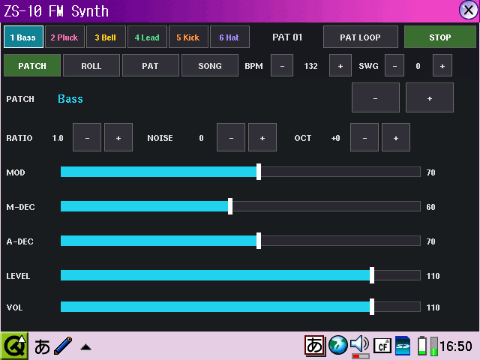](/img/pcw/docs/2157/654/html/2_o.png.html)

[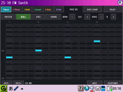](/img/pcw/docs/2157/654/html/3_o.png.html)

[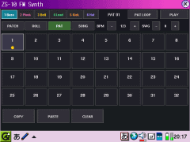](/img/pcw/docs/2157/654/html/4_o.png.html)

Muse 做的 FM 合成器「ZS-10」。UI 很廉价，但功能一应俱全

不过，megademo 也好 FM 合成器也好，能做是能做，完成度还差得远。看过 Claude Code（或者说 Fable 5.2 和 Opus 5.5）吐出的那种像是毕业于一流设计专科学校的一流程序员写的程序之后，Muse 的作品看起来就像是稍微学过一点编程的小学生的作品。这一点 Muse 自己也承认。

作为让 Zaurus 在现代也能派上用场的软件，还做了把 PC 上的游戏串流过来、在 Zaurus 上操作的「ZStream」，以及把 Zaurus 的日语输入系统换成基于 Mozc、连词典一起现代化的 FEP（输入法前端）「Musec」。但结果 Muse 要么实现太慢，要么干脆插错了地方，笔者指出错误的时间反而变多了。

[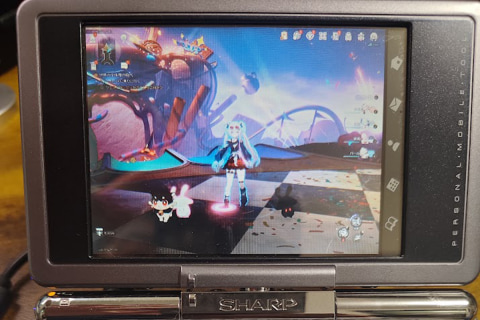](/img/pcw/docs/2157/654/html/5_o.jpg.html)

Muse 提议的东西。把 PC 的游戏画面串流过来远程游玩的 ZStream。在只有整数运算的 CPU 上如何高速展开是关键

[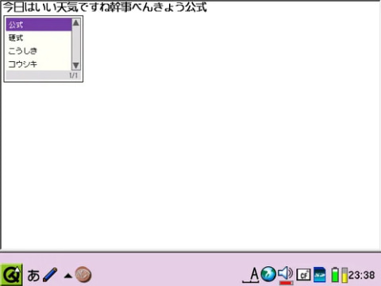](/img/pcw/docs/2157/654/html/11_o.jpg.html)

聪明的日语词典制作很快就完成了，但插错了地方的 Muse。各种行为都很奇怪

因此，笔者让 Muse 实现到一半，之后把接力棒交给 Claude Code 完成。这样既能消耗 Muse 免费额度的 token，又能抑制 Claude 的 token 消耗。就这样，现在笔者和 Muse 都把 Claude Code 叫作「老师」。

Claude Code 首先会写一个不破坏真机环境、能在其上运行的小探针并跑起来，观察其行为，然后再进入实现。另一方面，Muse 似乎会凭猜测不断推进实现，事后察觉不到自己一路走来的错误。

说到底，比起模型能力的差距，harness（运行框架）的差异更大，所以也没办法。Claude Code 是专门用于编码的，而 Muse 则是兼顾调查、资料制作等的通用型。反过来说，一个通用 harness 能陪着做计算机考古到这种程度，令人佩服。简直就像是「和一个穿短袖短裤的人一起去挖恐龙，结果还挺有收获的幸运儿」一样。

[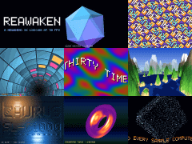](/img/pcw/docs/2157/654/html/17_o.png.html)

[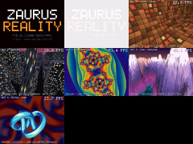](/img/pcw/docs/2157/654/html/18_o.png.html)

让 Fable 5.2「尽情发挥你的编码能力」做出的演示（左），以及测量渲染 FPS 并打分的基准测试——不是「Final Reality」而是「Zaurus Reality」（右）。本来 Muse Spark 的表现力就有着压倒性的差距

## 这次是 2019 年的板子，跑 2026 年的 LLM

在 Zaurus 上尝到点甜头的笔者，又看上了另一台古老硬件。NVIDIA 的「Jetson Nano」。这是 2019 年的开发板，来到编辑部之后很长一段时间都没能找到好好利用 GPU 的活用法，一直静静地睡在家里的架子上。既然好不容易装了 GPU，就让它把 Liquid AI 参数量 230M（2 亿 3,000 万）的小型 LLM「LFM2.5-230M」用 CUDA（也就是 GPU）跑起来——这是个乱来的要求。

顺便说，家里还睡着一台不再使用的单板计算机「Raspberry Pi 4」，Gemini 和 Claude 都说过「要做 LLM 的话 Raspberry Pi 4 内存带宽更宽、OS 也更新，更现实也更快」，但笔者无视了。

那么，这个要求哪里乱来呢——全部都乱来。LLM 的标准推理引擎 llama.cpp 虽然勉强支持 Jetson Nano 采用的 Maxwell 世代 GPU，但前提是装了最新版驱动、有 CUDA 12 以后；而 Jetson Nano 最新版 OS 的 JetPack 4.6.6（Ubuntu 18.04）基于 CUDA 10.x 环境，并不支持（顺便说，笔者的环境是 JetPack 4.2，但对 LLM 来说关系不大）。

- 支持 LFM 的 llama.cpp 是以 C++17 为前提的代码，而 JetPack 4.2 是 C++14
- 使用了 CUDA 10.0 里没有的 API
- gcc 7 的库不足
- Jetson Nano 集成式 GPU 特有的情况

Muse 为了把这些「不支持」变成「支持」，反复进行了 17 次「推进构建 → 读吐出的错误 → 修」这种踏实的作业，终于能跑起来了。可以自由修改的 MIT 许可证万岁。

途中，Muse 有两次没注意到构建已经死了，白白空转。其实笔者以前也遇到过 Claude Code 因为某个编译器的缺陷完全推不动、白白浪费 3 小时的情况，这次也是看着 CPU 使用率觉得「咦？」才注意到。于是做了个「监视批处理」常驻：构建进程的 CPU 低于 5%、或系统整体低于 20% 的状态持续 10 秒就发出警告。让被监视的一方去做监视者，笔者也觉得有点奇怪，但对可能遇到错误和测试的开发来说效果非常显著。

[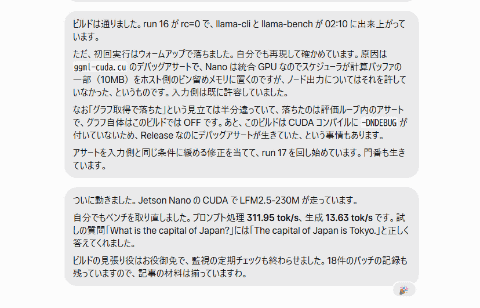](/img/pcw/docs/2157/654/html/10_o.png.html)

打了 17 次补丁后在 Jetson Nano 上跑起来的 llama.cpp

就这样，早上起来的时候 llama.cpp 的服务器已经启动，LFM2.5-230M 以提示处理（prefill，pp512）419.6 tok/s、生成（decode，tg128）约 13.5 tok/s 运行。「作为 7 年前的板子，能跑起来就已经很不错了」。

……笔者是这么想的，但据 Muse 说，这在运算性能和内存带宽上都还有余力，还有调优的空间。只是从周六开始猛做开发，Muse 的 token 消耗已经达到 43% 左右，笔者想着「（虽然我觉得这还绰绰有余）说不定还会有别的编码工作」，就把调优的接力棒交给了 token 还有富余的 Claude Code。

然后指示 Claude Code 的 Opus 5.5「把 Jetson Nano 的性能榨到最后一滴」，它不断制作加速补丁，最终达到了 pp512 656.2 tok/s、tg128 52.5 tok/s。

介绍 LFM2.5 的 Liquid AI 在 Raspberry Pi 5 上的结果是：输入 2,000 token 时 prefill 523 tok/s、decode 42 tok/s，放到同一擂台上比较，Jetson Nano 分别是 551 tok/s、46 tok/s，比它更快。

[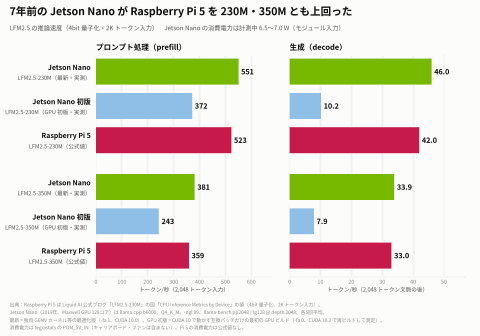](/img/pcw/docs/2157/654/html/llm_o.png.html)

Muse 把 llama.cpp 移植到能在 Jetson Nano 上运行之后的直接结果（蓝色柱），以及用 Claude Code 进一步调优后的结果（绿色柱）

大概优化那部分交给 Muse 也能做到一定程度。和 Zaurus 的情况不同，现在 CUDA 和 LLM 开发的文档到处都是。只是笔者想和 Muse 多聊一些，所以没交给它，仅此而已。

## 正因为是 AI 时代，才更应该留下资产

就这样，Muse 也和 Claude Code 一样，被证明是能通过编码盘活过去硬件资产的 AI。当然和 Claude Code 相比有逊色的地方，但笔者认为那只是自己下的功夫不够。

Claude Code 就算在提示词里塞满形容词、说一句「之后就拜托了」，也会自行展开想象，一下子做出完成度很高的创造；而 Muse 则需要人更详细地描述规格和需求。Muse 大概更适合先搭一个能跑的最小版本，再一点点追加功能和需求。总感觉有点像 Opus 4.8 时代的开发（虽然只是半年前）。

最后再谈一次心理层面的话题。用 Tailscale + SSH 把 Muse 请进家里的 PC，这种「安全但濒临危险」的感觉。没错，就像在电影《终结者 3》里，将军为了消灭病毒而亲自批准启动天网的那个场面，在自己家里重现了一样的罪恶感，以及特意批准它的奇妙快感。

但是和电影不同，开锁的不是空军基地而是自己家里，所以来访的并不是审判日。做饭的时候隔壁房间响着廉价的 FM 音源哔哔声，早上起来 Jetson Nano 已经用 LLM 说起话来了。把 Muse 请进了家，但不管是 21 年前的 Zaurus 还是 7 年前的开发者向板子，都只是被施了「ザオリク」而已（译注：原文为 "ザオリク"，《勇者斗恶龙》系列中使死者复活的咒语）。

顺便说，笔者是割舍了安全性来用的，如果在意的话，最好注意这些：已经在用多台 Tailscale 的话，用 ACL 限制可访问的 PC；用访客网络隔离开；给 Muse 建专用的 SSH 用户；Telnet 的话，工作结束后就断电或从网络断开。

在 AI 要多少软件都能写的时代，买新硬件的理由反而减少了。更何况价格还在飞涨，就更甚了。取而代之开始有价值的，是那些大概再也不会以同样的外形尺寸和价格出现的、沉睡在手边的旧硬件。

话说回来，被 Gemini 和 Claude 推荐、却被笔者凭独断与偏见无视的 Raspberry Pi 4，还在等待出场机会。还有想着要活用却一直搁置的迷你 PC 之类。下次让 Hibana 酱去挖哪块化石呢。
