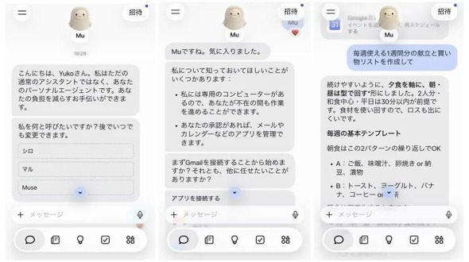
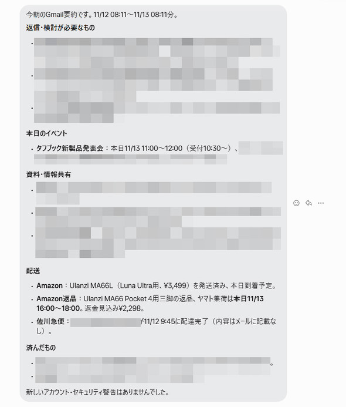
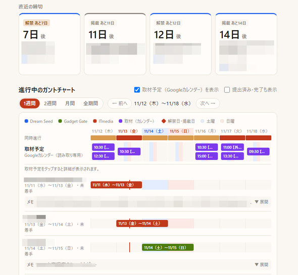
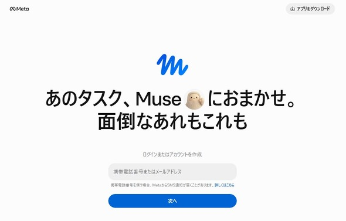
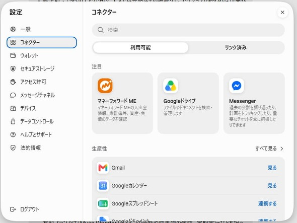
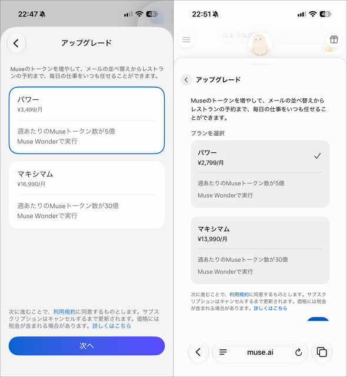



**收录说明**：直接下载两页全文（Shift_JIS 转码后抽取），合并存于本目录的 original.md，网站上不显示，已翻译；7 张图已本地化到 images/ 并看图写了替代文本，文末的相关文章与网站导航未收。原文称付费档使用 Muse Wonder，照录原文；与本库既有记录（2026-11-06 研究博客：向 Muse 推送的是以 Wonder 训练的特化模型，而非 Wonder 本身）口径不同，不自行改动。原文称 VM 存储容量约 100GB，注明为“利用环境を調べた人”的报告、非官方数字。

**内容摘要**：这是面向日本市场的 Muse 入门解说：Muse 于 10 月 23 日在日本上线，是北美以外首个提供地区，可通过 iOS/Android 应用与 muse.ai 网站使用，多数基本功能免费。作者将 Muse 的特点概括为每位用户拥有独立的云端虚拟环境、文件与未完成的工作得以保留，关机后处理仍可继续，并可设定晨间邮件摘要等定时任务、在本人不打开应用时自动执行。作者亲手用免费档通过 Spaces 功能制作了一个案件进度管理应用，可用甘特图查看截止日期与各案件工期，并读取 Google 日历中的取材日程。定价方面，Web 端申购 Power 为每月 2799 日元、Maximum 为每月 13990 日元，而 iOS/Android 应用内购则分别为每月 3499 日元与 16990 日元，同一套餐经应用商店申购更贵。日本连接器现状：发布时预告的 Mercari、Money Forward ME、Ticket Pia 三项国内服务合作中，Money Forward ME 已可使用，Mercari 与 Ticket Pia 目前仍未上线且未公布开始时间；此外原文称免费档使用 Muse Spark、付费档使用性能更高的 Muse Wonder，并提醒训练数据用于 AI 开发的设置默认开启，需手动关闭。

**保留理由**：日本市场首批 Muse 入门解说之一，提供日本定价渠道差与本地连接器上线现状这两项此前未收录的新事实，并含作者用免费档实测 Spaces 的一手体验；“付费档用 Wonder”的说法按原文照录，需注意与既有记录核对。

---

**Meta 的 AI 智能体「Muse」能做什么？　与 ChatGPT、Gemini 的区别、注意事项解说**

» 2026 年 11 月 22 日 11 时 14 分 发布

[[山本竜也](https://www.itmedia.co.jp/author/210657/)，ITmedia]

Meta 于 10 月 23 日开始在日本提供个人 AI 智能体「Muse（ミューズ）」。在 9 月先行上线的北美以外，日本是第一个提供地区。可通过 iOS 应用、Android 应用和网站（muse.ai）使用，多数基本功能免费。

　话虽如此，AI 服务已经有很多了。想必不少人会想：「老是看到 Muse 这个名字，但不知道它和其他服务有什么不同。」因此本文以 Muse 能做什么、与其他 AI 服务有何不同为中心，汇总了价格以及使用前需要确认的要点。

Meta 的个人 AI 智能体「Muse」 图片来自 [Meta 的网站](https://about.fb.com/ja/news/2026/10/muse-personal-ai-agent-launches-in-japan/)

## Muse 是在 Meta 云上运行的 AI 智能体

　Muse 是代替使用者推进工作的「AI 智能体」。许多聊天 AI 服务也有记忆功能，但留下的主要是对话记录和用户偏好等信息，并不会保留创建的文件或工作的中途状态。

　相比之下，Muse 为每位用户在云上准备了独立的虚拟环境，创建的文件和推进中的工作会原样保留。像「想接着改昨天做的那张表」这种以前一次工作为前提的请求之所以成立，原因就在这里。

　这个环境运行在 Meta 的云上，所以即使关掉手机或 PC 的电源，处理仍会继续，从任何终端打开都能访问同一个工作状态。另外，分配环境的存储容量官方并未公布。虽不是官方数字，但有调查过使用环境的人报告说大约是 100GB。

　另一个特点是，在用户没有操作时它也能动。只要设定「每天早上帮我总结邮件」这样的定期任务，即使本人没有打开应用，处理也会推进并把结果送达。它不是只返回单次回答的工具，而是被设计成持续工作的存在，这是它与传统聊天 AI 的一大区别。

Muse 的初始设置。称呼等也可以更改

## Muse 能够「调查」「制作」「持续」

　Muse 能做什么，与其罗列功能，不如按「调查」「制作」「持续」这样的工作流程来看更好理解。

　第一是「调查」。除了在 Web 上收集信息，还能读取已连接的 Gmail 和 Google 日历，提取所需信息。可以这样提问：「请告诉我本周日程中截止日期临近的事项。」

　第二是「制作」。调查结果不会止于聊天中的文字，而能整理成文档、电子表格、网页等成果物的形式。这样的成果物不会淹没在聊天流中，而是留在手边。

　第三是「持续」。一度委托的工作可以设为定期执行，从而实现每天早上自动收到邮件摘要、截止日期临近时收到提醒等运用。记忆过去交流和用户偏好的功能其他 AI 服务也有，但 Muse 的特点在于，创建的文件和进行到一半的工作本身会一直留在专用环境里。

　作为活用方式的印象，比如早晨的邮件摘要就很好懂。收件箱会收到大量通知邮件，可以只把需要回复的请求、配送通知、账户相关警告挑出来，每天早上送达。此外在日程管理上，也可以跨日历掌握发布会与采访的日程，并把截止日期临近的事项优先告知。

邮件摘要的例子。把需要回复的东西汇总起来，帮了很大忙

　当然，也可以做文章起草、摘要、翻译这类通常的 AI 助手式用法。

　另外，Muse 有一个叫「空间」（Spaces）的功能，可以制作自己专用的应用。笔者请它做了一个整理案件日程的仪表板。可以用甘特图确认距截止日期的天数和各案件的工作期间，还会读取并显示登记在 Google 日历中的采访预定。即使没有编程知识，只要指示「想做成这样」，就能轻松做出来。

请 Muse 制作的案件进度管理应用。只要指示「想这样」「想那样」就做出来了

　这些特点并非 Muse 独有。其他公司也推出了「ChatGPT Work」「Gemini Task」这样的智能体型服务。相对于「问了就答」的聊天 AI，收集并整理信息（调查）、操作已连接的服务直至完成成果物（制作）、积累工作并像定期执行那样在没有指示的时点也持续运转（持续），这种推进方式是智能体型服务共通的特性。

　如果只是当场构思文章或咨询，很多场景下聊天 AI 就够了；但如果是想「交给它」日常的定型工作和信息整理，智能体型就会成为选项。

　Muse 的特点在于，它在这些服务中是可以免费使用的。其他公司的智能体型服务大多以订阅合同为前提，而 Muse 虽然有用量上限，但提供了免费方案，可以轻松试用到智能体的使用手感。另外，上面那个日程管理应用就是用免费方案做的。

## Muse 从浏览器就能轻松开始　也能与外部服务连接

　使用可以从 Web 浏览器（muse.ai）开始。也准备了 iOS／Android 应用和 Mac 应用，使用 Chrome 扩展还能从浏览器侧边栏呼出。遗憾的是目前还没有 Windows 版应用。

从浏览器就能轻松开始使用 Muse

　开始方法很简单，创建账户，然后在聊天中委托即可。如果想让 Muse 处理邮件或日历，就在设置中「连接」对象服务。连接按服务逐个授予权限，不需要时可以随时解除。先不连接试用，再根据需要扩大范围，是比较现实的做法。

　Muse 通过名为「连接器」（コネクター）的机制与外部服务连接。支持 Gmail、Google 日历等服务，是否连接可以按服务逐个选择。

连接器除了 Gmail、Google 日历等，也可以与智能手机的联系人等连接

　连接的内容也不一样。仅查看信息的读取，与创建日程、发送邮件这类写入，所需的权限不同。许可了什么可以在设置画面确认，连接随时可以解除。也可以连接智能手机，让它参照日程和联系人。

　在日本上线的发布中，官方介绍将推进与 Mercari、Money Forward ME、Ticket Pia 等日本国内服务的连接。其中 Money Forward ME 已经可以使用，但 Mercari 和 Ticket Pia 目前仍不可用，开始时间也未公布。对日本常用服务的支持，可以说正处于今后逐步扩大的阶段。

## 价格方案　因申请渠道而异，需注意

　Muse 有免费方案和两个付费方案。付费方案分 Power 和 Maximum 两档，费用因申请渠道而异。从 Web（muse.ai）申请时，Power 为每月 2799 日元，Maximum 为每月 13990 日元。

　另一方面，在 iOS／Android 应用的应用内购买中，Power 为每月 3499 日元，Maximum 为每月 16990 日元，经应用商店的定价更高。同一方案支付金额却不同，所以要申请的话从 Web 更便宜。

从 iOS 的 Muse 应用申请（左）比从 Web 申请（右）略贵

　关于模型，免费方案基本上使用「Muse Spark」，付费方案可以使用性能更高的「Muse Wonder」。是否真正纳入日常业务，最好先用免费方案确认使用手感后再判断。

## 数据处理需要留意

　虽然方便，但开始使用前也有一些需要掌握的注意点。

　首先是数据处理。在 Muse 中，将对话内容用于 Meta 的 AI 开发的设置默认处于开启状态。如果在意，请打开设置中的「数据控制」（データコントロール），关闭「协助改进 AI 模型」（AIモデルの改善に協力する）。在处理业务机密信息之前，这是务必确认的项目。

　其次是审批的处理。发送邮件、购物这类对外操作，有在执行前请求用户批准的机制。这是安全装置，但不确认内容就批准则毫无意义。养成稍作停顿、确认要发送什么、发往哪里的习惯很重要。

　最后是连接范围的管理。虽说方便就连很多服务，万一时的波及范围也会扩大。建议从最小必要的连接开始，并定期复查已许可的服务。

## 总结：Muse 是持续工作的数字秘书

　我自己也在使用 Gemini、ChatGPT、Claude、Genspark 等服务，但最近用 Muse 的时间变长了。Muse 与其说是「聪明的聊天机器人」，不如说更接近「拥有自己的计算机、持续工作的数字秘书」。即使不逐一下指示，也有一种它提前替你想到了的感觉。

　对于想把人日常的邮件处理、日程管理、查资料与做资料一并交出去的人来说，这可以说是值得考虑的服务。建议先用免费方案，从小的定型工作开始交给它。
