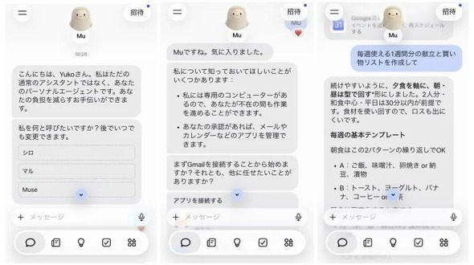
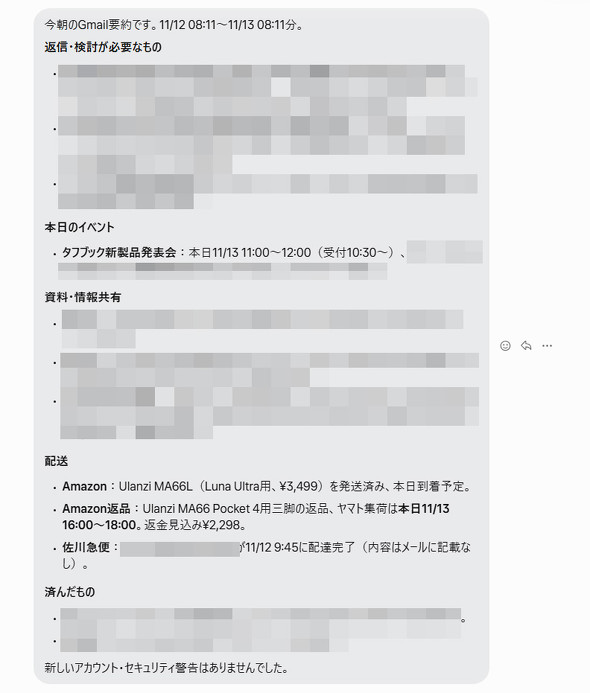
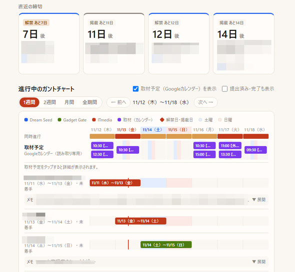
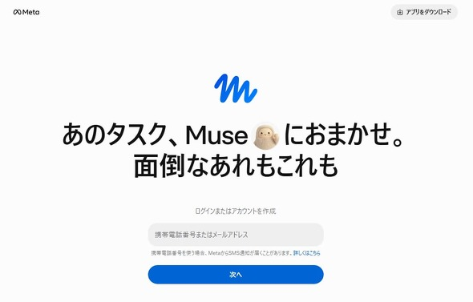
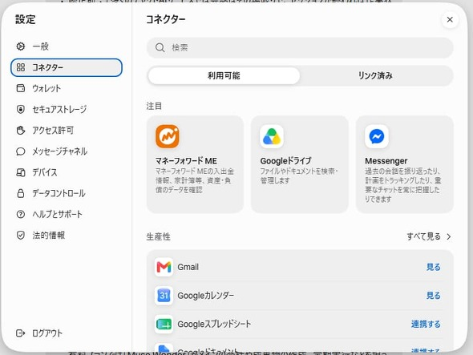
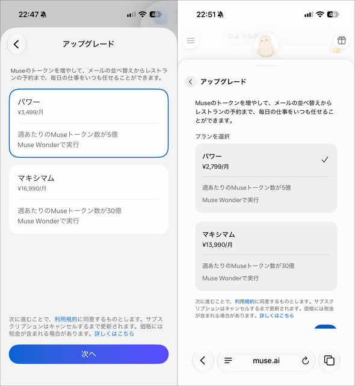

来源：https://www.itmedia.co.jp/mobile/articles/2611/22/news005.html
取文：2026-11-22，直接下载（Shift_JIS 转码后抽取；第 2 页 https://www.itmedia.co.jp/mobile/articles/2611/22/news005_2.html）

**MetaのAIエージェント「Muse」は何ができる？　ChatGPTやGeminiとの違い、注意点を解説**

» 2026年11月22日 11時14分 公開

[[山本竜也](https://www.itmedia.co.jp/author/210657/)，ITmedia]

Metaは10月23日、パーソナルAIエージェント「Muse（ミューズ）」の日本での提供を開始しました。9月に先行した北米以外では、日本が最初の提供地域です。iOSアプリ、Androidアプリ、Webサイト（muse.ai）から利用でき、基本的な機能の多くは無料で使えます。

　とはいえ、AIサービスは既に数多くあります。「Museという名前は見かけるけれど、他のサービスと何が違うのか分からない」という人も多いのではないでしょうか。そこでこの記事では、Museで何ができるのか、他のAIサービスと何が違うのかを中心に、料金や使う前に確認しておきたい点をまとめました。

MetaのパーソナルAIエージェント「Muse」 画像は[MetaのWebサイト](https://about.fb.com/ja/news/2026/10/muse-personal-ai-agent-launches-in-japan/)から

## MuseはMetaのクラウド上で動くAIエージェント

　Museは、利用者の代わりに作業を進める「AIエージェント」です。多くのチャットAIサービスにも記憶機能はありますが、残るのは会話の記録やユーザーの好みといった情報が中心で、作成したファイルや作業の途中経過までは保持されません。

　これに対してMuseでは、ユーザーごとにクラウド上に独立した仮想環境が用意され、作成したファイルや進めてきた作業がそのまま残ります。「昨日作った表の続きを直してほしい」といった、前回の作業を前提にした依頼が成立するのはこのためです。

　この環境はMetaのクラウド上で動くため、スマホやPCの電源を切っていても処理は進み、どの端末から開いても同じ作業状態にアクセスできます。なお、割り当てられる環境のストレージ容量は公式には公表されていません。公式な数字ではありませんが、利用環境を調べた人からは100GBほどだったという報告があります。

　もう1つの特徴は、ユーザーが操作していない間も動けることです。「毎朝、メールを要約してほしい」といった定期的なタスクを設定しておけば、本人がアプリを開いていなくても処理が進み、結果が届きます。単発の応答を返す道具ではなく、継続して働く存在として設計されている点が、従来のチャットAIとの大きな違いです。

Museの初期設定。呼び方なども変更できます

## Museは「調べる」「作る」「続ける」ことができる

　Museで何ができるかは、機能を並べるよりも、「調べる」「作る」「続ける」という仕事の流れで見ると分かりやすいでしょう。

　1つ目は「調べる」ことです。Webで情報を集めるのはもちろん、連携したGmailやGoogleカレンダーを読み取り、必要な情報を抜き出せます。「今週の予定の中で、締切が近いものを教えてほしい」といった聞き方が可能です。

　2つ目は「作る」ことです。調査結果はチャットの文章で終わらず、文書やスプレッドシート、Webページといった成果物の形に仕上げられます。こうした成果物はチャットの流れに埋もれることなく、手元に残ります。

　3つ目は「続ける」ことです。一度頼んだ作業を定期実行にでき、毎朝のメール要約を自動で受け取ったり、締め切りが近づいたら知らせてもらったりといった運用が可能です。過去のやりとりやユーザーの好みを記憶する機能は他のAIサービスにもありますが、Museは作成したファイルや進めかけの作業そのものが専用環境に残り続ける点が特徴です。

　活用のイメージとしては、例えば朝のメール要約が分かりやすいでしょう。受信トレイには大量の案内メールが届きますが、返信が必要な依頼や配送の通知、アカウント関連の警告だけを抜き出して毎朝届けてもらう、といった使い方ができます。また、予定の管理では、カレンダー上の発表会や取材の日程を横断して把握し、締め切りが近いものを先に知らせるような使い方も可能です。

メール要約の例。返信が必要なものをまとめてくれるのはかなり助かっています

　もちろん、文章の下書きや要約、翻訳といった通常のAIアシスタント的な使い方もできます。

　また、Museには自分専用のアプリを作れる「スペース」という機能があります。筆者は、案件のスケジュールを整理するダッシュボードを作ってもらいました。締め切りまでの日数と案件ごとの作業期間をガントチャートで確認でき、Googleカレンダーに登録した取材予定も読み込んで表示します。プログラムの知識がなくても、こんなものを作りたいと指示するだけで簡単に作ることができました。

Museに作ってもらった案件の進捗管理アプリ。「こうしたい」「ああしたい」と指示するだけでできました

　こうした特徴はMuseだけのものではありません。他社も「ChatGPT Work」や「Gemini Task」のようなエージェント型サービスを打ち出しています。「聞けば答える」チャットAIに対して、情報を集めて整理する（調べる）、連携したサービスを操作して成果物まで仕上げる（作る）、作業を積み重ねて定期実行のように指示のないタイミングでも動き続ける（続ける）という進め方は、エージェント型サービス全体に共通する特徴です。

　その場で文章を考えたり相談したりするだけならチャットAIで十分な場面も多いですが、日々の定型作業や情報整理を「任せたい」のであれば、エージェント型が選択肢になります。

　Museの特徴は、その中でも無料で使えることです。他社のエージェント型サービスの多くがサブスクリプション契約を前提としているのに対して、Museには利用量に上限があるものの無料プランが用意されており、エージェント型の使い勝手を手軽に試すことができます。なお、上記のスケジュール管理アプリは、無料プランで作ったものです。

## Museはブラウザから簡単に始められる　外部サービスとの連携も

　利用はWebブラウザ（muse.ai）から始められます。iOS／AndroidアプリとMacアプリも用意されており、Chrome拡張機能を使えばブラウザのサイドパネルから呼び出すこともできます。残念ながらWindows版のアプリはまだありません。

ブラウザから簡単にMuseを始められます

　始め方はシンプルで、アカウントを作成し、チャットで依頼するだけです。メールやカレンダーを扱わせたい場合は、設定から対象サービスを「連携」します。連携はサービスごとに権限を与える形で行い、不要になればいつでも解除できます。まずは連携なしで試してみて、必要に応じて範囲を広げていくのが現実的でしょう。

　Museは「コネクター」と呼ばれる仕組みで外部サービスと連携します。GmailやGoogleカレンダーといったサービスに対応しており、連携するかどうかはサービスごとに選べます。

コネクターはGmailやGoogleカレンダーなどのほか、スマートフォンの連絡先などとも連携可能です

　連携の内容も一様ではありません。情報を見るだけの読み取りと、予定の作成やメール送信のような書き込みとでは、求められる権限が異なります。何を許可したかは設定画面で確認でき、連携はいつでも解除可能です。スマートフォンを連携して、予定や連絡先を参照させるといった使い方もできます。

　日本での提供開始の発表では、メルカリ、マネーフォワード ME、チケットぴあといった国内サービスとの連携を進めると案内されました。このうちマネーフォワード MEは既に利用できるようになっていますが、メルカリとチケットぴあについては現時点ではまだ利用できず、開始時期も示されていません。日本でよく使われているサービスへの対応は、これから広がっていく段階といえそうです。

## 料金プラン　申し込み経路で異なるので要注意

　Museには無料プランと、2つの有料プランがあります。有料プランは「パワー」と「マキシマム」の2段階で、料金は申し込む経路によって異なります。Web（muse.ai）から申し込む場合は、パワーが月額2799円、マキシマムが月額1万3990円です。

　一方、iOS／Androidアプリのアプリ内課金では、パワーが月額3499円、マキシマムが月額1万6990円と、アプリストア経由の方が高く設定されています。同じプランでも支払額が変わるため、申し込むならWebからの方が割安です。

iOSのMuseアプリからの申し込み（左）は、Webからの申し込み（右）と比べて若干割高になっています

　モデルについては、無料プランでは基本的に「Muse Spark」が使われ、有料プランではより高性能な「Muse Wonder」が利用できます。本格的に日常業務へ組み込むかどうかは、まず無料プランで使い勝手を確かめてから判断するのがよいでしょう。

## データの取り扱いについては要注意

　便利な一方で、使い始める前に押さえておきたい注意点もあります。

　まず、データの取り扱いです。Museでは、会話の内容がMetaのAI開発に利用される設定が初期状態でオンになっています。気になる場合は、設定の「データコントロール」を開き、「AIモデルの改善に協力する」をオフにします。業務上の機密情報を扱う前に、必ず確認しておきたい項目です。

　次に、承認の扱いです。メール送信や買い物のような対外的な操作では、実行前にユーザーの承認を求める仕組みがあります。これは安全装置ですが、内容を確認せずに承認してしまっては意味がありません。何を、どこに送るのかをひと呼吸おいて確認する習慣が大切です。

　最後に、連携範囲の管理です。便利だからといって多くのサービスを連携させるほど、万が一の際の影響範囲も広がります。最初は必要最小限の連携から始めて、許可したサービスを定期的に見直すことをお勧めします。

## まとめ：Museは継続して働くデジタル秘書

　私自身、GeminiやChatGPT、Claude、Gensparkといったサービスを利用していますが、最近はMuseを使う時間が長くなってきています。Museは「賢いチャットbot」というよりも、「自分のコンピュータを持ち、継続して働くデジタル秘書」に近い存在です。いちいち指示をしなくても、先回りしてくれる感があります。

　日々のメール処理や予定管理、調べ物と資料作成をまとめて任せたい人にとって、検討する価値のあるサービスといえるでしょう。まずは無料プランで、小さな定型作業から任せてみるのがおすすめです。
