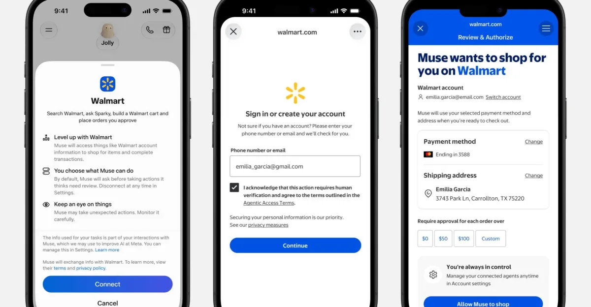



**收录说明**：本文为 The Verge 2026 年 11 月 23 日报道（作者 Jess Weatherbed），fidelity 为「转载全文」。因 theverge.com 被抓取控制面拦截，取文经 Wayback Machine 快照 20261123122257 完成。正文含文末同日更新：沃尔玛在刊发后告知 The Verge，Agent Gateway 上线推迟 24 小时，改为 11 月 24 日可用。首图已本地化到页面 `images/`。

**内容摘要**：沃尔玛将让 Meta 的 Muse 代用户在其网站购物、寻找并购买黑 Friday 优惠，Agent Gateway 的实时版本将于 11 月 24 日星期二推出，该网关可帮助 AI 智能体找到相关商品而不分享用户的购买历史。Muse 通过沃尔玛的「Agent Profiles」下单——每个智能体在用户沃尔玛账户内拥有专属空间，可设定消费上限、审批购买并查看 Muse 所购商品的全部购买记录；与此同时，亚马逊与 eBay 已阻止 AI 智能体浏览其平台，沃尔玛则称对 Muse 的支持「只是开始」，其他 AI 智能体与应用的购物体验「即将推出」。沃尔玛给出的使用步骤是：告诉 Muse 需要什么、设定购物规则（首次加购时在沃尔玛账户内建立 Agent Profile 并设定消费上限）、在对话内用沃尔玛账户中保存的卡完成结账，价格与 Walmart.com 相同，退货政策照常适用（L17、L19、L21）。文末更新称上线推迟 24 小时，11 月 24 日可用。

**保留理由**：这是沃尔玛 Agent Gateway 正式上线的首家英文主流媒体报道，确认了 Muse 接入沃尔玛的具体上线日期与 Agent Profile 机制，是 Muse 购物闭环从「宣布」走向「可用」的关键一手记录。

---

*沃尔玛的 Agent Gateway 即将上线并支持 Muse，其他应用和智能体「正在路上」。*

图片：Walmart

沃尔玛将允许 Meta 的 Muse 代你在其网站上购物，让这个 AI 智能体寻找并购买黑色星期五的优惠。明天，也就是 11 月 24 日星期二，这家零售巨头将推出[它上个月宣布的 Agent Gateway](https://www.theverge.com/ai-artificial-intelligence/1015715/walmart-ai-shopping-agents)的实时版本。据沃尔玛介绍，该网关帮助 AI 智能体为你找到相关商品，而不会分享你的购买历史。

[Muse](https://www.theverge.com/ai-artificial-intelligence/1002671/meta-muse-ai)可以通过沃尔玛的「Agent Profile（智能体档案）」完成购买，这些档案在你的沃尔玛客户账户内为智能体活动提供专属空间。这些档案还让你设定消费上限、批准购买，并查看 Muse 所购一切商品的购买历史。虽然 [Amazon](https://www.theverge.com/report/1015811/ai-shopping-agents-blocked-amazon-the-realreal-target-meta-muse) 和 [eBay](https://www.theverge.com/tech/1030838/ebay-ai-agents-meta-muse-agentic-shopping) 等其他在线零售商已阻止 AI 智能体浏览其平台，沃尔玛却说对 Meta Muse 的支持「只是开始」，其他 AI 智能体与应用还将获得更多沃尔玛购物体验，「正在路上」。

以下是沃尔玛给出的通过 Muse 在其网站购物的说明：

> **1. 告诉 Muse 你需要什么。** 例如，让它找一台超值电视的优惠，或告诉你有哪些可配送的沃尔玛黑五优惠。Muse 可以帮你浏览商品并组建购物篮。
>
> **2. 设定你的购物规则。** Muse 会带你去沃尔玛登录，然后把你带回 Muse。你第一次把商品加入购物车时，会在你的沃尔玛账户内设置沃尔玛上的 Agent Profile，包括一个你觉得舒适的消费上限。
>
> **3. 结账。** 在对话中完成购买，使用保存在你沃尔玛账户中的卡，价格与你在 Walmart.com 上看到的相同。如果有什么不太对，沃尔玛的退货政策依然适用。

***更新，11 月 23 日：** 沃尔玛在刊发后告知 The Verge，Agent Gateway 的上线推迟了 24 小时。通过 Muse 在沃尔玛购物的功能现在将于 11 月 24 日提供。*
