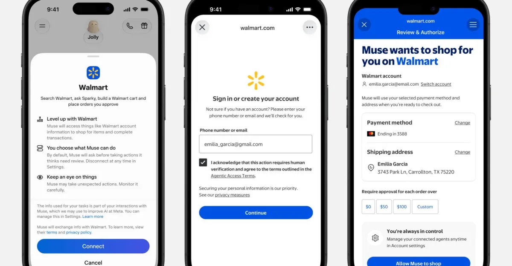

来源：https://www.theverge.com/ai-artificial-intelligence/1039874/walmart-agent-gateway-meta-muse-black-friday
取文：2026-11-23，Wayback Machine 快照 20261123122257（theverge.com 被抓取控制面拦截）

*The Walmart Agent Gateway is about to launch with Muse support, with other apps and agents ‘on the way.’*

Image: Walmart

Walmart will let Meta’s Muse shop on its website on your behalf, allowing the AI agent to find and purchase Black Friday deals. Tomorrow, on Tuesday November 24th, the retail giant will roll out a live implementation of the [Agent Gateway it announced last month](https://www.theverge.com/ai-artificial-intelligence/1015715/walmart-ai-shopping-agents), which helps AI agents find relevant products for you without sharing your purchase history, according to Walmart.

[Muse](https://www.theverge.com/ai-artificial-intelligence/1002671/meta-muse-ai) can make purchases through Walmart’s “Agent Profiles,” which provide a dedicated space for agent activity within your Walmart customer account. These profiles also allow you to set spending limits, approve purchases, and check the purchase history of everything bought by Muse. While other online retailers like [Amazon](https://www.theverge.com/report/1015811/ai-shopping-agents-blocked-amazon-the-realreal-target-meta-muse) and [eBay](https://www.theverge.com/tech/1030838/ebay-ai-agents-meta-muse-agentic-shopping) have blocked AI agents from browsing their platforms, Walmart says that support for Meta’s Muse is “just the beginning,” and that additional Walmart shopping experiences for other AI agents and apps are “on the way.”

Here are Walmart’s instructions for shopping its website via Muse:

> **1. Tell Muse what you need.** For example, ask it to find a great TV deal or show you which Walmart Black Friday deals are available for delivery. Muse can help you explore products and build your basket.
>
> **2. Set your shopping rules.** Muse will take you to Walmart to sign in, then bring you back to Muse. The first time you add an item to your cart, you’ll set up your Agent Profile on Walmart within your Walmart account, including a spending limit you’re comfortable with.
>
> **3. Check out.** Complete your purchase within the conversation using a card saved in your Walmart account, with the same Walmart prices you’d find on Walmart.com. And if something isn’t quite right, Walmart’s return policy still applies.

***Update, November 23rd:** Walmart informed The Verge after publication that the Agent Gateway launch has been delayed by 24 hours. The ability to shop on Walmart via Muse will now be available on November 24th.*
