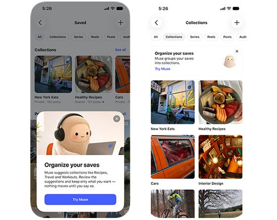



**收录说明**：原站直接下载返回 403，Wayback 无快照，改用 browser.open 读取全文；删去两处广告占位行；头图已下载到 images/ 并本地化。

**内容摘要**：Meta 于 11 月 24 日在 Instagram 上线一批 Muse 新功能，其中面向广告主的一项是新的有限 beta：了解 Muse 如何推动用户看到广告之后的行为，包括稍后保存、设置提醒、购买或填写表单。Meta 表示，正在探索把 Muse 整合进用户的广告体验、能否把兴趣转化为销售；这是一项在美国与加拿大的小范围测试，对象为已下载 Muse 的用户。测试还在 Facebook 与 Instagram 的 Save、Share 等入口及应用内浏览器中增加了 Muse 的进入点。同日上线的其他功能包括在 Instagram 私信中与 Muse 对话、按收藏内容整理清单、把食谱短视频转为购物清单等，私信与收藏部分已有 TechCrunch 11 月 24 日原稿覆盖。

**保留理由**：这是 Muse 进入广告体验这一新方向的首个报道，含有 Meta 对测试目标的直接表述，补上了 CNBC 收藏夹转化报道之外的另一条商业化线索。

---

Meta Platforms 的新 Muse 功能今天在 Instagram 上线，但其中一项面向广告主的功能，就其可能重塑平台的方式而言尤其值得关注。

这些面向广告主与营销人员的功能被描述为今天启动的新有限 beta，将帮助 Meta Platforms 的分析师与工程师理解：在用户看到广告之后，Muse 如何推动其行动，无论是把商品保存到以后、设置提醒、完成购买，还是填写表单。

对广告主而言，我们正在探索把 Muse 整合进用户的广告体验，能否在人们当下还没准备购买时，通过给他们更多考虑商品的方式，把兴趣转化为销售。这是在美国和加拿大面向已下载 Muse 的用户进行的小范围测试。

虽然尚未确认，但这一进展可能把 Instagram 的竞争优势从「品牌能多有效地抓住消费者注意力」转移到「平台能多有效地影响消费者决策，并促成把兴趣变成交易的行动」。

最重要的战略含义是，Meta 可能从一个出售消费者注意力访问权的平台，演化为一个帮助决定消费者如何处置这些注意力的平台。

从历史上看，Instagram 曾是一个发现引擎：用户看到商品、受到启发，然后必须自己想办法完成接下来的步骤。通过把 AI 直接嵌入那个「下一步」，Meta 从媒体分发渠道演化为商业基础设施。

这代表着整个行业的一次根本转变：从注意到行动，从发现到决策，从广告到交易影响。

在新的格局中，竞争优势将属于那个在行动发生的那一刻掌控旅程的平台。

成功的平台将驱动消费者发现、考虑、比较并最终选择什么——消除意图与购买之间的间隙，同时保持对行为历史与偏好的直接访问。

对广告主而言，那最后一步将成为终极的控制点。它抛出一个关乎营销未来的关键问题，并要求营销人员分析：当一个 AI 智能体坐在查询、广告与结账流程之间时，客户关系归谁所有。

今天宣布的其他功能包括：Instagram 用户可以在私信串中与 Muse 对话，以获取关于某条帖子的更多上下文、汇总他们在其他私信串中可能错过的内容等，从而无需在两个应用之间来回切换。

一项功能将让用户派 Muse 执行诸如「把这家咖啡店加入我的行程」或「找找黑色玛丽珍鞋的黑色星期五优惠」这样的查询。与 Muse 的私信对话会在主 Muse 应用中作为侧边聊天显示。

Muse 现在让用户能对 Instagram 上收藏的帖子和短视频做更多事——例如，让 Muse 处理 Instagram 收藏的帖子，并在需要时从中整理。

通过这次测试，Meta 为 Facebook 与 Instagram 的「保存」「分享」等界面以及应用内浏览器增加了 Muse 的进入点。

Muse 还可以把食谱短视频变成已保存的购物清单或一本食谱，或把喜欢的旅行创作者的旅行内容变成即将到来的旅行的行程。

从今天起，当帖子在 Instagram 上被保存时，用户可以提示 Muse 来整理它们。
