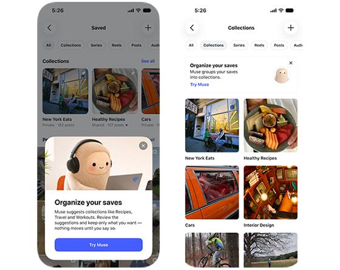

来源：https://www.mediapost.com/publications/article/419654/meta-tests-how-muse-drives-post-ad-actions.html
取文：2026-11-25，browser.open 读取全文（原站直接下载返回 403，Wayback 无快照）

Meta Platforms’ new Muse features rolled out today on Instagram, but one for advertisers is especially interesting in terms of the ways it could reshape the platform.

The features for advertisers and marketers, described as a new limited beta launching today, will help Meta Platforms analysts and engineers understand how Muse drives viewer actions after someone sees an ad, whether that's saving an item for later, setting a reminder, making a purchase, or completing a form.

For advertisers, we’re exploring whether integrating Muse into the user’s ads experience can turn interest into sales by giving people more ways to consider a product when they aren’t ready to buy in the moment. This is a small test in the US and Canada with people who have already downloaded Muse.

While unconfirmed, this advancement could shift Instagram's competitive advantage from how effectively brands capture consumer attention to how effectively the platform can influence consumer decisions and facilitate the actions that turn interest into transactions.

The most important strategic implication is Meta could evolve from a platform that sells access to consumer attention into a platform that helps determine what consumers do with that attention.

Historically, Instagram acted as a discovery engine where users saw a product, got inspired, and had to figure out the next steps on their own. By embedding AI directly into that next step, Meta evolves from a media distribution channel into commercial infrastructure.

This represents a fundamental shift across the industry, from attention to action, from discovery to decision-making, from advertising to transaction influence.

In the new landscape, the competitive advantage would belong to the platform that controls the journey at the point of action.

Successful platforms will drive what consumers discover, consider, compare, and ultimately choose -- eliminating the gap between intent and purchase while maintaining direct access to behavioral history and preferences.

For advertisers, that final step will become the ultimate point of control. It forces a critical question for the future of marketing, and requires marketers to analyze who owns the customer relationship when an AI agent sits between the query, the ad and the checkout process.

Other features announced today include a way for Instagram users to chat with Muse in a DM thread to get more context about a post, sum up what they might have missed in other DM threads, and more, eliminating the need to toggle between the two apps.

One feature will enable users to send Muse to act on queries such as “add this coffee shop to my itinerary” or “look for a Black Friday deal on black Maryjane shoes.” The DM chat with Muse will appear as a chat on the side in the main Muse app.

Muse now enables users to do more with posts and reels that are bookmarked on Instagram -- for example, asking Muse to turn Instagram saved posts and it will sort through them when needed.

With this test, Meta added an entry point to Muse for Facebook and Instagram surfaces such as "Save" and "Share," and in the in-app browser.

Muse also can turn recipe reels into saved grocery lists or a cookbook, or turn travel content from a favorite travel creator into an itinerary for an upcoming trip.

Starting today, when posts are saved on Instagram, the user can prompt Muse to organize them.
