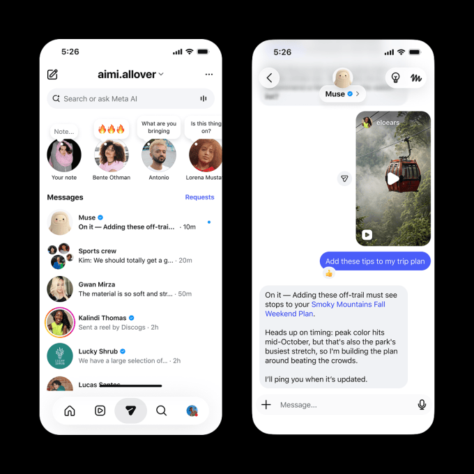



**收录说明**：直接下载；删去文末 Topics、作者简介、Most Popular 及推广说明等页面残留；正文配图为 Meta 提供的 Instagram 私信截图，已下载到 images/。

**内容摘要**：Meta 11 月 24 日宣布，Instagram 用户现在可以在私信（DM）对话中直接与 Muse 聊天，无需切换到 Muse 应用；用户可以向 Muse 询问所见帖子、地点或商品的背景，也可以让它汇总其他私信中错过的内容。用户可以把 Instagram 帖子分享给 Muse 并请它采取行动，例如把一家咖啡店加入墨西哥城行程，或为一双鞋找黑色星期五折扣；与 Muse 在 Instagram 上的对话会作为侧聊出现在 Muse 主应用中。从 11 月 24 日起，该功能向美国、加拿大、墨西哥、日本与新加坡的 iOS 与 Android 用户陆续推出。Meta 同时宣布，用户可以请 Muse 把收藏的帖子与 Reels 整理进自定义文件夹 Collections，例如把食谱视频变成购物清单、把旅行内容变成行程；保存帖子时出现的整理提示最初只在美国与加拿大推出。Meta 表示，未经用户批准不会分享、发布或发送任何内容，用户可以随时要求 Muse 忘记信息或撤销操作。

**保留理由**：Instagram 私信是 Muse 进入的又一个大型社交入口，也是继 WhatsApp 之后第二个把 Muse 放进对话的 Meta 社交应用；11 月 24 日起向美国、加拿大、墨西哥、日本与新加坡五国陆续推出，且包含日本，是本轮唯一的新渠道上线报道。

---

Meta 周二宣布，Instagram 用户现在可以在私信会话中与 Meta 的 AI 智能体 Muse 聊天。这家社交网络表示，用户可以就遇到的帖子、地点或商品与 Muse 聊天以获取更多背景，也可以让它帮自己补上其他私信里可能错过的对话。

这一新集成免去了用户在想要与 AI 智能体互动时在 Instagram 与 Muse 应用之间来回切换的需要。它也反映出科技公司之间日益激烈的竞争：让 AI 助手成为用户日常数字生活的一部分。通过把 Muse 直接嵌入 Instagram，Meta 既让用户更容易接触到这个 AI 智能体，也让 Muse 进入了一个用户本来就在发现商品、地点和内容的平台。

用户可以把 Instagram 帖子分享给 Muse，并请它采取行动，例如把一家咖啡店加入其墨西哥城行程，或为一双鞋找到黑色星期五的折扣。

Meta 指出，在 Instagram 上与 Muse 的对话会作为侧聊出现在 Muse 主应用中。

**图片来源：**Meta

Instagram 私信中的 Muse 将从周二起向美国、加拿大、墨西哥、日本和新加坡的 iOS 与 Android 用户陆续推出。

Meta 还宣布，用户现在可以对在 Instagram 上收藏的帖子和 Reels 做更多事。例如，他们可以请 Muse 把保存的内容整理进名为 Collections 的自定义文件夹。他们也可以请 Muse 把一段食谱视频变成购物清单、把喜欢的旅行创作者的内容变成即将到来的旅行的行程，或让 Muse 根据他们收藏的时尚 Reels 发来穿搭建议。

从周二起，当用户在 Instagram 上保存帖子时，他们会看到一个让 Muse 代为整理的提示。该功能在美国和加拿大推出。

Meta 表示，用户仍然掌控自己在 Instagram 上的 Muse 体验。未经他们批准，不会分享、发布或发送任何内容，并且他们可以随时让 Muse 忘记信息或撤销操作。
