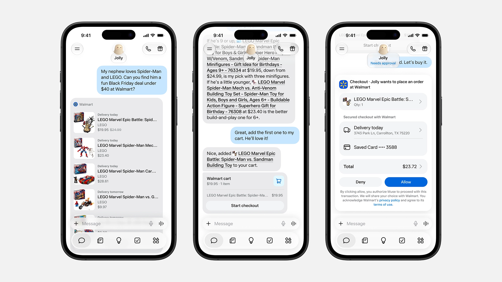



**收录说明**：直接下载；删去分享按钮、订阅引导与文末相关报道卡片；首图与黑五信息图为装饰图未收，三张手机购物流程图已下载到 images/ 并本地化。

**内容摘要**：即日起，顾客可通过 Muse 直接购买沃尔玛黑五优惠，Muse 可协助找商品、组建购物篮并完成购买，该体验由 Walmart Agent Gateway 提供支持。文中举例称，可请 Muse 找 500 美元以下的黑五电视优惠、追踪当季热门玩具或协助完成节日礼物清单，Muse 把购物清单交给沃尔玛，由沃尔玛按需求找商品。Agent Gateway 让用户决定智能体能做什么、不能做什么，且不会把顾客更广泛的购买历史分享给他人；通过 Agent Profiles，用户可设消费上限、批准购买并查看哪些购买由智能体完成。购物分三步：告诉 Muse 需求、首次加购时在沃尔玛账户内设置 Agent Profile 与消费上限、在对话内用沃尔玛账户保存的卡结账，价格与 Walmart.com 相同，退货政策照常适用；沃尔玛还称 Muse 只是开始，Agent Gateway 未来将支持通过更多应用与智能体在沃尔玛购物。

**保留理由**：沃尔玛官方首次公布 Muse 接入黑五购物的具体流程与 Agent Profiles 的控制方式，是 Muse 购物闭环落地的官方一手记录。

---

从日出前在店外排队，到如今，黑五购物已经走过了漫长的路。今年，有了购买沃尔玛优惠的新方式：让一个 AI 代理来干活。

从今天起，顾客可以直接通过 [Muse](https://muse.ai/)（Meta 的个人 AI 代理）购买沃尔玛的黑五优惠，Muse 可以帮助他们找到商品、组建购物篮并完成购买。

这一新的沃尔玛购物体验由 [Walmart Agent Gateway](https://corporate.walmart.com/news/2026/10/Making-It-Possible-for-Agents-to-Shop-on-Behalf-of-Customers) 提供支持，是 AI 购物向前迈出的一大步，把商品发现和购买带入同一个体验。

**你的购物清单。你的 Muse。你的规则。**

想象一下，请 Muse 找一款 500 美元以下的黑五电视优惠、追踪当季最热门的玩具，或帮你把节日礼物清单上的每个人都划掉。你不必自己逐个搜索商品，Muse 会连接到 Walmart Agent Gateway，把你的购物清单交给沃尔玛。然后由沃尔玛完成购物，找出符合你需求的商品。

你会看到沃尔玛的每日低价和黑五优惠，以及你熟悉的会员权益，例如免费配送。

**Walmart Agent Gateway 让你决定你的代理能做什么、不能做什么。**

60 多年来，沃尔玛一直通过帮助顾客省钱、生活得更好来赢得他们的信任。Walmart Agent Gateway 把同样的承诺带入 AI 购物，帮助代理找到相关的沃尔玛商品，同时不把顾客更广泛的购买历史分享给他人。

借助 Agent Profiles，控制权在你手中。你可以设置消费上限、批准购买，并查看购买历史，了解哪些购买是由你的代理完成的。

**如何用 Muse 在沃尔玛购物——包括我们的黑五优惠**

1. **告诉 Muse 你需要什么。**例如，请它找一款很棒的电视优惠，或向你显示哪些沃尔玛黑五优惠可以配送。Muse 可以帮助你浏览商品并组建购物篮。
2. **设置你的购物规则。**Muse 会带你到沃尔玛登录，然后把你带回 Muse。第一次把商品加入购物车时，你会在自己的沃尔玛账户内设置沃尔玛上的 Agent Profile，包括你感到舒适的消费上限。
3. **结账。**在对话内使用保存在你沃尔玛账户中的卡完成购买，价格与你在 Walmart.com 上看到的一样。如果有什么不太对，沃尔玛的退货政策仍然适用。

**黑五正在改变。沃尔玛已准备好。**

顾客购买黑五商品的方式比以往任何时候都多。有些人喜欢在货架间浏览。另一些人更喜欢搜索 Walmart.com、请 Sparky 帮忙，或让 Muse 这样的代理来干活。今年，[Sparky 能为购物者做更多事](https://corporate.walmart.com/news/2026/10/sparky-shopping-assistant-expansion)——例如把手写清单变成购物车、在店内为他们导航，以及使用图像和语音找到你需要的商品。

无论顾客选择哪种购物方式，他们都能指望沃尔玛一贯的优惠价格、商品种类、便利性和值得信赖的体验。

而 Muse 只是开始。Walmart Agent Gateway 将让顾客可以通过更多应用和代理在沃尔玛购物，更多体验即将推出。

这个黑五，你可以在店内和网上寻找优惠，也可以借助 Sparky、Muse 和代理来寻找。无论哪种方式，沃尔玛都准备好帮你省钱。
