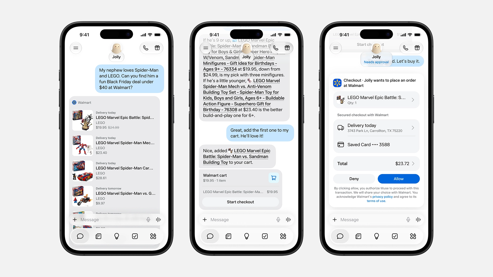

来源：https://corporate.walmart.com/news/2026/11/black-friday-deals-with-meta-muse
取文：2026-11-25，直接下载

Black Friday shopping has come a long way from lining up outside stores before sunrise. This year, there’s a new way to shop Walmart’s deals: Put an AI agent to work.

Starting today, customers can shop Walmart’s Black Friday deals directly through [Muse](https://muse.ai/), Meta’s personal AI agent, which can help them find items, build a basket and complete their purchase.

Powered by the [Walmart Agent Gateway](https://corporate.walmart.com/news/2026/10/Making-It-Possible-for-Agents-to-Shop-on-Behalf-of-Customers), this new Walmart shopping experience is a big step forward for shopping with AI, bringing product discovery and purchasing in one experience.

**Your shopping list. Your Muse. Your rules.**

Imagine asking Muse to find a Black Friday TV deal under $500, track down the season’s hottest toys or help you check off everyone on your holiday gift list. Instead of searching for each item yourself, Muse connects to the Walmart Agent Gateway, where it passes your shopping list to Walmart. Walmart then does the shopping, finding products that match your request.

You’ll find Walmart’s Every Day Low Prices and Black Friday deals, along with the membership benefits you’re used to, like free delivery.

**The Walmart Agent Gateway lets you decide what your agent can and can’t do.**

For more than 60 years, Walmart has worked to earn customers’ trust by helping them save money and live better. The Walmart Agent Gateway brings that same commitment to AI shopping, helping agents find relevant Walmart products without sharing customers’ broader purchase history with others.

And with Agent Profiles, you’re in control. You can set spending limits, approve purchases and check your purchase history to see which purchases were made by your agent.

**How to shop Walmart with Muse — including our Black Friday Deals**

1. **Tell Muse what you need.** For example, ask it to find a great TV deal or show you which Walmart Black Friday deals are available for delivery. Muse can help you explore products and build your basket.
2. **Set your shopping rules.** Muse will take you to Walmart to sign in, then bring you back to Muse. The first time you add an item to your cart, you’ll set up your Agent Profile on Walmart within your Walmart account, including a spending limit you’re comfortable with.
3. **Check out.** Complete your purchase within the conversation using a card saved in your Walmart account, with the same Walmart prices you’d find on Walmart.com. And if something isn’t quite right, Walmart’s return policy still applies.

**Black Friday is changing. Walmart is ready.**

Customers have more ways to shop Black Friday than ever before. Some love browsing the aisles. Others prefer searching Walmart.com, asking Sparky for help or putting an agent like Muse to work. This year, [Sparky can do even more for shoppers](https://corporate.walmart.com/news/2026/10/sparky-shopping-assistant-expansion) — like turning a handwritten list into a shopping cart, finding their way through the store and using images and voice to find what you need.

However customers choose to shop, they can count on the same great prices, assortment, convenience and trusted experience they expect from Walmart.

And Muse is just the beginning. The Walmart Agent Gateway will make it possible to shop Walmart through more apps and agents, with additional experiences on the way.

This Black Friday, you can hunt for the deals in stores and online, as well as with Sparky, Muse and agents. Either way, Walmart is ready to help you save.

---

**Related Stories**

[
###### New Ways to Shop, Holiday Traditions to Keep: Walmart is Ready for the Season

Walmart is ready for Holiday 2026 with new ways to shop, including Express Pickup, faster delivery options, accessible services, and holiday traditions customers count on.

Oct. 7, 2026
