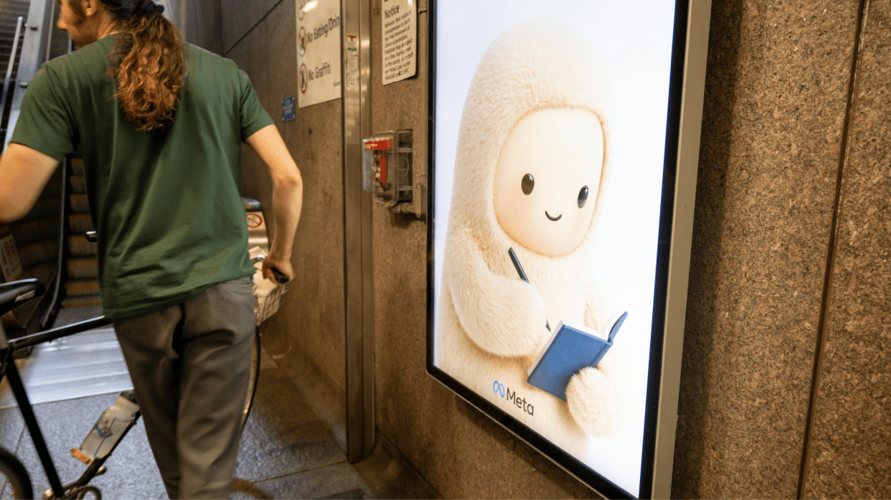



**收录说明**：直接下载；页面为付费墙，仅取到付费墙前的导语、要点框与开头三段，缺失处已在原文存档中标出；删去订阅推广与作者头像；头图已下载到 images/ 并本地化。另有 allthingsmuse 与 eMarketer 对同一 HUMAN 数据的转述，未另收。

**内容摘要**：据网络安全公司 Human Security 的数据，2026 年网络周（11 月 26 日至 30 日）智能体流量预计达到去年同期的约 150 倍，其中 Meta 的 Muse 约占七成。零售商网站的智能体流量预计从节前水平翻倍以上，在黑色星期五周末达到峰值，与去年 145% 的增幅相当。智能体大多只浏览，但结账页请求增长更快；Google 的智能体流量占比不到 5%，结账页请求却占近 20%。Human 首席战略官 John Searby 称，去年只是智能体商务的试运行，今年网络周将是它的“第一个真正旺季”；尽管一些零售商正在限制智能体活动，Human 仍预计随着合法智能体购物增加，拦截率会在网络周下降。

**保留理由**：这是 HUMAN 智能体流量系列的最新数据点（9 月 40%、10 月 59%，本轮 70%），首次给出网络周 150 倍的预测与结账页请求的分布，是智能体购物进入第一个旺季的规模证据。

---

## 随着智能体主导的购物升温，网络周的拦截率预计会下降，尽管一些零售商正着手限制其网站上的智能体活动

新数据显示，Meta 广受欢迎的个人助手 Muse 占智能体主导的网站请求的绝大多数。

（图片来源：Smith Collection/Gado via Getty Images）

作者：[Kendra Barnett](https://www.adweek.com/contributor/kendra-barnett/)

### 要点

- 智能体流量预计将比一年前增长约 150 倍，其中 Meta 的 Muse 发出了近 70%。
- 智能体大多只是浏览，但结账活动正在增长。谷歌的智能体占流量不到 5%，却占智能体对结账页请求的近 20%。
- 零售商对是否放行智能体意见分裂。Human 仍预计，随着合法的智能体购物增加，网络周期间的拦截率会下降。

据网络安全公司 Human Security 的数据，在网络周（11 月 26 日至 30 日）期间，智能体流量预计将达到去年网络周数字的 150 倍。尤其是来自智能体的零售流量，预计将从节前水平增长一倍以上，在黑色星期五周末达到峰值，与去年 145% 的增幅相仿。

智能体除了像聊天机器人那样用自然语言回应用户的查询，还能代表用户执行多步操作。

Human 首席战略官 John Searby 说，去年只是智能体商务的一次试运行，而今年的网络周将代表智能体的「第一个真正旺季」。

（以下内容无法获取）
