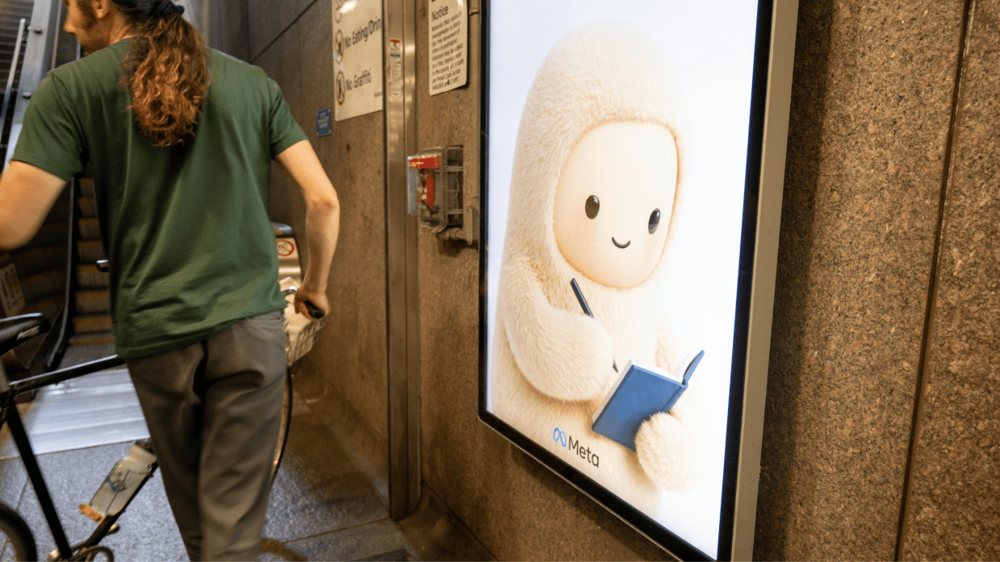

来源：https://www.adweek.com/commerce/ai-agent-traffic-to-surge-150x-this-cyber-week-driven-mostly-by-meta-muse/
取文：2026-11-25，直接下载（仅付费墙前可读部分）

## Block rates are expected to drop during Cyber Week as agent-led shopping picks up steam, even as some retailers move to limit agent activity on their sites

Meta's popular personal assistant Muse accounts for the vast majority of agent-led site requests, new data indicates.

（图片来源：Smith Collection/Gado via Getty Images）

By [Kendra Barnett](https://www.adweek.com/contributor/kendra-barnett/)

### Key Takeaways

- Agent traffic is expected to be up about 150x from a year ago, and Meta's Muse sends nearly 70% of it.
- Agents mostly browse, but checkout activity is growing. Google's agents account for under 5% of traffic but nearly 20% of agent requests to checkout pages.
- Retailers are split on letting agents in. Human still expects block rates to dip during Cyber Week as legitimate agent shopping rises.

During Cyber Week, from Nov. 26 to 30, agentic traffic is expected to hit 150x last year’s Cyber Week figures, according to cybersecurity firm Human Security. Retail traffic from agents in particular is set to more than double from pre-holiday levels to its Black Friday weekend peak, mirroring last year’s 145% jump.

Agents, which, as well as responding to user queries in natural language like chatbots, can take multi-step actions on a user’s behalf.

While last year was a test run for agentic commerce, this Cyber Week will represent agents’ “first real season,” said John Searby, Human’s chief strategy officer.

（以下内容无法获取）
