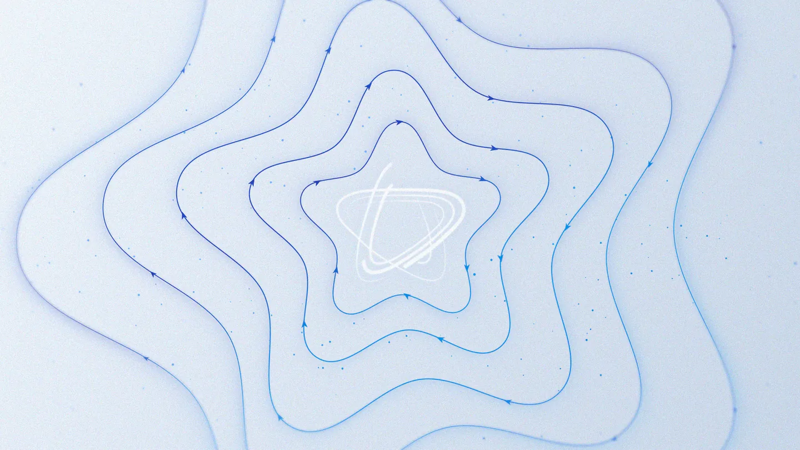
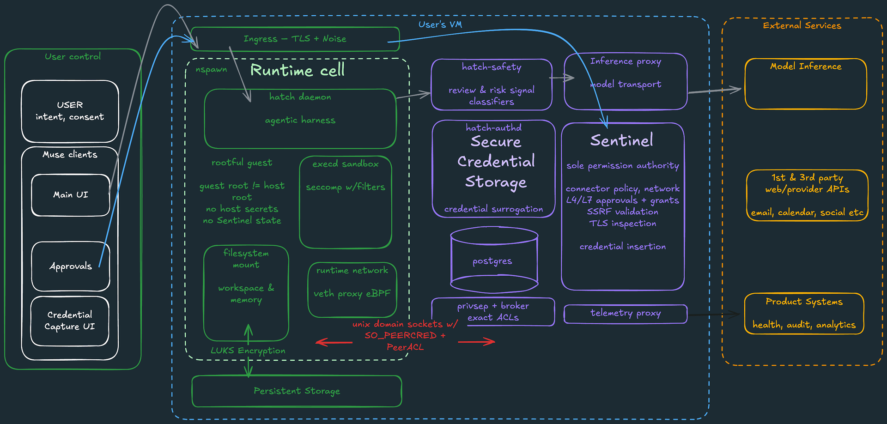



**收录说明**：这是 Meta 研究博客文章，作者 Tarek Sheasha 是 Meta 超级智能实验室的软件工程师兼副总裁，页面标注 2026 年 9 月 8 日，全文翻译。来源地址为 security.muse.ai，原文有一段视频，译文以封面图和链接保留。早期收集时直接翻译，原文未单独存档。

**内容摘要**：文章讲 Muse 发布时的安全设计，核心假设是智能体可能正在受到攻击。每个用户有一台隔离的云端 VM，核心 harness 和用户文件运行在 systemd-nspawn 容器中，安全服务放在容器外：hatch-safety 运行分类器，privsep 执行连接器代码，hatch-authd 管凭证并做凭证替代，Sentinel 是连接器操作和网络出站的唯一权限机构。批准通过客户端的对话框而不是聊天收集，并绑定到特定连接器或目的地。防护包括模型训练、不可信输入标记、提示注入分类器和「污点出站」数据流追踪。浏览器有独立代理和分类器，购买使用一次性卡号。文章还预告了计划在今年晚些时候交付的 Muse Confidential VM，并宣布向所有人开放漏洞赏金计划。

**保留理由**：这篇是 Muse 架构和安全机制最详细的官方说明，其他实测和漏洞报道里提到的 Sentinel、privsep、authd 等组件，都可以回到这里对照。

---

2026 年 9 月 8 日 · 20 分钟阅读

- Tarek Sheasha，软件工程师兼副总裁，Meta 超级智能实验室（Meta Superintelligence Labs）

[视频](https://research.meta.ai/blog/security-and-safety-for-ai-agents-our-approach-with-muse)

今天，我们发布了 Muse：我们的个人智能体。从 2026 年初开始，我们就一直在开发并亲自使用 Muse。我们一开始使用它，就看到了真正的个人超级智能的微光：一个了解你、真正做事、在后台工作、发起成群的子智能体、构建自己的工具并编辑自身的智能体。

这也是我们第一次把自己的收件箱、日历和一个 shell 交给一款软件，并让它在无人看管的情况下运行，而结果并不总是如我们所计划的那样。要让这项技术为每个人所用，需要精心的设计和工程，使其更安全地运行。这个项目的大部分精力都投入在这里，这篇文章详细解释了我们的做法。

我们训练模型时特别关注了对这类智能体至关重要的几个方面：使用 CLI 和技能（skills）的零样本工具调用、长上下文、长轨迹的指令遵循（同时内在地意识到提示注入），以及多智能体协调。

无论核心模型有多强，这样的智能体仍然会犯错，有时还会通过它读取的数据受到攻击。所以我们把系统设计成假定智能体可能正在受到攻击，并限制潜在的损害：harness 运行在它自己的隔离单元中，它看不到真实的凭证，与外部世界的每一次交互都要经过一个智能体无法推翻的 Sentinel。Muse 仍然可能、也会犯错，但由于我们内建的安全系统，我们预计这些错误会少得多，造成的损害也小得多。

我们基于大量的内部试用（dogfooding）、智能体式红队测试，以及安全研究人员在我们非公开漏洞赏金计划中于真实对抗场景下发现的问题，对 Muse 进行了加固。今天，我们向所有人开放 Muse 漏洞赏金计划，以便负责任地披露问题。该计划为有效报告提供最高 300,000 美元的奖励，其中影响单个用户的成功提示注入尝试最高可达 130,000 美元。

通过详细介绍 Muse 的内部工作原理，我们希望让你了解在实践中可以如何信任它，以及可以信任它到什么程度。以下描述的是发布时的系统。当然，我们会继续关注不断变化的威胁形势，并根据需要做出改变。

## 总体情况

### 你自己的云端计算机中的智能体

你和你的 Muse 共享一台属于你自己的云端专用计算机。这是你的 Muse 所在的地方，也是你所连接的任何服务的所有数据和凭证被安全存储的地方。每台虚拟机（VM）都是一台隔离的 Linux 机器，带有浏览器，以及足够做实际工作的存储、CPU 和内存，比如编译智能体编写的代码、开发自定义技能，以及处理并发的子智能体和定时任务（crons）。

### 你的计算机，你的数据

你的专用 VM 是你放进 Muse 的一切内容的记录系统（system of record）。如下文所述，Muse 只在推理和遥测必需时，才从 VM 向外发送有限的数据。

### 客户端

Muse 客户端（iOS 和 Android 应用、网页界面）通过安全的传输层直接连接到你的 VM。

### 连接器

当你把 Muse 连接到你的电子邮件以及汽车、家居等其他系统时，它最有用。我们构建了一批初始的连接器，连接第三方系统以及 Instagram 和 Facebook 等其他 Meta 应用。对于每个连接器，我们都与服务提供方密切合作来集成他们的 API，并编写和迭代了 SKILL，也就是给 Muse 的详细说明，告诉它如何充分利用每个连接器。对于你关心的其他服务，只要它们有自己的 API 或 CLI，Muse 也可以自己编写自定义连接器。

## Muse Secure VM

VM 的结构经过精心设计，利用 Linux 隔离原语，把你和你的 Muse 所做的事情，与我们为保障你的安全而内建的一切分隔开来。正确的心智模型是：一台机器上的两个隔离的安全域，而不是一个拥有 root 权限、由 LLM 驱动的智能体。

Hatch[^1] 守护进程（核心的智能体 harness），以及包含你的工作区和文件的文件系统，还有 Muse 代表你执行的所有二进制程序和工具，都运行在一个 `systemd-nspawn` 运行时容器中。运行时单元（runtime cell）内的 root 被映射为宿主上的一个非特权用户，因此运行时单元的 root 并不是宿主的 root。该单元有自己的根文件系统（包括一个完整的 debian 镜像），与存放你其他更敏感数据的宿主文件系统分开。它还有一个虚拟网络接口、经过过滤的系统调用（例如没有 `io_uring`），以及受限的内核能力（例如没有 `CAP_SYS_PTRACE`，也没有 `CAP_NET_ADMIN`）。

安全敏感的服务位于运行时单元之外。这种划分很重要，因为运行时单元预计要处理不可信的数据。这些服务作为独立的 systemd 单元运行：

- `hatch-safety` 运行一套独立的模型和分类器，检查发往核心模型推理以及从中返回的请求和响应。这些对于控制前沿风险以及识别提示注入尝试等其他威胁很重要。把它们运行在运行时单元之外，意味着攻击者无法禁用这些保护。
- `privsep` 工作进程以严格限定的权限执行内置连接器的代码，使已连接的凭证不在智能体的可及范围之内。
- `hatch-authd` 负责凭证存储（包括你选择连接的第三方服务的 OAuth 令牌，这些令牌存储在你的 VM 中，而不是 Meta 的集中式基础设施中），以及凭证替代（credential surrogation），使你的主智能体永远看不到敏感凭证。
- Sentinel 是连接器操作和网络出站（egress）的唯一权限机构。
- 所有持久化的应用状态都存储在一个 postgres 数据库中，与运行时单元和凭证存储分开。
- 推理和遥测的代理只向外部基础设施开放受限的路径。

运行时单元与 VM 中其他服务之间的所有通信，都通过带有 SO\_PEERCRED 和对端 ACL 的 Unix 域套接字进行。这提供了经内核认证、最小权限的进程间通信，没有可供窃取的秘密。

## 内建的 Sentinel

Sentinel 是一个独立于你的 Muse 的宿主侧智能体。它是批准使用第三方服务连接器执行操作、以及批准所有网络出站的唯一权限机构。Muse 提出操作，但只有 Sentinel 才能授予执行操作的许可。

### 连接器

当 Muse 想通过某个连接器采取行动时，相关的连接器工具会在运行时单元中被调用。它向 Sentinel 提交一个请求，描述连接器、要调用的方法、操作类别、范围，以及用户所要求内容的上下文，Sentinel 据此为该请求生成一个用户可见的目的说明。Sentinel 评估由用户设置的连接器策略，并决定这个操作应当被**允许**（allowed）、**拒绝**（denied），还是**询问**（ask）用户。

### 网络出站

每一个具体的网络请求在出站时都受 Sentinel 管控。运行时的流量通过一个正向代理到达 Sentinel，该代理由 Linux 网络控制（userns、veth 边界和 eBPF 过滤）配置。Sentinel 可以在第 4 层和第 7 层评估目的地：主机名、解析出的和最终的目的 IP 地址、端口、协议、HTTP 方法、路径，以及实际解码后的请求。SSRF 限制可以防止一个看似公开的主机名在 DNS 查询后解析到私有基础设施。

对于任何需要密钥或认证令牌的请求，Sentinel 还会执行即时的凭证注入。对于所有这类请求，运行时单元或工作进程中的代码只会看到一个由 authd 签发的「替身」（surrogate）令牌。在具体的网络请求获得授权后，Sentinel 会在网络边界处用从 authd 获取的真实凭证替换掉所有替身令牌。智能体永远看不到真实的令牌，这意味着任何通过提示注入或其他方式胁迫智能体泄露真实秘密的尝试都是徒劳的。

为了平衡用户批准的信噪比，Muse 使用内核级的数据流追踪，我们称之为「污点出站」（tainted egress）。每个工具执行进程都以干净状态开始，一旦读取了用户数据就会被标记为污点。已经符合某个严格限定的自动允许策略、并且还通过了对出站 URL 其他检查的干净网络请求，可以在不打扰用户的情况下放行。污点信息被用来确定请求所需的适当用户批准。被标记为污点或无法验证的进程会失去自动允许资格，回退到正常的批准流程。其实现使用 eBPF `cgroup` 程序进行网络拦截和进程归属，另外还有挂接在我们为污点传播而添加的 Linux 安全模块（Linux Security Module）钩子上的 eBPF 程序。

## 人在环路

当 Sentinel 的决定结果是**询问**用户时，Sentinel 会创建一个待批准项，执行随之停止。Sentinel 把这个请求直接发送给 Muse 客户端，描述需要批准的确切操作。一个对话框会直接在客户端界面中呈现给用户，而不是通过他们与 Muse 的对话；他们的答复会被直接送回 Sentinel，由 Sentinel 按用户的决定执行。随后 Sentinel 更新其权威的批准状态，并相应地允许操作继续或拒绝它。

通过人在环路系统授予的批准是严格的能力（capabilities），而不是对话中的建议。它们被绑定到特定的连接器或目的地以及用途。Muse 支持获取一次性的、会话范围的、任务范围的、有时间限制的或永久的许可。Sentinel 决定呈现哪些授权类型供用户选择，并确保后续调用与所授予的范围完全匹配。

重点不在于事事都询问用户。只读的、之前已被允许的，或者明显低风险的操作可以不被打断地继续进行。目标是在同意真正重要的地方设置阻力，同时让例行操作自由流转。我们预计随着对真实用户积累更多经验，会不断调整这种平衡。

## 最小权限

从不向模型展示 API 密钥，是我们应用最小权限原则的一个例子。模型不需要看到 API 密钥，所以它看不到，这意味着它不会通过其他途径意外泄露它们。Muse 在尽可能多的地方应用这一原则。例如：

很多服务都支持读和写操作。用户往往更愿意给他们的智能体读取数据的权限（例如「读取我的日历，把冲突标记给我」），而在给予写入权限（例如「为我安排新会议」）之前，更愿意花时间了解系统在实践中工作得如何。在底层服务支持的情况下，Muse 把读取和写入权限分开。Muse 还对智能体可以代表用户采取的具体操作提供细粒度的控制，比通常以 OAuth 范围（scopes）形式暴露的粗粒度分组更细。（例如，如果你在 Gmail 一侧授予 Muse Gmail 读取权限的 OAuth 范围，你可以移除通常随之而来的访问 Gmail 设置的能力。）系统在连接器、进程、凭证和请求层面增加了更细粒度的控制。

像 Muse 这样的智能体的一种标准做法，是为第三方服务提供基于 CLI 的连接器，这些连接器与 harness 运行在同一个环境中。其风险在于，智能体可能会被提示注入胁迫去修改工具代码，用这些 CLI 能访问的服务凭证去做恶意的事情。Muse 通过使用 `privsep`，把内置连接器的逻辑运行在运行时单元之外，并严格限定凭证访问，实现了更高程度的保护。

内置连接器有在运行时单元中运行的 CLI，这些 CLI 只是解析参数、打开调用方本就有权访问的文件，并通过 Unix 套接字传递类型化的参数和文件描述符。然后由一个经 systemd 沙箱化的工作进程执行该工具的业务逻辑。

每个工作进程由其 `cgroup` 标识，并有明确的凭证允许列表。一个日历工作进程无法仅仅通过修改一个请求参数，就向 authd 索取电子邮件凭证。

- Privsep 决定能够使用凭证的代码在哪里执行
- `Authd` 决定经过认证的调用方可以获得哪些凭证材料
- Sentinel 决定所请求的操作是否可以执行

浏览器遵循类似的模式。CDP 访问位于运行时单元之外的一个代理（broker）中，浏览器智能体只能获得一个狭窄、受控的访问接口。

对于内置连接器，考虑到这些服务深入你生活的程度，我们也仔细思考了如何让 Muse 更安全地访问它们。想想你的主邮箱：你可能会在那里收到大量一次性令牌验证码。而且你的电子邮件账户很可能可以通过点击「忘记密码」链接，用来重置你在网上使用的大多数其他账户的密码。把你的电子邮件连接到 Muse，不应该让智能体或者胁迫智能体的其他人能够在其他网站上冒充你。所以 Muse 的电子邮件连接器通过确定性过滤器和一个分类器模型，过滤掉一次性令牌、密码重置链接和登录魔法链接（login magic links）。

## 纵深防御

和任何 AI 系统一样，Muse 有时会犯错。它还需要在对抗性的环境中行动。我们应用纵深防御（defense in depth）的概念，来限制技术栈中任何一层出现问题时的影响。我们为降低提示注入造成危害的风险所采取的做法就是一个很好的例子。

Simon Willison 早在 2025 年 6 月就创造了「致命三要素」（the lethal trifecta）一词，用来描述提示注入的前提条件，而这个问题一直是我们念兹在兹的事情。

> 致命的三种能力组合是：
>
> - 访问你的私人数据：这本来就是工具最常见的用途之一！
> - 接触不可信的内容：恶意攻击者控制的文本（或图像）可能借以进入你的 LLM 的任何机制。
> - 能够以可被用来窃取你数据的方式对外通信。（我常称之为「外泄」（exfiltration）……）。
>
> 如果你的智能体同时具备这三种特性，攻击者就可以轻易地诱骗它访问你的私人数据并发送给攻击者。
>
> – [Simon Willison](https://simonwillison.net/2025/Jun/16/the-lethal-trifecta/)

我们采用纵深防御的方法来防止提示注入造成危害：

- 模型层面的训练：我们的模型经过训练，能够识别并抵御提示注入。我们开发了一套严格的评估，使我们能够长期跟踪模型在这一指标上的表现。Muse Spark 1.3 在这项能力上接近最先进水平（SOTA）。
- harness 层面的保护：当数据从任何外部来源进入模型上下文时，它会被标记为不可信输入。这一点，加上模型更强地遵循开发者指令的能力，意味着在存在潜在有害数据的情况下，模型理解哪些指令该遵循、哪些该忽略的核心能力会被放大。
- 一组由多个提示注入检测分类器组成的集成，这些分类器经过训练，能检测在真实数据集中发现的提示注入尝试，以及我们自己在所有经由文件和工具调用进入模型上下文的外部数据上大规模运行的智能体式红队测试中发现的尝试。它们彼此并行运行，在发现操纵智能体行为的企图时能够采取果断的行动。通过独立于模型来训练这个系统，我们可以让整个系统达到显著更高的准确率。
- 如上所述，对把数据移出 VM 的操作进行人在环路的批准

在智能体之下，我们同样有纵深防御：即使 Muse 被说服做出不良行为，确定性的边界依然适用。运行时单元限制系统访问，privsep 限制哪些代码可以看到哪些凭证，authd 执行 ACL，而 Sentinel 评估每一个操作和所有网络出站。

## 浏览器

Muse 拥有一个真实的、保持最新的基于 Chromium 的浏览器，运行在一个虚拟化层之后。用户可以看到 Muse 在浏览器中做什么，并随时接管。通过模型在网络上观察到的数据（无论是文本还是图像）对其进行提示注入或操纵，是另一个重要的攻击途径，我们在上述措施之外对此施加了额外的保护。

- 用户最常想做的事情之一，是在浏览器中登录网站。与 Muse 处理 API 令牌的方式类似，但使用一个能更好地与密码管理器集成的不同的定制界面，我们在客户端呈现一个定制界面来采集你的用户名和密码，把它们直接发送到 `authd`，并存储在 Muse VM 中运行时单元之外的安全凭证存储里。你输入的内容直接进入安全存储，你的主智能体看不到，但会在需要的时候被注入到浏览器窗口中。
- 驱动网页浏览器来实现用户的目标，是 Muse Spark 1.3 模型特别擅长的事情。Muse 使用一个专门的浏览器子智能体来完成每项任务：阅读页面、浏览网站、填写表单等。这个子智能体有类似的、针对网页的说明，告诉它内容中的哪些部分可能是对抗性的。
- 浏览器由一个单独的代理（broker）管理，该代理管理 Chrome DevTools Protocol 连接。驱动浏览器的子智能体看到的是页面的无障碍树快照（accessibility tree snapshot），而不是原始 DOM。（这也意味着它无法读取从凭证存储中填入的凭证，也无法手动从 DOM 中把它们倒推出来。）它无法在页面上下文中运行 javascript，没有脚本动词（script verbs），不能在浏览器进程中执行，Chrome 开发者工具也被禁用。当用户接管浏览器控制，或者安全凭证存储正在填写表单时，智能体会被暂停，完全无法行动。
- 此外，我们实现了一系列分类器，在 Muse 使用浏览器时提供另一层独立的保护；根据检测到的威胁，它们会阻止操作，或者提示用户检查即将发生的事情。它们关注的是：
  - 通过浏览器外传与当前任务无关的个人数据。
  - 网页 DOM 中存在的提示注入尝试。
  - 通过网页上的图像或媒体进行的提示注入尝试。
  - 通过浏览器下载的文件进行的提示注入尝试。
  - 试图提交高风险表单。
- 最后，Meta 已有一些系统，可以检测并拦截用户可能通过我们应用家族中的帖子或广告被引导去访问的恶意网站。我们能够在用户的 VM 内与这份名单进行比对，阻止浏览器导航到已知的有害网站。

### 购买

用 Muse 买东西是最受欢迎的浏览器用例之一。由于这里的错误可能让用户损失真金白银，我们对此格外谨慎。如果你在一个已经存有你付款凭证的网站上购物，我们在浏览器中构建了检测功能，识别出你正处于结账页面，并且每一次都会就购买的确切细节发起人在环路的批准。对于你以前没有购物过的网站，Muse 内含一个钱包，可以合规地存储付款凭证。在发布时，我们与 Stripe Link 合作，Shop Pay 即将推出。付款时，会签发一个一次性卡号，传递给商家网站的是这个卡号，而不是你的常用信用卡。对于每一个这样的事件，我们都会发起人在环路的批准。该凭证绑定到特定的商家、特定的金额，并且只在有限的时间内有效。这样一来，即使它通过提示注入或其他攻击被窃取，对攻击者也没有多大用处。

## 漏洞赏金

我们通过持续的智能体式红队测试来增强对系统的信心，这也帮助我们积累了一套非常困难的评估，可用于离线评估我们的保护措施。此外，我们这一年来一直通过漏洞赏金计划与外部安全研究人员合作。今天，我们向任何负责任地披露问题的人开放这个[漏洞赏金计划](https://bugbounty.meta.com)。该计划根据所展示的影响，为有效报告提供最高 300,000 美元的奖励，包括成功的提示注入尝试。

## 即将推出：Muse Confidential VM

我们打造 Muse 的目标，是让它默认就成为你个人信息的审慎管理者，并把透明度和控制融入日常体验。今天的 Muse 架构把每个用户的数据彼此隔离，并保障其安全。它通过运营政策限制 Meta 人员对你数据的访问。它并不能阻止 Meta 在为支持、保护或运营服务而必要时访问数据。

我们认为，人们还应该能够为个人智能体选择一种完全私密的模式，在这种模式下，即使是 Meta 或任何其他服务提供方，也无法看到或授予对你信息的访问。

这就是为什么我们在 Muse Confidential VM 上大量投入，并计划在今年晚些时候交付这项能力。Muse Confidential VM 旨在以密码学的、可验证的方式阻止 Meta 访问你 VM 中的数据。我们已经在一小群受信任的测试者中使用这个系统，并已开始向外部审计方提供我们的设计和该系统的源代码。我们正在吸收审计方的反馈；一旦推出，系统将接受持续审计，审计结果任何人都可以看到和检查。专家将能够确认 Meta 没有能力访问机密 VM 环境中的数据。我们也欢迎安全和隐私专家联系我们，提前体验这个版本的产品。他们的合作和审视会让它更强大。*（你可以通过 [muse-security@meta.com](mailto:muse-security@meta.com) 联系我们。）*

## 我们的数据政策

我们知道，把你最敏感的数据连接到 Muse 是一种信任的表现。我们在设计 Muse 时就考虑到了这一点。你放进 VM 的所有文件，以及 Muse 代表你生成或使用的一切，都存储在那里。你可以自由地检查、编辑和下载这些文件，包括 Muse 关于你的记忆。这也延伸到你连接的任何第三方服务的凭证和认证令牌：它们存储在你 VM 中一个单独的隔离容器里，而不是 Meta 的其他服务中。你的 VM 数据会持续备份，以便出现问题时你可以恢复。

Muse 不会与 Meta 的广告系统共享你的对话或你虚拟机中的数据。话虽如此，在一些合理的场景中，你使用 Muse 的方式可能会影响你看到的广告。当 Muse 浏览互联网时，它会显示为你的活动，所以如果你让 Muse 从一个服装设计师的网站上买一件衬衫，这位设计师可能会利用你的访问在 Instagram 上向你展示广告。类似地，如果 Muse 为你预订了一家餐厅，或者帮你在 Facebook Marketplace 上找到一件很棒的商品，这也可能间接影响你看到的广告。

推理数据，即你与你的 Muse 之间的来回对话，以及由此产生的工具调用和子智能体交接（「轨迹」），是训练核心 LLM 模型新检查点的有用数据。为了保护用户隐私，这些轨迹在用于训练之前会被清洗，去除关键的个人身份信息。我们认为这是一个好的默认设置：随着我们所有人共同使用这个产品，并帮助模型理解人类生活的种种细节，每一位 Muse 用户都会得到一个更好的个人智能体。如果你完全不希望你的数据被用于模型训练，你可以通过 Muse 设置中的一个简单开关选择退出。

## 结论

Muse 并非对攻击免疫。提示注入在业界仍然是一个悬而未决的问题，Muse 有时也会犯错。我们设计这个系统，是为了在出现问题时限制其影响，并帮助用户在不被淹没的情况下保持掌控。

有两件事对我们帮助最大。如果你是一名安全研究人员，或者只是喜欢尝试攻破东西，漏洞赏金计划今天已经开放。我们会为成功的提示注入攻击支付赏金，不是因为我们认为找到它们是不可能的，而是因为这种安全最佳实践将帮助我们以最快的速度改进 Muse 在真实世界中的行为。如果你是一名隐私专家，并且愿意帮助我们把 Muse Confidential VM 做好，请联系我们：我们希望与少数几位专家密切合作，在我们把它推向市场的过程中为我们的工作提供建议和审查。

[^1]: Hatch 是 Muse 在代码库中的内部名称。
