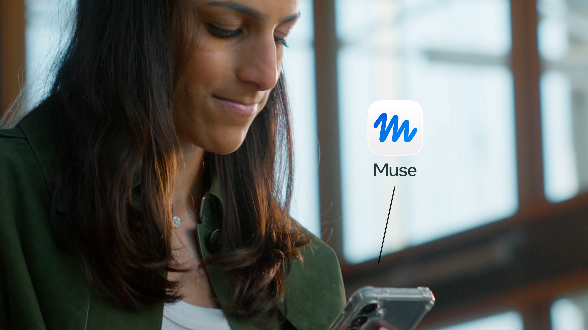
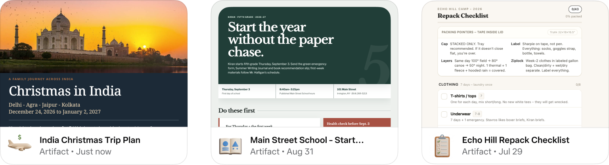
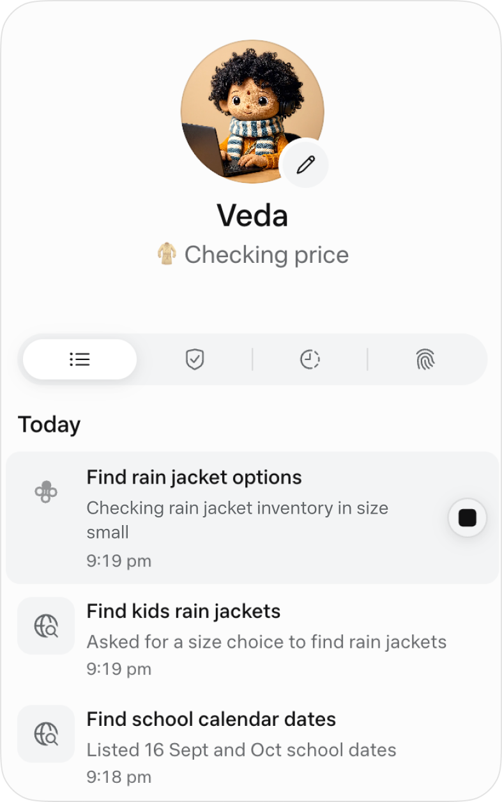
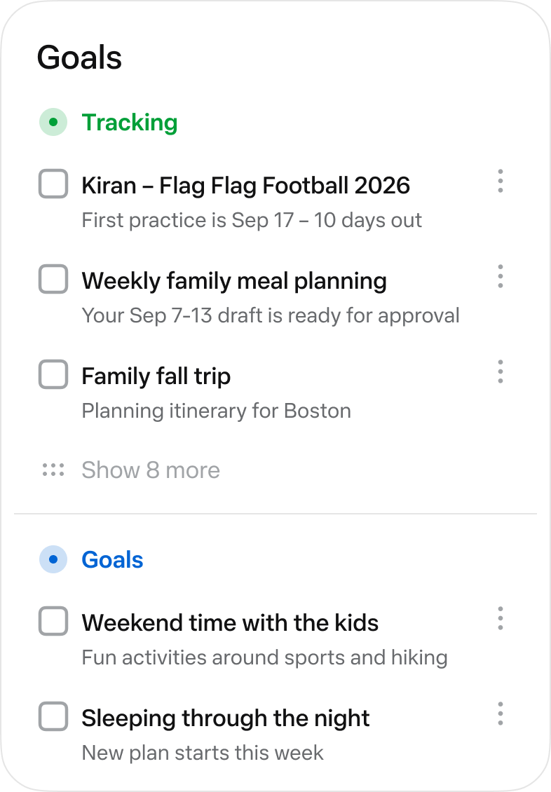
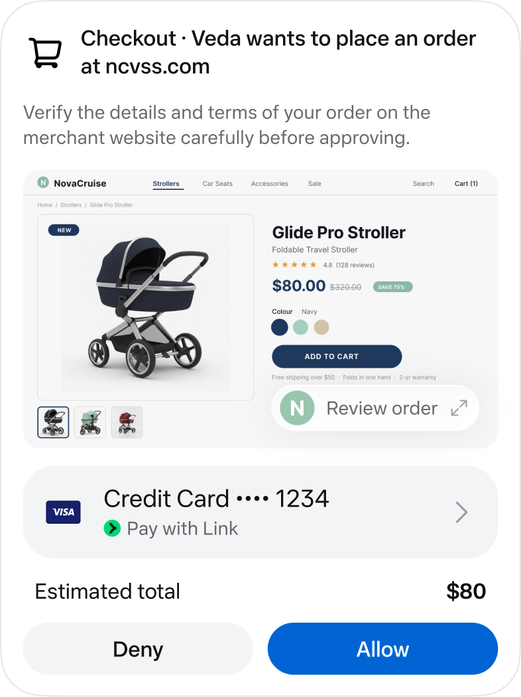
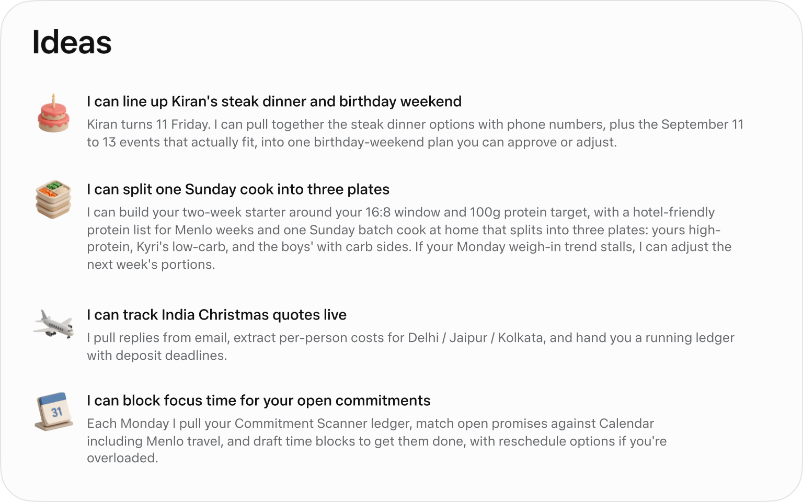



**收录说明**：Meta 的 Mona Sarantakos 和 Christine Awad 署名的设计说明，正文署 2026 年 9 月，日期取自页面结构化数据。全文翻译。页面中的视频只保留了封面和链接，链接指向原页面。早期收集时直接翻译，原文未单独存档。

**内容摘要**：两位作者讲述 Muse 的设计取舍。Muse 有自己的计算机、文件系统、终端和完整浏览器，可以编写代码、填表、预订和购买，并在后台按计划或随事件继续工作。产品采用一个主聊天，可以打断也可以一次发多项请求，并且会主动发消息，因此主动消息的门槛被设得很高。为让后台工作透明，界面提供活动视图、目标与进度跟踪；批准卡片和凭证存放等少数场景使用确定性界面，而不是对话。Muse 还会根据用户的目标和行为主动提出想法。

**保留理由**：这篇是 Muse 产品团队自己讲的设计理由，系统提示第一句、主动消息门槛和确定性控制的设计思路在别处没有。

---

[视频：Muse 整理日常生活（Muse organizing everyday life）](https://introducing.muse.ai/)

**Mona Sarantakos** 与 **Christine Awad**

2026 年 9 月

Christine 和我一起做产品已经将近十年，把我们连在一起的，是对两件事的全心投入：我们所爱的人，以及我们所打造的产品。平衡这两项优先事项并不容易。这些年里，随着我们的孩子和父母进入人生的新阶段，我们谈论得最多的，是如何不被事务淹没，以及如何从有限的时间里再多挤出一点。

对我们来说，Muse 把我们最稀缺的东西还给了我们：**与所爱之人相处的时间**。

Muse 是我们一起打造过的最个人化、也最具挑战性的产品。它感觉就像是在为一个新时代做设计：一个主动的模型，掌握远多于以往的上下文，能力强到可以生成自己的体验。这意味着无数全新的产品决策：设想新的沟通方式、新的创造方式，同时还要保障你的数据和操作安全。

下面是一个起点：我们做出的决定，以及我们划定的界线。我们也非常鼓励你阅读我们的同事 Tarek Sheasha 的[博客文章](https://security.muse.ai/)，它更深入地介绍了产品在技术上是如何构建的，以及我们保障用户及其数据安全的系统。

我们很期待你们每个人都亲自体验它，并告诉我们你们的想法。

### Muse 是一个真正能做事的智能体

Muse 的魔力，在于看着它真正为你把一件事办成。

我们希望 Muse 在帮你完成任务和目标方面尽可能地有帮助。事实上，我们系统提示词（System Prompt）的第一行写的是：

> *Your purpose is to make your user’s life better.*

（译注：意为「你的目的是让你的用户的生活变得更好。」）

对我来说，让我的生活变得更好，意味着终于能处理完我脑子里的那份待办清单：那份让我夜不能寐、似乎永远不会变短的清单。

Muse 做这件事的方式，老实说是我做不到的。它同时处理多项任务，它不会累，也不会分心。这是它唯一的工作。

就在这周，我在为这次发布做准备时，让 Muse 打理我孩子们的返校准备：盯着如潮水般涌来的学校邮件和学区网站，把关键日期放到我们的家庭日历上，把他们需要的用品装进购物车，甚至找到了我儿子想要的那件运动衫（正在打折！），还订了一顿晚餐来庆祝开学第一天。

正是这样，它发现了一件我肯定会错过的事：埋在那些邮件里的，是我儿子的体育队选拔，报名将在十二小时后截止。我的 Muse 在我登机前给我发了一条消息，于是我打电话给我丈夫，他在截止前四个小时把表格交了上去。要不是它发现了这件事，我儿子就赶不上选拔了。

要做到这一切，Muse 必须能力极强，并且积极主动。

Muse 有自己的计算机，带有文件系统和终端，所以它可以编写自己的代码，构建任务所需的工具。它还能使用完整的网页浏览器，所以它可以搜索、浏览网站、填写表单并完成交易，比如预订和购买。

Muse 还能为你产出东西：文档、PDF、网页等等。它可以为你的开销做一个追踪器，做一份交互式学习指南，或者做一个仪表盘来发现你睡眠中的规律。

而且 Muse 一直在工作。一旦你设定了一个目标或一项任务，Muse 就会按计划、并在相关事件发生时继续工作，执行下一步并跟进，同时处理你在对话中向它提出的任何请求。当它完成后台工作时，它会评估结果是否值得呈现给你，只有在出现真正有意义的新情况或需要你的意见时才会通知你。

### 从助手演进为智能体

在设计产品时，我们倾向于在一个主聊天（main chat）中进行一段长长的对话，就像你和另一个人之间的那种对话。与其他 AI 应用不同，Muse 不是一问一答的体验。你可以打断它，或者一次发送多项任务，而不必等它回复上一条。它的记忆在你的各次对话之间持续保留，并且能管理大量上下文。在早期测试中，有些人仍然希望为某些话题保留单独的上下文，随着项目变得更加复杂，这是合理的。所以我们构建了侧边对话（side chats）。

Muse 也是主动的。它可以在你没有提示的情况下给你发消息。这意味着发送一条消息的门槛必须很高：一条主动消息必须真正有帮助，值得为它打断你。我们认为默认设置对大多数人是合适的，而你随时可以告诉你的 Muse 关掉它、调低它或调高它。主动性还迫使我们做了一个较小的决定。一旦消息可以不按轮次到达，而用户（比如我……）又会连续发好几条，一份平铺的、没有边界的对话记录就变得难以阅读了。这就是 Muse 使用聊天气泡的原因：它们标出了一个想法在哪里结束、下一个想法从哪里开始。

为 Muse 设计头像和个性，既是一件令人愉快的事，也是最自然的选择。在进行这些长时间的对话时，与一个公司标志或实体交谈感觉非常奇怪。我们每个人想象中的交谈对象都大不相同。团队里的每个人都开始创建自己的 Muse……于是我们意识到，让它们真正属于你，对这个产品至关重要。创建自己的头像、给它起名字并赋予它独特的风格，已经成为人们最为之兴奋的核心功能之一。这就说到了我的 Muse：Veda，一个梵语名字，寓意智慧。

Veda

### 用 Muse 把事情办成

后台工作与透明度

Muse 可以管理多项任务，并在应用关闭时在后台完成它们。这非常令人兴奋，但也让我们想知道……它究竟在做什么？你无法信任你看不到的东西，所以我们在界面中构建了越来越多的透明度。例如，在头像下方，你会看到它正在做的事情的片段。点击你的 Muse 头像，会显示它完整的活动日志以及你已批准的权限。我们还在权限界面、设置以及你的记忆文件中内置了透明度，记忆文件你可以直接阅读和编辑。

目标与跟踪

我们开始给我们的智能体分配多项长期运行的任务，这些任务通常与我们想要实现的目标相关。事实上，Muse 相当擅长分解目标，并给出实现目标的可执行计划。所以，我们需要的不只是一个活动标签页：我们需要清楚地看到 Muse 正在为我们跟踪的所有事情，以及它实现目标的计划。「目标」（Goals）标签页就是 Muse 为你记录这一切的地方，你可以直接在那里与之交互，也可以在聊天中和它谈论这些任务。

确定性控制

Muse 可以通过对话处理很多事情，但在少数几个领域，对话是不够的。所以我们刻意明确了哪些地方必须使用确定性的界面：带有清晰接受或拒绝操作的结构化批准卡片，以及用于存放你凭证的安全存储。

浏览网页是我们最喜欢的 Muse 能力之一，但这也伴随着很大的责任。我们的人在环路（human-in-the-loop）功能会在关键操作上与你确认，比如写电子邮件或进行购买。但我们也希望避免横幅盲视（banner blindness）：人们为了让提示消失而批准一切。对那些「不可逆」的操作进行监督是很重要的。所以默认设置允许常规的网页浏览，而在任何难以撤销的操作前停下来。我们也内置了控件，让你可以把这些默认设置调整得更谨慎或更宽松。

Artifacts

有时候，一大段文字并不是答案该有的形态。如果你请一个人规划一次旅行，你不会想要一份 2,000 字的回复；你会想要一份行程单。如果你在长期跟踪自己的开销，你可能更想要一个实时仪表盘，而不是每天一条消息。Muse 可以创建丰富的交互式输出，它们通过聊天发送，也可以存在于聊天之外。我们称之为 Artifacts。我们认为，人们将越来越希望获得更丰富、更量身定制的界面，而不是今天聊天以文本形式提供的东西。

找到魔力所在

早期测试发现了一个意想不到的问题：Muse 能做的事情太多了，人们不知道从哪里开始。所以我们把 Muse 设计成始终在思考它能为你做什么，根据你的目标、你的行为模式以及它在对话中了解到的情况生成想法。

Muse 为你生成的想法有多种形式：在你开始使用的头几天，以提示的形式出现；在「想法」（Ideas）标签页中，以建议的形式出现；而且，如果 Muse 了解你的目标，它会根据它的观察以及你与它的对话，主动分享新的想法或对计划的调整。

观看我们的产品设计负责人 Alex [更详细地演示 Muse](https://www.youtube.com/watch?v=wHn0hTjvFoo)。

### 我们接下来的方向

我们为自己打造的东西感到自豪，我们也知道现在还很早。在使用 Muse 时深思熟虑是很重要的，所以请花时间熟悉我们的设置和控件。我们会继续向你们学习，并迭代产品，使它更有帮助、使用起来更安全。我们会以同等的雄心和审慎来打造产品，因为缺了任何一方，另一方都行不通。这就是我们打算与前沿同行的方式。

说到这里，我们希望你喜欢我们的这个起点，也迫不及待想听到你们自己的 Muse 故事。
