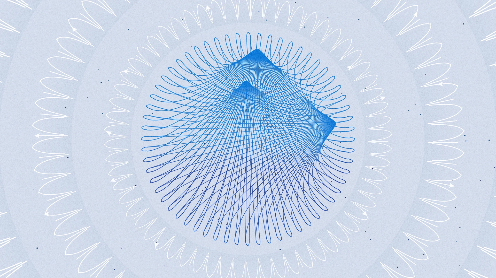
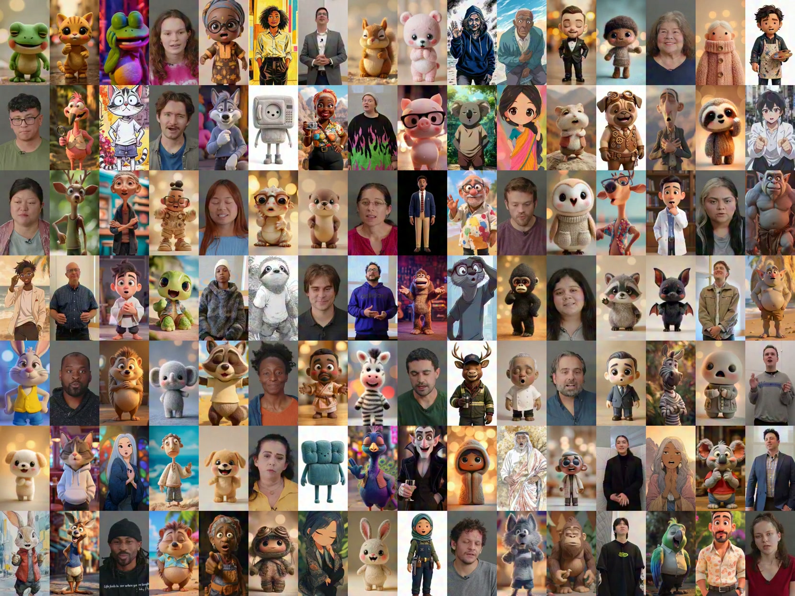
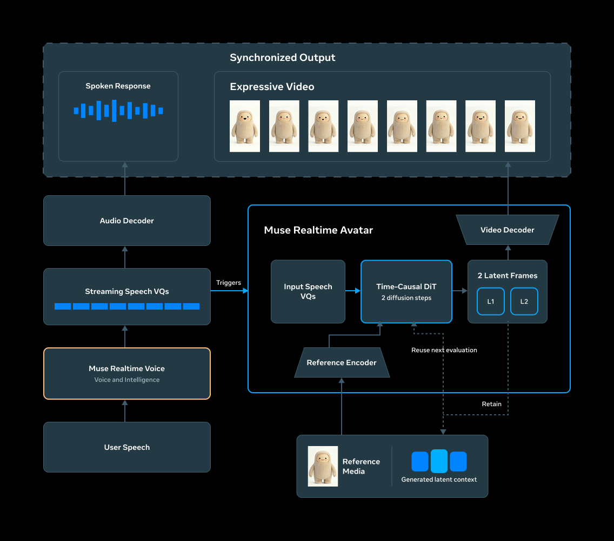
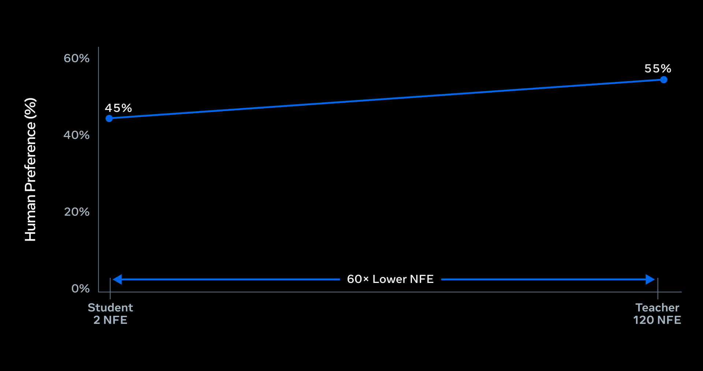
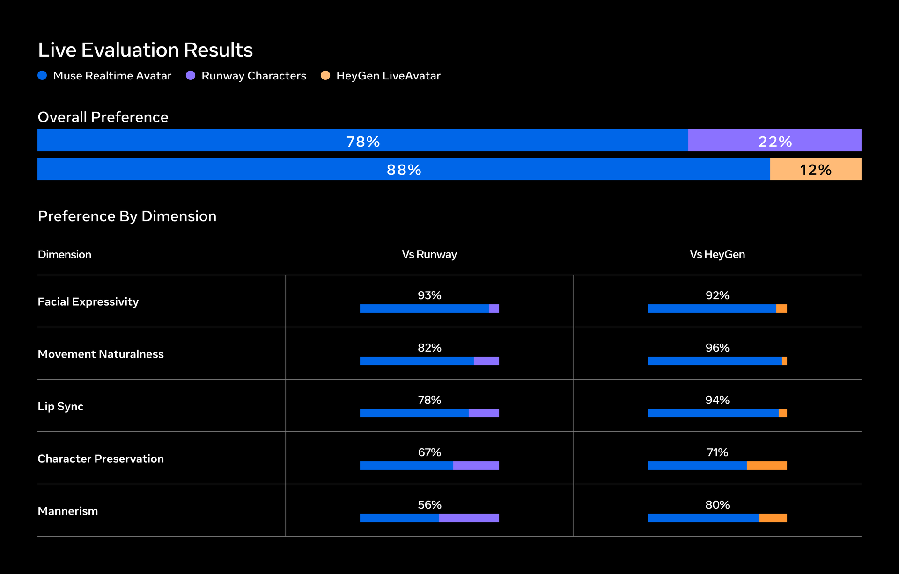



2026 年 9 月 23 日 · 10 分钟阅读

[视频：动画角色讲解 Muse Realtime Avatar 如何结合 Muse Spark 与 Muse Presence，呈现富有表现力、反应灵敏的个性](https://research.meta.ai/blog/bringing-your-muse-to-life)

今天，我们推出 Muse Realtime Avatar，这是我们最先进的具身技术，它把 Muse Realtime Voice 变成富有表现力、可互动的头像。

Muse Realtime Avatar 以参考媒体为条件，把任何角色带入实时对话。一张写实肖像通过细微的表情作出回应，而一幅全身插画在说话时会做手势、变换姿势。动物和日常物品变得富有表现力，同时不失其独特之处。逐帧来看，头像的外观和举止从一轮对话到下一轮都保持连贯。

不只是会说话的头像，Muse Realtime Avatar 能实时让任何图像活起来，带有富有表现力的面部、手部和全身动作。

## 从智能到实时的存在感

Muse Realtime Voice 和 Muse Realtime Avatar 构成一个连接智能、声音和具身的单一流式系统。Muse Realtime Voice 提供对话智能，并产生一个语音令牌（VQ）流，其中既包含说了什么，也包含是怎么说的。一个音频解码器把这些令牌变成语音，而 Muse Realtime Avatar 消费同一个流来生成相应的视觉表演。共享这个令牌流，使声音、唇形和表情保持同步。

Muse Realtime Avatar 是一个音频驱动的扩散 Transformer（Diffusion Transformer），以语音令牌流、参考媒体以及最近视频潜变量（latents）的滚动窗口为条件。它以短的因果分块（causal chunks）生成视频。每个分块完成时，其最新生成的潜变量就成为下一个分块的运动上下文，把头像的外观和举止延续下去，同时让计算量保持有界，使生成可以随对话一直持续下去。

Muse Realtime Avatar 把流式语音 VQ 转换为同步视频，并把已生成的上下文向前传递，以在整个对话中保持连续性。

## 实时无限视频生成

直播流必须同时解决两个问题：生成视频的速度要足以支持实时互动，并且在整个对话中保持视觉一致，不累积误差。

我们从一个高质量的双向教师模型出发，通过自强制（self-forcing）和分布匹配蒸馏（distribution matching distillation），得到一个带固定长度 KV cache 的因果学生模型。自强制让学生模型在它自己生成的上下文上训练，并教会它在小误差随时间累积时抵抗漂移，与它在推理时遇到的条件相匹配。

教师模型使用 40 个扩散步，配合三路无分类器引导（classifier-free guidance，CFG），每一步需要三次模型前向，每个分块共需 120 次模型评估。我们精心调校的方案把扩散过程和 CFG 的效果联合蒸馏到一个无引导的两步学生模型中。这些技术结合起来，让学生模型用两次无引导评估就能重现教师模型经过 120 次有引导评估逐步细化的结果，减少了 60 倍，同时紧密保持了教师模型的质量。

蒸馏把每个分块的推理从 120 次神经函数评估减少到 2 次，减少了 60 倍，同时在总体偏好上得到接近平分的结果。

## 最先进的头像体验

为了解 Muse Realtime Avatar 在实时对话中的表现，我们将它与两款领先的商用头像系统 [Runway Characters](https://runway.com/product/characters) 和 [HeyGen LiveAvatar](https://www.liveavatar.com/) 进行了比较，使用的是每个产品原生的实时通话体验。评估者使用相匹配的头像身份，与每个系统进行两到三分钟的对话，然后在视觉质量、同步性、角色一致性和举止等方面比较这些体验。下图报告的是总体偏好，评估者更常偏好 Muse Realtime Avatar。

评估者在总体上以及在每一个被评估的维度上都更偏好 Muse Realtime Avatar。与 Runway Characters 在举止方面的比较，在统计上与持平无法区分。

## 以 Meta 的规模提供亚秒级延迟的服务

Muse Realtime Avatar 随着实时对话的展开持续生成头像的视频。要以 Meta 的规模提供这种体验，既需要交互级的延迟，也需要高并发。为此，我们从头重新设计了 Meta 的实时 AI 推理栈，并结合了一个专为高度优化的实时视频推理和服务而构建的内部定制引擎。

带有内存感知位置编码的持久 KV cache，让我们在解码时可以在分块之间智能地复用上下文。缓存感知路由和延迟感知的动态批处理，高效地分配并发会话。四位量化感知训练在降低推理成本的同时保持质量，而融合内核和 NVIDIA CUDA Graph 捕获减少了内存流量和调度开销。我们与 NVIDIA 合作进行了多项模型优化，以最大限度降低模型前向传播的成本。整个系统，包括底层基础设施，都经过端到端优化，以确保流畅的用户体验。

Muse Realtime Avatar 以每秒 25 帧的速度流式输出 448x768 的竖屏视频，从用户的发言结束到收到同步的语音加视频响应的第一个字节，测得的延迟约为 870 毫秒。在 GB200 上的单个会话中，每个生成步骤产生八帧，对应 320 毫秒的播放时长，耗时 20 毫秒，即每帧有效模型时间为 2.5 毫秒。

上述优化加上在语音和视频之间的智能编排，使服务容量相对于两步 BF16 基线提高了 8 倍，使单个 GB200 能够支持 12 个并发的实时视频生成会话。

[视频组：与 Muse Realtime Avatar 的对话示例（共 9 段）](https://research.meta.ai/blog/bringing-your-muse-to-life)

浏览与 Muse Realtime Avatar 的对话，以交互级的亚秒延迟呈现。

## 负责任地构建具身 AI

我们在整个体验中执行严格的安全要求，以降低滥用风险并保护人们。为了让生成的媒体可追溯，Muse Realtime Avatar 使用 [Meta Video Seal](https://aidemos.meta.com/videoseal/) 在生成的视频中全程嵌入持久、不可见的水印，且不会给实时体验增加延迟。随着具身 AI 的发展，我们将继续加强这些保护措施。本文中的所有示例都是为了说明模型能力，并不全都反映 Muse 应用中可用的头像。Muse 面向 18 岁及以上的用户。
