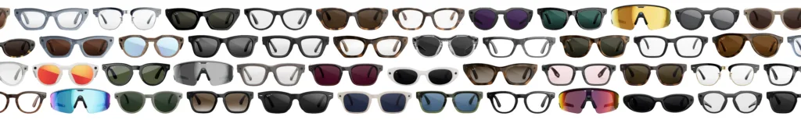
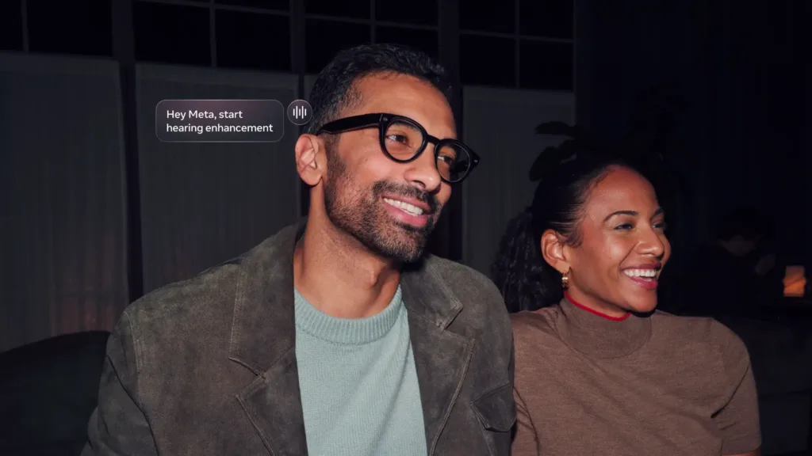
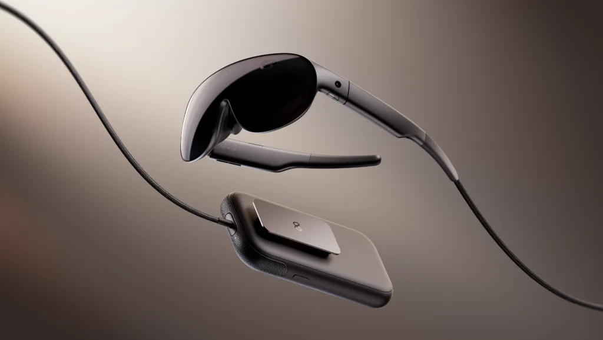
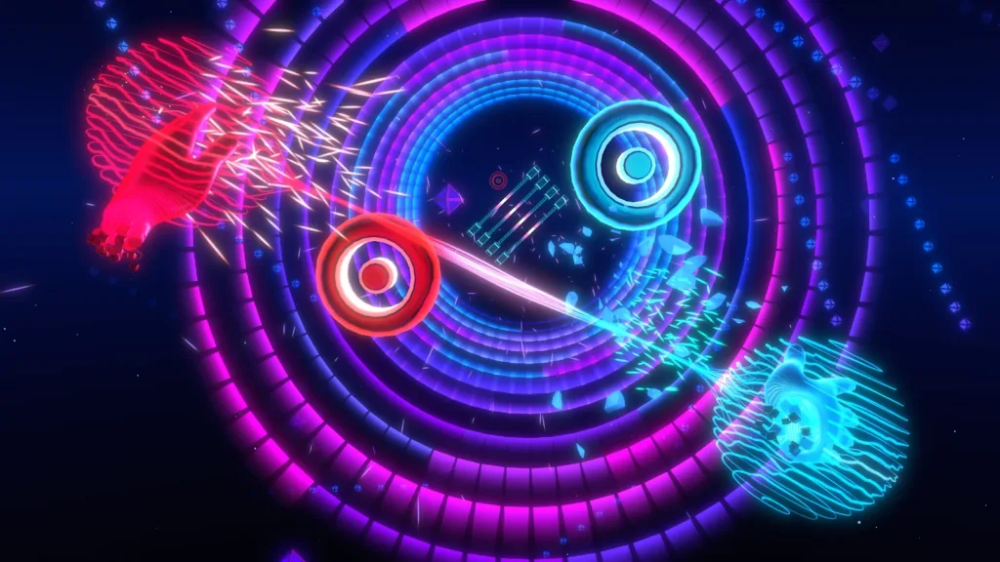



未来应该属于每个人。这意味着为每个人服务的个人 AI 智能体，以及让你在任何地方都能与它们联系的设备。

在 Connect 2026 上，我们展示了 Muse 如何通过新功能、新连接器以及一个让你的 Muse 栩栩如生的最先进模型而不断变得更好。它也不再局限于你的手机和桌面：我们正在把 Muse 带到我们的眼镜上，让你在一天中都能与你的智能体联系。

我们还推出了新的 AI 眼镜产品线，在 Ray-Ban、Oakley 和 Meta Glasses 中提供最广泛的款式。其中包括我们的首款音频眼镜，每一副都内置强大的 AI 和开放式音频。到今年年底，AI 眼镜将有超过 100 种款式。

最后，我们首次推出了 Meta VR Glasses，这是一款像眼镜一样可以佩戴的突破性设备，提供 IMAX 级的影院体验和完整的空间计算。

有了个人 AI 智能体和业界领先的硬件，这就是下一代计算的样子。

以下是关于 Connect 2026 最重大发布你需要知道的一切。

### 让你的 Muse 随你去往任何地方

就在几周前，我们推出了 [Muse](https://introducing.muse.ai)，反响非常热烈。在 Connect 上，我们展示了接下来的发展：一个你可以实时交谈、并能在一天中更多地方联系到的 Muse。

- **出色的语音模式：** 与一个像 Muse 这样有能力的智能体交谈，不同于与助手进行语音聊天。你可以进行长时间、深入的对话，而在你还在说话的时候，Muse 就在后台把工作做完。你还可以只通过描述你想要的效果来设计你的 Muse 的声音：更快、更慢，甚至是某种特定的口音。
- **看到你的 Muse 栩栩如生：** Meta 超级智能实验室（Meta Superintelligence Labs）推出 [Muse Realtime Avatar](https://research.meta.ai/blog/bringing-your-muse-to-life)，这是一项最先进的具身技术，把 Muse Realtime Voice 变成富有表现力、可互动的头像。
- **AI 眼镜上的 Muse：** 在未来几个月内，我们将把 Muse 带到我们的 AI 眼镜上，提供免手持访问，通过说出你的智能体的名字来激活。Muse 还可以针对你正在看的东西采取行动，这样你就不必描述眼前有什么：询问货架上的一件商品、墙上的一张传单，或者一长串学习用品清单，Muse 都可以采取行动。
- **Muse 拥有自己的电子邮件地址：** Muse 将拥有自己的电子邮件地址，它可以用这个地址把事情办成，或者这仅仅作为你与它沟通的另一种方式。
- **Muse for Mac 更新：** Muse for Mac 现已支持计算机操作（computer use）。在你的许可下，Muse 现在可以操作你 Mac 上的任何应用。你可以离开你的电脑，它会继续为你处理你排好的所有任务。
- **Muse 的更多连接器：** 连接器是 Muse 能为人们做这么多事情的一个重要原因。我们在发布时接入了几十家合作伙伴，并可访问整个 Shopify 商品目录。为了让 Muse 成为更好的购物者，我们正在加入 Walmart、Best Buy、American Eagle Outfitters、DICK'S Sporting Goods、Fanatics、Gap、Michael Kors、Sephora、Ulta 和 Wayfair，以及用于付款的 Shop Pay 和 PayPal。Expedia 即将推出，帮助你规划旅行；当你给厨房备货时，有 Instacart。在完成工作方面，有 Notion、Granola、GitHub 和 Box。而这只是开始，更多合作伙伴正在路上。

这一切都是在你今天联系 Muse 的现有方式之上的：Muse 应用、WhatsApp、网页，以及我们最近推出的 Mac 桌面版，它可以管理消息、查找旧文件并帮助你把工作做完。

### Muse Charm

Muse Charm 是一款令人愉悦的趣味设备，专为你与你的 Muse 交谈和互动而打造。它把 Muse 的能力与最先进的实时语音模型一起放进一个可以放进口袋的设备中。今年晚些时候我们将分享更多信息。

### 我们的首个音频眼镜系列，以及我们迄今最丰富的 AI 眼镜产品线，提供 100 多种选择

我们推出了我们的首款音频眼镜，每一副都内置强大的 AI 和开放式音频。Ray-Ban Meta Audio 眼镜专为那些想要真正全天佩戴的人设计，以经典的 Ray-Ban 风格提供耳机和 AI 的能力。它们是我们迄今最纤薄、最轻的镜框，有两种新款式（Clubmaster 和 Burbank），提供 12 小时续航，并兼容范围广泛的光学处方。

此外，我们正在通过新功能和新款式扩展我们的 AI 眼镜产品组合。到今年年底，我们将推出迄今最丰富的 AI 眼镜款式阵容。有超过 100 种不同的选择，每一种风格和用途都会有合适的一副。

- **Ray-Ban Meta（第三代）**：全球最畅销 AI 眼镜的下一代产品将采用更纤薄、更舒适的设计，配备一个可以更快使用 Meta AI 和其他功能的操作按钮，并拥有所有 Ray-Ban Meta 型号中最长的续航。还将有两款新镜框加入产品线：Aviator，世界上辨识度最高的镜框轮廓之一；以及 Zena，一款大胆、现代的猫眼设计。
- **新的 Meta Glasses 款式**：我们的系列包括 Kylie Jenner 联名款 Meta Glasses 的新象牙色款，以及我们与国际偶像 LISA 的首次合作。我们还推出了更多镜框形状（Meta Capri 和 Meta Nova），以舒适地适配更多脸型；一款低价的 Meta Adventurer；以及一款限量版 Meta Fury，发布时只在 Meta Lab 门店销售。
- **个性化：** Meta Glasses 现在通过美国的 Mix & Match 计划变得更加个性化，让你可以自定义镜框、镜片和眼镜盒的颜色。
- **新市场**：我们还把 Meta Glasses 带到新的市场：从今天起在新加坡、韩国和墨西哥推出，并即将登陆巴西和阿联酋。
- **Ray-Ban Meta（第二代）光学款** 今年秋天，升级你的日常眼镜，享受出众的风格、更纤薄的贴合度和全天的舒适，三款颜色更新：两款限时季节色，Blayzer Optics 亮面砖棕色和亮面透明海洋蓝；此外，我们还将核心色透明深橄榄色限时带到 Scriber Optics 款式上。
- **Meta Ray-Ban Display 现已在更多地方销售**：你第一次可以在线订购 Meta Ray-Ban Display。它从今天起在加拿大和英国开售，并从今天起在法国、意大利和德国开放预订，于 10 月 13 日上市。

[阅读更多](https://www.meta.com/blog/ray-ban-meta-audio-and-deepest-ai-glasses-lineup)

### Meta AI 眼镜的新功能

我们还发布了一系列软件功能，旨在帮助你专注于当下，而不是低头看屏幕。这些更新将在未来几个月内陆续推出：

- **内置听力辅助：** 听力增强是一项获得 FDA 许可的软件功能，帮助 18 岁及以上、自觉有轻度至中度听力损失的成年人听得更清楚，即将登陆受支持的 AI 眼镜。听力增强可以在家中几分钟内完成设置，无需去诊所，也无需处方。听力增强将于今年晚些时候在美国推出，可以以 $149.99 的价格（可使用 HSA/FSA\*）添加到受支持的 AI 眼镜上，或通过 Meta One 订阅获得。我们还为每一位 AI 眼镜佩戴者提供了更多音频控制：用新的音频平衡功能把声音偏向左耳或右耳，或者用单声道音频把所有声音导向一侧。
- **为你的一天提供动力：** 我们还加入了免手持的跑步和骑行指导锻炼、带个性化分析的营养追踪，以及能识别商品、价格和评价的购物 AI，让你可以设置提醒或用语音购买。
- **记录当下：** Meta AI 眼镜是首款让用户能够以杜比全景声拍摄和体验视频的消费级设备。以真正的 360° 空间声音记录精彩时刻。只需录制，眼镜会处理好一切，无缝地以杜比全景声采集，让回放时的沉浸感如同身临其境。
- **听起来更像人的导航**：根据地标而不是街道名称获取步行路线，比如「在超市左转」而不是「在百老汇左转」。[阅读关于此功能的更多信息](https://www.meta.com/blog/meta-ray-ban-display-more-useful-more-people)。
- **更多定制体验的方式：** 个性化音频、自定义手势和更智能的视觉 AI，让你对如何使用眼镜有更多控制。把触控板的长按快捷操作设置为启动你常用的工具。
- **骑行和公共交通路线**：本月晚些时候将在美国和加拿大的 Meta Ray-Ban Display 上推出，你将可以用语音查询骑行和公共交通路线。

[阅读更多](https://www.meta.com/blog/muse-personal-agent-ai-glasses/)

### Meta VR Glasses：我们迄今最先进的 VR 设备

Meta VR Glasses 把影院、工作空间和游戏机装进一个舒适的外形中，将于 2027 年春季上市，售价 $1,299.99 美元。

Meta VR Glasses 重约 100 克，比 Meta Quest 3 轻五倍。它采用基于 micro-OLED 面板的 5K 无限显示屏（5K Infinite Display），并采用两件式设计，把电池和处理器移到一个可以夹在腰带、口袋或包上的小盒中，让重量不压在脸上。

Meta VR Glasses 支持多面板虚拟显示，并内置表面输入，让你可以把任何桌子或书桌变成键盘和触控板，无论身在何处都能展开一块甚至几块巨大的屏幕，还可以选择连接你的其他设备并扩展它们的屏幕。输入方式流畅直观：用眼睛和手势导航，而不是使用控制器。你还可以让 Meta AI 执行各种任务，比如重新排列你的工作空间，或者在 Disney+、YouTube、HBO Max、Prime Video 等应用上播放电影。

我们还首次推出了全息影像（hologram），这是一种照片级真实、实时的你的数字形象，让与你通话的人能看到你的面孔和表情。只需要用手机快速自拍采集一次。全息影像将在明年春季 Meta VR Glasses 上市时提供，并将在未来几个月内开始在美国通过 WhatsApp 以抢先体验（Early Access）的形式向 Meta Ray-Ban Display 用户推出。

[阅读更多](https://www.meta.com/blog/meta-vr-glasses-announcement-meta-connect/)

### 《Beat Saber》进入新时代

明年春天，《Beat Saber》将迎来有史以来最大的一次更新，登陆 Meta VR Glasses 和 Meta Quest，并带来近十年来首次视觉焕新和新标志。主打内容是 Flux，一种围绕高保真手部追踪打造的全新玩法：你的双手变成你的武器，你在两掌之间引导能量来劈砍音符，并积累 Jolt Energy 获得额外分数。

[阅读更多](https://www.meta.com/blog/beat-saber-flux-campaign-update-rewards-hand-tracking/)

### 一大波适用于 Meta VR Glasses 和 Quest 的新游戏

我们的新阵容包括从零开始为手部追踪打造的游戏，你可以在 Meta VR Glasses 上不用控制器玩，也可以在 Meta Quest 上用控制器玩。新作包括 *Cardmada、Dice Throne Digital、Dragon Grove、Phoenix Wright: Ace Attorney – Dual Destinies、Supernatural、Tetris Effect: Mixed Realities* 和 *Two Point Hospital*。

[阅读更多](https://www.meta.com/blog/connect-2026-game-announcements-meta-vr-glasses-quest/)

### 为每个人打造个人超级智能

这是我们有史以来最重要的 Connect 活动之一，展示了我们对个人 AI 超级智能的愿景如何与我们在眼镜和 VR 领域业界领先的硬件相连。随着 Muse 即将登陆我们不断扩大的 AI 眼镜系列，以及我们首款音频眼镜的推出，我们很高兴能为每个人打造未来。

\*听力增强符合 HSA/FSA 报销条件。请查看你的计划以确认资格。
