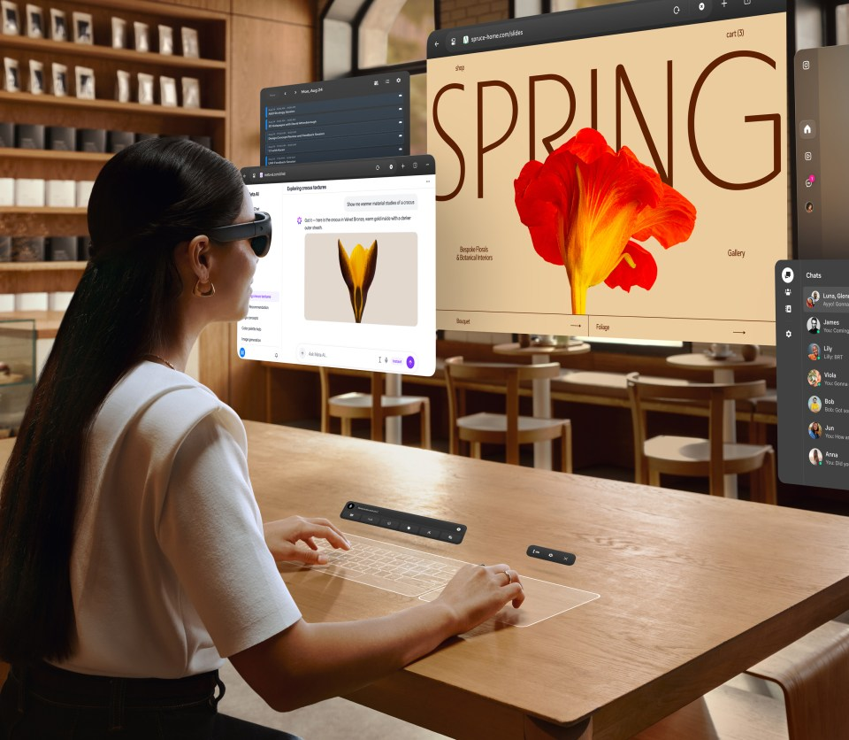



**收录说明**：这是 Meta 官方新闻稿，全文翻译。原文中的视频以链接保留。早期收集时直接翻译，原文未单独存档。

**内容摘要**：Meta 在 Connect 2026 上宣布将在未来几个月把 Muse 带到 AI 眼镜上，用户可以说出智能体的名字，让它针对正在看的东西采取行动，并提供语音模式。Muse 将增加 Walmart、Best Buy 等购物类连接器，并拥有自己的电子邮件地址。Meta 还介绍了口袋设备 Muse Charm，称今年晚些时候公布更多信息。同时发布的有约 100 克重的 Meta VR Glasses、Ray-Ban Meta Audio 眼镜和 Ray-Ban Meta 第三代，到年底 Ray-Ban、Oakley 和 Meta Glasses 的 AI 眼镜款式将超过 100 款。

**保留理由**：这篇汇总了 Connect 当天与 Muse 有关的所有硬件和功能预告，包括 Muse Charm 和 Muse 专属邮箱，可以作为这些说法的最早出处。

---

## 要点

- 昨天在 Connect 2026 上，我们宣布将把 Muse 带到我们的 AI 眼镜上，让你在一天中都可以免手持地与你的智能体联系，同时还推出了让你的 Muse 变得更好的新功能和连接器。
- 我们推出了 Meta VR Glasses：在一副可以舒适佩戴数小时的突破性眼镜中，呈现 VR 沉浸感的全部魔力。
- 我们还发布了新的 AI 眼镜产品线，包括音频眼镜。到今年年底，我们将在 Ray-Ban、Oakley 和 Meta Glasses 中拥有超过 100 款 AI 眼镜款式。

我们正在为每个人打造个人 AI 智能体，以及一整个设备家族，让你可以随时随地与它们联系。

## 把 Muse 带到 AI 眼镜上

本月早些时候，我们推出了 [Muse](https://about.fb.com/news/2026/09/introducing-muse-personal-ai-agent/)，这是一个首创的个人 AI 智能体，它会主动帮助你实现目标。在 Connect 上，我们宣布将在未来几个月内把 Muse 带到我们的 AI 眼镜上，让你很快就能在任何地方方便地使用你的个人智能体。Mark Zuckerberg 展示了 Muse 如何通过新功能、新连接器以及一个让你的 Muse 栩栩如生的最先进模型而不断变得更好。

- **AI 眼镜上的 Muse**：你很快就可以说出你的智能体的名字，Muse 可以针对你正在看的东西采取行动，这样你就不必描述眼前有什么。询问货架上的一件商品、墙上的一张传单，或者一长串学习用品清单，Muse 都可以采取行动。
- **语音模式**：与一个像 Muse 这样有能力的智能体交谈，不同于与助手进行语音聊天。你可以进行长时间、深入的对话，而在你还在说话的时候，Muse 就在后台把工作做完。

[视频：把 Muse 带到 AI 眼镜上](https://about.fb.com/wp-content/uploads/2026/09/02_Bringing-Muse-to-AI-Glasses.mp4)

- **Muse 的更多连接器**：连接器是 Muse 能为人们做这么多事情的一个重要原因。我们在发布时接入了几十家合作伙伴，并可访问整个 Shopify 商品目录。为了让 Muse 成为更好的购物者，我们正在加入 Walmart、Best Buy、American Eagle Outfitters、DICK’S Sporting Goods、Fanatics、Gap、Michael Kors、Sephora、Ulta 和 Wayfair，以及用于付款的 Shop Pay 和 PayPal。Expedia 即将推出，帮助你规划旅行；当你给厨房备货时，有 Instacart。在完成工作方面，有 Notion、Granola、GitHub 和 Box。而这只是开始，更多合作伙伴正在路上。
- **Muse 拥有自己的电子邮件地址**：Muse 将拥有自己的电子邮件地址，它可以用这个地址把事情办成，或者这仅仅作为你与它沟通的另一种方式。

## Muse Charm

Muse Charm 是一款令人愉悦的趣味设备，专为你与你的 Muse 交谈和互动而打造。它把 Muse 的能力与最先进的实时语音模型一起放进一个可以放进口袋的设备中。今年晚些时候我们将分享更多信息。

## 改变 VR 体验的眼镜

[Meta VR Glasses](https://about.fb.com/news/2026/09/introducing-meta-vr-glasses-3d-movies-immersive-live-sports-100-grams/) 是我们迄今最先进的设备，它在一副重约 100 克、大致相当于一副扑克牌重量的眼镜中，提供个人影院、场边座位、工作空间和游戏机。这款眼镜是外形上的一次突破，让你在获得沉浸式体验的同时，也能察觉周围正在发生的事情，而且脸上不需要绑带或笨重的硬件。

[视频：改变 VR 体验的眼镜](https://about.fb.com/wp-content/uploads/2026/09/04_Glasses-That-Transform-the-VR-Experience.mp4)

它是首款获得 IMAX Enhanced 认证的 VR 设备，也将是在家中以 IMAX 独家扩展画幅观看部分影片的少数方式之一。我们正在与 Prime Video、YouTube、DIRECTV、AMC+、Crunchyroll、Plex、ESPN、Tubi 等合作，提供所有 VR 设备中最好的媒体内容阵容。你还可以观看来自 Disney+、Peacock、HBO Max 和 Paramount+ 的 3D 内容。

我们与 ESPN、MLB、NBC Sports、TNT Sports、UFC 等合作，每年为你提供前排座位，以及超过 100 场沉浸式体育直播赛事。

[视频：沉浸式体育](https://about.fb.com/wp-content/uploads/2026/09/05_Immersive-Sports.mp4)

我们的 VR Glasses 还能让你无论身在何处都有一块屏幕，为你提供一个个性化、私密的工作场所。你可以把任何平面变成键盘和触控板，这样不用随身携带额外的硬件就能完成工作。

## 音频眼镜、Meta AI 眼镜的新功能，以及大量新款式

我们推出了 [Ray-Ban Meta Audio 眼镜](https://about.fb.com/news/2026/09/introducing-ray-ban-meta-audio-glasses-new-styles-plus-muse/)，它把耳机和 AI 的能力装进了我们迄今最轻、最薄的 AI 眼镜中。你可以免手持地听音乐和播客、接打电话、与你的 AI 助手交谈，在旅途中获得高品质的声音，同时又不会把你与周围的世界隔绝开来。

我们还发布了 Ray-Ban Meta（第三代），这是我们最畅销的 AI 眼镜的下一代产品，现在设计更纤薄、佩戴更舒适，续航更长，并新增了一个可自定义的操作按钮，可以一键使用 Meta AI。

我们扩展后的眼镜系列包括 Kylie Jenner 联名款 Meta Glasses 的新象牙色款，以及我们与国际偶像 LISA 的首次合作；我们迄今最实惠的一款 Meta Glasses；以及各款式的大量新配色，让你可以找到最适合自己的眼镜。

我们还加入了听力增强功能，这是一款获得 FDA 许可的软件，帮助自觉有轻度至中度听力损失的成年人听得更清楚，即将登陆受支持的 AI 眼镜。听力增强可以在家中几分钟内完成设置，无需去诊所，也无需处方。听力增强将于今年晚些时候在美国推出，可以以 $149.99 的价格（可使用 HSA/FSA\*）添加到受支持的 AI 眼镜上，或通过 Meta One 订阅获得。我们还为每一位 AI 眼镜佩戴者提供了更多音频控制：用新的音频平衡功能把声音偏向左耳或右耳，或者用单声道音频把所有声音导向一侧。

[视频：听力增强](https://about.fb.com/wp-content/uploads/2026/09/08_Hearing-enhancement.mp4)

## Meta Ray-Ban Display 的更新

我们还宣布了 [Meta Ray-Ban Display](https://about.fb.com/news/2026/09/new-features-for-meta-ray-ban-display-navigation-hologram/) 的更新，让这款眼镜在日常生活中更加有用。我们加入了新的免手持导航功能、帮助你在视频通话中保持联系的个性化全息影像、带空间环绕声的杜比全景声采集等功能。我们还通过在线订购，以及扩展到英国、加拿大、法国、意大利和德国，让更多人能够买到它。

## AI 的未来

到今年年底，我们将提供超过 100 种不同的 AI 眼镜选择。而通过接入 Muse，我们正在把个人超级智能构建进你可以随身携带、去到任何地方的设备中，我们认为这是值得期待的事情。

我们将继续打造、创新，并寻找新的方式，让 AI 对每个人都更容易获得、更有帮助。
