

## 要点

- 今天，我们宣布推出 [Muse for Small Business](http://muse.ai/business)。Muse 是我们为个人超级智能时代打造的最重要的产品之一。现在，我们正在扩展它能做的事情。
- 给 Muse 一个目标，比如经营你的生意或寻找新客户，它就会把事情办成。
- 你现在只需点击几下，就能连接更多你已经在使用的工具，包括 Asana、Box、Canva、Dropbox、Figma、Granola、HighLevel、Intuit QuickBooks、Klaviyo、Lovable、Notion、Shopify、Slack、Stripe、Zoom，以及你的 Facebook 和 Instagram 商业账户，而且 Muse 一开始就已经了解你的生意。
- 一切由你掌控：未经你的批准，任何内容都不会被发布、发送或花费。如需深入了解 Muse 是如何设计的，以及安全、防护和隐私是如何构建进去的，请阅读[我们如何将安全构建进 Muse](http://security.muse.ai/)和[我们如何设计 Muse](http://introducing.muse.ai/)。

本月早些时候，我们推出了 [Muse](https://about.fb.com/news/2026/09/introducing-muse-personal-ai-agent/)，这是一个在美国和加拿大可用、代表你完成任务的个人 AI 智能体。今天，我们在 Muse 中加入一系列新的技能（skills）和连接器（connectors），对它进行扩展，帮助人们经营自己的生意。

近二十年来，小企业一直在我们的应用上成长。他们告诉我们，他们缺的是时间，不是想法。所以我们打造了 Muse for Small Business，借助他们已经在用的工具帮助他们把工作做完。

爱荷华州莫尔文市 Mulholland Grocery 的店主 Tom Mulholland 说：*「我每周工作大约 65 个小时，有太多事情只有我能做。我需要腾出时间去做那些真正能为我的生意赚钱的工作：切牛排、做香肠。我非常擅长我做的事，但这并不意味着我能胜任一个小企业主必须扮演的所有不同角色，而 Muse 正在接手其中的几个。」*

## 为配合人们经营生意时已在使用的工具而打造

Muse 只需点击几下，就能连接你的 Instagram 专业账户分析数据、Facebook 公共主页和 Meta 广告账户，而且它已经了解你的生意：你卖什么、你的品牌说话是什么风格、顾客总在问你什么。

Muse 还可以连接企业日常运营所依赖的几十种工具，因此它可以配合你的品牌、店面、账簿和客户记录开展工作。

**Canva 联合创始人兼首席产品官 Cameron Adams** 说：*「Muse 是朝着真正帮助我们工作、创作并让生活更轻松的智能体迈出的激动人心的一大步。它可以帮你开始整理想法，帮助它们成形，但真正的魔力发生在它与你现有的工作、你的上下文和你的品牌完全连接起来的时候。通过将 Muse 与 Canva 连接，所有这些都会成为你对话的一部分。无论你是在开展一项副业，还是在打磨一份演示文稿，你最喜欢的 Canva 模板和工具都会在你需要时出现；帮助你把一个初步的想法变成符合品牌、可编辑、随时可以分享的作品。」*

你可以在 Muse 应用的设置中查看可用连接器的完整列表，更多连接器即将推出。有兴趣的合作伙伴可以在 [muse.ai/platform](http://muse.ai/platform) 申请。

Muse 还支持自定义连接器，让你可以接入我们尚未支持的服务，你可以在[这里](https://www.meta.com/help/artificial-intelligence/1687253048996149/)了解如何操作。

## 小企业用 Muse 完成了什么

为了帮助你开始使用 Muse，我们分享五个我们最喜欢的 Muse 用例：

[视频：小企业用例 1](https://about.fb.com/wp-content/uploads/2026/09/01_SMB_carousel_01.mp4)

可以试试的提示词：“Analyze this year’s sales, campaigns, and social and make me a growth plan to meet my business goals for next year.”（译注：意为「分析今年的销售、营销活动和社交媒体表现，为我制定一份增长计划，以实现我明年的业务目标。」）

[视频：小企业用例 2](https://about.fb.com/wp-content/uploads/2026/09/01_SMB_carousel_02.mp4)

可以试试的提示词："I'm underwater. What do I need to pay attention to from my email, calendar, news, etc? Can you take any of it off my plate?”（译注：意为「我快被淹没了。我的邮件、日历、新闻等里面，有哪些是我需要关注的？你能帮我接手其中一些吗？」）

[视频：小企业用例 3](https://about.fb.com/wp-content/uploads/2026/09/01_SMB_carousel_03.mp4)

可以试试的提示词：“How do I improve my ads and content? Can you analyze what's working or not, and draft a campaign for next week? Make sure to look at what's trending.”（译注：意为「我该如何改进我的广告和内容？你能分析一下哪些有效、哪些无效，并为下周起草一个营销活动吗？一定要看看当下的流行趋势。」）

[视频：小企业用例 4](https://about.fb.com/wp-content/uploads/2026/09/01_SMB_carousel_04.mp4)

可以试试的提示词：“How was my business's financial performance this month? Find any expenses that look off.”（译注：意为「我的生意这个月的财务表现如何？找出任何看起来不对劲的开支。」）

[视频：小企业用例 5](https://about.fb.com/wp-content/uploads/2026/09/01_SMB_carousel_05.mp4)

因为 Muse 一直在为你工作，它也会主动带着想法和解决方案来找你，比如主动标记需要回复的邮件并为你写好初稿。你还可以前往「想法」（Ideas）标签页，找到更多让 Muse 为你工作的方式。

## 小企业和我们的合作伙伴的早期反馈

在今天之前，已经有人在试用 Muse 的新技能和连接器。以下是他们告诉我们的：

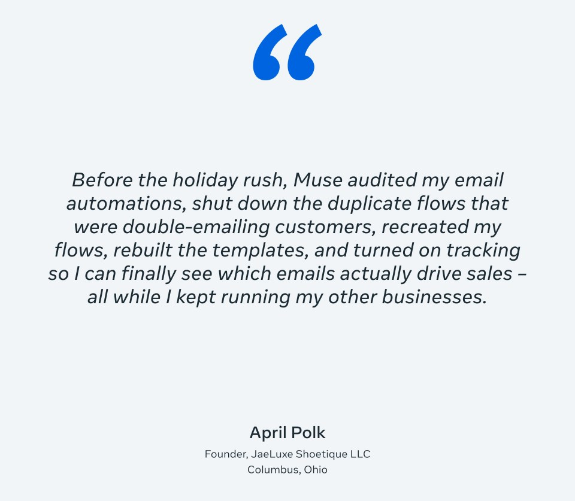

> 「在节日购物高峰到来之前，Muse 审查了我的邮件自动化流程，关掉了重复给顾客发邮件的重复流程，重建了我的流程，重做了模板，并开启了追踪，让我终于能看到哪些邮件真正带来了销售。而这一切发生时，我还在继续经营我的其他生意。」——April Polk，JaeLuxe Shoetique LLC 创始人，俄亥俄州哥伦布市

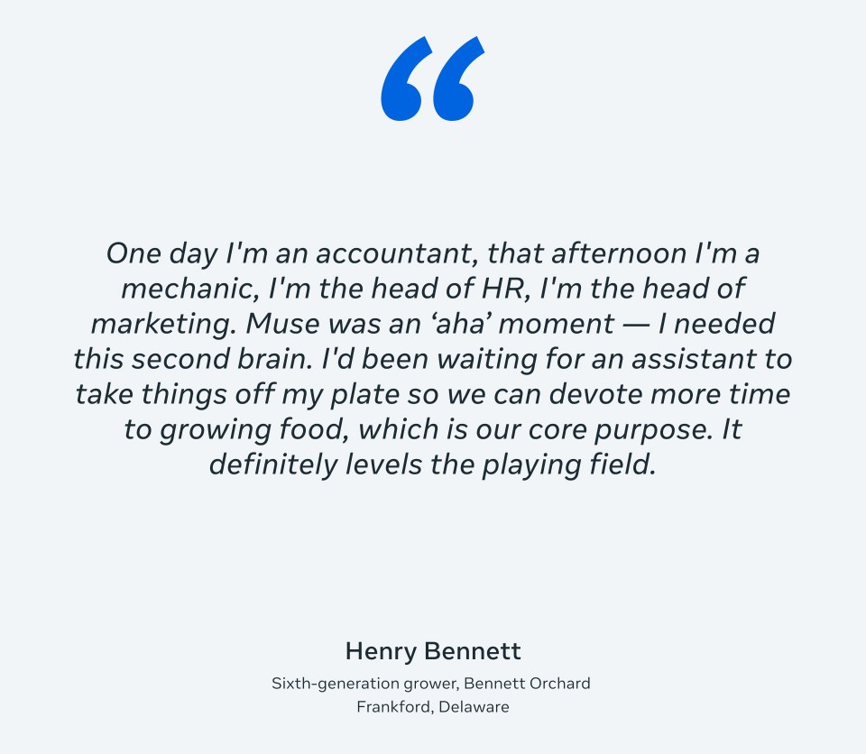

> 「一天里，我上午是会计，下午是机修工，我是人力资源主管，我是市场主管。Muse 是一个『顿悟』时刻：我需要这个第二大脑。我一直在等一个助手帮我接手一些事情，这样我们就能把更多时间投入到种植粮食上，这是我们的核心使命。它确实让大家站在了同一起跑线上。」——Henry Bennett，第六代种植者，Bennett Orchard，特拉华州弗兰克福德

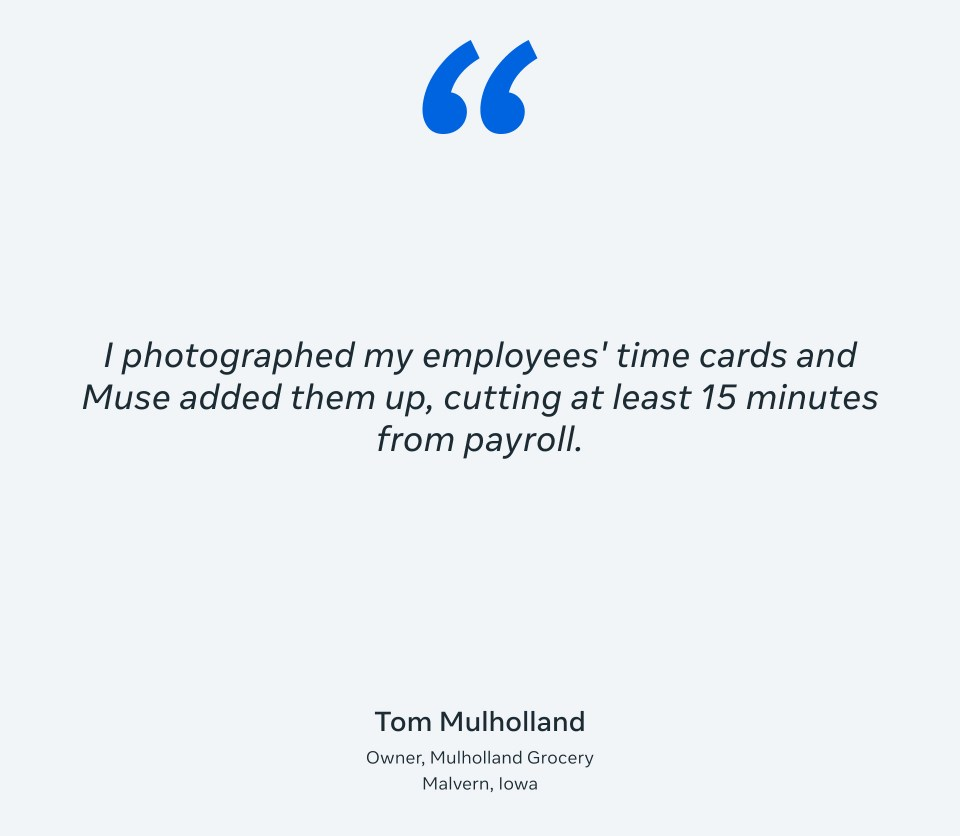

> 「我给员工的考勤卡拍了照，Muse 把它们加总起来，让发工资的工作至少省了 15 分钟。」——Tom Mulholland，Mulholland Grocery 店主，爱荷华州莫尔文市

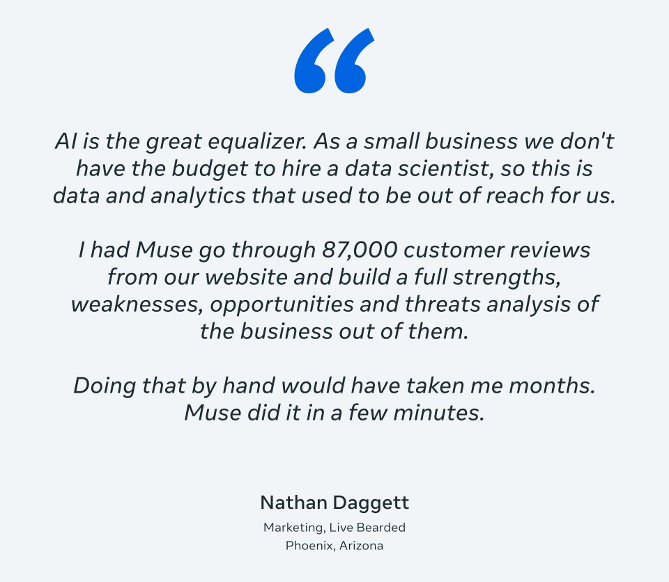

> 「AI 是伟大的均衡器。作为一家小企业，我们没有预算聘请数据科学家，所以这些是我们过去够不着的数据和分析。我让 Muse 阅读了我们网站上的 87,000 条顾客评价，并据此对生意做了一份完整的优势、劣势、机会和威胁分析。手工做这件事要花我几个月的时间。Muse 几分钟就做完了。」——Nathan Daggett，Live Bearded 市场营销，亚利桑那州凤凰城（译注：此图原页面无替代文本，文字依据图片转录）

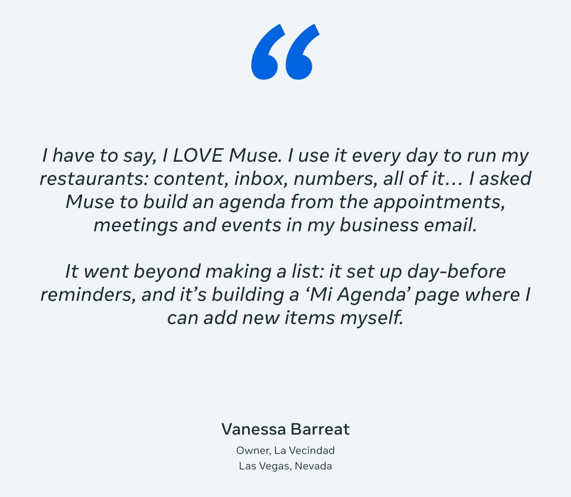

> 「我不得不说，我爱 Muse。我每天都用它来经营我的餐厅：内容、收件箱、数字，所有的一切……我让 Muse 根据我商务邮箱里的预约、会议和活动建立一份日程。它做的不只是列一个清单：它设置了提前一天的提醒，并且正在建一个『Mi Agenda』页面，让我可以自己添加新事项。」——Vanessa Barreat，La Vecindad 店主，内华达州拉斯维加斯

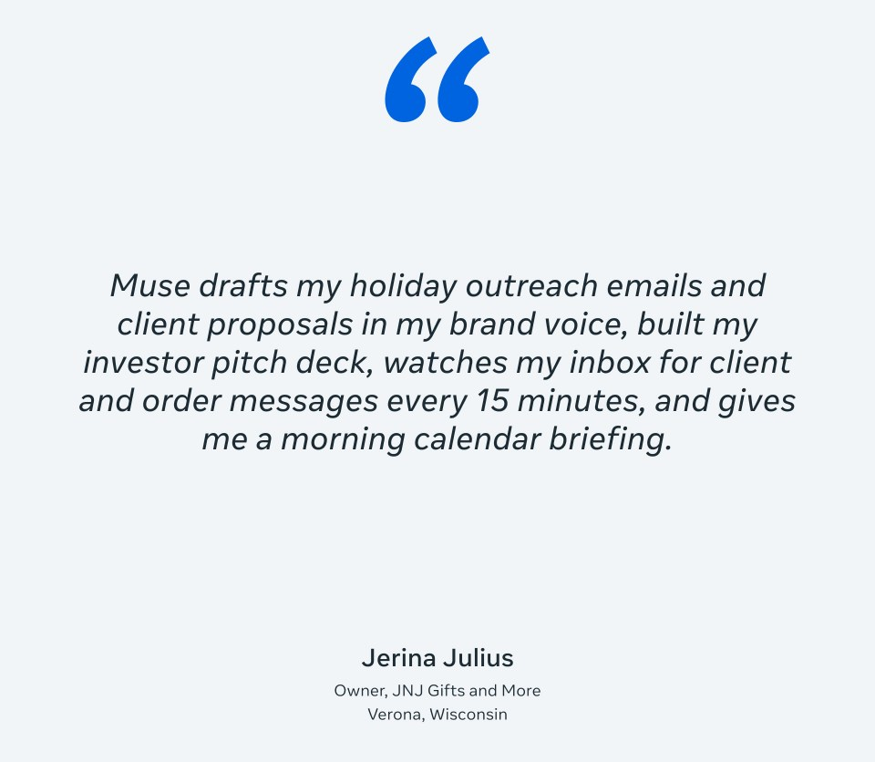

> 「Muse 用我的品牌语气起草我的节日推广邮件和客户提案，做好了我的投资人路演文稿，每 15 分钟检查一次我的收件箱里有没有客户和订单消息，还每天早上给我一份日历简报。」——Jerina Julius，JNJ Gifts and More 店主，威斯康星州维罗纳（译注：此图原页面无替代文本，文字依据图片转录）

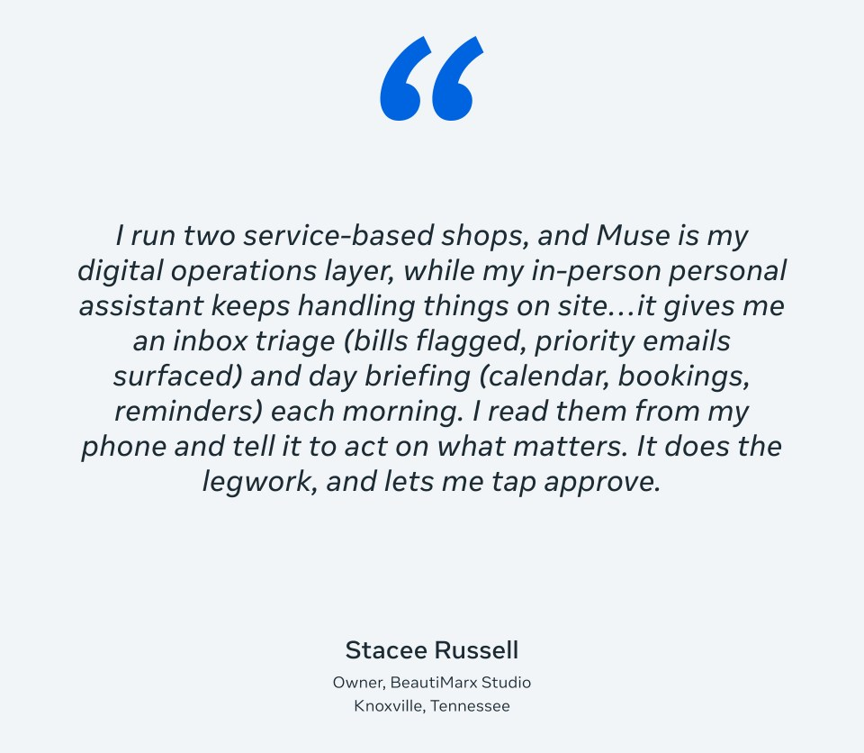

> 「我经营两家服务型店铺，Muse 是我的数字运营层，而我线下的私人助理继续处理现场的事情……它每天早上给我一份收件箱分拣（标出账单、提出优先邮件）和一份当日简报（日历、预订、提醒）。我在手机上阅读，然后告诉它对重要的事情采取行动。跑腿的活它来做，我只需点一下批准。」——Stacee Russell，BeautiMarx Studio 店主，田纳西州诺克斯维尔

以下是我们的合作伙伴的评价：

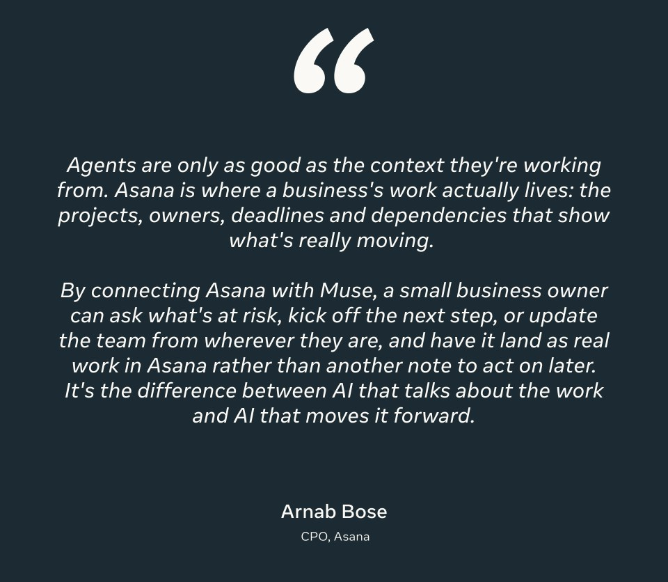

> 「智能体的好坏取决于它所依据的上下文。Asana 是一家企业的工作真正所在的地方：项目、负责人、截止日期和依赖关系，它们显示出真正在推进的是什么。通过将 Asana 与 Muse 连接，小企业主无论身在何处，都可以询问哪些事情存在风险、启动下一步或向团队通报进展，并让这些成为 Asana 中真实的工作，而不是又一条留待以后处理的笔记。这就是谈论工作的 AI 与推动工作的 AI 之间的区别。」——Arnab Bose，Asana 首席产品官

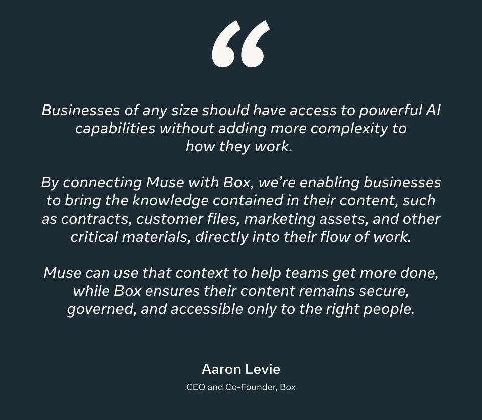

> 「任何规模的企业都应该能够获得强大的 AI 能力，而不必让工作方式变得更复杂。通过将 Muse 与 Box 连接，我们让企业能够把其内容中蕴含的知识，比如合同、客户档案、营销素材和其他关键材料，直接带入他们的工作流程。Muse 可以利用这些上下文帮助团队完成更多工作，而 Box 确保他们的内容保持安全、受治理，并且只有合适的人才能访问。」——Aaron Levie，Box 联合创始人兼首席执行官

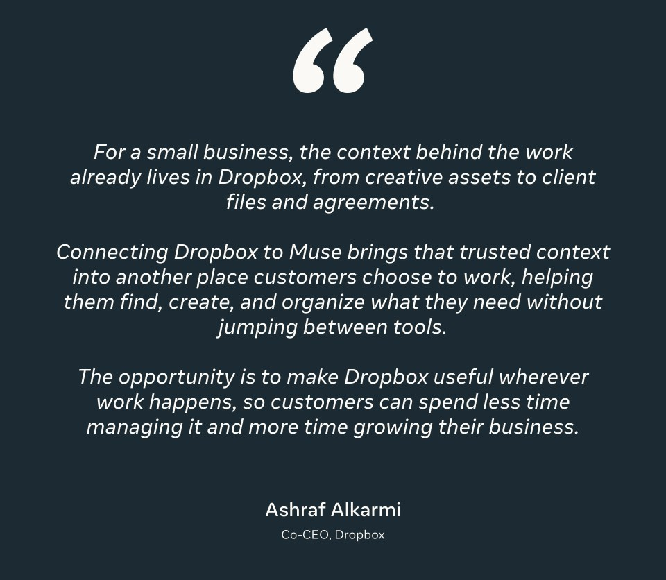

> 「对小企业来说，工作背后的上下文已经存放在 Dropbox 中，从创意素材到客户文件和协议。将 Dropbox 连接到 Muse，会把这些可信的上下文带到客户选择工作的另一个地方，帮助他们查找、创建和整理所需的内容，而不必在工具之间来回切换。机会在于让 Dropbox 在任何发生工作的地方都有用，让客户可以少花时间管理它，多花时间发展自己的生意。」——Ashraf Alkarmi，Dropbox 联席首席执行官

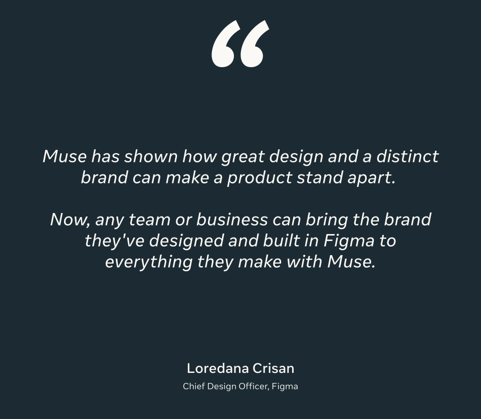

> 「Muse 展示了出色的设计和鲜明的品牌如何让一个产品脱颖而出。现在，任何团队或企业都可以把他们在 Figma 中设计和打造的品牌，带到他们用 Muse 制作的一切之中。」——Loredana Crisan，Figma 首席设计官

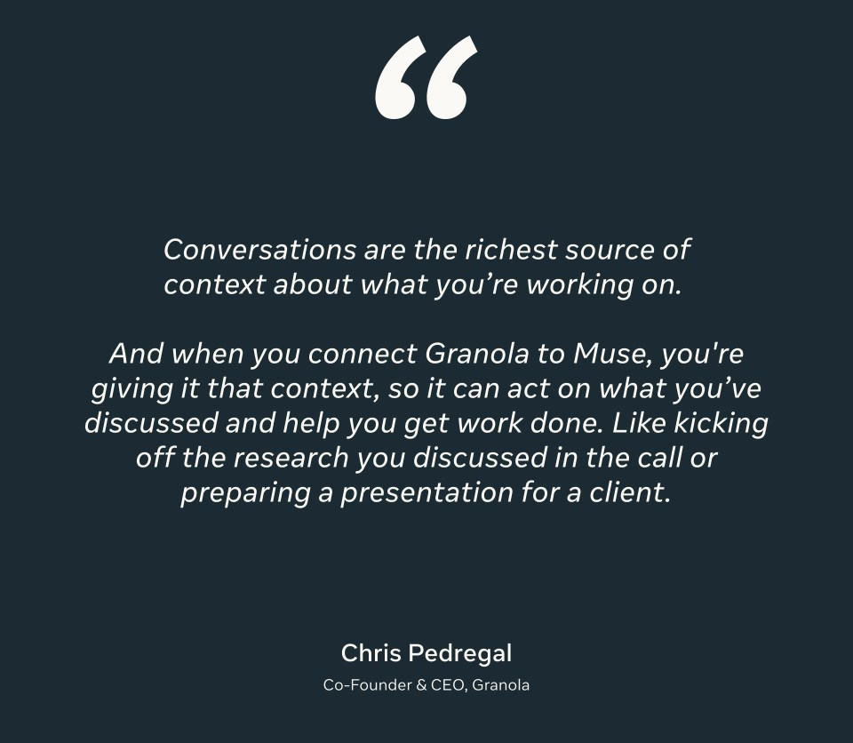

> 「对话是关于你正在做的事情的最丰富的上下文来源。当你把 Granola 连接到 Muse 时，你就把这些上下文交给了它，让它可以根据你们讨论过的内容采取行动，帮你把工作做完。比如启动你在通话中讨论过的研究，或者为客户准备一份演示文稿。」——Chris Pedregal，Granola 联合创始人兼首席执行官

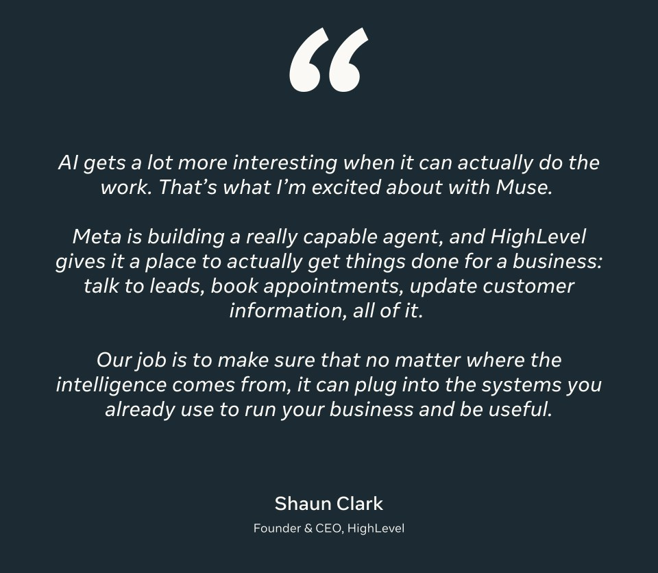

> 「当 AI 能够真正做事时，它就变得有趣得多。这就是 Muse 让我兴奋的地方。Meta 正在打造一个非常有能力的智能体，而 HighLevel 为它提供了一个真正为企业办事的地方：与潜在客户交谈、预约、更新客户信息，所有的一切。我们的工作是确保无论智能来自哪里，它都能接入你已经在用来经营生意的系统并发挥作用。」——Shaun Clark，HighLevel 创始人兼首席执行官

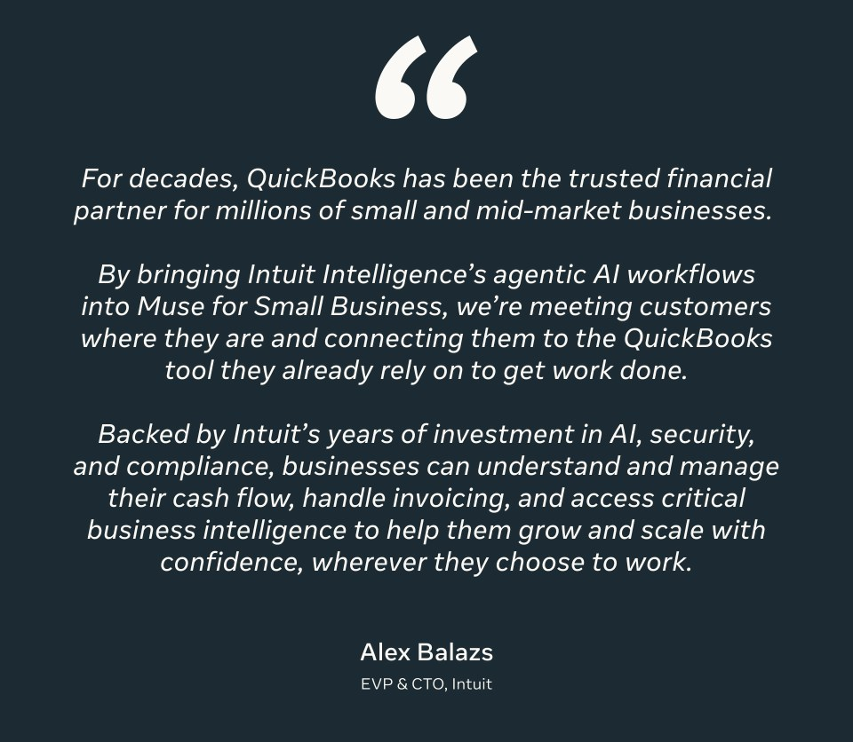

> 「几十年来，QuickBooks 一直是数百万中小企业值得信赖的财务伙伴。通过把 Intuit Intelligence 的智能体式 AI 工作流带入 Muse for Small Business，我们在客户所在之处与他们相遇，把他们与已经依赖来完成工作的 QuickBooks 工具连接起来。依托 Intuit 多年来在 AI、安全和合规方面的投入，企业无论选择在哪里工作，都可以了解和管理现金流、处理开票，并获取关键的商业情报，帮助他们满怀信心地成长和扩大规模。」——Alex Balazs，Intuit 执行副总裁兼首席技术官

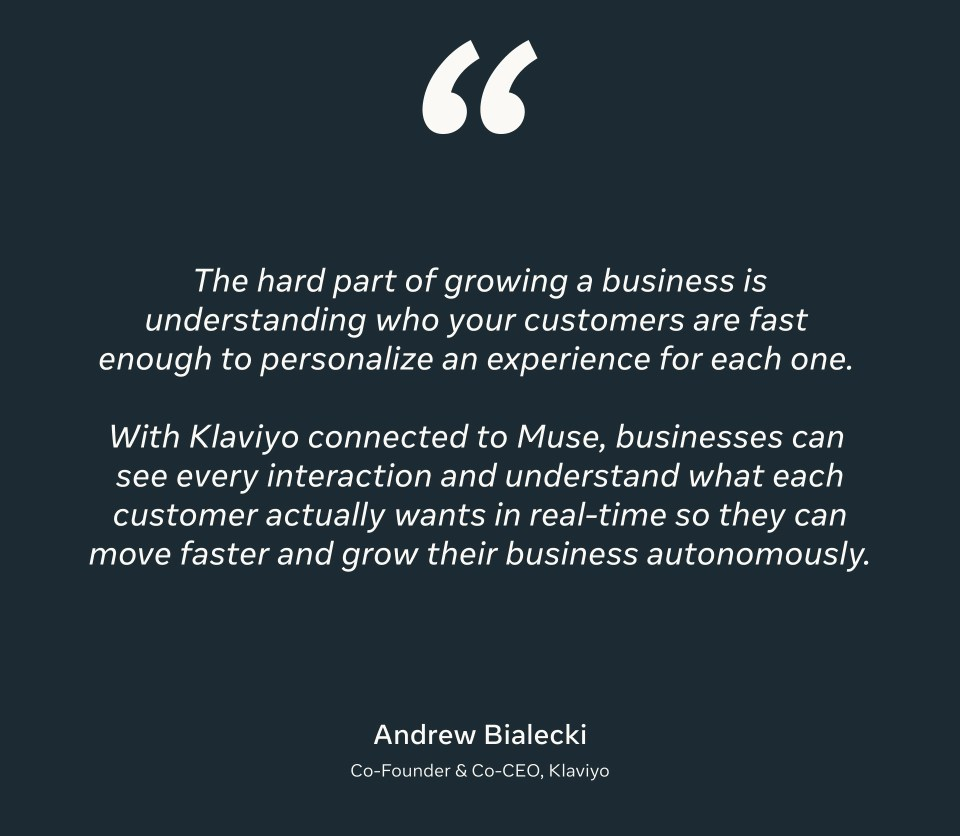

> 「发展一家企业的难点，在于足够快地了解你的客户是谁，以便为每一位客户提供个性化的体验。将 Klaviyo 连接到 Muse 后，企业可以看到每一次互动，并实时了解每位客户真正想要什么，从而更快行动，自主地发展生意。」——Andrew Bialecki，Klaviyo 联合创始人兼联席首席执行官

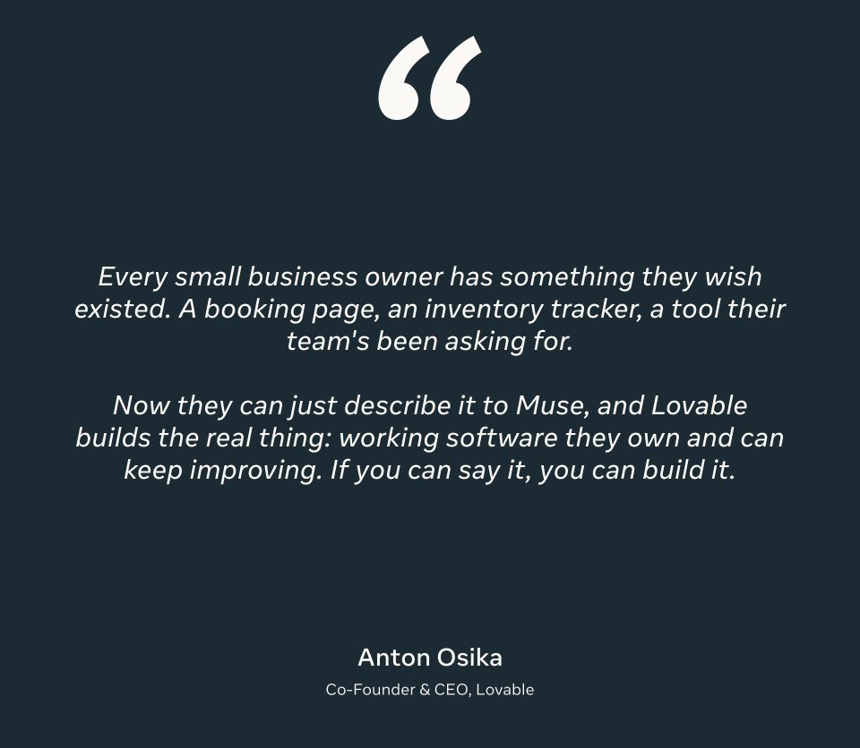

> 「每个小企业主都有一样他们希望存在的东西。一个预约页面、一个库存追踪器、一个团队一直在要的工具。现在他们只需向 Muse 描述它，Lovable 就会把真东西做出来：他们自己拥有、可以不断改进的可用软件。只要你能说出来，你就能把它做出来。」——Anton Osika，Lovable 联合创始人兼首席执行官

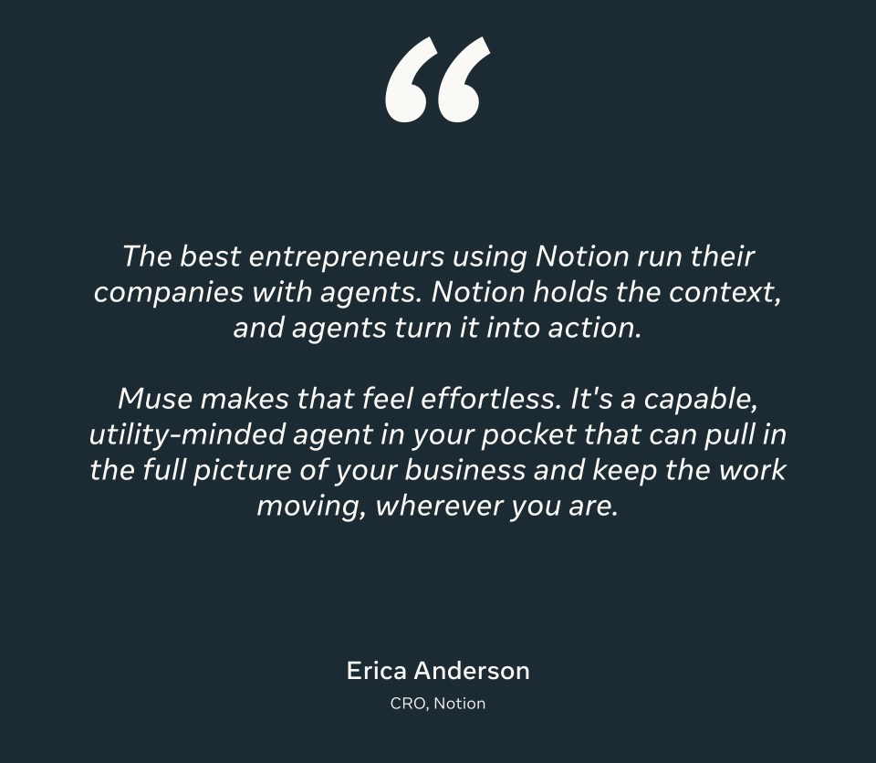

> 「使用 Notion 的最出色的创业者用智能体来经营他们的公司。Notion 保存上下文，智能体把它变成行动。Muse 让这一切显得毫不费力。它是你口袋里一个有能力、讲求实用的智能体，无论你身在何处，都能调取你生意的全貌，让工作持续推进。」——Erica Anderson，Notion 首席营收官

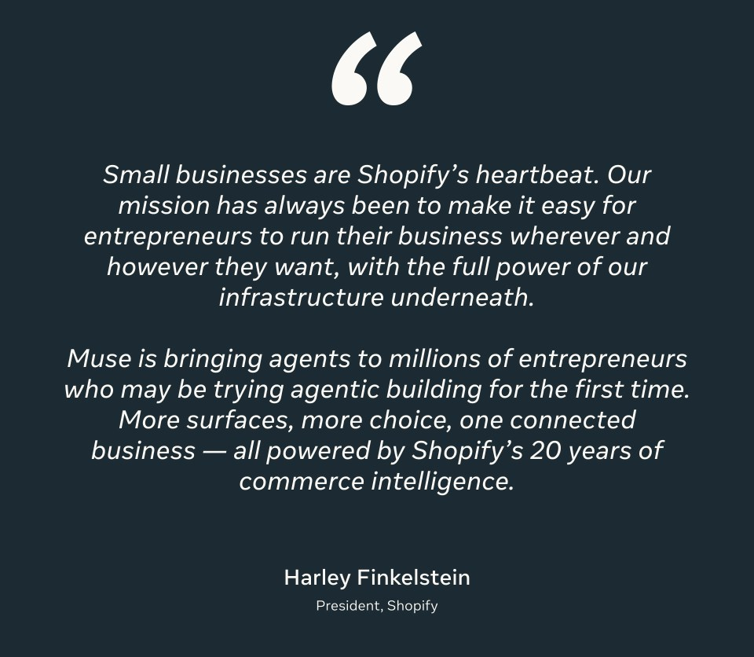

> 「小企业是 Shopify 的心跳。我们的使命一直是让创业者能够随时随地、以任何方式轻松经营自己的生意，并以我们基础设施的全部能力作为支撑。Muse 正在把智能体带给数以百万计的创业者，他们中的许多人可能是第一次尝试智能体式的构建。更多的界面、更多的选择、一个互联的生意，这一切都由 Shopify 20 年的商业智能驱动。」——Harley Finkelstein，Shopify 总裁

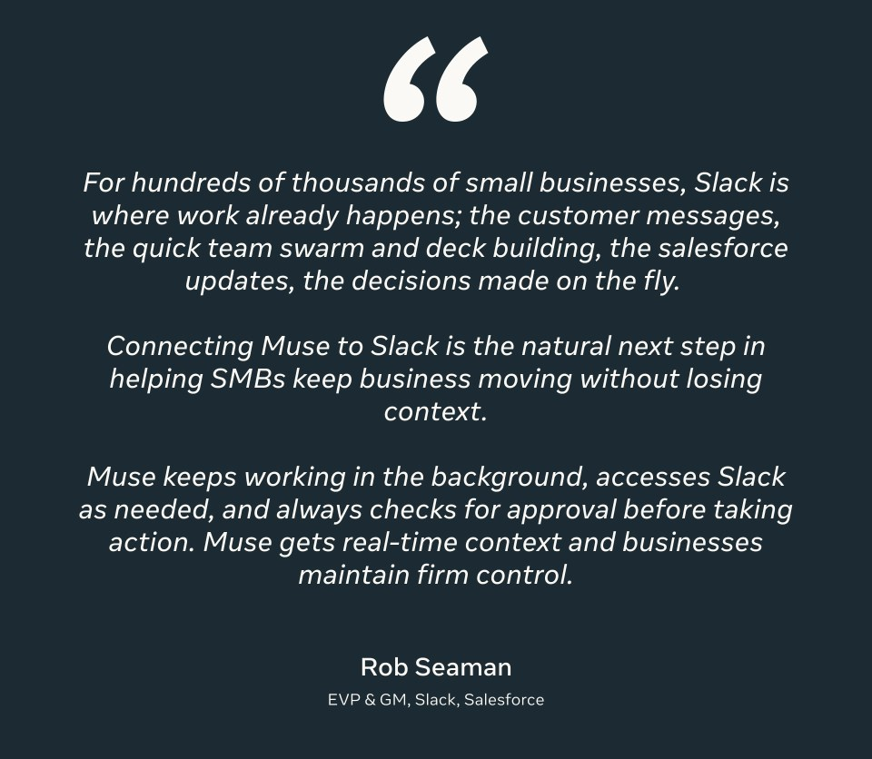

> 「对数十万家小企业来说，Slack 就是工作已经在发生的地方：客户消息、团队的快速集结与演示文稿制作、Salesforce 的更新、即时做出的决策。将 Muse 连接到 Slack，是帮助中小企业在不丢失上下文的情况下保持业务运转的自然的下一步。Muse 在后台持续工作，根据需要访问 Slack，并且在采取行动之前总是先征求批准。Muse 获得实时的上下文，企业则保持牢固的掌控。」——Rob Seaman，Salesforce 旗下 Slack 执行副总裁兼总经理

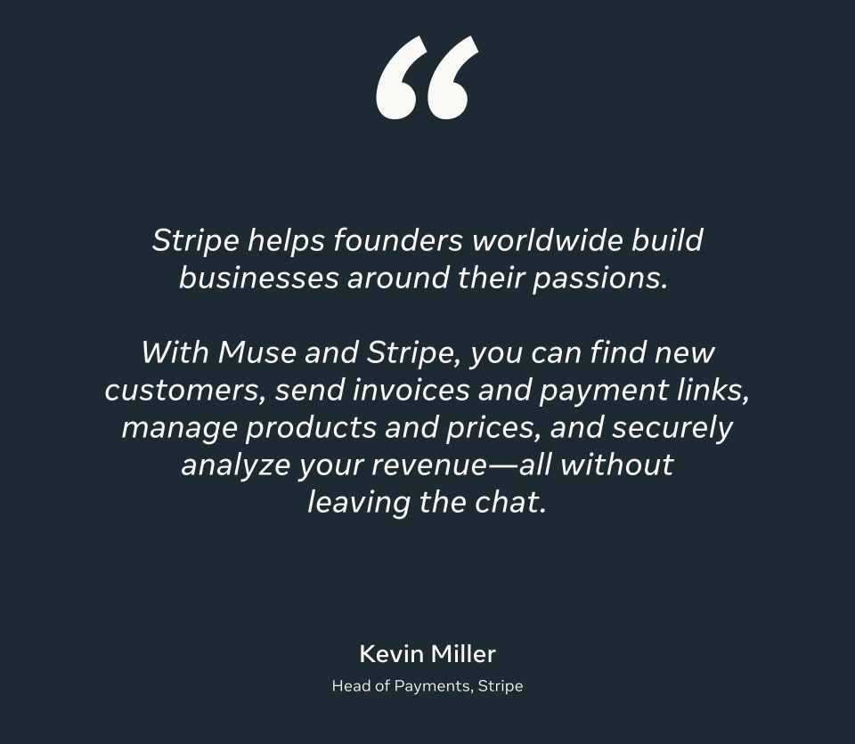

> 「Stripe 帮助全球的创始人围绕自己的热爱打造事业。有了 Muse 和 Stripe，你可以寻找新客户、发送发票和付款链接、管理产品和价格，并安全地分析你的收入，全部不必离开聊天。」——Kevin Miller，Stripe 支付负责人

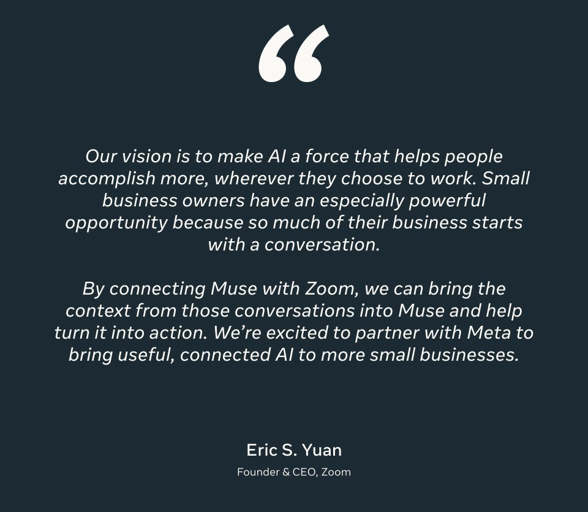

> 「我们的愿景是让 AI 成为一种力量，帮助人们无论选择在哪里工作都能完成更多事情。小企业主拥有一个尤其强大的机会，因为他们的很多生意都是从一次对话开始的。通过将 Muse 与 Zoom 连接，我们可以把这些对话中的上下文带入 Muse，并帮助把它变成行动。我们很高兴与 Meta 合作，把有用的、互联的 AI 带给更多小企业。」——Eric S. Yuan，Zoom 创始人兼首席执行官

Muse 在人们所需的大部分功能上是免费的，这符合我们让尽可能多的人掌握超级智能的愿景。对于想要更多功能的人，我们提供[订阅方案](https://www.meta.com/help/subscriptions/1021145227643680/)。我们还在整个 Meta 打造 [AI，帮助处于各个阶段的企业](https://www.facebook.com/business/ai)。

在接下来的几个月里，敬请期待更多的连接器、更多的技能，以及更多替你处理好的业务。未来属于每个人，尤其是小企业，而 Muse 就是他们打造未来的方式。

[**立即开始使用 Muse for Small Business。**](https://www.facebook.com/business/help/38565157129799046)
