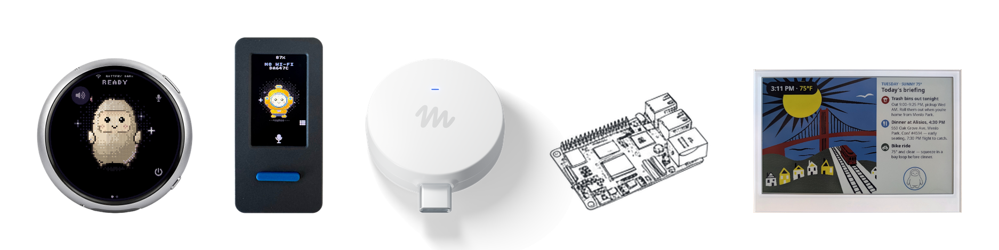



（译注：本页为仓库根目录 README.md 的全文翻译。文件开头的 Apache 2.0 许可证注释未译出。仓库内各子目录另有 README，未收入本页。）

Muse 小设备（gadgets）是你自己动手打造的开源设备。给一块现成的 ESP32 开发板编程，或者用我们的设备 SDK 配置一台 Raspberry Pi，然后把 Muse 连接到你的显示屏、按钮、传感器、执行器，以及你工作台上随手放着的任何其他东西。

我们在这里开源了 SDK 和固件。它由黑客打造，为黑客而做，纯粹为了好玩。动手折腾的副作用可能包括板子变砖、保修失效、电压不足掉电或者破产。风险自负！

| | |
|---|---|
| [**ESP32 Device SDK**](https://github.com/facebookincubator/muse-gadget-sdk/tree/main/esp32) | 通过我们的开源 SDK 把你的 ESP32 开发板连接到 Muse。加一块屏幕来显示图片，加上音频输入和输出，或者接上其他传感器。 |
| [**Linux Device SDK**](https://github.com/facebookincubator/muse-gadget-sdk/tree/main/linux) | 把那台闲置的 Raspberry Pi 或 Linux 机器变成一个 Muse 小设备。加入你自己的命令，让 Muse 处理系统管理杂务或你的 Home Assistant 配置。 |
| [**Muse Gadgets Test**](https://github.com/facebookincubator/muse-gadget-sdk/tree/main/android/musegadgetstest)（[iPhone](https://github.com/facebookincubator/muse-gadget-sdk/tree/main/ios/musegadgetstest)） | 通过 Wi-Fi 把手机摄像头的画面或一段视频片段流式传输到 ESP32 小设备的屏幕上：在板子上解码 H.264 或 VP8，在 466 像素的圆形板上达到 30 fps。[`protocols/VIDEO.md`](https://github.com/facebookincubator/muse-gadget-sdk/blob/main/protocols/VIDEO.md) 说明了实现方式。 |

在刷写或配对小设备之前，请先获取一个 [SDK 令牌](https://gadgets.muse.ai/settings/sdk-tokens)，并阅读 [Gadget SDK 条款](https://gadgets.muse.ai/sdk-terms)。每个小设备都需要一个令牌才能配对。

ESP32 和 Linux 小设备通过 iOS 和 Android 上的 Muse 应用配对，路径是「设置 > 设备」（Settings > Devices）。先在那里打开开发者模式（Developer mode），然后查找以「MuseGadget」为前缀的设备。

每个目录都有一个用于入门的 `README.md`，以及一个面向 [Muse Code](https://developer.meta.com/ai/lp/muse-code/) 等编程智能体的 `AGENTS.md`。

关于电池输入的功耗分析，请参阅[移植指南](https://github.com/facebookincubator/muse-gadget-sdk/blob/main/esp32/docs/power/README.md)。可选启用的诊断核心与开发板无关；由各开发板提供其钩子和状态矩阵，[power_sweep.py](https://github.com/facebookincubator/muse-gadget-sdk/blob/main/esp32/tools/power/power_sweep.py) 负责驱动无需 USB 的扫描测试。这个隔离的诊断不进行配对，也不需要 SDK 令牌；正如 [PPK2 规则](https://github.com/facebookincubator/muse-gadget-sdk/blob/main/esp32/docs/power/ppk2.md)所述，夹具安全和明确的硬件授权仍然是第一位的。

## 社区

在我们的社区 [Discord](https://discord.gg/3bhjCkZdd6) 中结识其他正在打造和定制 Muse 小设备的黑客。获得灵感，互相支持，分享你的作品。

## 许可证

Muse Gadgets 采用 Apache License 2.0 许可，见 [`LICENSE`](https://github.com/facebookincubator/muse-gadget-sdk/blob/main/LICENSE)，以下第三方文件除外，它们保留各自上游的许可证：

| 路径 | 上游 | 许可证 |
|---|---|---|
| [`esp32/components/minimp3/include/minimp3.h`](https://github.com/facebookincubator/muse-gadget-sdk/tree/main/esp32/components/minimp3) | [lieff/minimp3](https://github.com/lieff/minimp3) | CC0-1.0，见 [`LICENSE`](https://github.com/facebookincubator/muse-gadget-sdk/blob/main/esp32/components/minimp3/LICENSE) |
| [`esp32/components/muse/boards/ostb_echoear_display_init.h`](https://github.com/facebookincubator/muse-gadget-sdk/blob/main/esp32/components/muse/boards/ostb_echoear_display_init.h) | [78/xiaozhi-esp32 ESP-VoCat 面板初始化序列](https://github.com/78/xiaozhi-esp32/blob/0d576d3d4c049c6f55eaf879725dc23e516511b4/main/boards/espressif/esp-vocat/esp_vocat.cc) | MIT，保留在文件头中 |
| [`board_seeed_xiao_s3_147.c`](https://github.com/facebookincubator/muse-gadget-sdk/blob/main/esp32/components/muse/boards/board_seeed_xiao_s3_147.c) 中的 JD9853A 初始化序列 | [Seeed-Studio/Seeed_GFX2](https://github.com/Seeed-Studio/Seeed_GFX2) | MIT，见 [`Seeed_GFX2.txt`](https://github.com/facebookincubator/muse-gadget-sdk/blob/main/esp32/devices/licenses/Seeed_GFX2.txt) |
| [`esp32/main/pixel_font.c`](https://github.com/facebookincubator/muse-gadget-sdk/blob/main/esp32/main/pixel_font.c) | Adafruit GFX `glcdfont.c` | BSD-2-Clause，在文件头中 |
| [`esp32/components/muse/fonts/`](https://github.com/facebookincubator/muse-gadget-sdk/tree/main/esp32/components/muse/fonts) | GNU Unifont 16.0.04、Noto Sans SC 和 Montserrat Medium（经由 LVGL）的子集（见其 README） | SIL Open Font License 1.1（Unifont 同时采用带字体嵌入例外的 GPL-2.0+） |
| [`esp32/components/muse/eink/fonts/montserrat.ttf`](https://github.com/facebookincubator/muse-gadget-sdk/tree/main/esp32/components/muse/eink/fonts) | Montserrat Medium，经由 LVGL v9.5.0 | SIL Open Font License 1.1 |
| [`esp32/components/muse/eink/fonts/unscii.ttf`](https://github.com/facebookincubator/muse-gadget-sdk/tree/main/esp32/components/muse/eink/fonts) | unscii-8 | 公有领域 |
| [`esp32/components/muse/eink/fonts/symbols.ttf`](https://github.com/facebookincubator/muse-gadget-sdk/tree/main/esp32/components/muse/eink/fonts) | Font Awesome 5 Free，经由 LVGL v9.5.0 | SIL Open Font License 1.1（图标为 CC BY 4.0） |
| [`esp32/main/epd_ssd1677.c`](https://github.com/facebookincubator/muse-gadget-sdk/blob/main/esp32/main/epd_ssd1677.c) | Seeed-reTerminal-E10xx-Firmware 的 SSD1677 刷新序列 | MIT，保留在文件头中 |
| [`esp32/components/tinyh264/src`](https://github.com/facebookincubator/muse-gadget-sdk/tree/main/esp32/components/tinyh264) | Android 开源项目（AOSP）的 H.264 解码器，经由 [udevbe/tinyh264](https://github.com/udevbe/tinyh264) | Apache-2.0，AOSP 的版权，见 [`LICENSE`](https://github.com/facebookincubator/muse-gadget-sdk/blob/main/esp32/components/tinyh264/LICENSE) |
| [`esp32/components/libvpx_vp8/src`](https://github.com/facebookincubator/muse-gadget-sdk/tree/main/esp32/components/libvpx_vp8) | [libvpx](https://chromium.googlesource.com/webm/libvpx) v1.16.0 的 VP8 解码器，经过裁剪 | BSD-3-Clause，WebM 项目作者的版权，见 [`LICENSE`](https://github.com/facebookincubator/muse-gadget-sdk/blob/main/esp32/components/libvpx_vp8/LICENSE)，Google 的专利授权见 [`PATENTS`](https://github.com/facebookincubator/muse-gadget-sdk/blob/main/esp32/components/libvpx_vp8/PATENTS) |

构建时拉取的依赖适用其各自的许可证：ESP-IDF 组件（拉取到 `esp32/managed_components/`），以及模拟器使用的 LVGL 和 SDL（列于 [`esp32/simulator/THIRD_PARTY.md`](https://github.com/facebookincubator/muse-gadget-sdk/blob/main/esp32/simulator/THIRD_PARTY.md)）。

Apache 许可证不涵盖 [Jollybot 头像](https://github.com/facebookincubator/muse-gadget-sdk/tree/main/esp32/avatar)。

Muse Gadgets Test 的示例片段不在本仓库中：播放时，应用会获取 Blender 基金会开放电影（CC BY 3.0）中的几秒片段，并显示其署名。

Muse Gadgets Test 可以在手机上使用 x264（GPL-2.0）；本仓库不包含其任何代码。你用它构建的 APK 或 iPhone 应用受 GPL 约束（[`android/musegadgetstest/README.md`](https://github.com/facebookincubator/muse-gadget-sdk/blob/main/android/musegadgetstest/README.md)、[`ios/musegadgetstest/README.md`](https://github.com/facebookincubator/muse-gadget-sdk/blob/main/ios/musegadgetstest/README.md)）。
