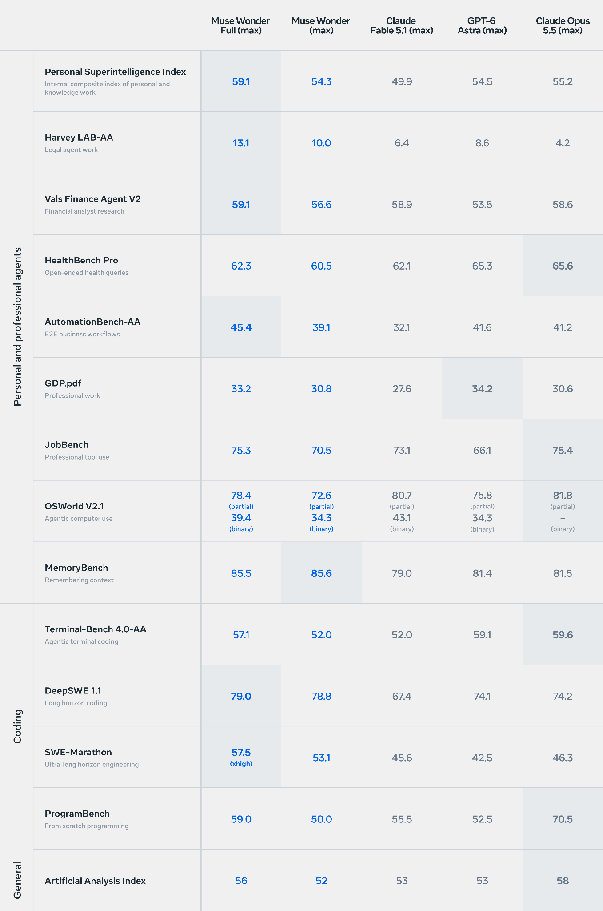



**收录说明**：模型卡 PDF 由 Muse Wonder 研究博客链接。按「模型资料的收录原则」只收与 Personal Agent 直接相关的部分（用户 2026-11-05 决定）：第 1 节模型概况、第 2 节预期用途、第 3 节的总体评测方法与「Personal and Professional Agents」一组基准的说明和分数、第 6 节局限与使用条件。未收：第 3 节的编码与通用基准、第 4 节前沿风险评估（化学生物、网络安全、失控）、第 5 节 Trust and Safety、附录。评测分数表在 PDF 中是图片，原图收入 images/，其中 Personal and professional agents 一组分数另行转录为表格。原文全文存于本目录的 original.md，网站上不显示，已翻译。

**内容摘要**：模型卡介绍 Muse Wonder 与 Muse Wonder Full 两个模型：2026-10-12 发布，输入支持文本、图像、视频、音频，推理时上下文长度 1M tokens，预期用途中特别强调「personal and professional agentic tasks」。个人与专业智能体一组共 9 项基准，与 GPT-6 Astra、Claude Fable 5.1、Claude Opus 5.5（均为 max 推理强度）对比：Muse Wonder Full 在内部综合指数 Personal Superintelligence Index（59.1）、Harvey LAB-AA、Vals Finance Agent V2、AutomationBench-AA 上分数最高，MemoryBench 上 Muse Wonder（85.6）与 Muse Wonder Full（85.5）都高于对比模型；在 HealthBench Pro、GDP.pdf、JobBench、OSWorld V2.1 上低于对比模型中的最高分。卡中说明了两项内部基准：MemoryBench 测试在 64K 到 100K tokens 的多轮对话中准确回忆关键信息，FocusBench 测试智能体在住房、出行、IT、金融等个人事务中跨多轮交互克服现实阻碍、适应变化环境的能力。局限部分指出模型在多步推理中仍会出错、不适合 18 岁以下用户，并建议在能采取现实行动的智能体场景中加入人工确认等护栏；使用受 Muse 补充服务条款约束。

**保留理由**：Muse Wonder 是驱动 Muse 的模型（见同日发布的新闻稿与研究博客），这份模型卡给出了它在个人智能体类任务上的官方评测数字和两项面向个人智能体的内部基准（MemoryBench、FocusBench）的定义，是比较 Muse 底层能力的一手来源。

---

## 1. 模型

| | |
| --- | --- |
| 名称 | Muse Wonder 与 Muse Wonder Full |
| 模型提供方 | Meta Platforms, Inc. 或 Meta Platforms Ireland Limited |
| 网站 | dev.meta.ai |
| 发布日期 | 2026 年 10 月 12 日 |
| 模态 | 输入：文本、图像、视频、音频 输出：文本 |
| 语言 | 该模型在多语言训练数据上训练，在全球各语言中都有大量覆盖。 |
| 上下文长度 | 推理时 1M tokens |
| 联系方式 | https://dev.meta.ai/support |

## 2. 预期用途

Muse Wonder 系列模型面向商业与研究用途，在个人与专业智能体任务上尤为擅长。这些模型支持广泛的使用场景，包括：

1. 通用辅助与推理——回答问题、写作与编辑、总结信息、分析文档与数据，以及对复杂问题进行推理。

2. 编码与软件工程——生成、解释、调试、测试和修改代码，从单个编程任务到跨较大软件项目的持续工作。

3. 个人与专业智能体——通过工具使用以及与应用的交互，支持研究、规划和多步骤工作流。

4. 特定领域的知识工作——帮助用户解读和处理法律、金融、健康等领域的专业信息，包括理解文档、综合原始材料，以及准备供审阅的草稿。

5. 多模态理解与推理——结合文本解读文档、截图、图表、图像和视频。

6. 研究与开发——支持科学与技术研究，包括综合信息、提出并检验假设、设计实验和分析结果。

已知局限见下文「考量与局限」。

## 3. 能力评测与评测方法

我们在涵盖个人与专业智能体（包括法律、金融和健康任务）、软件工程与编码以及通用智能的基准上评测 Muse Wonder 与 Muse Wonder Full。

（Personal and professional agents 部分）

| | Muse Wonder Full (max) | Muse Wonder (max) | Claude Fable 5.1 (max) | GPT-6 Astra (max) | Claude Opus 5.5 (max) |
| --- | --- | --- | --- | --- | --- |
| Personal Superintelligence Index — 个人与知识工作的内部综合指数 | 59.1 | 54.3 | 49.9 | 54.5 | 55.2 |
| Harvey LAB-AA — 法律智能体工作 | 13.1 | 10.0 | 6.4 | 8.6 | 4.2 |
| Vals Finance Agent V2 — 金融分析师研究 | 59.1 | 56.6 | 58.9 | 53.5 | 58.6 |
| HealthBench Pro — 开放式健康查询 | 62.3 | 60.5 | 62.1 | 65.3 | 65.6 |
| AutomationBench-AA — 端到端业务流程 | 45.4 | 39.1 | 32.1 | 41.6 | 41.2 |
| GDP.pdf — 专业工作 | 33.2 | 30.8 | 27.6 | 34.2 | 30.6 |
| JobBench — 专业工具使用 | 75.3 | 70.5 | 73.1 | 66.1 | 75.4 |
| OSWorld V2.1 — 智能体计算机使用 | 78.4（部分分）/ 39.4（二元分） | 72.6（部分分）/ 34.3（二元分） | 80.7（部分分）/ 43.1（二元分） | 75.8（部分分）/ 34.3（二元分） | 81.8（部分分）/ –（二元分） |
| MemoryBench — 上下文记忆 | 85.5 | 85.6 | 79.0 | 81.4 | 81.5 |

### 总体方法

- 模型与配置。Muse Wonder 与 Muse Wonder Full 的结果在最高推理强度（max reasoning effort）下生成。我们与同样处于最高推理强度的 GPT-6 Astra、Claude Fable 5.1 和 Claude Opus 5.5 比较。在受控的内部编码对比中，每个模型都使用相同的、针对具体基准的评测框架（harness）。外部编码结果保留报告方或模型提供方所用的评测框架或智能体产品，并在下文标明来源。

- 评测与分数选择。我们尽可能贴近每项基准原有的任务、输入、评分方式和主要指标。如果存在可比的第三方结果或提供方报告的结果，我们就采用该结果；否则，我们采用内部验证运行结果、自报分数或官方排行榜分数中的最高值。基准名称在可用时链接到官方排行榜。模型拒答得零分，并保留在分母中，而不是被剔除。与官方设置的重大差异会在下文说明。

- 竞品模型结果。内部生成的竞品运行在可行时采用通用设置，但仍属尽力而为：提示词、工具和运行时未必针对专有模型做过最优调校。

### 各基准详情

#### 个人与专业智能体

- 个人超级智能指数（Personal Superintelligence Index，PSI）。PSI 是七项个人与知识工作评估的内部综合指标：Agents’ Last Exam、AutomationBench-AA、FocusBench、JobBench、GDP.pdf、VBT 与 DRACO。

- Harvey LAB-AA。Harvey LAB-AA 是 Artificial Analysis 版本的 Harvey 法律智能体基准（Legal Agent Benchmark），其中智能体根据案件文档产出法律工作成果，由 Artificial Analysis 的评审小组按任务特定标准检查每份交付物。我们报告的是 1.1 版，该版本增加了幻觉检查。结果来源为 Artificial Analysis，主要指标是交付物满足全部标准并通过幻觉检查的任务占比。

- Vals Finance Agent V2。Vals Finance Agent V2 评估需要研究申报文件与市场信息的金融分析师任务。结果来源为 Vals AI，主要指标是其私有测试集准确率。

- HealthBench Pro。HealthBench Pro 评估对 525 个专业级健康问题的回答。模型在不使用工具的情况下作答，由 GPT-5.4 评分器按医生编写的评分细则为每个回答打分。我们在统一的内部框架中运行官方任务与评分。主要指标是按长度归一化的加权评分细则得分。对于 Claude Fable 5.1 和 Claude Opus 5.5，我们采用 Anthropic 在 Claude Fable 5.1 系统卡和 Claude Opus 5.5 系统卡中报告的结果。

- AutomationBench-AA。AutomationBench-AA 在模拟应用环境中评估真实的业务流程。智能体通过自动化工具完成每项工作流，确定性的终态断言检查操作后的应用状态。结果来源为 Artificial Analysis，主要指标是其严格 pass@1：通过每一项终态断言的工作流占比。

- Agents’ Last Exam。Agents’ Last Exam 评估在 Linux 虚拟机上执行的、要求较高的端到端科学与专业任务。我们使用其中 105 项任务的 Linux 集合。每项任务由任务自带的评测脚本评分，在 0 到 1 之间给出部分分，不使用 LLM 评审。

- GDP.pdf。GDP.pdf 评估基于所提供的 PDF 原始材料开展的专业工作。结果来源为 Surge，主要指标是 Surge 报告的分数。

- OSWorld V2.1。OSWorld V2.1 是一个长时程计算机使用基准，在完整的 Ubuntu 桌面虚拟机上评估 108 个真实工作流。智能体通过截图以及点击、输入、滚动、按键等操作控制图形界面（GUI）。我们在统一的内部框架中运行更新后的 V2.1 评测，同时保留官方任务环境与程序化评分器。主要指标是各任务部分奖励的均值；严格的二元完成情况是次要指标。Claude Opus 5.5 的结果是 Anthropic 作为模型提供方报告的部分分；没有可用的二元分数。

- JobBench。JobBench 包含涵盖 35 种白领职业的 65 项专业任务。每项任务要求智能体产出一份实用的工作成果，并按任务特定评分细则打分。主要指标是各任务奖励的均值。

- MemoryBench。MemoryBench 是一项内部基准，测试模型能在 64K 到 100K tokens 的漫长、复杂多轮对话中多准确地回忆关键信息，这些对话跨越若干独立事实，并包含干扰性对话以及与目标细节冲突或随后更新目标细节的注入轮次。由 LLM 评审按加权的、针对具体问题的评分细则为每个回答打分。

- 可验证浏览任务（Verifiable Browsing Task，VBT）。VBT 是一项内部智能体网页浏览评测，模型使用浏览器的搜索、打开与查找工具，回答以真实用户请求形式写出的列表式信息查找问题。

- 深度研究准确性、完整性与客观性（Deep Research Accuracy, Completeness, and Objectivity，DRACO）。DRACO 来自 Perplexity，是一个包含 100 个复杂、跨领域问题的深度研究基准。我们在统一的内部框架中运行它，模型使用浏览器的搜索、打开与查找工具，并在沙箱中执行代码来作答。

- FocusBench。FocusBench 是一项内部评测，涵盖住房、出行、IT、金融等多种领域的个人智能体任务。它评估智能体能否在多次交互中持续克服现实阻碍，并适应动态变化的环境。

（以下内容未收入：第 3 节中 Software Engineering and Coding、General 两组基准的说明，第 4 节 Risk assessments under the Meta Superintelligence Scaling Framework，第 5 节 Trust and Safety。）

## 6. 考量与局限

Muse Wonder 是一项带有已知和未知风险的技术。迄今开展的测试尚未覆盖、也不可能覆盖所有场景。

### 局限

1. 模型可能对用户提示词生成不准确、有偏见或令人反感的回答。

2. 尽管针对智能体任务做了优化，模型在多步推理中仍可能出错，尤其是在训练数据中代表性不足的新颖场景中。

3. 视觉与空间推理，尤其是 3D 任务，仍是已知局限。对于依赖精确空间理解的应用，请验证其表现。

4. 模型尚未在预训练数据包含的所有语言上评估。在强支持语言集之外的语言上，性能可能下降。

5. 性能可能随量化、服务配置、提示词、工具与智能体运行框架（agent harness）而变化。

6. 该模型不面向 18 岁以下个人使用。部署方有责任确保与 18 岁以下个人此类使用相关的任何风险都已得到充分评估并适当缓解，且此类使用符合所有适用法律。

使用 Muse Wonder 须遵守适用使用条款中的限制与条件，包括 Meta Model API 服务条款（https://dev.meta.ai/legal/terms-of-service）、Meta Model 可接受使用政策（https://dev.meta.ai/legal/acceptable-use-policy）与 Muse 补充服务条款（https://muse.ai/terms）。

### 负责任使用

开发者应自行评估该模型是否适合其部署，并针对自己的具体应用与拟支持语言开展评估。在模型可采取现实行动的智能体场景中部署时，我们建议增加额外的护栏（例如对不可逆操作进行人工在环确认）。

（以下内容未收入：Appendix: CBRN Proxy Evaluation Descriptions。）
