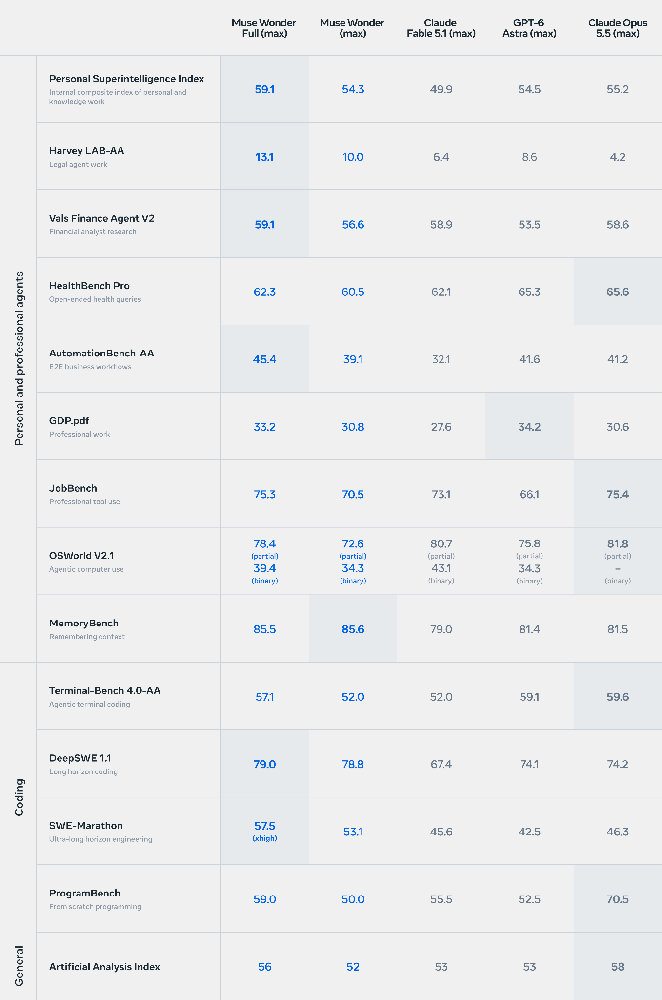

来源：https://research.meta.ai/static/muse-wonder-model-card
取文：2026-11-05，直接下载 PDF（PDF 元数据创建于 2026-10-23），pypdf 版面模式抽取文字；评测分数表是图片，另行转录

## 1. The models

| | |
| --- | --- |
| Name | Muse Wonder and Muse Wonder Full |
| Model Provider | Meta Platforms, Inc. or Meta Platforms Ireland Limited |
| Website | dev.meta.ai |
| Date of Release | October 12, 2026 |
| Modalities | Input: text, image, video, audio Output: text |
| Languages | The model was trained on multilingual training data, with substantial representation across worldwide languages. |
| Context Length | 1M tokens at inference |
| Contact | https://dev.meta.ai/support |

## 2. Intended uses

The Muse Wonder models are intended for commercial and research use, with particular strengths in personal and professional agentic tasks. The models support a broad range of use cases, including:

1. General-purpose assistance and reasoning — answering questions, writing and editing, summarizing information, analyzing documents and data, and reasoning through complex problems.

2. Coding and software engineering — generating, explaining, debugging, testing, and modifying code, from individual programming tasks to sustained work across larger software projects.

3. Personal and professional agents — supporting research, planning, and multi-step workflows through tool use and interaction with applications.

4. Domain-specific knowledge work — helping users interpret and work with specialized information in areas such as law, finance, and health, including understanding documents, synthesizing source material, and preparing drafts for review.

5. Multimodal understanding and reasoning — interpreting documents, screenshots, charts, images, and video alongside text.

6. Research and development — supporting scientific and technical research, including synthesizing information, developing and testing hypotheses, designing experiments, and analyzing results.

Known limitations are covered in Considerations and Limitations below.

## 3. Capabilities evaluations and eval methodology

We evaluate Muse Wonder and Muse Wonder Full on benchmarks spanning personal and professional agents (including legal, finance, and health tasks), software engineering and coding, and general intelligence.

（Personal and professional agents 部分）

| | Muse Wonder Full (max) | Muse Wonder (max) | Claude Fable 5.1 (max) | GPT-6 Astra (max) | Claude Opus 5.5 (max) |
| --- | --- | --- | --- | --- | --- |
| Personal Superintelligence Index — Internal composite index of personal and knowledge work | 59.1 | 54.3 | 49.9 | 54.5 | 55.2 |
| Harvey LAB-AA — Legal agent work | 13.1 | 10.0 | 6.4 | 8.6 | 4.2 |
| Vals Finance Agent V2 — Financial analyst research | 59.1 | 56.6 | 58.9 | 53.5 | 58.6 |
| HealthBench Pro — Open-ended health queries | 62.3 | 60.5 | 62.1 | 65.3 | 65.6 |
| AutomationBench-AA — E2E business workflows | 45.4 | 39.1 | 32.1 | 41.6 | 41.2 |
| GDP.pdf — Professional work | 33.2 | 30.8 | 27.6 | 34.2 | 30.6 |
| JobBench — Professional tool use | 75.3 | 70.5 | 73.1 | 66.1 | 75.4 |
| OSWorld V2.1 — Agentic computer use | 78.4 (partial) / 39.4 (binary) | 72.6 (partial) / 34.3 (binary) | 80.7 (partial) / 43.1 (binary) | 75.8 (partial) / 34.3 (binary) | 81.8 (partial) / – (binary) |
| MemoryBench — Remembering context | 85.5 | 85.6 | 79.0 | 81.4 | 81.5 |

### Overall Methodology

- Models and configurations. Muse Wonder and Muse Wonder Full results are generated with max reasoning effort. We compare with GPT-6 Astra, Claude Fable 5.1, and Claude Opus 5.5 at max reasoning effort. For controlled internal coding comparisons, every model uses the same benchmark-specific harness. External coding results retain the harness or agent product used by the reporting vendor or model provider, and that source is identified below.

- Evaluation and score selection. We preserve each benchmark’s tasks, inputs, grading, and primary metric as closely as possible. Where a comparable third-party or provider-reported result exists, we use it; otherwise we use the highest of our internally validated run, self-reported score, or official leaderboard score. Benchmark names link to official leaderboards where available. Model refusals receive zero credit and remain in the denominator rather than being dropped. Material departures from the official setup are noted below.

- Competitor-model results. Internally generated competitor runs use common settings where practical but remain best-effort: prompts, tools, and runtime may not be optimally tuned for proprietary models.

### Per-benchmark details

#### Personal and Professional Agents

- Personal Superintelligence Index (PSI). PSI is an internal composite of seven personal and knowledge-work evaluations: Agents’ Last Exam, AutomationBench-AA, FocusBench, JobBench, GDP.pdf, VBT, and DRACO.

- Harvey LAB-AA. Harvey LAB-AA is Artificial Analysis’s version of Harvey’s Legal Agent Benchmark, in which agents produce legal work products from matter documents and an Artificial Analysis judge panel checks each deliverable against task-specific criteria. We report version 1.1, which adds hallucination checks. The result source is Artificial Analysis, and the primary metric is the share of tasks whose deliverable meets every criterion and passes the hallucination checks.

- Vals Finance Agent V2. Vals Finance Agent V2 evaluates financial-analyst tasks requiring research over filings and market information. The result source is Vals AI, and the primary metric is its private-test-set accuracy.

- HealthBench Pro. HealthBench Pro evaluates responses to 525 professional-grade health questions. Models answer without tools, and a GPT-5.4 grader scores each response against physician-written rubrics. We run the official tasks and grading in a common internal framework. The primary metric is the length-normalized weighted rubric score. For Claude Fable 5.1 and Claude Opus 5.5, we use the results Anthropic reports in the Claude Fable 5.1 system card and the Claude Opus 5.5 system card.

- AutomationBench-AA. AutomationBench-AA evaluates realistic business workflows in a simulated application environment. Agents complete each workflow through automation tools, and deterministic end-state assertions inspect the resulting application state. The result source is Artificial Analysis, and the primary metric is its strict pass@1: the share of workflows that pass every end-state assertion.

- Agents’ Last Exam. Agents’ Last Exam evaluates demanding end-to-end scientific and professional tasks performed on Linux virtual machines. We use the 105-task Linux set. Each task is graded by its native evaluation script, which awards partial credit between 0 and 1 without an LLM judge.

- GDP.pdf. GDP.pdf evaluates professional work grounded in supplied PDF source material. The result source is Surge, and the primary metric is Surge’s reported score.

- OSWorld V2.1. OSWorld V2.1 is a long-horizon computer-use benchmark of 108 real-world workflows on a full Ubuntu desktop VM. The agent controls the GUI through screenshots and actions such as clicking, typing, scrolling, and key presses. We run the updated V2.1 evaluation in a common internal framework while preserving the official task environments and programmatic graders. The primary metric is mean per-task partial reward; strict binary completion is a secondary metric. The Claude Opus 5.5 result is Anthropic’s provider-reported partial score; no binary figure is available.

- JobBench. JobBench contains 65 professional tasks across 35 white-collar occupations. Each task asks the agent to produce a practical work product and is scored against task-specific rubrics. The primary metric is mean reward across tasks.

- MemoryBench. MemoryBench is an internal benchmark that tests how accurately a model can recall critical information across long, complex multi-turn conversations of 64K to 100K tokens that span several individual facts, with distractor conversations and injected turns that conflict with or later update the target details. An LLM judge scores each answer against weighted, question-specific rubric criteria.

- Verifiable Browsing Task (VBT). VBT is an internal agentic web-browsing evaluation in which models answer list-style information-seeking questions, written as realistic user requests, using browser search, open, and find tools.

- Deep Research Accuracy, Completeness, and Objectivity (DRACO). DRACO, from Perplexity, is a deep-research benchmark of 100 complex, multi-domain questions. We run it in a common internal framework, where models answer using browser search, open, and find tools plus code execution in a sandbox.

- FocusBench. FocusBench is an internal evaluation of personal agentic tasks across a variety of domains like housing, travel, IT, and finance. It evaluates how well agents can persistently work through real-world blockers across multiple interactions and adapt to dynamically changing environments.

（以下内容未收入：第 3 节中 Software Engineering and Coding、General 两组基准的说明，第 4 节 Risk assessments under the Meta Superintelligence Scaling Framework，第 5 节 Trust and Safety。）

## 6. Considerations and Limitations

Muse Wonder is a technology that carries known and unknown risks. Testing conducted to date has not covered, and could not cover, all scenarios.

### Limitations

1. The model may produce inaccurate, biased, or objectionable responses to user prompts.

2. While optimized for agentic tasks, the model may still make errors in multi-step reasoning, particularly in novel scenarios not well represented in training data.

3. Visual and spatial reasoning, especially 3D tasks, remains a known limitation. Validate performance for applications that depend on precise spatial understanding.

4. The model has not been evaluated on all languages contained in the pre-training data. Performance may degrade on languages outside the strongly supported set.

5. Performance can vary with quantization, serving configuration, prompts, tools, and the agent harness.

6. The model is not intended to be used by individuals under the age of 18. Deployers are responsible for ensuring that any risks associated with such use by individuals under the age of 18 have been fully assessed and appropriately mitigated, and that such use complies with all applicable laws.

Muse Wonder's use is subject to the restrictions and conditions in the applicable terms of use, including the Meta Model API Terms of Service (https://dev.meta.ai/legal/terms-of-service), Meta Model Acceptable Use Policy (https://dev.meta.ai/legal/acceptable-use-policy), and Muse Supplemental Terms of Service (https://muse.ai/terms).

### Responsible Use

Developers should conduct their own evaluation of whether the model is appropriate for their deployment, with assessments tailored to their specific applications and proposed languages. We recommend implementing additional guardrails (such as human-in-the-loop confirmation for irreversible actions) when deploying the model in agentic contexts where it can take real-world actions.

（以下内容未收入：Appendix: CBRN Proxy Evaluation Descriptions。）
