

**收录说明**：这是 Meta 研究博客的文章，页面标注日期为 2026-10-12。页首的动态标题和交互演示只保留了标题与链接，图表在原文中为图片，按原样引用。早期收集时直接翻译，原文未单独存档。

**内容摘要**：Meta 推出 Muse Wonder 系列，包括 Muse Wonder 和 Muse Wonder Full，称其在个人和职业智能体、记忆和编程基准上达到最先进水平。Muse Wonder 通过 Meta Model API 和 Muse Code 使用，Muse Wonder Full 向 Muse Code 订阅用户开放，Muse 中的体验将很快由它支持，先向订阅用户推出。文章介绍了主动记忆和主动专注两个能力，并列出 MemoryBench、FocusBench、SWE-Marathon、DeepSWE 等评估。安全部分比较了未经授权代码执行、个人信息处理、生物与网络滥用拒绝等指标。

**保留理由**：这是 Muse 底层模型的官方发布说明，说明了它与 Muse 产品的关系和上线顺序。基准结果都是 Meta 自己报告的。

---

[交互演示：页首动态标题（Step-and-repeat typographic hero）](https://research.meta.ai/blog/muse-wonder)

2026 年 10 月 12 日 · 6 分钟阅读

[视频：研究人员介绍 Muse Wonder 并讨论其能力](https://research.meta.ai/blog/muse-wonder)

一个在个人和职业智能体上领先的前沿模型

今天，我们很高兴推出 Muse Wonder 系列，包括 Muse Wonder 和 Muse Wonder Full，这是我们能力最强的模型，在个人和职业领域的智能体任务上提供最先进的性能。它们共同标志着我们扩展阶梯上的下一步，也是朝着个人超级智能迈出的重大一步。Muse Wonder 把**主动记忆**（Active Memory）和**主动专注**（Active Focus）结合在一起，记住对你重要的事情，并勤勉地朝着你想要实现的目标工作。

Muse Wonder 从今天起可通过 [Meta Model API](http://dev.meta.ai) 和 [Muse Code](http://dev.meta.ai/code) 使用，Muse Wonder Full 从今天起向 Muse Code 订阅用户开放。

Muse Wonder 将很快为 [Muse](https://muse.ai/) 中的体验提供支持，并将首先向订阅用户推出。Muse Wonder 还将为 artifact 生成以及需要更高智能的流程提供支持。未来，我们将用 Muse Wonder 来开发专用模型，把它们带给每一位使用 Muse 的人。

## 迈向个人超级智能的扩展

十四个月前，我们开始从头全面改革我们的人工智能工作。在这段时间里，我们从基于第一性原理重建技术栈，走到了推动前沿。

当我们推出 [Muse Spark](https://ai.meta.com/blog/introducing-muse-spark-msl/) 时，我们概述了可预测、严谨的扩展方法。今天的发布在预训练和强化学习两方面延续了这项工作，交付了我们迄今能力最强的模型。Muse Wonder 和 Muse Wonder Full 在我们吉瓦级的 Prometheus 数据中心训练，汇集了 Meta 各团队的工作，为工作和日常生活中的复杂任务提供前沿能力，这是朝着把个人超级智能带给使用我们产品的数十亿人迈出的又一步。

## 前沿能力

### 模型亮点

Muse Wonder 系列在个人和职业智能体、记忆以及编程的关键基准上取得了最先进的结果。

（译注：原页面此处为一组图表，静态页面中无法确定组内图表的顺序，以下三张按页面数据中的顺序排列。）

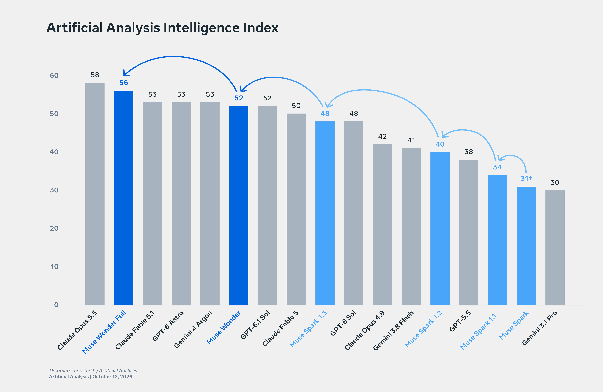

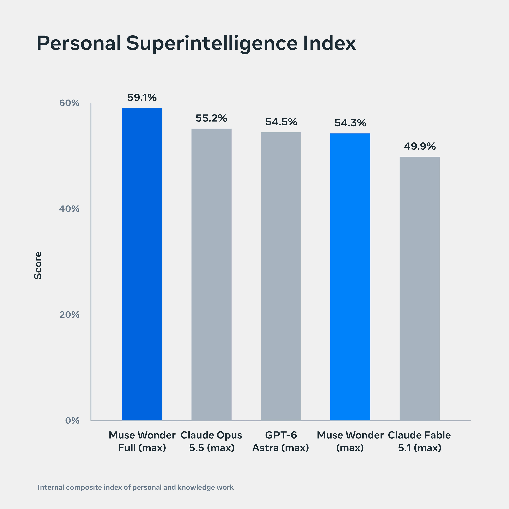

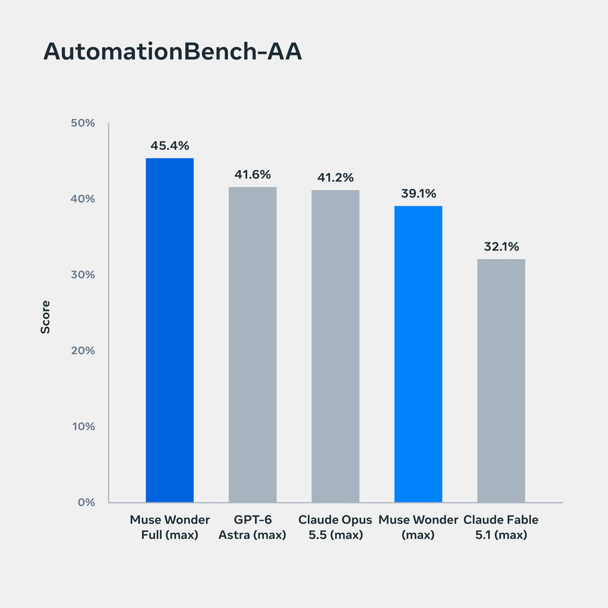

下方的完整结果在广泛的评估套件上，将 Muse Wonder 和 Muse Wonder Full 与其他前沿模型进行比较。

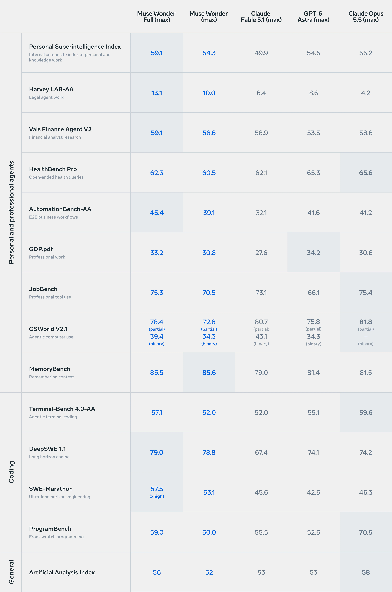

有关我们评估的更多细节，请参阅[我们的报告](https://research.meta.ai/static/muse-wonder-model-card)。

以上结果提供了模型表现的全貌。下面我们仔细看看对它们完成现实世界任务至关重要的四个方面：领域专业知识、主动记忆、主动专注和前沿编程。

### 领域专业知识

Muse Wonder 和 Muse Wonder Full 把专业知识运用到人们在工作和日常生活中遇到的问题上，从理解一份租约到弄懂财务或健康信息。我们的评估包括法律、金融和健康方面的任务，用来测试这种能力。例如，Harvey 的法律智能体基准（Legal Agent Benchmark，LAB）要求模型处理原始文档，并遵循详细的指示来产出法律工作成果。

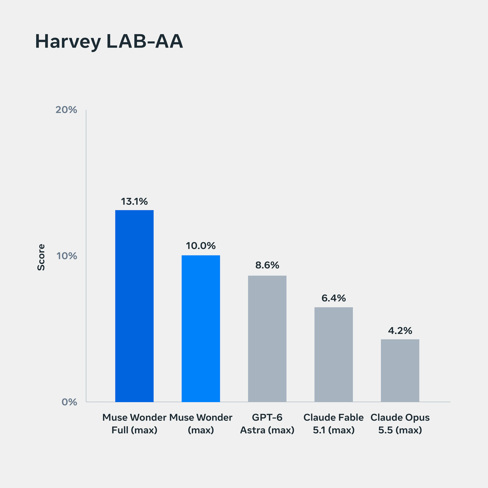

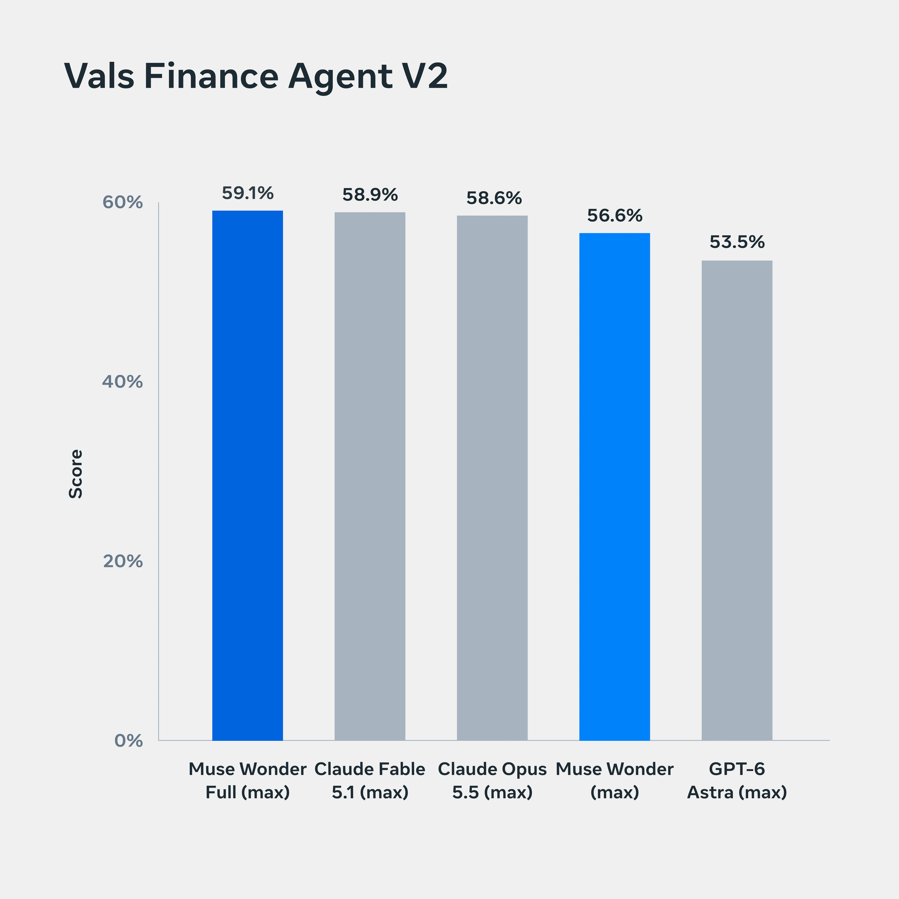

### 主动记忆

迈向有用的个人和职业智能体，最关键的步骤之一是可靠的记忆。模型需要记住重要的事情，并识别出先前的信息何时变得相关。我们称之为**主动记忆**：在不同对话之间携带关于你的重要上下文，并主动检索与手头任务相关的细节。

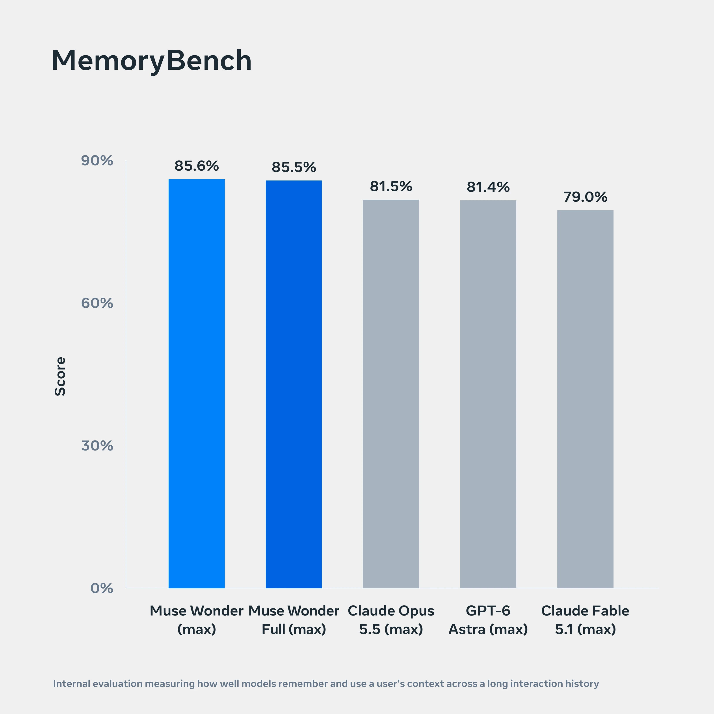

### 主动专注

利用这些上下文完成一项任务，还需要持续的努力。**主动专注**描述的是 Muse Wonder 如何持续朝着一个有挑战性的目标工作：尝试其他方法、克服障碍、适应新信息。在此过程中，它会在需要时请求澄清，并在采取重要操作之前先与你确认。我们通过 FocusBench 评估专注能力，通过 SWE-Marathon 评估持续执行能力，后者测试在长期软件项目上的工作。

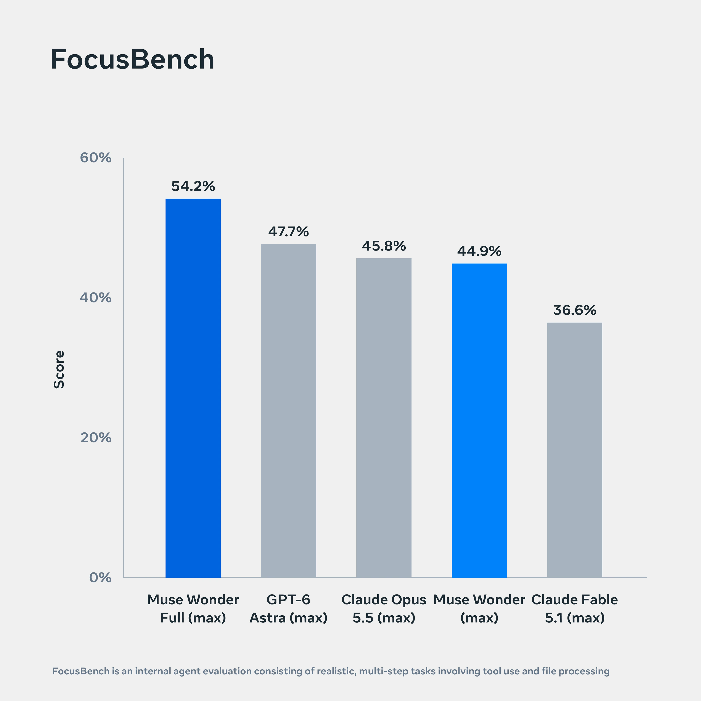

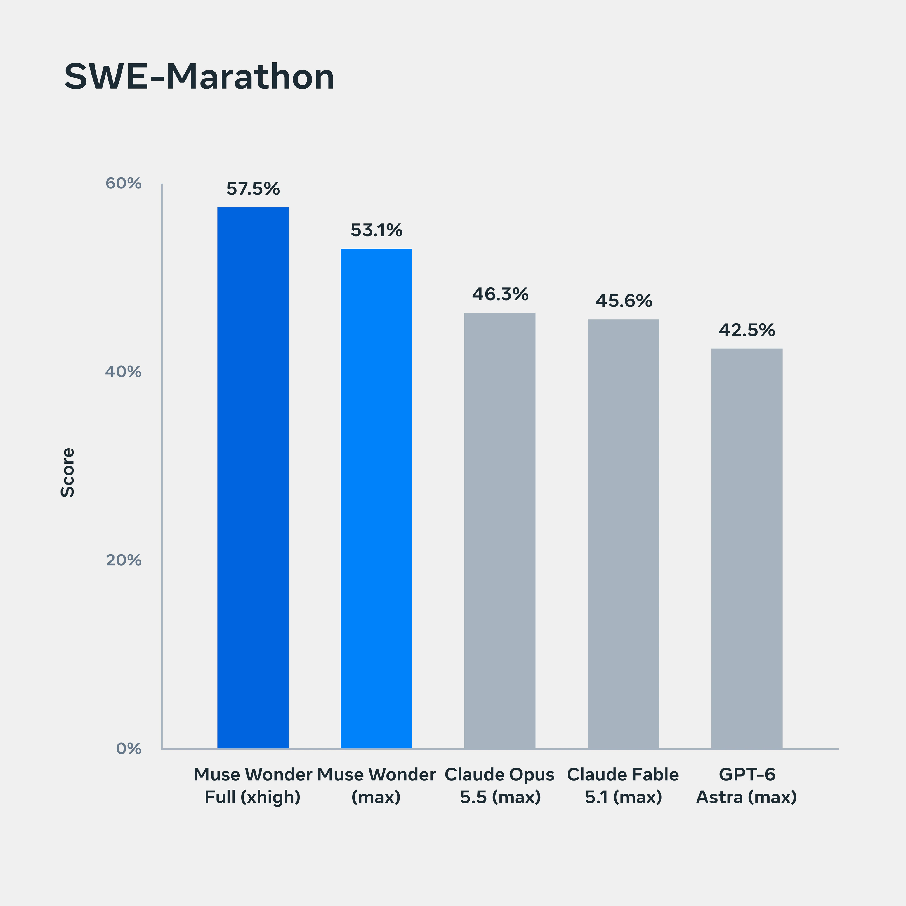

### 前沿编程

编程把这些能力结合在一起。构建软件需要跟踪需求、在整个代码库中进行修改，并经历反复的测试和修订循环。Muse Wonder 和 Muse Wonder Full 提供前沿的编程性能，支持从小型应用到复杂软件的各种项目。我们用多样化的长期任务训练这两个模型，帮助它们在这个过程中持续取得进展。

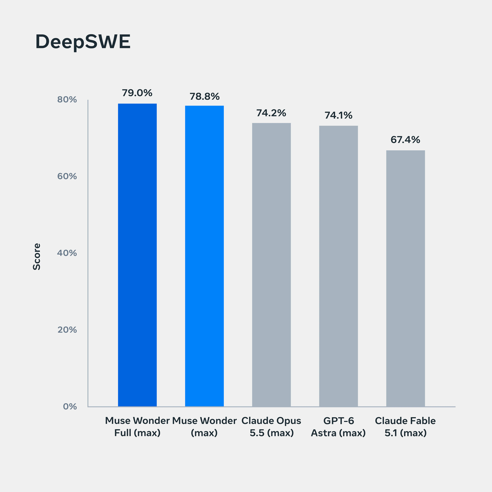

[交互演示（三个标签页）：厨房游戏（Kitchen Game）、健康支持（Wellness Support）、保险理赔（Insurance Claim）](https://research.meta.ai/blog/muse-wonder)

- 厨房游戏：Muse Wonder 根据可自定义的图片输入，构建了一个可玩的 3D 厨房游戏。
- 健康支持：用户在旅行时寻求健康建议。Muse Wonder 拥有来自其日历、消息和电子邮件的上下文。
- 保险理赔：Muse Wonder 端到端地处理一张有争议的医疗账单。（视频：保险理赔智能体演示的屏幕录像）

## 能够泛化的能力

两个模型的基准分数常常相近，但其中一个似乎能处理范围广得多的陌生任务。对「刷榜」（benchmaxxing）的抱怨和对「大模型味道」（big model smell）的称赞，说的都是这一点：一种几个领域里的流行基准无法完全捕捉的能力广度。

为了量化这种不一致，我们研究了随着测试时计算量的扩大，后训练阶段针对性任务上的表现与陌生任务上的表现之间的关系。下图比较了 Muse Spark 1.3 和 Muse Wonder Full，每个点代表一个不同推理强度下的表现。横轴显示模型在一组代表后训练重点任务的综合指标上的得分（「分布内」）。纵轴显示模型在一组后训练未针对的任务上的平均得分（「分布外」）。

随着测试时计算量的扩大，我们的两个模型在分布外任务上的提升幅度相似。但考虑到其分布内表现，Muse Wonder Full 在陌生任务上的表现甚至比 Muse Spark 1.3 的趋势所预测的更好。这种上移是因为 Muse Wonder 和 Muse Wonder Full 建立在更大、更强的基础模型之上：更强的基础模型使后训练带来的提升能更有效地迁移到陌生任务上。这种多面性对个人智能体尤其重要，因为它们需要处理目标、工具和约束的多种组合，而其中并非所有组合都能在训练时预料到。

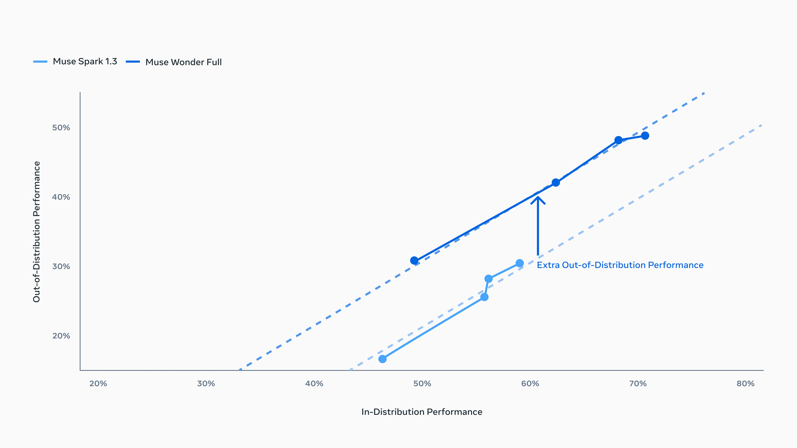

[交互演示（三个标签页）：周六跑步规划（Saturday Run Planning）、个性化礼物（Personalized Gifts）、婚礼座位表（Wedding Seating Chart）](https://research.meta.ai/blog/muse-wonder)

- 周六跑步规划（视频：周六跑步规划智能体演示的屏幕录像）：Muse Wonder 直接在浏览器中并跨多个应用工作，根据个人偏好和情况制定一份跑步计划（地图数据 © [OpenStreetMap](https://www.openstreetmap.org/copyright) 贡献者）。
- 个性化礼物：Muse Wonder 根据个人 Instagram 主页上的真实照片，设计并订购定制周边。
- 婚礼座位表：Muse Wonder 根据一系列复杂的匹配要求，准备一份定制的婚礼座位表。

## 前沿的安全

把个人超级智能带给每个人，需要在对齐和安全上进行大量投入。个人智能体代表用户采取行动，可能会处理消息、日历和私人文档等上下文。这种程度的访问权限，要求模型对私人信息保持审慎，并能抵御滥用。我们训练 Muse Wonder 系列在这两个维度上都处于领先：对对抗性指令具有稳健性，并谨慎处理私人信息。

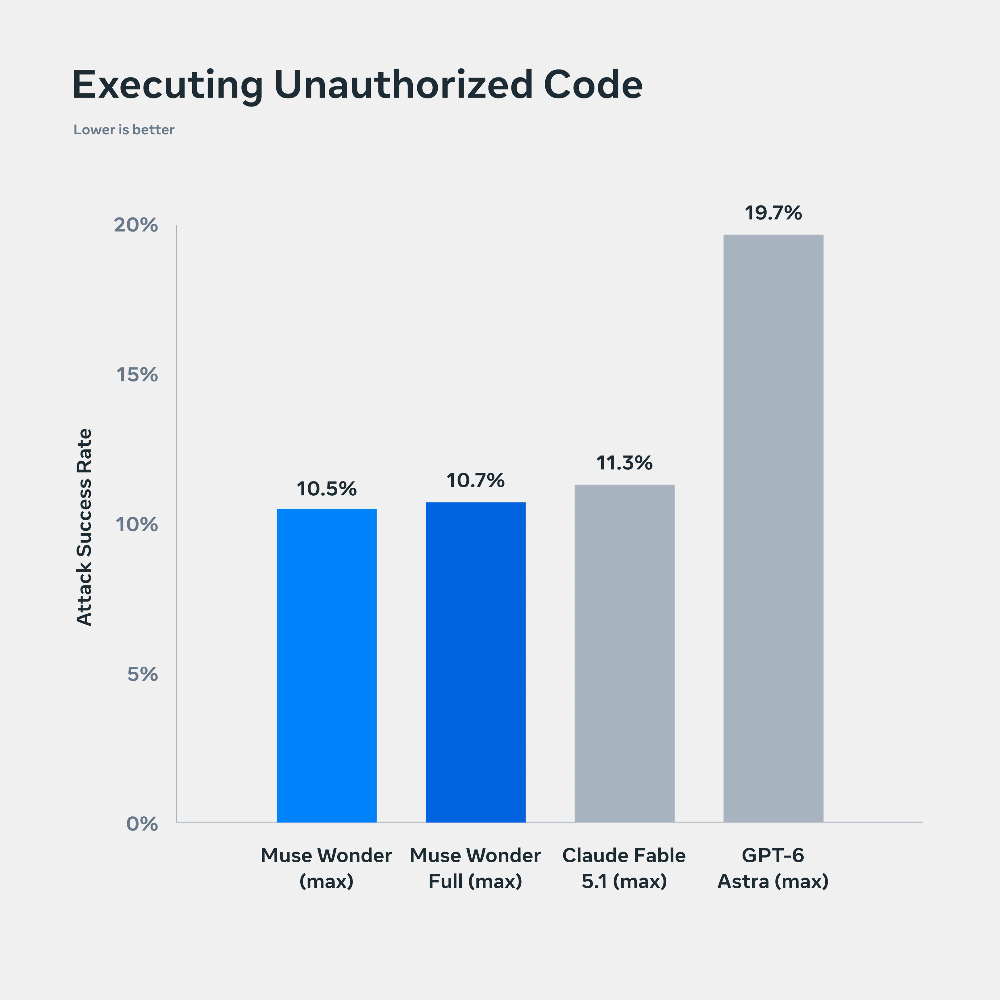

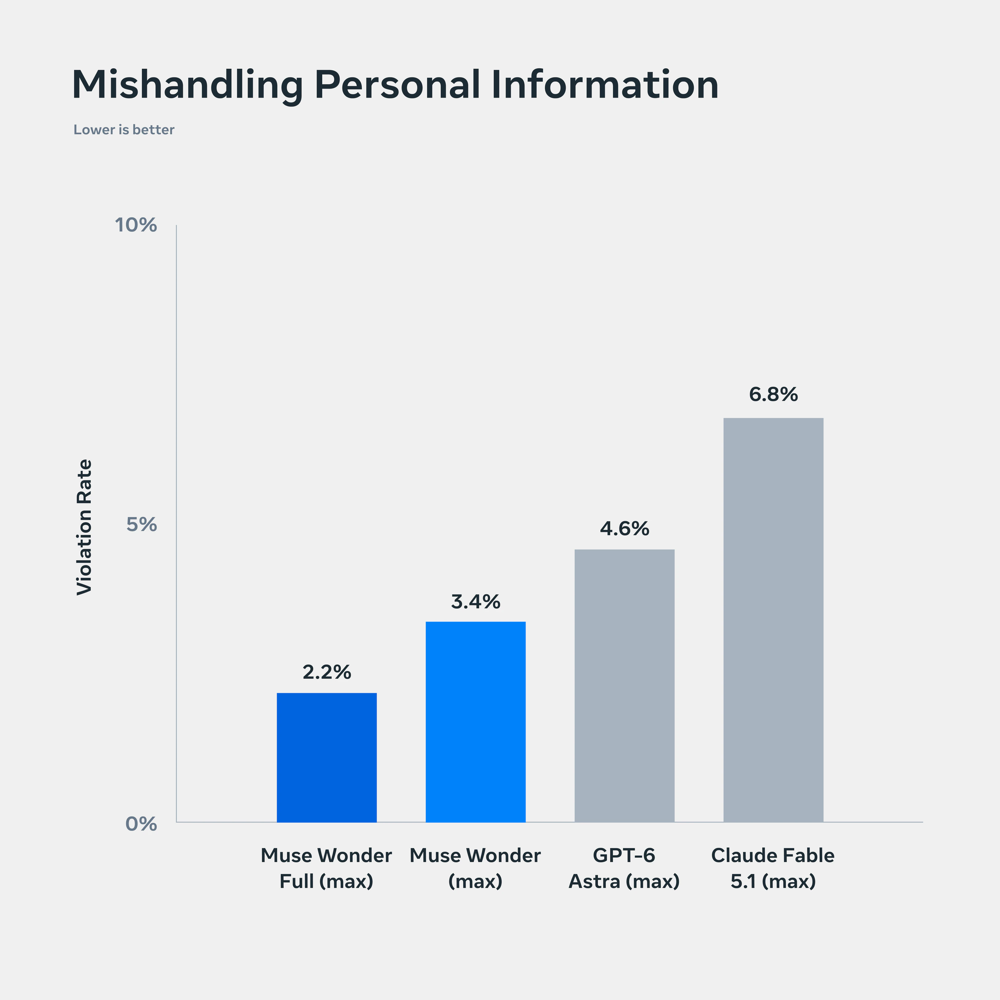

随着模型能力越来越强，我们的目标是帮助人们安全、负责任地利用这些能力。按照我们的 [Meta 超级智能扩展框架](https://research.meta.ai/static/meta-superintelligence-scaling-framework)（Meta Superintelligence Scaling Framework），Muse Wonder 提供了我们迄今针对 CBRN（化学、生物、放射性和核）和网络滥用最强的防护措施，同时保留了将前沿网络能力用于防御用途的途径。

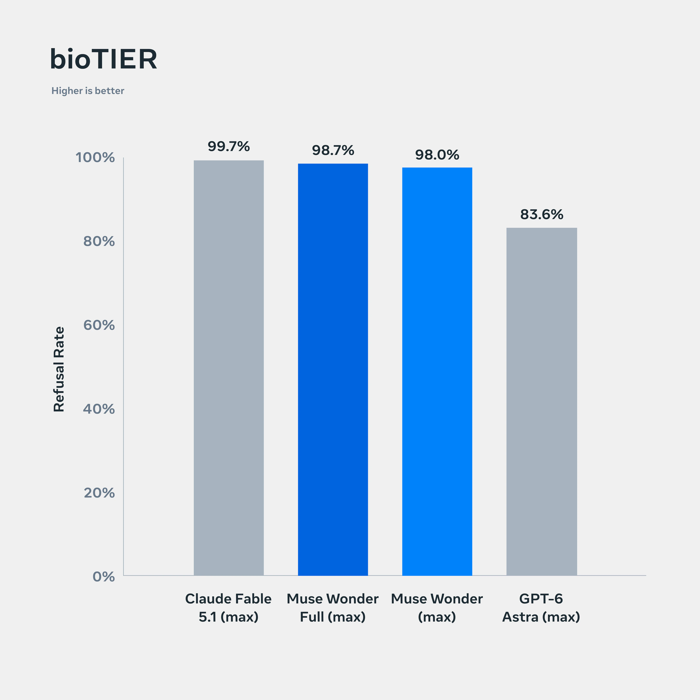

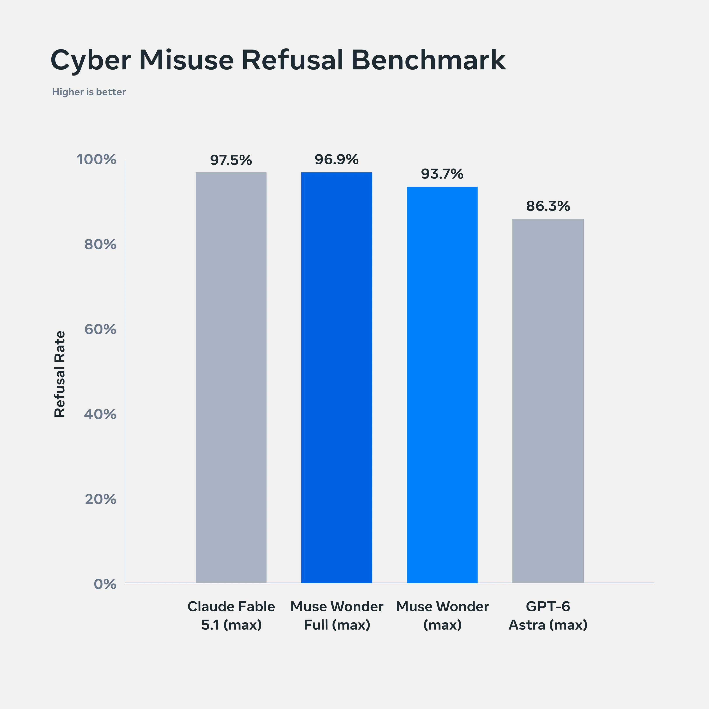

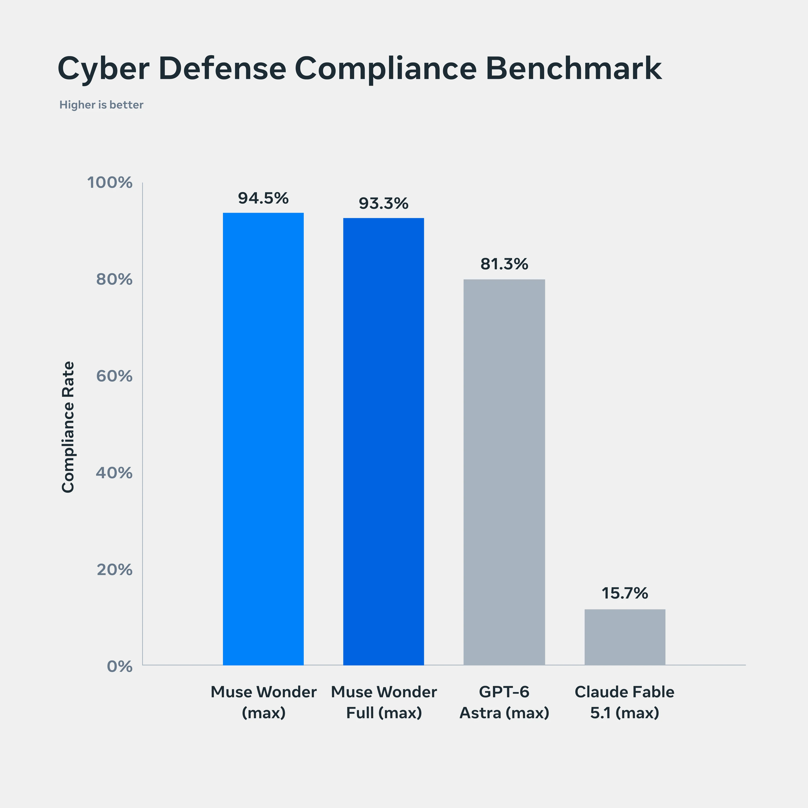

Muse Wonder 是我们迄今对齐程度最高的模型，而对齐是我们打造个人超级智能方式的核心。一份包含更多安全评估的完整报告将很快发布。

我们希望 Muse Wonder 和 Muse Wonder Full 能让更多人有能力追求自己的梦想，建设他们想要的世界。这是朝着为每个人提供个人超级智能迈出的重要技术一步，未来还有更多。

[视频：人们追求个人和职业目标，旁白介绍 Muse Wonder](https://research.meta.ai/blog/muse-wonder)
