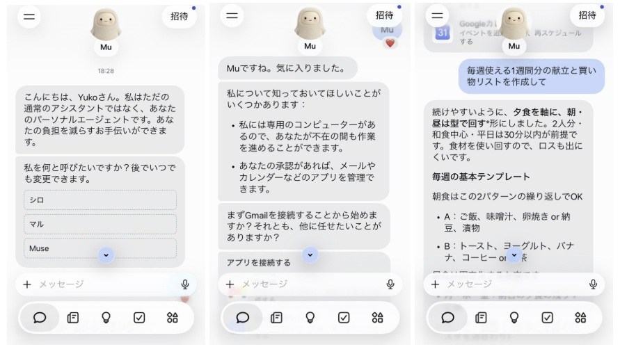



[视频：Meta Muse 日本宣传片（30 秒）](https://about.fb.com/ja/wp-content/uploads/sites/15/2026/10/1_Meta_Muse-Campaign_JP_16x9_30sec-2.mp4)

Meta 自 10 月 23 日（日本时间）起，在日本开始提供个人 AI 智能体「Muse」。日本是继今年 9 月率先开始提供服务的北美之外，第一个提供服务的地区。Muse 是全球首个为让任何人都能轻松使用而设计的个人 AI 智能体。它在重视安全性和隐私的同时，不仅回答问题，还能主动支持用户实现目标，并实际推进任务。

Muse 是按照用户日常的沟通方式设计的，用户可以在 Muse 应用中与它对话，就像给另一个人发消息一样。只要把要做的事告诉 Muse，Muse 就会制定计划并推进所需的工作。

**Muse 的特点与工作方式**

Muse 的构建方式让人无需学习特别的使用方法就能使用。它不仅能处理发送电子邮件、预订旅行之类的任务，还能着手更大的目标。用户告诉它一个目标后，Muse 会帮助制定适合每个人的计划，调整时间和资源，之后便自主推进工作。它可以打开浏览器、填写表单，代替用户进行各种操作。

对于耗时较长的任务，Muse 会在用户关闭应用后继续工作，并在情况发生变化时，或者在发送电子邮件、购买商品等需要批准时通知用户。此外，Muse 会记住对用户重要的事情，并能基于过去的对话提出建议、采取行动。

**Muse 可使用的服务与在日本的合作扩展**

连接器是 Muse 能做这么多事情的一个重要原因。通过与日本用户已经在使用的应用和服务连接，Muse 可以支持广泛的日常事务。其中包括 Gmail、Google 日历、Instagram 等，可以管理电子邮件往来、调整日程、利用已保存的内容，以及按目的所需工作的执行是可推进工作。（译注：原文此句为「目的に応じた必要な作業の遂行が可作業を進めることができます」，句子残缺；大意为「能够按目的执行所需的工作」。）

此外，通过与 Stripe、Shopify、Trip.com、Agoda、Klook 等在全球开展业务的各种服务连接，Muse 可以在购物、旅行规划与预订等广泛场景中发挥作用。

我们还在推进与日本用户身边常用服务的连接。随着 Muse 在日本开始提供服务，我们将推进与运营二手交易应用「Mercari」（メルカリ）的株式会社 Mercari、可将家庭收支与资产可视化的「Money Forward ME」（マネーフォワード ME），以及「Ticket Pia」（チケットぴあ）等服务的连接。今后，我们还将进一步推进与日本用户日常使用的服务的连接，扩大 Muse 的用途。

此外，Meta 日本法人代表董事味泽将宏表示：「Muse 是一个个人 AI 智能体，它代替用户推进各种任务，帮助每个人专注于真正重要的事情。在日本开始提供服务之际，除了与许多人已经在使用的全球服务连接之外，我们还将推进与株式会社 Mercari、Money Forward Home 株式会社、Pia 株式会社等国内合作伙伴的连接。我们希望通过把 Muse 与用户日常使用的服务连接起来，在购物、旅行、日常日程管理等更广泛的场景中提供有用的体验。」

**面向更自然的沟通**

在前不久举办的 Meta Connect 上，我们介绍了 Muse 能够实时对话、可在更广泛场景中使用的新功能。除了可以在持续长时间自然对话的同时在后台处理任务的高级语音模式之外，我们还发布了实现富有表现力的头像的「[Muse Realtime Avatar](https://research.meta.ai/blog/bringing-your-muse-to-life)（仅英文）」，以及可用于处理任务和沟通的 Muse 专属电子邮件地址。关于 Meta Connect 的发布内容，详情请见[这里](https://about.fb.com/ja/news/2026/09/meta-connect-2026-everything-we-announced/)。这些功能在日本的提供情况，将另行通知。

**以隐私、安全性和安全防护为前提的设计**

个人智能体需要一种新形态的安全计算机。Muse 运行在专用虚拟机「Muse Secure VM」上。这是在云端为每位用户隔离的专用环境，安全地保管所连接服务的数据和认证信息。

独立于 Muse 的 Sentinel（センチネル）智能体管理对互联网的访问。此外，Muse 无法查看用户的密码或付款方式，在发送电子邮件、购买商品等重要操作之前会向用户本人确认。用户可以查看 Muse 已经执行和计划执行的操作的历史记录。

主导权始终在用户自己手中。用户可以选择连接的应用和访问范围，也可以随时更改权限或解除连接。用户还可以选择退出，不让与 Muse 的互动被用于训练 Meta 的 AI 模型。Muse 不会与 Meta 的广告系统共享用户的对话或虚拟机内的数据。

关于 Meta 在 AI 智能体安全性和安全防护方面的做法，详情请见[这里](https://research.meta.ai/blog/security-and-safety-for-ai-agents-our-approach-with-muse)。

**今后的展望**

Meta 认为，个人超级智能将成为我们一生中带来最大变革的技术之一。Muse 是迈向这一目标的第一步，它承担更多的工作，帮助用户专注于对自己真正重要的事情。

Muse 自今天起在日本通过 iOS、Android 和 muse.ai 开始提供服务。许多基本功能可以免费使用，并为希望更多使用的用户准备了订阅方案。

关于 Muse 的工作方式以及安全性、隐私的详细信息，请参阅 [9 月的发布文章](https://about.fb.com/ja/news/2026/09/introducing-muse-personal-ai-agent/)。
