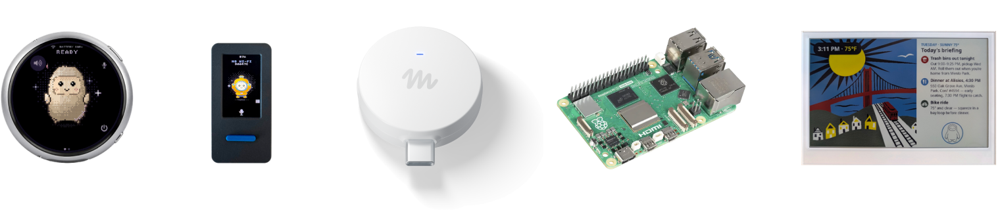
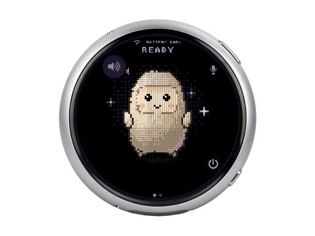
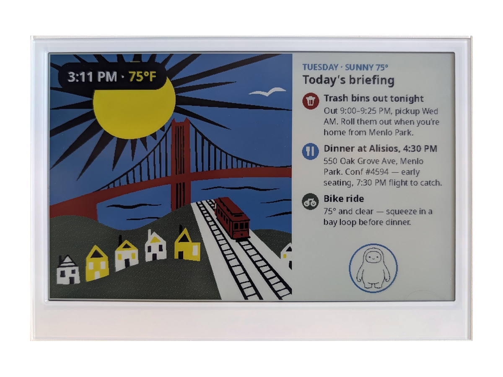
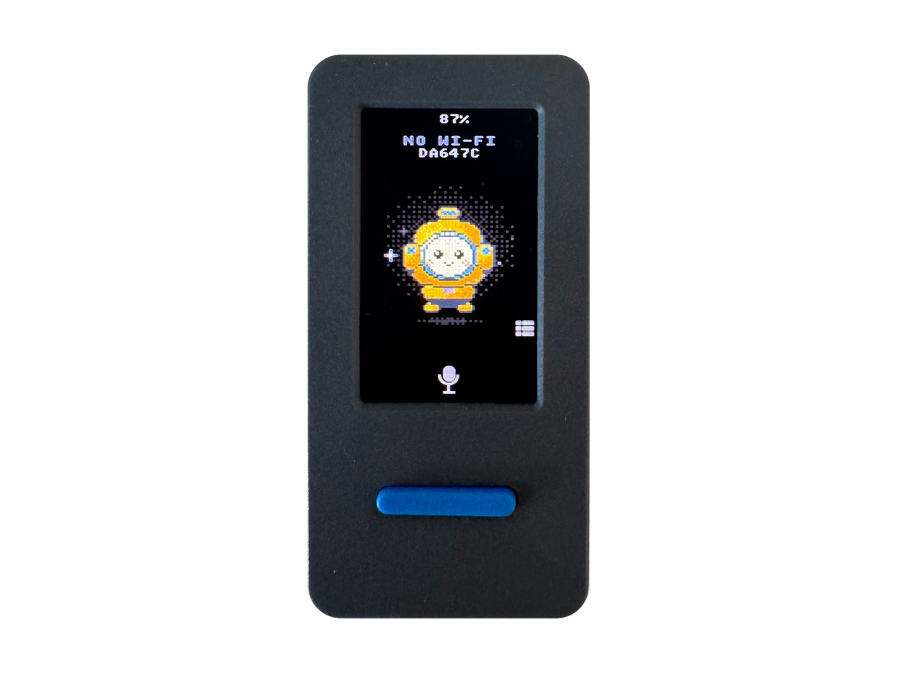
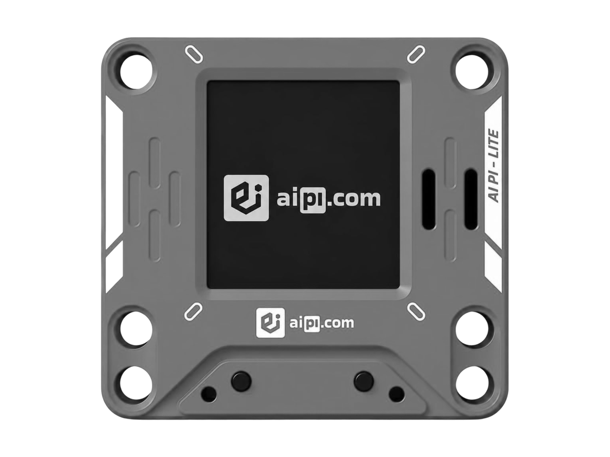



（译注：原页面以网格排版，各节编号为 01 至 05，网页源码中的顺序为 01、03、04、02、05；以下按编号顺序排列。页首右侧有一幅由字符组成的 Muse 角色图，以下用占位行代替。）

## 为你的 [Muse](https://muse.ai) 打造的开源硬件

Muse 小设备（gadgets）是你自己动手打造的开源设备。给一块现成的 ESP32 开发板编程，或者用我们的 SDK 配置一台 Raspberry Pi，然后把 Muse 连接到你的显示屏、按钮、传感器、执行器，以及你工作台上随手放着的任何其他东西。

[字符画：Muse 角色](https://gadgets.muse.ai/)

01 / 在你的硬件上

## 自己动手做

我们[开源](https://github.com/facebookincubator/muse-gadget-sdk)了制作 Muse 小设备所需的代码。它由黑客打造，为黑客而做，纯粹为了好玩。动手折腾的副作用可能包括板子变砖、保修失效、电压不足掉电或者破产。风险自负！

先获取一个 [SDK 令牌](https://gadgets.muse.ai/settings/sdk-tokens)，再挑一个我们推荐的[项目创意](#项目创意)开始。然后尽情折腾和定制。如果你更喜欢，也可以为一块全新的开发板构建支持。

### [ESP32 Device SDK↗](https://github.com/facebookincubator/muse-gadget-sdk/tree/main/esp32)

通过我们的开源 SDK 把你的 ESP32 开发板连接到 Muse。加一块屏幕来显示图片，加上音频输入和输出，或者接上其他传感器。

### [Linux Device SDK↗](https://github.com/facebookincubator/muse-gadget-sdk/tree/main/linux)

把那台闲置的 Raspberry Pi 或 Linux 机器变成一个 Muse 小设备。加入你自己的命令，让 Muse 处理系统管理杂务或你的 Home Assistant 配置。

02 / 使用我们的硬件

## 我们做的一款：[Muse Home Link](https://gadgets.muse.ai/home-link)

把 Muse 连接到你家的 Wi-Fi，让它能够访问你已经拥有的兼容设备，或者你用本地 HTTP API 构建的任何东西。社区构建的技能可以让 Muse 打开一盏灯、控制你的电视、把文档发送到打印机等等，具体取决于你的配置。

[领取你的 Muse Home Link↗](https://gadgets.muse.ai/#notify)

仅限美国，随有效的 Muse 订阅附赠，每位订阅用户限领一个。10 月发货，先到先得。

03 / 一起打造✳

## 社区

在我们的社区 Discord 中结识其他正在打造和定制 Muse 小设备的黑客。获得灵感，互相支持，分享你的作品。

258 名成员在线（译注：收集时页面显示的数字）

[加入 Discord↗](https://discord.gg/3bhjCkZdd6)

04 / 开放源码</>

## 源代码

浏览我们的设备 SDK 和固件的源代码。把它作为你项目的起点，并把你的改进贡献回社区。

设备 SDK 和固件以 Apache 2.0 许可证开源，按原样提供，不附带任何担保。

[GitHub 上的 Muse Gadgets↗](https://github.com/facebookincubator/muse-gadget-sdk)

05 / MUSE 小设备示例

## 项目创意

- **Raspberry Pi 5** 让 Muse 能够配合 Home Assistant 和其他流行的 Linux 应用工作。[购买 ↗](https://www.walmart.com/ip/Raspberry-Pi-5-SC1160-8GB-RAM-Single-Board-Computer/5820957894) [源码 ↗](https://github.com/facebookincubator/muse-gadget-sdk/tree/main/linux)
- **Waveshare ESP32-S3-Touch-AMOLED-1.75C** 一块 1.75 英寸的圆形 AMOLED 触摸屏，带按键通话、扬声器和麦克风，以及电池。[购买 ↗](https://www.waveshare.com/esp32-s3-touch-amoled-1.75c.htm) [源码 ↗](https://github.com/facebookincubator/muse-gadget-sdk/blob/main/esp32/devices/sdkconfig.muse-waveshare-s3-175c)
- **电视上的 Muse** 一根插进电视 HDMI 接口的电视棒，让你可以请 Muse 把东西投到大屏幕上。即将推出
- **Seeed reTerminal E1002** 给你的 Muse 一块彩色电子墨水屏。Muse 可以显示晨间简报、提醒、购物清单，或者你想到的任何其他东西。[购买 ↗](https://www.seeedstudio.com/reTerminal-E1002-p-6533.html) [源码 ↗](https://github.com/facebookincubator/muse-gadget-sdk/blob/main/esp32/devices/sdkconfig.reterminal-e1002)
- **M5Stack StickS3** 一台口袋大小的 M5Stack 设备，彩色屏幕显示 Muse 的状态，正面有一个按钮。[购买 ↗](https://shop.m5stack.com/products/m5sticks3-esp32s3-mini-iot-dev-kit) [源码 ↗](https://github.com/facebookincubator/muse-gadget-sdk/blob/main/esp32/devices/sdkconfig.muse-m5stack-sticks3)
- **AiPi Lite** 一个给 Muse 用的小巧桌面伙伴。按下按钮说话，Muse 会出声回答，并在彩色屏幕上显示图片。[购买 ↗](https://aipi.com/products/aipi-lite) [源码 ↗](https://github.com/facebookincubator/muse-gadget-sdk/blob/main/esp32/devices/sdkconfig.muse-aipi)
- **带 1.9 英寸显示屏的 ideaspark ESP32** 给 Muse 一块小小的状态屏。一眼看到 Muse 正在做什么，并让它在 1.9 英寸彩色显示屏上画图。[购买 ↗](https://www.amazon.com/dp/B0D6QXC813) [源码 ↗](https://github.com/facebookincubator/muse-gadget-sdk/blob/main/esp32/devices/sdkconfig.ideaspark)
- **Home Assistant Voice Preview Edition** 通过它的扬声器和麦克风用按键通话的方式与 Muse 交谈，并在它的 LED 光环上看到 Muse 的状态。[购买 ↗](https://www.home-assistant.io/voice-pe/) [源码 ↗](https://github.com/facebookincubator/muse-gadget-sdk/blob/main/esp32/devices/sdkconfig.home-assistant-voice)

此处展示的设备由其他公司制造和销售，Meta 不为它们背书或提供担保。名称和标志归其各自所有者所有。

## 分享你的项目

做了一个 Muse 小设备？在 Discord 的 #projects 频道分享它。我们可能会在这里展示它，并链接到你的代码仓库，让其他人也能做出来。

### 发帖之前

1. 拍一张照片或一段短视频。
2. 为你的项目写一两句话。
3. 准备好一个带 README 的 GitHub 仓库。

[在 #projects 中分享 ↗](https://discord.gg/tkpSAd9MJ)
