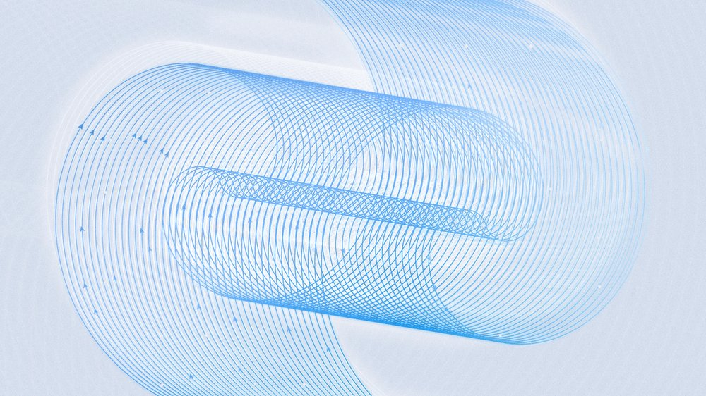



**收录说明**：直接下载后用 extract.py 抽取；文中两张图表以 HTML 数据表形式呈现，已按文字顺序还原为简表；首图已本地化到 images/（webp 超限已转为 jpg，145KB）。原文全文存于本目录的 original.md，网站上不显示，已翻译。

**内容摘要**：Meta 于 2026 年 11 月 6 日推出以 Muse Wonder 训练的现有模型特化版，并向 Muse 与 Meta AI 用户推送。特化模型带来 Active Memory 与 Active Focus；Active Memory 使模型记住重要信息、区分临时与永久信息、跨时间推理，Muse 中关键信息遗忘减少 2.4 倍，Active Memory 评估中正确使用关键上下文的任务从 76% 升至 90%。Active Focus 使 Muse 在遇到意外困难时仍朝目标推进，日常任务完成率提升 67%。当前 Muse 模型在 Personal Superintelligence Index 得 47%，上一代为 38%。

**保留理由**：这是特化模型推送的官方原文，给出了 Active Memory 与 Active Focus 的定义及三组对照数据，是后续关于该推送的报道与讨论的出处依据。

---

为 Muse 与 Meta AI 带来特化模型

2026 年 11 月 6 日·阅读 2 分钟

几周前，我们推出了 [Muse Wonder](https://research.meta.ai/blog/muse-wonder) 系列，这是我们迄今最强的模型，在个人与专业智能体任务上达到最先进水平。今天，我们推出基于 Muse Wonder 训练的现有模型特化版本，并向使用 Muse 和 Meta AI 的用户推送。

## 把关键前沿能力带给 Muse 与 Meta AI

我们设计 Muse Wonder，是为了在工作和日常生活的复杂任务上具备前沿能力。我们也用它改进了 Muse 和 Meta AI 背后的模型，把其中一些能力带给更多人。

### Personal Superintelligence Index

当前与上一代 Muse 模型在 Personal Superintelligence Index 上的得分：47% 与 38%。

| 模型 | 指数得分 |
| --- | --- |
| 当前 Muse 模型 | 47% |
| 上一代 Muse 模型 | 38% |

## 记住重要的事

借助 Muse Wonder，我们推出了 Active Memory 与 Active Focus。我们正在把这两项都带到 Muse 和 Meta AI 的特化模型中。

Active Memory 让 Muse 和 Meta AI 记住重要的事，并识别早先的信息何时变得相关，从而更容易基于你过去的对话继续。我们训练模型识别何种信息是临时的、何种是永久的，跨时间推理，并区分仍然相关的内容与已经过时的内容。例如，我们在 Muse 中改进后的模型在遗忘帮助用户达成目标所需关键信息方面减少了 2.4 倍。

### Active Memory 评测

当前与上一代 Muse 模型在 Active Memory 评测上的得分：90% 与 76%。

| 模型 | 正确使用关键上下文的任务 |
| --- | --- |
| 当前 Muse 模型 | 90% |
| 上一代 Muse 模型 | 76% |

## 朝你的目标努力

Active Focus 让 Muse 即使面对意外挑战也能继续朝目标推进。我们在各种反映现实的瓶颈上训练了模型，使它们能代你更努力尝试、恢复或寻找替代方案。在 Muse 中，我们的模型在完成会出现意外问题的日常任务方面提升了 67%。

我们还让特化模型利用 Muse Wonder 在尤其对 Muse 重要的行为上的表现。例如，它们学会了成为出色的多任务处理者，知道何时独立推进你的目标、何时与你实时协作。它们也能更好地适应运行中任务中途的指令与澄清，而不被搞糊涂。

在 Meta AI 中，同样的改进造就了更好的思考伙伴与协作者。它能把复杂问题拆成清晰的步骤、提出更犀利的追问，并在你于对话中途改变方向时跟上。

通过把这些特化模型加入 [Muse](https://muse.ai/) 和 [Meta AI](https://meta.ai/)，我们希望让更多人获得能力更强的超级智能。我们迫不及待想让你亲自体验。
