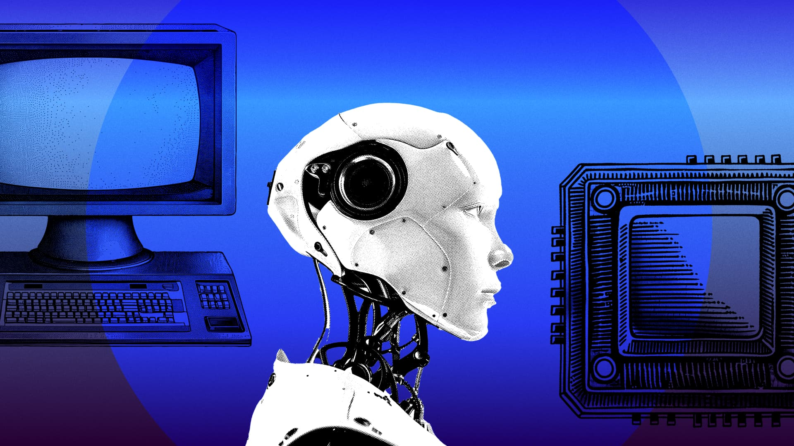



**收录说明**：领投方 General Catalyst 的投资文章，含与两位创始人的问答。发布方是投资机构，不是厂商也不是媒体，归入社区。直接下载后抽取，删去了页首的标题、作者与日期行以及模板占位链接（Example H2/H3）。已翻译。

**内容摘要**：General Catalyst 说明领投 Interaction 种子轮的理由：人们被邮件和消息淹没，现有工具加快了信息速度而未改变信息量与时间的平衡。文章称 Poke 住在 iMessage、WhatsApp 和 SMS 中，GC 是 beta 最早试用者之一，称其能迅速理解沟通模式；几千名 beta 用户已交换超过 50 万条消息、留存突出。创始人问答中，Marvin 与 Felix 称起初做以邮件为中心的产品，用户反馈后转向“不想学新界面”，做出带已读回执、输入指示、可被打断的对话体验；beta 用户用 Poke 替代 ChatGPT，团队比计划更快扩展到邮件之外，并称定价按用户情况调整。文章还介绍创始人曾带 65 人团队做出 22 吨隧道掘进机并在 SpaceX 的 Not-a-Boring Competition 获奖。

**保留理由**：给出投资方视角和创始人对产品转向（从邮件客户端到对话式助手）的早期自述，是时间线早期证据；其 50 万条消息与新闻稿的 75 万条不一致，引用时需注明出处。

---

如今的人们生活在接连不断、未曾收尾的对话之中。收件箱爆满，消息全天候不时响起，日历被一个接一个相互重叠的提醒填满。管理这股几乎不间断的沟通洪流，已经变成一件耗尽心力的事。为管理这种泛滥而设计的工具和系统，例如预测输入（predictive text）、收件箱清零（inbox-zero）和高级过滤，最终只是加快了速度，而没有改变消息量与接收者有限时间之间的平衡。

这就是我们领投 The Interaction Company of California 种子轮的原因——他们正在构建下一代个人智能。

## **理解人类如何沟通的 AI**

Interaction 正在打造的产品，挑战了人们对 AI 助手的一个根本假设：用户会再接受一个应用、再学一套界面，并切换到另一个标签页。他们的产品 [Poke](https://poke.com/) 住在人们已经在用的消息平台里，比如 iMessage、WhatsApp 和 SMS。通过构建一个覆盖理解、起草、日程安排与跟进的统一系统，他们的平台能够提供我们所认为将定义数字连接未来的那种个性化、端到端的沟通协助。

我们是最早试用 Poke beta 版的人之一，并立刻被打动。通过整合短信、邮件和日历等平台，它几乎立刻就能理解我们以及我们的沟通模式。结果是一款不太像工具、更像身边有位记得你在意之事的老朋友的产品——而这位朋友恰好拥有完美的记忆力和无限的耐心。

他们展现出惊人的早期势头：几千名 beta 用户已与 Poke 交换了超过 50 万条消息，留存表现亮眼。Poke 因其直观的设计和出人意料地像人的互动而受到称赞，并不断以用户意想不到的方式证明自己的用处。

创始人 Marvin von Hagen 与 Felix Schlegel 是长期合作者，两人合计拥有人工智能研究与大规模系统工程的经验。从中学到创办 Interaction 之间，他们创办了 TUM Boring，带领一支 65 名工程师的团队造出一台 22 吨的隧道掘进机，并在 SpaceX 的 Not-a-Boring Competition 中获奖。他们曾在斯坦福、MIT 和剑桥从事研究，也曾在 Tesla 和 Apple 工作。他们还组建了一支来自 Jane Street、Apple、Robinhood、Amazon 等公司的工程师团队——这些人忍不住全天候打磨这款产品，因为他们自己就是用户。

## **与 Marvin 和 Felix 的对话**

我们最近与 Marvin 和 Felix 坐下来聊了聊，想更多了解他们打造一个以沟通为先、始终在线的数字助手平台的历程。这篇访谈经过编辑，以控制篇幅并保证清晰。

***你希望这家公司给世界带来怎样的影响？***

现有的 AI 产品感觉机械、冰冷，还要求用户围绕它们改变习惯。我们想把更多人性带进 AI，打造一款真正好用、能融入全球数以百万计人们生活的产品。不用太久，我希望人们甚至不再去想「使用 AI」这件事——他们只是在给 Poke 发短信，而一切自然运转。

***你们早期建设团队文化的方式是什么？***

在 Interaction 工作，感觉就像我们成长过程中参加的那些黑客松。有人晚饭时冒出个想法，到早上就有了能跑的原型。我们为发布拍了一部短片：一个发生在巴黎的爱情故事，和那种典型的「我们很高兴地宣布」创业公司视频完全不同。我们更愿意讲故事，而不是做声明；更愿意自然地展示产品，而不是罗列功能。就连我们的定价也体现了这一点——它根据你是谁来调整，把「学生折扣」做到了极致。

***从开始做这件事以来，你的想法是如何演变的？***

起初我们把它当作一个以邮件为中心的产品，计划做一个带自动化功能和各种典型配置的客户端。但和用户交流后我们发现，人们并不想再学一套界面。凡是有能力负担的人，想要的是一位人类行政助理：大多数邮件根本不用看，只需通过短信快速确认该做什么。

所以我们把大量精力放在打磨这种体验上：让 Poke 真正像在对话、有个人感、会主动，具备已读回执、输入指示、可以像真人一样被打断，以及比以往任何 AI 系统都更像人的行为。

这导致 beta 用户用 Poke 替代了他们原本使用 ChatGPT 的场景，甚至包括我们并未为之设计的任务，其留存与使用数据在个人助手领域前所未闻。我们现在扩展到邮件之外的速度远快于原计划，不是我们在推，而是用户在自然地把我们往那个方向拉。

***在 General Catalyst，我们被这样的问题吸引：它们和我们使用的工具一样古老，却尚未从根源上被解决。AI 让我们有可能设想一种与数字沟通的不同关系。长上下文模型如今给了我们能够跨平台携带记忆、记得语气、预判义务、并在人脑已经转向别处时继续跟进的助手。其承诺是一个真正的数字分身：减少噪音、恢复专注，并为任何以沟通为生的人整理生活。***

在这个阶段，有意义的合作远不止资本。当我们被介绍给 GC 时，我们完全没想到会打开哪些门，尤其是那些出乎意料、却极其宝贵的支持。GC 团队做了许多精彩的引荐，包括招到一位出色的人选，我们还得到了一支专职团队的公关支持。真正的伙伴关系，就是在我们甚至想不到该如何开口的地方提供帮助！
