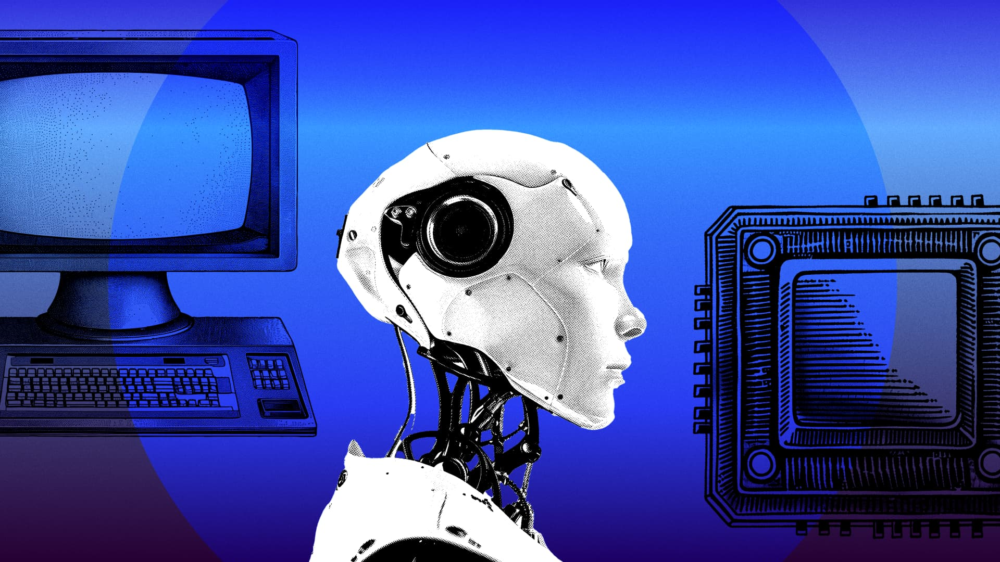

来源：https://www.generalcatalyst.com/stories/seeding-the-future-with-the-interaction-company-of-california
取文：2026-11-09，直接下载

People today live in a flurry of unfinished conversations. Inboxes overflow, messages ping at all hours of the day, and calendars fill with overlapping reminders. Managing the near-constant stream of communication has become an all-consuming activity. Tools and systems meant to manage this proliferation, like predictive text, inbox-zero, and advanced filtering, end up accelerating velocity rather than changing the balance between the volume of messages and the limited time of the person receiving them.

That's why we're leading the seed round for The Interaction Company of California as they build the next generation of personal intelligence.

## **AI That Understands How Humans Communicate**

What Interaction is building challenges a fundamental assumption about AI assistants: that users will adopt yet another app, learn another interface, and context-switch to another tab. Their product, [Poke](https://poke.com/), lives inside the messaging platforms people already use, like iMessage, WhatsApp, and SMS. By creating a unified system that covers comprehension, drafting, scheduling, and follow-up, their platform can deliver the kind of personalized, end-to-end communication assistance that we believe will define the future of digital connectivity.

We were among the first to try the beta version of Poke and were immediately impressed. By integrating across platforms like text, email, and calendar, it was able to understand us and our communication patterns almost instantly. The result is a product that feels less like a tool and more like having an old friend by your side who remembers what matters to you—and who happens to have perfect memory and infinite patience.

They’ve demonstrated remarkable early traction, with impressive retention among the several thousand beta users who have exchanged over half a million messages with Poke. Praised for its intuitive design and surprisingly human-like interactions, Poke keeps proving useful in ways users don’t expect.

Founders Marvin von Hagen and Felix Schlegel are long-time collaborators with combined experience in AI research and systems engineering at scale. Between middle school and founding Interaction, they started TUM Boring, leading a team of 65 engineers to build a 22-ton tunnel boring machine that won SpaceX’s Not-a-Boring Competition. They have research experience at Stanford, MIT, and Cambridge and have worked at Tesla and Apple. And they’ve built a team of engineers from Jane Street, Apple, Robinhood, Amazon and more who can’t help but work on their product at all hours because it’s one they all use themselves.

## **Our Conversation with Marvin and Felix**

We recently sat down with Marvin and Felix to learn more about their journey to creating a communication-first, always-on digital assistant platform. This interview has been edited for length and clarity.

***What impact do you want this company to have on the world?***

Existing AI products feel robotic, cold, and require users to change their habits around them. We want to bring more humanity into AI, and build a genuinely good product that blends into many millions of lives around the world. Not too soon from now, I hope people won't even think about 'using AI' anymore—they'll just be texting with Poke, and it will just work.

***What’s your approach to building team culture early on?***

Working at Interaction feels just like those hackathons we grew up in. Someone will have an idea at dinner, and by morning there's a working prototype. We released a short film for our launch: a love story set in Paris, nothing like the typical 'we're excited to announce' startup video. We'd rather tell a story than make claims. We'd rather show the product naturally than list features. Even our pricing reflects this—it adjusts based on who you are, taking 'student discounts' to an extreme.

***How has your thinking evolved since you started working on this?***

We initially approached this as an email-centric product, planning to build out a client with automations and all the typical trappings. But talking to users told us people didn't want another UI to learn. Whoever can afford it wants a human executive assistant: never even seeing most emails, just quickly checking in via text on whatever needs to be done.

So we focused a lot on perfecting that experience: making Poke feel genuinely conversational, personal, and proactive, with read receipts, typing indicators, the ability to be interrupted like a human, and a much more human behavior than any other AI system before.

This led to beta users replacing their ChatGPT usage with Poke, even for tasks we hadn't designed it for, with retention and usage numbers unheard of in the personal assistant space. We're now expanding beyond email much faster than we originally planned, not because we're pushing it, but because users are naturally pulling us in that direction.

***At General Catalyst, we are drawn to problems like this: the ones that are as old as the tools we use but have not yet been solved at the root. AI makes it possible to imagine a different relationship to digital communication. Long-context models now give us assistants that carry memory across platforms, recall tone, anticipate obligations, and follow up when the human brain has moved on. The promise is a real digital twin: something that reduces noise, restores focus, and organizes the life of anyone who communicates for a living.***

Meaningful partnership at this stage goes far beyond just capital. When we were introduced to GC, we couldn't have anticipated the doors that would open, especially the unexpected support that has been so valuable. The GC team has made incredible introductions, including an exceptional hire, and we’re receiving PR support from a dedicated team. True partnership means being helpful in ways we couldn’t even think to ask for!
