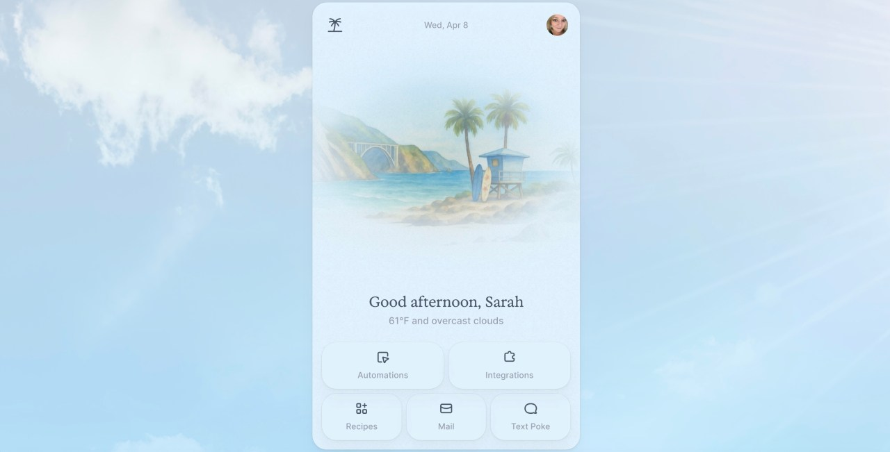
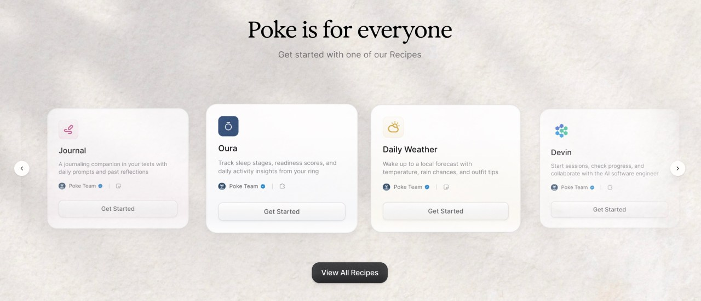
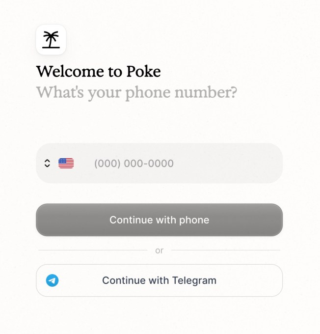
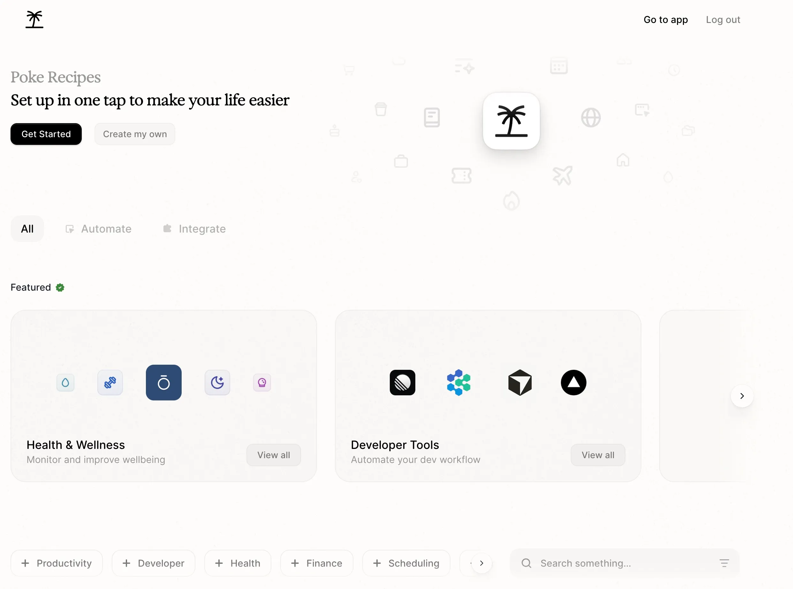
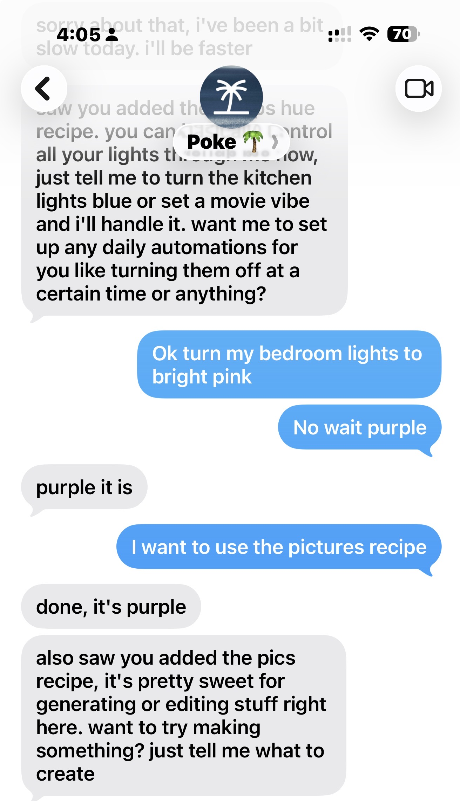
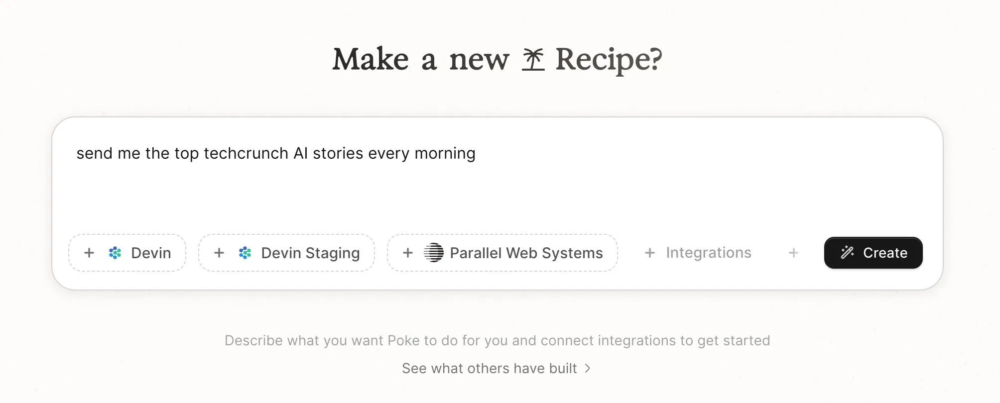
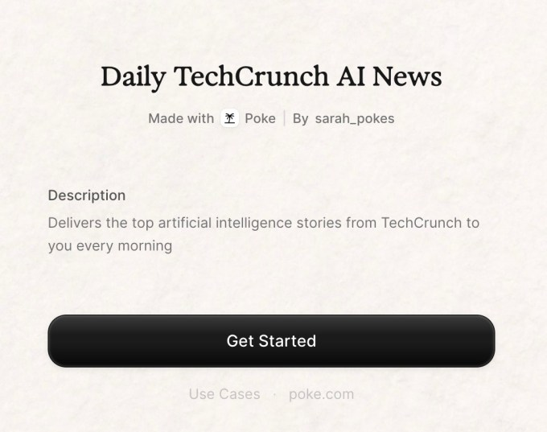
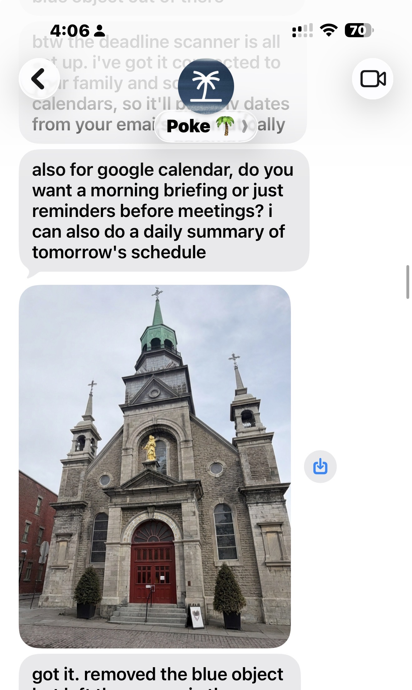



**收录说明**：TechCrunch 报道，直接下载后抽取，删去了文末的作者简介、活动广告与推荐阅读。文中有对联合创始人 Marvin von Hagen 的采访。已翻译。

**内容摘要**：文章把 Poke 描述为面向普通人的“OpenClaw”式 AI agent，可通过 iMessage、SMS、Telegram 以及部分市场的 WhatsApp 使用，2026 年 3 月公开发布，无需安装 app，在 Poke.com 输入手机号即可开始。联合创始人 Marvin von Hagen 称它源自早期邮件助手 beta 用户的使用方式，团队因此部分转向通用助手；Poke 按任务选择模型（大厂或开源），并借助 Linq 接入 iMessage，WhatsApp 因 Meta 禁止其他通用聊天机器人而受限。文章称 10 人团队在 2025 年 1500 万美元种子轮之外又融资 1000 万美元，估值 3 亿美元（post-money），客户数两个月内增长 10 倍但未披露具体数字。定价方面，beta 期用户曾与 AI 协商月费（Poke 称在 10–30 美元之间），现在按使用方式定价，实时推理（如每封来信触发的自动化）才是成本所在；创作者每带来一个通过 recipe 注册的用户可获得 10 美分到 1 美元；von Hagen 称目标不是盈利。安全部分写道：多层安全模型，包括渗透测试和限制权限，默认团队看不到 token 内部内容，TechCrunch 声明未做自己的安全审计。

**保留理由**：给出 Poke 产品形态、模型路由、消息通道（Linq）、定价逻辑和 recipe 分成的最详细第三方报道，并含创始人对成本与商业模式的原话。

---

[Poke](https://poke.com/) 是我们普通人的 OpenClaw 吗？这正是一家新初创公司提出的想法，它提供一款可通过 iMessage、短信、Telegram 以及部分市场的 WhatsApp 访问的 AI agent。

AI agent Poke 于 3 月[公开发布](https://x.com/interaction/status/2034713714415608123)，让消费者能通过一个熟悉的界面获得可代为行动的个人助手。如今，Poke 可以帮忙处理日常需求，比如每日规划、管理日历、追踪健康与健身、控制智能家居、编辑照片等等，全部通过短信完成。

**图片来源：**Poke/The Interaction Company of California

当你有了问题或想做研究时，可能仍会与 ChatGPT 或 Claude 这样通用 AI 聊天机器人交互；而当你想快速办成一件事，或想把某项任务自动化以节省时间时，你才会转向 Poke。

例如，你可以让 Poke 就特定邮件提醒你（比如家人或老板发来的邮件），或在早上提醒你是否需要带伞。它可以帮助你追踪健康和健身目标，或告诉你昨晚比赛的比分。Poke 还能发送每日用药提醒，或让你了解当天新闻等等，因为用户可以用纯文本编写自己的自动化，然后分享给朋友。

这家 10 人初创公司获得 Spark Capital、General Catalyst 及其他天使投资人的支持，最近又在去年 1500 万美元种子轮之外，向金库新增了 1000 万美元。它现在的投后估值为 3 亿美元。

> 从今天起，个人超级智能只差一次点击。\
>
> 无需下载，无需注册。\
>
> 现在免费给 Poke 发消息：<https://t.co/VIWYU64dUI> 🌴\
>
> —\
> 0:00 – Poke 是什么？\
> 0:50 – 介绍 Poke Recipes\
> 1:25 –  10 秒创建一个 Recipe\
> 1:43 – 在 Poke 上赚钱\
> 2:44 – 用 npx 构建… [pic.twitter.com/LHLFRVgahk](https://t.co/LHLFRVgahk)
>
> — Poke (@interaction) [2026 年 3 月 19 日](https://twitter.com/interaction/status/2034713714415608123)

这款工具问世之际，对 agentic AI 系统的需求正急剧上升，这促使 OpenAI [抢下 OpenClaw 的创造者](https://techcrunch.com/2026/02/15/openclaw-creator-peter-steinberger-joins-openai/)，也让英伟达 CEO 黄仁勋在发布英伟达企业级替代方案时警告说，[每家公司都需要有自己的 OpenClaw 战略](https://techcrunch.com/2026/03/16/nvidias-version-of-openclaw-could-solve-its-biggest-problem-security/)。

但对技术不那么在行的人来说，要通过终端安装软件、管理依赖并排查错误，这种前景令人望而生畏。此外，像 OpenClaw 这样的系统因其深度系统访问权限而引发安全担忧。

因此，对许多人来说，OpenClaw 和其他 agentic 系统仍然显得遥不可及。Poke 背后的团队想要改变这一点。

**图片来源：**Poke/The Interaction Company of California

[Marvin von Hagen](https://www.linkedin.com/in/marvinvonhagen/) 是 [The Interaction Company of California](https://interaction.co/) 的联合创始人，这家位于帕洛阿尔托的初创公司打造了这款新 AI agent。他告诉 TechCrunch，Poke 源自观察 beta 测试者如何使用公司大约一年前推出的早期产品——一款用于邮件的 AI 助手。

「我们在那里注意到的是，人们想把 Poke 用于一切……尽管它本来只用于邮件，人们却开始让 Poke 提醒他们吃药。他们问 Poke 体育比赛结果——『嘿 Poke，每天早上告诉我需不需要带外套，』」von Hagen 解释说。「而在那时，我们并没有很多这类功能，但我们意识到需要更快地走向通用，因为人们实在太喜欢它的个性和人情味了。」

团队随后部分转向，专注于让 Poke 更有用、更主动，也更有人情味。

与 OpenClaw 不同，上手 Poke 很简单。你只需访问 Poke.com，点击「Get Started」，输入手机号。无需安装 app，因为这款助手通过短信运行。

**图片来源：**Poke/The Interaction Company of California

在底层，Poke 会选择最适合该任务的 AI 模型，无论它来自某家大型 AI 供应商还是开源模型。

「我认为从长远看，这也是我们的主要优势之一：我们几乎所有的竞争对手都只是绑定特定供应商的大型科技公司和实验室。比如 Meta AI 永远只能使用 Meta 的模型，ChatGPT 永远只能使用 OpenAI 的模型，」von Hagen 指出。

为了在 iMessage 等消息平台上工作，Poke 还[借助 Linq](https://techcrunch.com/2026/02/02/linq-raises-20m-to-enable-ai-assistants-to-live-within-messaging-apps/)，这是一套让 AI 助手能住在消息应用里的方案。这款应用也能通过短信和 Telegram 运行，但 WhatsApp 支持目前有限，因为 [Meta 去年秋天禁止了其他通用聊天机器人](https://techcrunch.com/2025/10/18/whatssapp-changes-its-terms-to-bar-general-purpose-chatbots-from-its-platform/)。

不过这可能会改变。[来自欧盟](https://techcrunch.com/2026/03/05/meta-will-allow-rival-ai-chatbots-on-whatsapp-in-europe-but-for-a-fee/)、意大利和[巴西](https://techcrunch.com/2026/03/06/after-europe-whatsapp-will-let-rival-ai-companies-offer-chatbots-in-brazil/)的[监管机构启动反垄断调查](https://techcrunch.com/2026/03/05/meta-will-allow-rival-ai-chatbots-on-whatsapp-in-europe-but-for-a-fee/)，以对抗这一决定，这也让 Poke 回到了巴西。希望当 Meta 降低费用后，Poke 也能在欧盟的 WhatsApp 上工作。（Meta 因其收取的高额费用而遭到反对——von Hagen 说这是一种「恶意服从」，他相信很快会得到处理。）

**图片来源：**Poke/The Interaction Company of California

发布时，Poke 提供多种「recipes」——即帮助你将生活或工作各方面自动化的预制工具。它们涵盖健康与养生、生产力、财务、日程、旅行、家庭、学校、邮件、社区等类别，以及面向技术人员的开发者工具。安装只需点一下按钮，然后按需走一遍标准授权流程。

这些 recipe 设计为与你已经熟悉的 app 和服务配合使用，比如 Gmail、Google Calendar、Outlook、Notion、Linear、Granola 等。有些健康与健身「recipes」可与 Strava、Withings、Oura、Fitbit 等配合，还有些可与 Philips Hue、Sonos 等公司的智能家居设备配合。

使用 Poke 的开发者还可以通过与 PostHog、Webflow、Supabase、Vercel、Devin、Sentry、GitHub、Cursor Cloud Agents 等工具的集成，将部分工作流自动化。

Poke 的安全模型是多层的，包括定期渗透测试、安全检查、各种工具，以及对 agent 和人类员工都限制权限。默认情况下，团队看不到 token 内部的任何内容，除非用户在设置中打开开关，主动选择提供日志文件或分析数据的访问权限。（需要说明的是，TechCrunch 并未进行自己的安全审计。）

**图片来源：**Poke 截图/TechCrunch

过去几周，[Poke 的用户](https://poke.com/explore)又创建了数千个 recipe 和自动化，公司计划在不久的将来把它们加入 recipe 目录供人发现。它还在鼓励创作者构建这些可分享的 recipe：每有一个用户通过该 recipe 注册 Poke，就支付 10 美分到 1 美元（按地区而定）。

**图片来源：**Poke.com 截图/TechCrunch

**图片来源：**[Poke.com 截图/TechCrunch（在新窗口打开）](https://poke.com/r/r6D8_OGYIxP)

使用 Poke 的费用低得出人意料：开始免费，之后定价灵活。在 beta 测试期间，用户实际上得与这个 AI agent 协商每月付多少钱，价格在 10 到 30 美元之间——至少 Poke 在回答我们这个问题时是这么说的。

Von Hagen 说，现在定价基于 AI agent 的使用方式。如果你要的东西不需要实时数据，你大概可以免费用 Poke。真正让 Poke 花钱的是实时推理，比如对每封来信都运行的自动化，或实时航班值机。为了定价，公司给了 Poke 关于各项成本有多高的指引，这使它能够确定个性化价格。

von Hagen 指出，虽然公司已设法让 Poke 更高效以降低成本，但目前的目标并不是盈利。

**图片来源：**Poke 截图/TechCrunch

「我们真的不想赚钱，但我们真的很想增长。我们想为十亿人打造一款产品，变现真的是次要的，」他说。「接下来几周和几个月的目标，是让 Poke 进入日常生活。」为此，它将借助创作者和网红来展示他们如何使用 Poke。

> 我构建了「tastebuds」，一个基于 [@interaction](https://twitter.com/interaction) 的 Poke Recipes 的 MCP server，用来众包对食物的看法。\
>
> 当你在找地方吃饭时，Poke 会推荐你所在地区其他 Poke 用户以前喜欢过的餐厅，办法是存储他们的评价，这一切都在……中安静运行。
>
> — Dani (@daniticow) [2026 年 4 月 8 日](https://twitter.com/daniticow/status/2041682276388630559)

这家由 [Felix Schlegel](https://www.linkedin.com/in/felixmschlegel/) 共同创办的公司没有透露有多少客户注册，只是指出这个数字在过去几个月里增长了 10 倍。（不过，我们确实发现 Poke 位居 [Vercel 的 AI Gateway 排行榜](https://vercel.com/ai-gateway/leaderboards)榜首，不管这值多少。）

除了主要机构投资者 Spark Capital 和 General Catalyst，这家初创公司还吸引了一批天使投资人的关注，包括 John 和 Patrick Collison（Stripe 创始人）、Jake 和 Logan Paul、DeepMind 的 Logan Kilpatrick、OpenAI 的 [Joanne Jang](https://x.com/joannejang/status/2041267523107299557)，以及 Scott Wu 和 Walden Yan（Cognition 创始人）。

其中还包括 Vercel 联合创始人 Guillermo Rauch、PayPal 联合创始人 Ken Howery、Dropbox 联合创始人 Arash Ferdowsi、Mercor 联合创始人 Brendan Foody、Hugging Face 联合创始人 Thomas Wolf、Flapping Airplanes 联合创始人 Ben Spector，以及其他几位。
