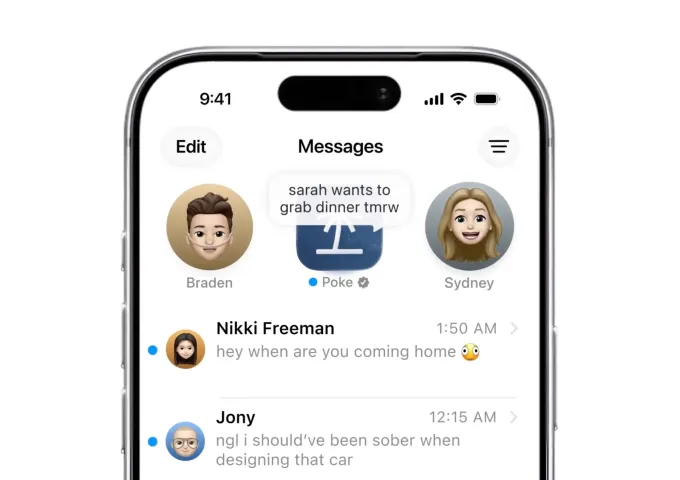
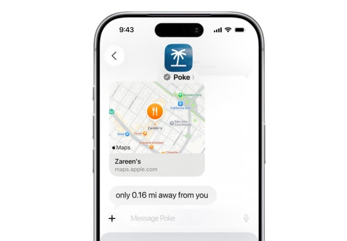
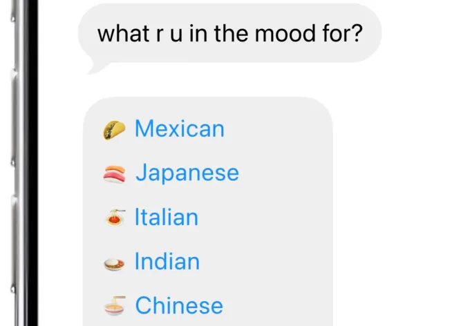



**收录说明**：TechCrunch 报道，直接下载后抽取，删去了文末的作者简介、活动广告与推荐阅读。文末有更正：Poke 按用户付费的对象是它的消息服务商，不是直接付给 Apple。已翻译。

**内容摘要**：文章称 Poke 成为首个获准在 Apple Messages for Business 平台运行的 AI agent，该平台此前面向航空、零售等企业与其客户沟通，未对独立第三方 AI agent 开放。Poke 称 2026 年 3 月上线，至今已转发约 1 亿条消息，此前运行于 SMS、Telegram 和部分市场的 WhatsApp。获批要求包括证明可提供真人支持、AI agent 明确标识，并按 Apple 规范调整界面（如显示链接预览、使用 Apple 的样式指南）；von Hagen 称这花了几个月，并称团队支付的是消息服务商而非 Apple，按用户计费，费用明显低于 Meta AI 上调后的费用。现有用户将收到可选迁移邀请，订阅仍保留并可使用 Apple Pay；10 人团队此前融资 1000 万美元，累计加 2025 年 1500 万美元种子轮，估值 3 亿美元。文末更正：原稿已改为 Poke 按用户向其消息服务商付费，而不是直接向 Apple 付费。

**保留理由**：给出 Apple 审批条件、通道成本结构（按用户付给服务商）以及“首个”的创始人解读，并带有更正说明，可用来校正通道成本说法。

---

[Poke](https://poke.com/) 是一家创业公司，它[把使用 AI agent](https://techcrunch.com/2026/04/08/poke-makes-ai-agents-as-easy-as-sending-a-text/) 变得像发一条短信一样简单。如今，它已成为首个获准在 [Apple 的 Messages for Business 平台](https://www.apple.com/ios/business-chat/)上运行的 AI agent。此前，该平台是为企业——航空公司、零售商、连锁酒店等——通过 Apple 的 Messages 应用与自己的客户沟通而设计的，提供一个同时支持自动聊天和真人工坐席的标准化界面。直到现在，它都未曾对独立的第三方 AI agent 开放。

Poke 于 3 月上线，是最早一批面向普通用户的 AI agent 之一——这些用户既没有技术能力，也没有兴趣去使用命令行工具或像 OpenClaw 这样更复杂的 agent 系统。如今，Poke 可以通过短信帮助处理日常事务，例如每日规划、管理日历、追踪健康与健身数据、控制智能家居，以及编辑照片。公司对 TechCrunch 表示，迄今为止它已转发约 1 亿条消息。

该 AI 服务通过 SMS、Telegram 以及部分市场的 WhatsApp 运行。现在 Poke 将能够把 Apple Messages for Business（即作为已验证的企业账户）加入其支持的平台之列。

> 向新的 Poke 打个招呼吧！🌴\
>
> 现已获 Apple 官方批准，可在 Apple Messages 上发消息。\
>
> 作为首个也是唯一的 AI agent。现在就来聊天：<https://t.co/VIWYU64dUI> [pic.twitter.com/AtZxupI2Ji](https://t.co/AtZxupI2Ji)
>
> — Poke (@interaction) [2026 年 6 月 4 日](https://x.com/interaction/status/2062575428213285352)

Poke 登陆 Apple Messages for Business 的消息传出，距 Apple 预计于周一举行的[全球开发者大会（WWDC）](https://techcrunch.com/2026/06/04/what-to-expect-from-wwdc-2026-siris-highly-anticipated-revamp-and-apple-intelligence-updates/)只有几天。外界预计 Apple 将在会上推出 AI 优化的 Siri 版本，以及面向应用开发者的其他 AI 工具与服务。还有[传闻](https://www.macrumors.com/2026/05/13/apple-ai-agent-apps-app-store/)称，Apple 会向 AI agent 开放其 App Store。

Poke 的情况与上述并不相同。Apple 的 Messages for Business 平台并不是要提供一个面向消费者的移动应用，而是让消费者通过 Messages 应用的界面直接与企业互动。这样消费者就能向企业查询信息、寻求支持、预约时间等，而不必打电话。Poke 的用户向这个 AI agent 提问或提出请求，它便通过短信回复。

**图片来源：**Poke/The Interaction Company of California

对创始人和投资人来说，更有趣的细节或许是它开启的商业模式。[Marvin von Hagen](https://www.linkedin.com/in/marvinvonhagen/) 是 [The Interaction Company of California](https://interaction.co/) 的联合创始人，这家位于帕洛阿尔托、打造 Poke 的创业公司。他说，自己的公司会按用户数向其消息服务提供商付费——他与该服务商合作实现了 Messages for Business 的接入。虽然他不能透露具体价格，但他指出，这明显低于 Meta AI 的费用，后者在欧盟监管要求其允许第三方 AI agent 接入 WhatsApp 之后上调了价格。

**图片来源：**Poke/The Interaction Company of California

「我认为 Apple 只是注意到这是提供 AI 的最佳方式，」他说，并补充说他相信 Apple 对 AI agent 的支持也会随着时间增长。

获得 Apple 的批准，需要公司证明它在需要时能够提供真人支持，并且其 AI agent 被清楚地标识为 AI。Poke 还提交了来自其消息服务商的证词，并定制了用户界面以符合 Apple 的规范。

例如，Poke 在 Apple Messages for Business 上必须显示链接预览，而不是像以前那样使用行内链接；按钮和界面元素等则遵循 Apple 的样式指南。

**图片来源：**Poke/The Interaction Company of California

「遵守所有这些标准花了几个月；任何其他想在这个平台上开发的人，也要花上几个月才能走完这套审批流程，」von Hagen 说。至于成为第一个？这在很大程度上与信任有关。

「同样重要的是，我们在公司定位上非常一致，」他指出，并解释说如今许多消费产品靠可疑手段去追求数字。「我们在意质量，我们在意拥有一个传递信任的品牌，」von Hagen 说。

目前不清楚 Apple 是否会在下周的 WWDC 上宣布与 Messages for Business 平台上 AI agent 相关的消息，von Hagen 也不了解 Apple 的计划。不过，Poke 正在向现有用户陆续发出邀请，让他们可以选择迁移到 Apple Messages for Business 平台。Poke 将继续提供订阅，其中会包含使用 Apple Pay 的选项。

这家 10 人规模的创业公司由 Spark Capital、General Catalyst 及其他天使投资人支持，在去年 1500 万美元种子轮之外，最近又[增加了 1000 万美元](https://techcrunch.com/2026/04/08/poke-makes-ai-agents-as-easy-as-sending-a-text/)。其最新投后估值为 3 亿美元。

Apple 未能立即置评。

*更正：在联合创始人 Marvin von Hagen 澄清 Poke 是按用户向其消息服务提供商付费、而不是直接向 Apple 付费之后，本文已更新。*
