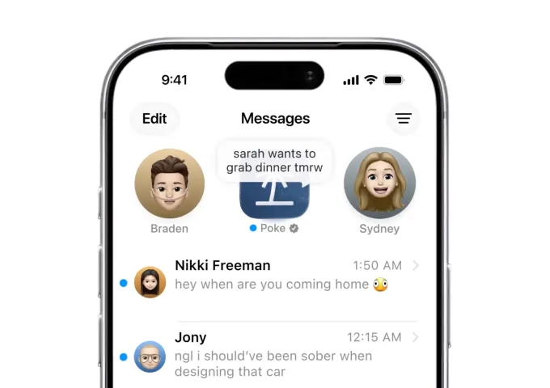



**收录说明**：TechCrunch 报道，直接下载后抽取，删去了文末的作者简介、活动广告与推荐阅读。交易价格区间由 Marvin von Hagen 向 TechCrunch 确认。已翻译。

**内容摘要**：文章称 Interaction 被 AI 编码公司 Cognition 收购，交易估值为“low nine figures”，价格由 Marvin von Hagen 在采访中确认。交易将把 Poke 的交互模式与个性带给 Cognition 的 Devin，Poke 则使用 Cognition 的模型和基础设施。Cognition 称过去三个月用户交换了超过 1 亿条消息，数十万人使用；但 von Hagen 称 Poke 运行成本高、难以盈利。今年底前 Poke 不会立即改变并留在 Apple 平台，明年将尝试让 Poke 在部分任务上使用 Cognition 的 SWE-1.7 模型，也不排除完全合并两个产品；von Hagen 设想由 Poke 编排多个 Devin 会话，并帮助 Devin 跨会话记住任务（“a persistent co-worker”）。

**保留理由**：给出收购估值区间、成本难以盈利的创始人说法和后续产品整合设想，补充 Cognition 官方公告所没有的内容。

---

Poke，那个[像朋友一样与你互发短信的 AI 助手](https://techcrunch.com/2026/04/08/poke-makes-ai-agents-as-easy-as-sending-a-text/)，正迈出下一步。这款助手背后的公司 [The Interaction Company of California](https://interaction.co/) 已被 AI 编码创业公司 Cognition 收购，交易对该创业公司的估值为「low nine figures」（九位数低段）。

这笔交易将把 Poke 的交互模式与个性带给 Cognition 的编码助手 Devin。Cognition 表示，与此同时，Poke 将借助 Cognition 的模型和基础设施变得更快、更可靠。

Poke 让消费者觉得有趣——如今也让收购方觉得有趣——的地方，在于它如何回应用户的请求。Poke 不像工具那样运作，而是与用户更熟络地聊天，像朋友一样回应，甚至在互动中加入俚语和幽默。这一点可以为 Devin 的编码 agent 增加价值。

「你大概更希望同事有个性，而不是只有一帮机器人同事，」Interaction Company 联合创始人 [Marvin von Hagen](https://www.linkedin.com/in/marvinvonhagen/) 在接受 TechCrunch 采访时解释说，他也在采访中确认了交易价格。「当你的同事同时也是软件工程师时，他们还能开个玩笑。你会觉得有趣、愉快。」

这笔收购凸显出一种日益增长的信念：AI 助手与用户互动的方式，将变得与驱动它们的底层模型同样有价值。Cognition 想让 Devin 感觉不那么像软件，而更像一位同事。

「Interaction 团队打造了一个人们喜爱的 agent：它主动、懂你，而且聊起来很有趣。与 Devin 共事的感觉正该如此，现在我们能一起把它做出来，」Cognition 联合创始人 Scott Wu 在[博客文章](https://cognition.com/blog/interaction)中写道。

他还提到，他和 Cognition 联合创始人 Walden Yan 都曾是 Poke 背后公司的天使投资人。

Poke 于 2026 年 3 月首次上线，让用户通过自己选择的消息平台与其 AI agent 互动，无论是 iMessage、SMS、Telegram，还是部分市场的 WhatsApp。人们在旅行、健康、金融、日程安排和教育等类别中使用 Poke 完成[各种任务](https://poke.com/explore)。

Von Hagen 指出，管理邮件、提醒和待办事项这类生产力任务是 Poke 最常见的用例之一。

**图片来源：**Poke/The Interaction Company of California

Cognition 表示，过去三个月里，Poke 用户在该平台上交换了超过 1 亿条消息。但 von Hagen 说，尽管有数十万人使用，Poke 的运行成本一直很高，难以盈利。

今年 6 月，Poke 成为[首个获准](https://techcrunch.com/2026/06/04/apple-approves-poke-as-the-first-ai-agent-on-its-messages-for-business-platform/)在 Apple Messages for Business 平台上运行的 AI agent。该平台为企业提供在 Apple Messages 应用内处理客户沟通的标准化体验。

据悉，到今年年底之前，Poke 不会有任何立即的变化。Poke 计划继续留在 Apple 的平台上。

不过，明年团队将试验 Poke 和 Devin 如何各自改进，Poke 会在部分任务上转向 Cognition 最新的软件工程模型 [SWE-1.7](https://cognition.com/blog/swe-1-7)。也并未排除将两个产品完全合并的可能。

「我认为从长期看，Poke 在编排所有这些编码[任务]时可以更可靠……同时，Devin 也可以变得更像 Poke，」von Hagen 说。「比如现在，Devin 一次只能处理一个 PR——也就是 pull request……让 Poke 编排不同的 Devin 会话有很大价值。」此外，Poke 还能帮助 Devin 跨不同会话记住任务。

「有一位持久的同事会很好，」他补充说。
