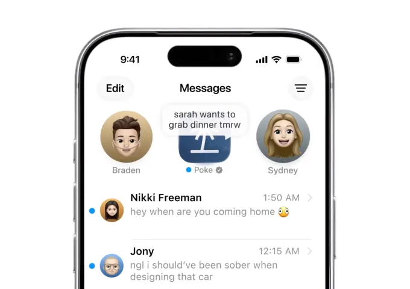

来源：https://techcrunch.com/2026/07/24/why-cognition-bought-poke-ai-personality-is-becoming-a-competitive-advantage/
取文：2026-11-09，直接下载

Poke, the [AI assistant you text like a friend](https://techcrunch.com/2026/04/08/poke-makes-ai-agents-as-easy-as-sending-a-text/), is making its next big move. The company behind the assistant, [The Interaction Company of California](https://interaction.co/), has been acquired by AI coding startup Cognition in a deal valuing the startup in the “low nine figures.”

The deal will bring Poke’s interaction model and personality to Cognition’s coding assistant Devin. Meanwhile, Poke will take advantage of Cognition’s models and infrastructure to become faster and more reliable, Cognition said.

What makes Poke interesting to consumers — and now, to its acquirer — is how it engages with users’ requests. Instead of functioning like a tool, Poke chats more familiarly with users, responding like a friend and even incorporating slang and humor into its interactions. That’s something that could add value to Devin’s coding agent.

“You probably prefer it if you have co-workers that have personality, rather than if you have co-workers that are just robots,” explained Interaction Company co-founder [Marvin von Hagen](https://www.linkedin.com/in/marvinvonhagen/) in an interview with TechCrunch, where he also confirmed the deal’s price. “When you have co-workers that are also software engineers, they can also make a joke. And you’ll find it funny and enjoyable.”

The acquisition underscores a growing belief that how AI assistants interact with users will become just as valuable as the underlying models powering them. Cognition wants to make Devin feel less like software and more like a colleague.

“The Interaction team has built an agent that people love: it’s proactive, it knows you, and it’s fun to talk to. That’s exactly how working with Devin should feel, and now we get to build it together,” Cognition co-founder Scott Wu wrote in a [blog post](https://cognition.com/blog/interaction).

He also noted that he and Cognition co-founder Walden Yan had been angel investors in the company behind Poke.

First launched in March 2026, Poke allows users to engage with its AI agent through their messaging platform of choice, whether that’s iMessage, SMS, Telegram, or, in some markets, WhatsApp. People use Poke for a [variety of tasks](https://poke.com/explore) across categories like travel, health, finance, scheduling, and education.

Von Hagen noted that productivity tasks like managing emails, reminders, and to-dos were among Poke’s most common use cases.

**Image Credits:**Poke/The Interaction Company of California

Over the past three months, Poke users exchanged more than 100 million messages on the platform, Cognition said. But despite being used by hundreds of thousands of people, Poke had been expensive to run, making it difficult to turn a profit, von Hagen said.

In June, Poke became the [first AI agent to be approved](https://techcrunch.com/2026/06/04/apple-approves-poke-as-the-first-ai-agent-on-its-messages-for-business-platform/) to run on Apple’s Messages for Business platform, which provides businesses with a standardized experience for handling their customer communications within Apple’s Messages app.

Going forward, nothing will immediately change for Poke through the end of the year, we’re told. Poke plans to remain on Apple’s platform.

However, next year the team will experiment with how both Poke and Devin can improve, with Poke turning to Cognition’s newest software engineering model [SWE-1.7](https://cognition.com/blog/swe-1-7) for some tasks. Fully combining the two products has not been ruled out, either.

“I think in the long term Poke can be more reliable with orchestrating all these coding [tasks] … and, at the same time, Devin could become more like Poke,” von Hagen said. “Like right now, Devin can only do one PR — pull request — at a time … I think there’s a lot of value in having Poke orchestrate different Devin sessions.” Plus, Poke could help Devin remember tasks across different sessions.

“It would be good to have a persistent co-worker,” he added.
