

**收录说明**：Unite.AI「AI Tools 101」栏目的上手评测，旧笔记 learning-ai-agent 引用的是它的中文机器翻译版（已记入 altUrls），这里收英文原文。直接下载后抽取，删去了页首的栏目、署名与日期行和文末的作者简介、推荐阅读。文首有联盟链接披露（Unite.AI 可能从评测产品的链接中获得报酬），照录。已翻译。

**内容摘要**：评测者用 Poke 总结未读邮件并生成下周计划，结论称其接入 iMessage、WhatsApp 或 Telegram，基于 recipe 的自动化“令人印象深刻”，但邮件仅支持 Gmail 和 Outlook、不能在单个账户管理多个手机号，Ultra 档对早期产品偏贵。优点栏称设置不到两分钟，连接 40 多项服务，可接受语音备忘；缺点栏称邮件分拣不够敏锐，可能漏掉紧急邮件而转发琐碎邮件，且把权限交给 AI 需要信任。文中描述了九步使用流程（注册、连手机号、连邮箱日历、浏览 recipe、设每周日晚间摘要、发语音、接入更多集成），并介绍 memory、模型路由和 Poke Human（真人操作员只看到任务所需细节）。评测将 Poke 与 ChatGPT、Gemini、Claude 比较，称 Poke 偏轻量任务自动化；FAQ 称过去的时区与日期错误及提醒迟发已解决。页首披露 Unite.AI 可能因产品链接获得佣金。

**保留理由**：这是本批中唯一的第三方上手评测，包含一手使用流程、缺点（邮件分拣质量）和与通用助手的对比；联盟链接披露需在引用时注明。

---

披露：

当你使用我们所评测产品的链接时，Unite.AI 可能会获得报酬。这不会影响我们的编辑评价。请阅读我们的[联盟链接披露](https://www.unite.ai/affiliate-disclosure/)。

你是否曾因为重要的事情被埋在一堆打开的标签页、一个你忘了的应用，或一条被你划掉的提醒里而错过它？你为了[掌握自己的日程](https://www.unite.ai/best-ai-scheduling-assistants/)手忙脚乱地在好几个应用之间切换，却总还是有什么东西漏了过去。

[Poke](https://poke.com/) 声称能解决这个问题：它把整个助手体验搬进一个我本来就会不停查看的地方——我的短信。无需下载新应用，也不用学什么仪表盘。你像给朋友发消息一样给它发短信，它便在后台处理你的日历、收件箱以及几十种其他工具。

在这篇 Poke 评测中，我会用真实任务来展示它的表现：让它总结我的未读邮件，并生成下一周的每周摘要。我也会告诉你它哪些地方让我印象深刻，以及我认为它仍有不足的地方。

接着，我会把它与我心目中的前三个替代品作比较来收尾：[ChatGPT](https://chatgpt.com/)、[Google Gemini](https://gemini.google.com) 和 [Claude](https://www.anthropic.com/)。读完你就知道哪款[AI 助手](https://www.unite.ai/10-best-ai-assistants/)适合你！

## 结论

Poke 是一款完全住在 iMessage、WhatsApp 或 Telegram 里的 AI 助手，而不是又一个你需要记得打开的 app。它基于 recipe 的自动化在正常工作时确实令人印象深刻。然而，它在邮件上只支持 Gmail 和 Outlook，还不能在单个账户上管理多个手机号，而且它有一个对这么早期的产品来说可能偏贵的 Ultra 档。

## 优点

- 无需下载 app：Poke 完全在 iMessage、短信、WhatsApp 或 Telegram 内运行
- 设置不到两分钟：只需一个手机号和一个邮件连接即可开始
- 可连接 40 多项服务，包括 Gmail、Google Calendar、Notion、GitHub、Linear 和 Philips Hue
- 「Recipes」提供可自定义的预置自动化，无需从零搭建工作流
- 可通过其 recipe 向导（「Poke Kitchen」）在 Poke 上自定义和创建自己的 recipe
- 会主动呈现信息，而不是只在你询问时才回应
- 把任务路由给最合适的底层 AI 模型，而不是把你锁定在单一供应商上
- 除打字外也接受语音备忘，你可以说而不是打
- Poke Human 会派出真人处理预订、打电话等现实事务
- 现已内置于 Apple 的 Messages for Business 平台
- 提供免费方案，无需信用卡

## 缺点

- 邮件分拣还不够敏锐，可能把紧急邮件埋没，却转发琐碎内容
- 邮件仅支持 Gmail 和 Outlook，iCloud、Yahoo 和 Google Workspace 均不受支持
- 尚不能在单个账户上管理多个手机号
- 对于一个仍偶尔不可靠的产品，Ultra 档价格偏高
- 把收件箱、日历和智能家居设备的访问权交给 AI agent，需要一定程度的信任，有些人还没准备好

## Poke 是什么？

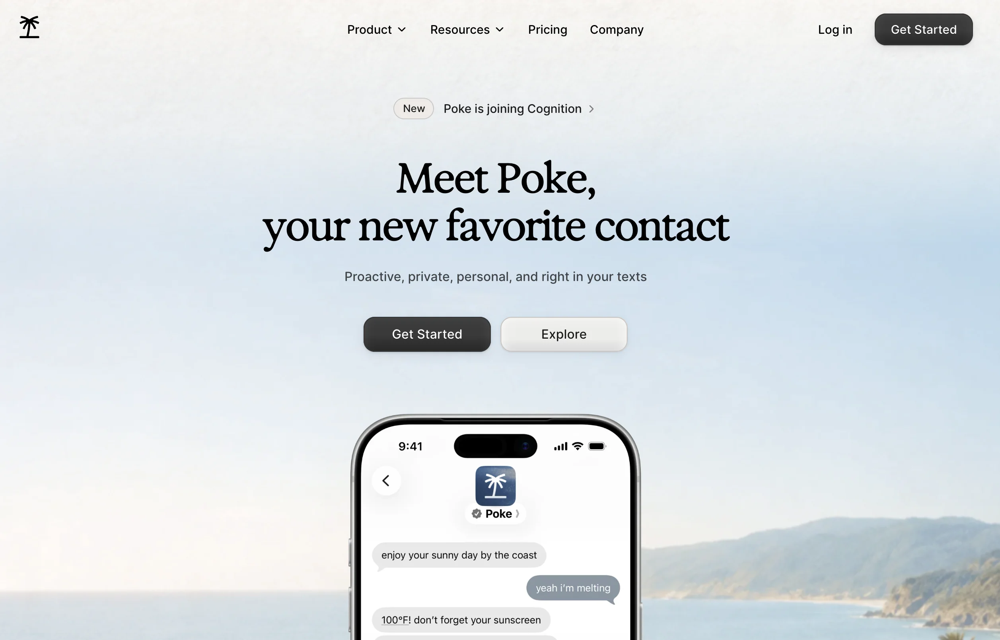

Poke 是一款完全通过文字对话的 AI 助手，无论是 Apple Messages、短信、WhatsApp 还是 Telegram。它由 [The Interaction Company of California](https://interaction.co/) 打造，这是一家位于帕洛阿尔托的 AI 初创公司，由 Marvin von Hagen 和 Felix Schlegel 共同创办。

Poke 不要求你下载 app 或学习新界面，而是在几乎所有人本来就会不停查看的地方与你相遇：他们的消息。你像给一个人发短信那样把请求发给它，它便用适合该任务的已连接服务和 AI 模型来处理。

### 背后的想法

Poke 的主张简单得令人耳目一新：你的生活已经运行在几十个[彼此割裂的 app](https://www.unite.ai/best-no-code-app-builders/)（邮件、日历、项目看板、健身追踪器、[智能家居设备](https://www.unite.ai/artificial-intelligence-is-the-next-step-for-smart-homes/)）之上，而 Poke 想成为覆盖在所有这些之上的一层对话界面。因此，你无需打开五个 app 去规划旅行或整理收件箱，只要给 Poke 发一条消息，它就把各部分拼起来。

这家初创公司大力押注这种「隐形界面」理念，并换来了可观的覆盖：Poke 最近成为首个直接内置到 Apple 的 Messages for Business 平台的第三方 AI agent。不仅如此，这款产品的分量足以让 [Cognition（AI 编程 agent Devin 背后的公司）在 2026 年将其收购](https://www.renascence.io/news/31187/why-cognition-bought-poke-ai-personality-is-becoming-a-competitive-advantage)。

### Poke 如何工作

在底层，Poke 使用「recipes」，即针对常见任务的预置自动化模板，例如总结收件箱、记录锻炼，或按计划调暗 Hue 灯。你可以按原样使用 recipe，用大白话加以自定义，或者[编写自定义自动化](https://poke.com/kitchen/recipes)并分享给他人。

Poke 还有记忆功能，会随时间学习你的偏好，所以你用得越久它越有用。不同于绑定某一家 AI 实验室的助手，Poke 会把每个请求路由给最能处理该任务的模型（来自大厂或开源的模型）。

### Poke Human

让 Poke 有别于典型聊天机器人的一个功能是 Poke Human。它用于需要真人的任务，例如预订餐厅或[打电话](https://www.unite.ai/best-ai-phone-platforms/)。

Poke 会派出一名真人操作员，他只能看到该任务所需的细节，而看不到你的完整聊天记录或已连接账户。它包含在 Ultra 方案中，相关费用（如实际的预订费）按原价计费，不加价。

## Poke 最适合谁？

以下是 Poke 最适合的人群：

- 忙碌的职场人士可以用 Poke 在不开笔记本电脑的情况下理清邮件和日历的混乱
- 非技术用户可以借助 Poke 获得 agent 式自动化，而无需学习新的 app 或工作流工具
- 父母和照护者可以用 Poke 从手机消息里管理提醒、预约和杂务
- [小企业主](https://www.unite.ai/best-ai-tools-for-business/)可以用 Poke 在不雇用助理的情况下掌握日程安排和沟通
- 智能家居爱好者可以用 Poke 以对话方式控制 Sonos 音箱、Philips Hue 灯等已连接设备
- [常旅客](https://www.unite.ai/best-ai-tools-for-travel-planning/)可以把预订和打电话这类琐事交给 Poke Human
- [开发者可以用 Poke](https://www.unite.ai/7-best-ai-software-development-tools/)从 GitHub、Linear 或 Vercel 获取状态更新，而无需逐个查看仪表盘
- 任何不喜欢学新软件的人，都可以通过自己每天都在用的界面（发短信）用 Poke 获得 AI 协助

## Poke 的核心功能

下面更仔细地看看 Poke 的核心功能：

- 多平台消息支持：可在 Apple Messages、短信、WhatsApp 和 Telegram 内使用，因此无需安装任何新东西。
- Recipe 库：针对常见任务的预置自动化，从收件箱摘要到健身记录，可直接开箱使用或自定义。
- 自定义自动化：用大白话写下自己的自动化，Poke 会构建并运行它，然后让你分享给他人。
- 跨模型选择：Poke 不被锁定在单一 AI 供应商上；它会从大厂或开源选项中挑选最适合给定任务的模型。
- 主动通知：Poke 不等你提示，就能根据你连接的数据呈现相关更新（一笔到期账单、日程冲突）。
- 发送语音备忘：你可以发语音而不是打字，Poke 会像处理文字一样处理它。
- 邮件与日历集成：完整支持 Gmail 和 Outlook 的收件箱、日历和联系人同步。
- Notion、GitHub 和 Linear 集成：与常见的生产力工具和开发者工具收发信息。
- 健身与健康追踪：可连接 Fitbit 等平台，以对话方式展示健康数据。
- 智能家居控制：与 Philips Hue、Sonos 等设备集成，实现家居自动化。
- [网站搭建工具](https://www.unite.ai/best-ai-website-builders/)：可以用自定义的 yourname.poke.site 域名[设计并发布](https://www.unite.ai/10-best-ai-graphic-design-tools/)一个简单的个人网站。
- 记忆：跨对话保留上下文和偏好，因此回复意在随时间变得更个性化。
- Poke Human：为需要真人在环的任务（如预订或打电话）派出真人。

## 如何使用 Poke

以下是我如何完全通过文字，用 Poke AI 管理邮件、日历、重复任务和其他日常请求：

1. 注册 Poke
2. 连接你的手机号
3. 关联邮箱和日历
4. 给 Poke 发消息
5. 浏览 Recipe 目录
6. 发送你的第一个请求
7. 设置自动化
8. 试试发送语音备忘
9. 连接更多集成

### 第 1 步：注册 Poke

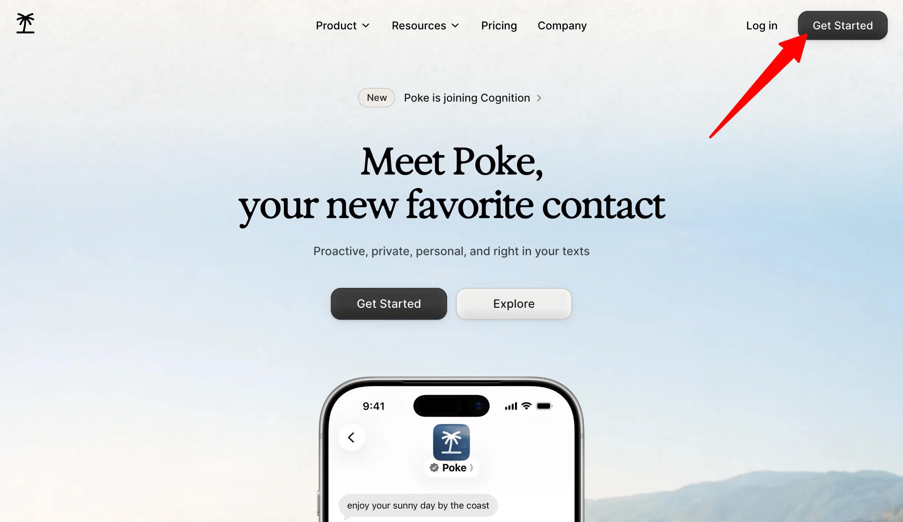

前往 [poke.com](https://poke.com/) 并点击「Get Started」。用你的姓名和手机号注册。无需填写账户表格，免费档也不需要信用卡，但请记住会产生短信和数据费用。

### 第 2 步：连接你的手机号

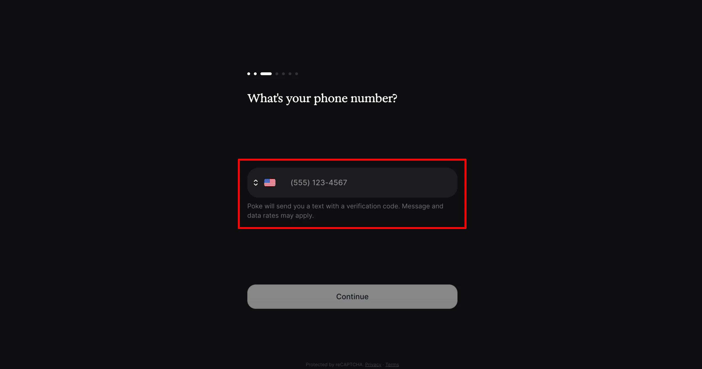

输入手机号后，Poke 会直接在你使用的消息应用（Apple Messages、短信、WhatsApp 或 Telegram）上给你发消息。从此，这就是你的全部界面。

### 第 3 步：关联邮箱和日历

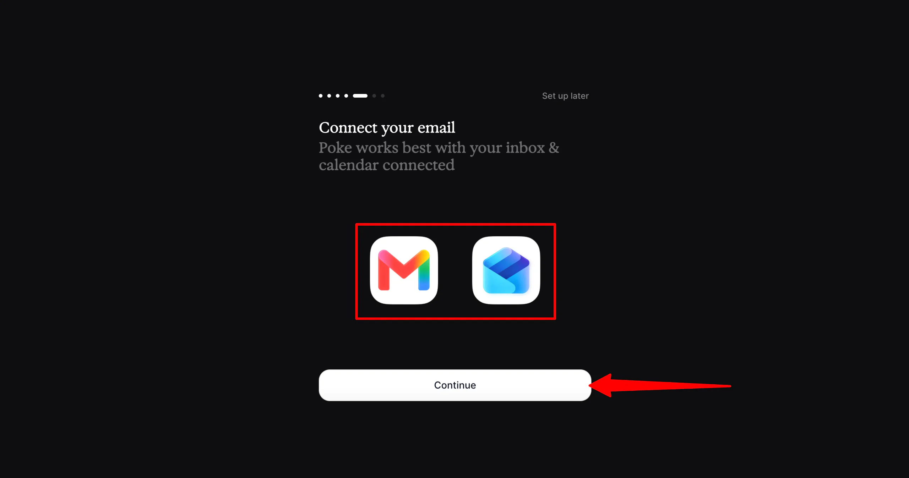

连接你的 Gmail 或 Outlook 账户，好让 Poke 读取并总结你的收件箱和日历。正是这一步，解锁了这款助手在日常使用中的大部分用处。

### 第 4 步：给 Poke 发消息

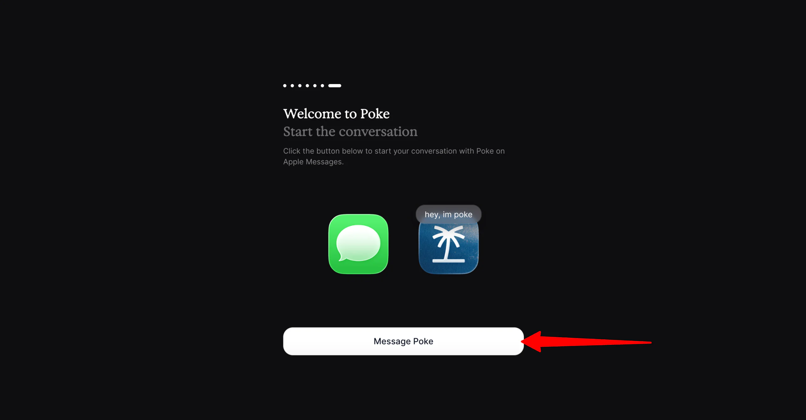

输入手机号并连接 Gmail 或 Outlook 账户后，给 Poke 发消息即可开始对话。

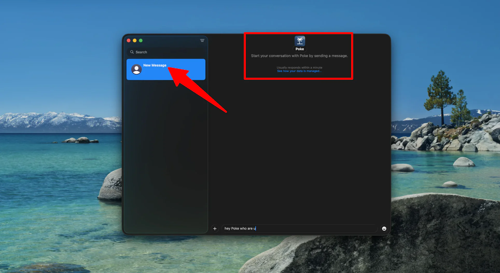

你的电脑上会自动打开一个与 Poke 的短信窗口。

### 第 5 步：浏览 Recipe 目录

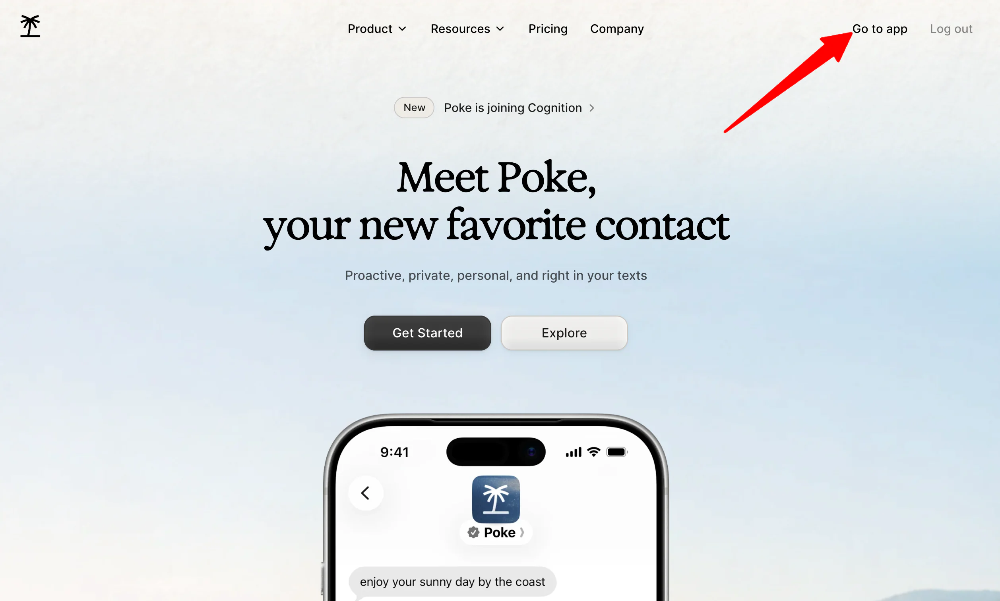

在[编写自己的自动化](https://www.unite.ai/best-ai-writing-tools/)之前，先登录你的 Poke 账户，在 recipe 目录里看看预置模板。

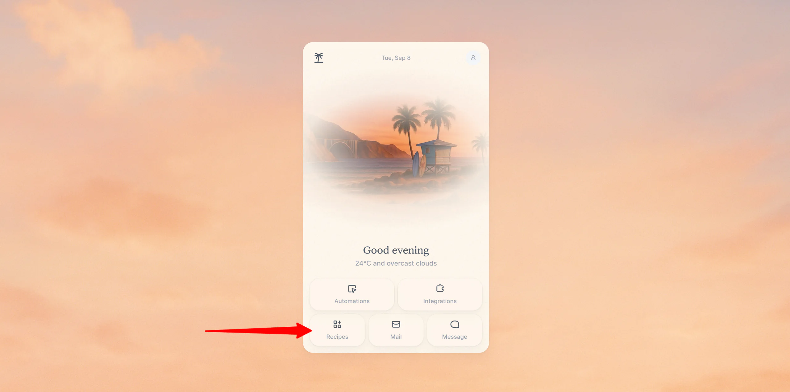

你会在 app 里发现几项有用的功能：

- 自动化
- 集成
- Recipes
- 邮件
- 消息

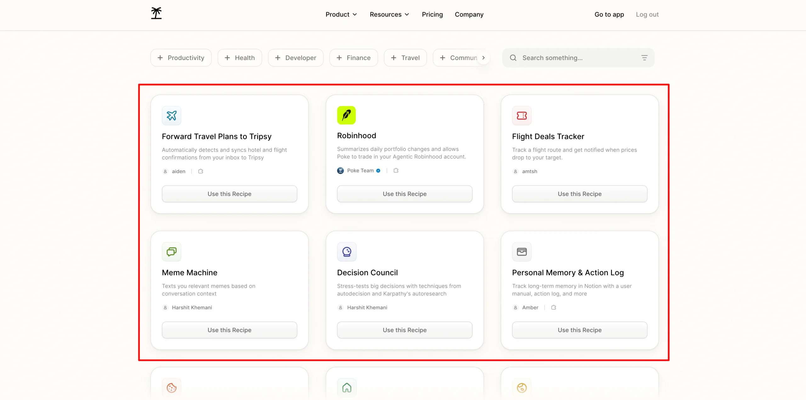

我发现了一些我甚至没想到要问的 recipe，比如机票优惠追踪器。

### 第 6 步：发送你的第一个请求

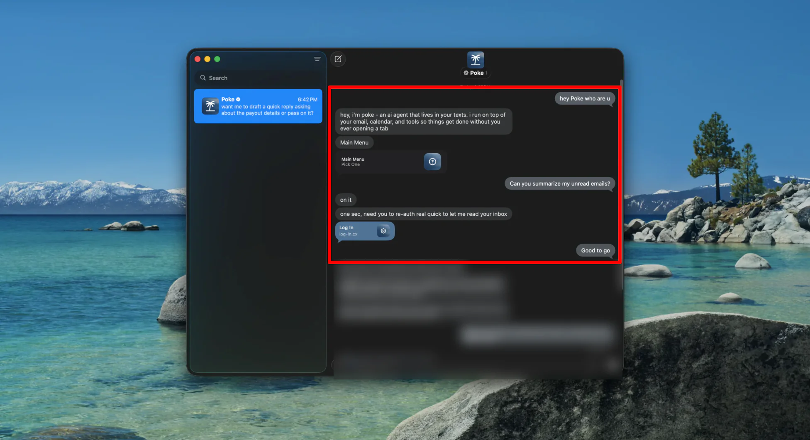

给 Poke 发点简单的内容，比如让它总结未读邮件或查看明天的日历。这是最快感受它如何回应的方式。

### 第 7 步：设置自动化

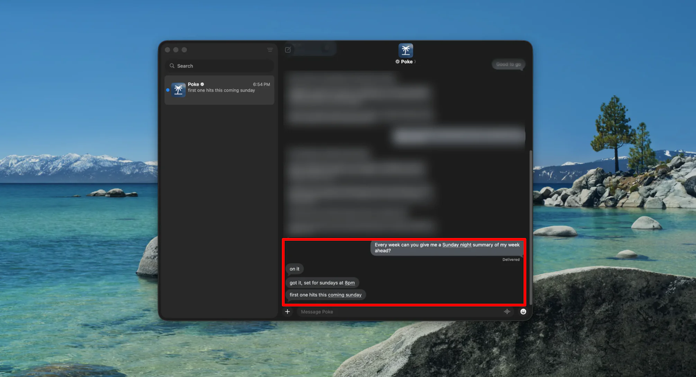

让 Poke 定期处理某件事，比如每周日晚间对你下一周做摘要。正是在这里，「助手」这个说法开始显得真实，而不只是个噱头。

### 第 8 步：试试发送语音备忘

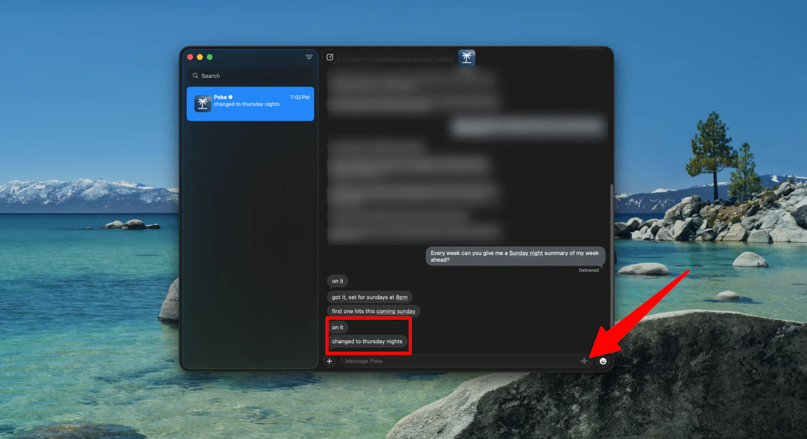

不用打字，录一段带请求的简短语音备忘。Poke 会像处理文字一样处理它，这在开车或双手没空时很方便。

### 第 9 步：连接更多集成

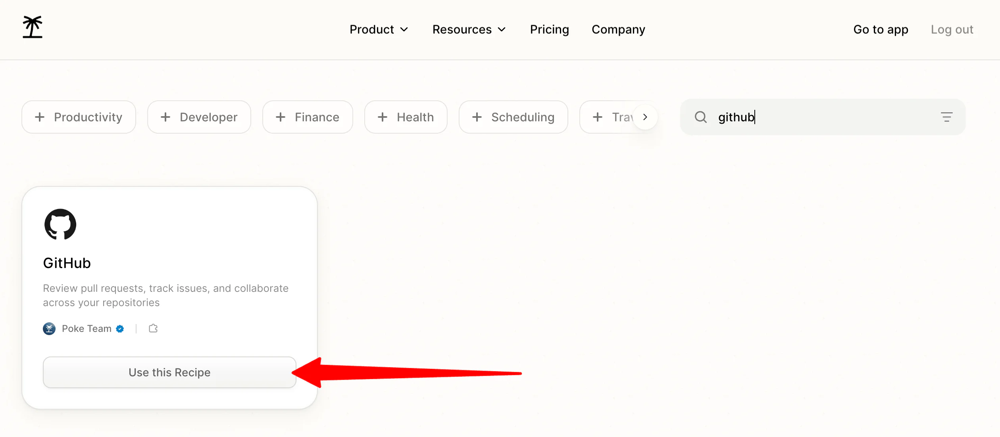

关联 [Notion](https://www.unite.ai/notion-review/)、GitHub 或你的智能家居设备等工具，扩大 Poke 实际能做的事。你连接得越多，它就越有用。你甚至可以把「真人」任务交给它，比如预订一家不接受线上订位的餐厅。

总的来说，Poke 让我印象深刻的是它如此自然地融入我每天都在用的东西：发短信。邮件与日历访问、自动化、语音备忘和集成的组合确实很有用。

## Poke 的前 3 个替代品

以下是我试过并愿意推荐的 Poke 最佳替代品。

### [ChatGPT](https://chatgpt.com/)

对大多数人来说，ChatGPT 可能已经在浏览器标签页里开着了，它能在一个地方处理异常广泛的任务（从写作、编程到研究和[图像生成](https://www.unite.ai/ai-art-generators/)）。

两个工具都能连接你的日历和收件箱，但体验有本质不同。

一方面，Poke 安静地住在你的短信里，会主动提醒你。另一方面，ChatGPT 是你主动打开并操控的东西，无论通过 app、浏览器还是它自己的 Work 模式。ChatGPT 在通用推理、编程和图像生成上的深度与 Poke 不在一个量级，后者是为轻量任务自动化而非重度知识工作而打造的。

如果你想要一个在你的消息里与你相遇、省心省力的助手，就选 Poke。否则，如果你想要一个能直接打开、可用于研究、写作和解决问题的强大工具，就选 ChatGPT。

### [Google Gemini](https://gemini.google.com/)

Gemini 是谷歌的多模态助手，它最大的优势是与 Gmail、Docs、Calendar 以及 Google Workspace 其余部分的深度交织。如果你已经生活在这个生态里，Gemini 几乎无需设置就能直接处理你的邮件、文档、日历和其他 Google 应用。

Gemini 和 Poke 都能总结收件箱、管理日程。不过，Gemini 只支持谷歌自家的服务，而 Poke 在同一个短信会话里横跨 Gmail、Outlook、Notion、GitHub 以及其他几十种服务。此外，Gemini 的多模态推理（在同一段对话中处理文档、图像和视频）远超 Poke 的设计目标。

如果你的工具分散在谷歌生态之外，就选 Poke。否则，如果你完全投入 Workspace，并想要一个对文件的理解与对日程一样深的助手，就选 Gemini。

### [Anthropic Claude](https://claude.ai/)

当我处理大量信息时，我往往会求助于 Claude。它尤其擅长写作、翻查长文档，以及在不丢失细节的前提下帮助理清复杂研究。

Claude 和 Poke 都能连接其他工具，并被要求完成涉及多个步骤的任务。不过，Claude 被构建成一个你打开并[在其中协作](https://www.unite.ai/best-ai-collaboration-tools/)的工作区，而不是一个会先给你发短信的背景存在。与此同时，Poke 的主要卖点是它通过消息主动来找你，而 Claude 则等你开启对话。

如果你想要让你一整天保持正轨的简单自动化，就选 Poke。否则，如果你更看重高质量的写作、分析和推理而非单纯的便利，就选 Claude。

## Poke 评测：适合你的工具吗？

总的来说，Poke 如此自然地融入我每天都在用的东西——发短信——让我印象深刻。能够不打开另一个 app 就管理邮件、查看日历、设置重复任务、发送语音备忘并连接其他工具，令人耳目一新。

如果你喜欢这种住在你的消息里、能替你处理日常任务的 AI 助手，Poke 值得一试，尤其因为它有免费选项。但如果你想要一个更传统、可以直接打开并用于更广泛工作的 AI 助手，下面这些可能更合适：

- [ChatGPT](https://chatgpt.com/) 最适合在一个地方完成通用知识工作、编程和研究
- [Google Gemini](https://gemini.google.com/) 最适合深度使用 Google Workspace 的人
- [Anthropic Claude](https://claude.ai/) 最适合高质量写作和复杂信息分析

感谢阅读我的 Poke 评测！希望它对你有帮助。如果你想亲自试试 Poke，可以访问 [poke.com](https://poke.com/)，免费开始，无需信用卡。

## 常见问题

### Poke 免费吗？

是的，Poke 的大部分核心功能免费，无需信用卡。

### Poke 支持哪些消息应用？

Poke 可通过 Apple Messages、短信、WhatsApp 和 Telegram 使用，因此无需下载单独的 app。

### Poke 支持哪些邮件服务商？

Poke 目前仅支持 Gmail 和 Outlook。iCloud、Yahoo Mail 和 Google Workspace 账户尚不支持。

### 什么是 Poke Human？

Poke Human 是包含在 Ultra 方案中的功能，会派真人完成需要真人在环的任务，比如餐厅预订或打电话。

### Poke 在日程安排上可靠吗？

是的，Poke 在日程安排上可靠。过去它曾出现时区和日期错误，偶尔也会延迟发送提醒，但[这些问题已经解决](https://poke.com/docs/release-notes)。

### 现在 Poke 归谁所有？

Poke 由 The Interaction Company of California 打造，并于 2026 年被 AI 编程 agent Devin 背后的公司 Cognition 收购。
