来源：https://www.unite.ai/poke-review/
取文：2026-11-09，直接下载

Disclosure:

Unite.AI may receive compensation when you use links to products we review. This does not influence our editorial evaluations. Read our [affiliate disclosure](https://www.unite.ai/affiliate-disclosure/).

Have you ever missed something important because it was buried in a pile of open tabs, an app you forgot about, or a notification you swiped away? You juggle several apps just to [keep track of your schedule](https://www.unite.ai/best-ai-scheduling-assistants/), yet somehow something still slips through the cracks.

[Poke](https://poke.com/) claims to fix that by moving the entire assistant experience into the one place I already check obsessively: my text messages. There’s no new app to download, and no dashboard to learn. You just text it like you’d text a friend, and it handles your calendar, inbox, and dozens of other tools in the background.

In this Poke review, I’ll show you how it worked by handing it real tasks: summarizing my unread emails and getting a weekly summary of the following week. I’ll also tell you where it impressed me, and where I think it still falls short.

From there, I’ll finish the article by comparing it to my top three alternatives: [ChatGPT](https://chatgpt.com/), [Google Gemini](https://gemini.google.com), and [Claude](https://www.anthropic.com/). By the end, you’ll know which [AI assistant](https://www.unite.ai/10-best-ai-assistants/) is right for you!

## Verdict

Poke is an AI assistant that lives entirely inside iMessage, WhatsApp, or Telegram instead of another app you have to remember to open. Its recipe-based automations are impressive when they work. However, it only supports Gmail and Outlook for email, it can’t yet manage multiple phone numbers on a single account, and it has an Ultra tier that some may consider expensive for a product this early.

## Pros

- No app to download: Poke works entirely inside iMessage, SMS, WhatsApp, or Telegram
- Setup takes under two minutes: just a phone number and an email connection to get going
- Connects to 40+ services, including Gmail, Google Calendar, Notion, GitHub, Linear, and Philips Hue
- “Recipes” give you pre-built automations you can customize instead of building workflows from scratch
- Customize and create your own recipes on Poke by using their recipe wizard (“Poke Kitchen”)
- Proactively surfaces information instead of only responding when you ask
- Routes tasks to whichever underlying AI model fits best, instead of locking you into a single provider
- Accepts voice memos as well as typed texts, so you can talk instead of type
- Poke Human dispatches an actual person to handle real-world errands like reservations and phone calls
- Now built into Apple’s Messages for Business platform
- Free plan available with no credit card required

## Cons

- Email triage isn’t very sharp yet, so it can bury something urgent while forwarding something trivial
- Only supports Gmail and Outlook for email, so iCloud, Yahoo, and Google Workspace aren’t supported
- Can’t yet manage multiple phone numbers on a single account
- The Ultra tier is steep for a product that’s still occasionally unreliable
- Giving an AI agent access to your inbox, calendar, and smart home devices takes a level of trust some people aren’t ready for

## What is Poke?

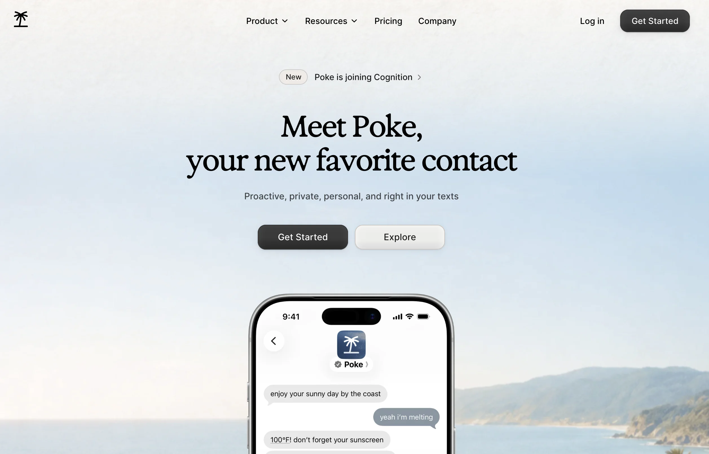

Poke is an AI assistant you talk to entirely through text, whether that’s Apple Messages, SMS, WhatsApp, or Telegram. It’s built by [The Interaction Company of California](https://interaction.co/), a Palo Alto AI startup co-founded by Marvin von Hagen and Felix Schlegel.

Instead of asking you to download an app or learn a new interface, Poke meets you in the one place almost everyone already checks constantly: their messages. You text it a request the way you’d text a person, and it handles it using whichever connected services and AI models fit the task.

### The Idea Behind It

Poke’s pitch is refreshingly simple: your life already runs through dozens of [disconnected apps](https://www.unite.ai/best-no-code-app-builders/) (email, calendar, project boards, fitness trackers, [smart home gadgets](https://www.unite.ai/artificial-intelligence-is-the-next-step-for-smart-homes/)) and Poke wants to be the one conversational layer sitting on top of all of them. So rather than opening five apps to plan a trip or sort through your inbox, you send Poke a message and it pulls the pieces together.

The startup has leaned hard into this “invisible interface” idea, and it’s paid off with meaningful distribution: Poke recently became the first third-party AI agents built directly into Apple’s Messages for Business platform. Not only that, but the product was significant enough that [Cognition (the company behind the AI coding agent Devin) acquired it in 2026](https://www.renascence.io/news/31187/why-cognition-bought-poke-ai-personality-is-becoming-a-competitive-advantage).

### How Poke Works

Under the hood, Poke uses “recipes,” which are pre-built automation templates for common tasks like summarizing your inbox, logging a workout, or dimming your Hue lights on a schedule. You can use recipes as-is, customize them in plain English, or [write custom automations](https://poke.com/kitchen/recipes) and share them with others.

Poke also has a memory function that learns your preferences over time, so it gets more useful the longer you use it. And unlike assistants that are tied to one AI lab, Poke routes each request to whichever model (from major labs or open source) handles that task best.

### Poke Human

One feature that sets Poke apart from your typical chatbot is Poke Human. It’s for tasks that need an actual person, like booking a restaurant reservation or [making a phone call](https://www.unite.ai/best-ai-phone-platforms/).

Poke dispatches a real human operator who only sees the details needed for that task, not your full chat history or connected accounts. It’s included with the Ultra plan, and costs (like the actual reservation fee) are billed with no markup.

## Who is Poke Best For?

Here’s who Poke is best for:

- Busy professionals can use Poke to sort through email and calendar chaos without opening a laptop
- Non-technical users can use Poke to get agent-style automation without learning a new app or workflow tool
- Parents and caregivers can use Poke to manage reminders, appointments, and errands from their phone’s messages
- [Small business owners](https://www.unite.ai/best-ai-tools-for-business/) can use Poke to keep on top of scheduling and communications without hiring an assistant
- Smart home enthusiasts can use Poke to control connected devices like Sonos speakers and Philips Hue lights conversationally
- [Frequent travelers](https://www.unite.ai/best-ai-tools-for-travel-planning/) can use Poke to offload logistics like reservations and phone calls to Poke Human
- [Developers can use Poke](https://www.unite.ai/7-best-ai-software-development-tools/) to get status updates from GitHub, Linear, or Vercel without checking each dashboard
- Anyone who dislikes learning new software can use Poke to get AI assistance through an interface they already use every day (texting)

## Poke’s Key Features

Here’s a closer look at Poke’s core features:

- Multi-platform messaging support: Works inside Apple Messages, SMS, WhatsApp, and Telegram, so there’s nothing new to install.
- Recipe library: Pre-built automations for common tasks, from inbox summaries to fitness logging, that you can use out of the box or customize.
- Custom automations: Write your own automation in plain English and Poke will build and run it, then let you share it with others.
- Cross-model selection: Poke isn’t locked to a single AI provider; it selects the model best suited to a given task from major labs or open-source options.
- Proactive notifications: Instead of waiting for a prompt, Poke can surface relevant updates (a bill due, a schedule conflict) based on your connected data.
- Send voice memos: You can send a voice note instead of typing, and Poke will process it the same way it handles text.
- Email & calendar integration: Full support for Gmail and Outlook inboxes, calendars, and contact synchronization.
- Notion, GitHub, and Linear integration: Sends and receives information from common productivity and developer tools.
- Fitness & health tracking: Connects with platforms like Fitbit to show health data conversationally.
- Smart home control: Integrates with devices like Philips Hue and Sonos for home automation.
- [Website builder](https://www.unite.ai/best-ai-website-builders/): Can [design and publish](https://www.unite.ai/10-best-ai-graphic-design-tools/) a simple personal website at a custom yourname.poke.site handle.
- Memory: Retains context and preferences across conversations so responses are meant to get more personalized over time.
- Poke Human: Dispatches an actual person for tasks that need a human in the loop, like reservations or phone calls.

## How to Use Poke

Here’s how I used Poke AI to manage my emails, calendar, recurring tasks, and other daily requests entirely through text:

1. Sign Up for Poke
2. Connect Your Phone Number
3. Link Your Email and Calendar
4. Message Poke
5. Browse the Recipe Directory
6. Send Your First Request
7. Set Up an Automation
8. Try Sending a Voice Memo
9. Connect Additional Integrations

### Step 1: Sign Up for Poke

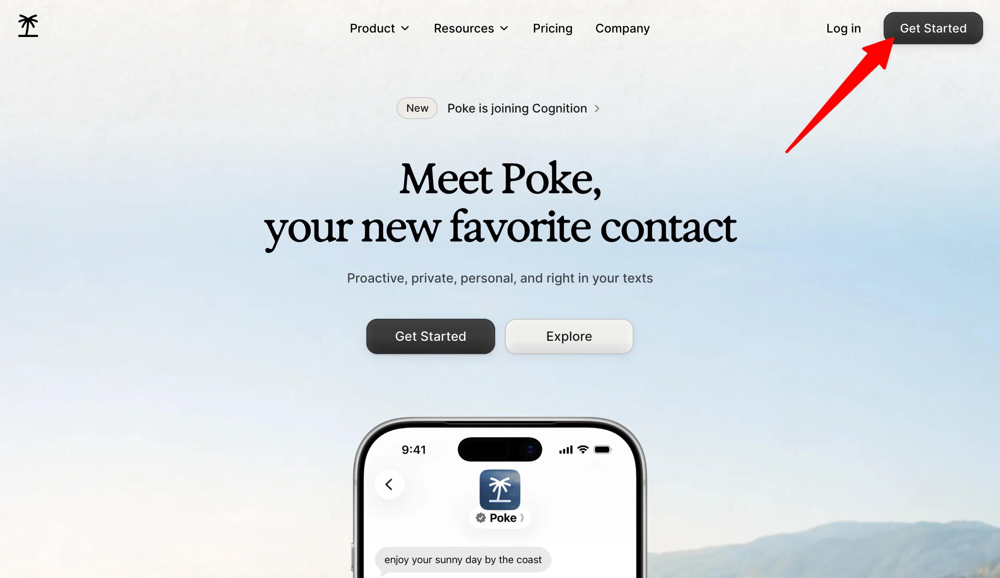

Head to [poke.com](https://poke.com/) and hit “Get Started.” Sign up with your name, phone number.  There’s no account form to fill out and no credit card required for the free tier, but just keep in mind that message and data rates apply.

### Step 2: Connect Your Phone Number

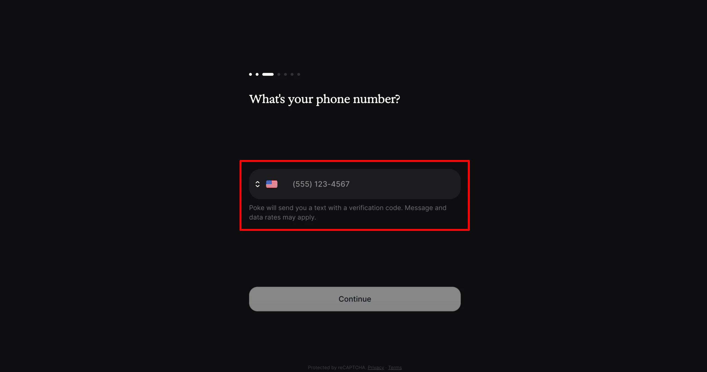

Once you’ve entered your phone number, Poke will text you directly on whichever messaging app you use (Apple Messages, SMS, WhatsApp, or Telegram). From here on, that’s your entire interface.

### Step 3: Link Your Email & Calendar

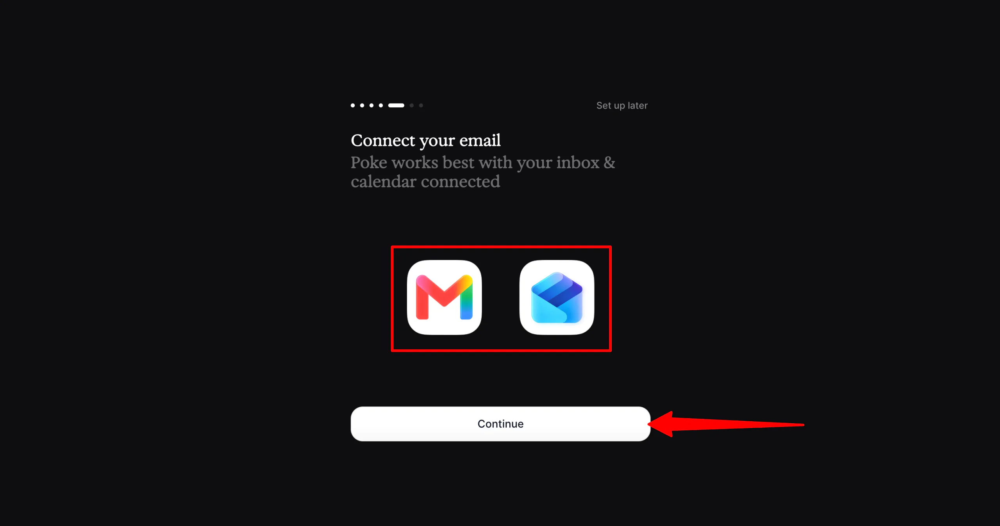

Connect your Gmail or Outlook account so Poke can read and summarize your inbox and calendar. This step is what unlocks most of the assistant’s usefulness on a day-to-day basis.

### Step 4: Message Poke

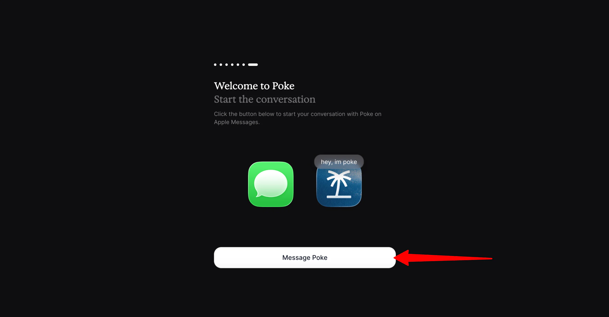

Once you’ve entered your phone number and connected your Gmail or Outlook account, message Poke to begin the conversation.

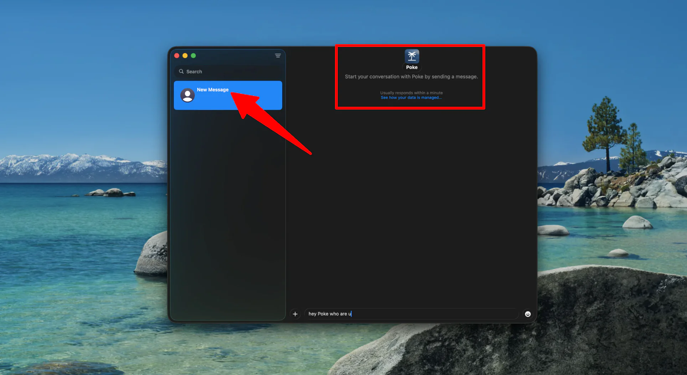

A text message window with Poke will automatically open on your computer.

### Step 5: Browse the Recipe Directory

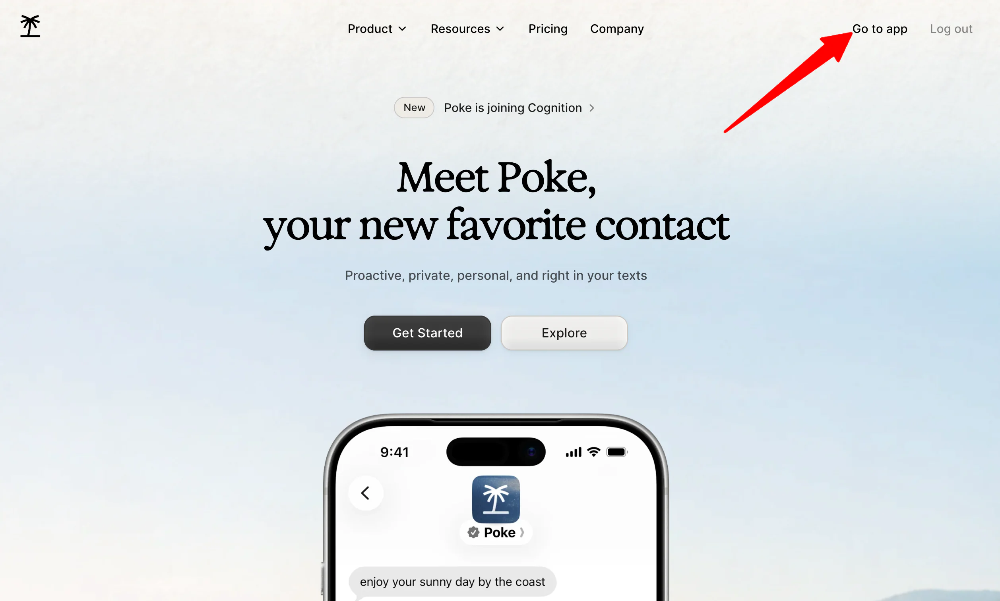

Before [writing your own automation](https://www.unite.ai/best-ai-writing-tools/), check the recipe directory for pre-built templates by accessing your Poke account.

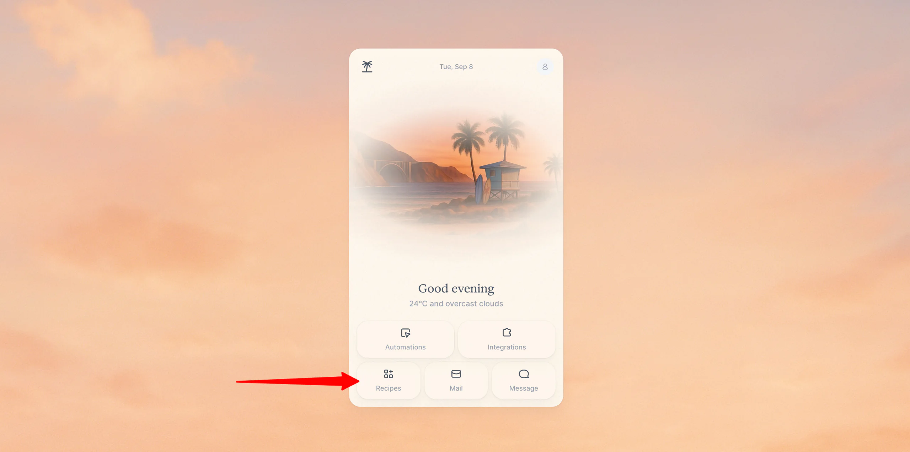

You’ll find a couple of useful features within the app:

- Automations
- Integrations
- Recipes
- Mail
- Message

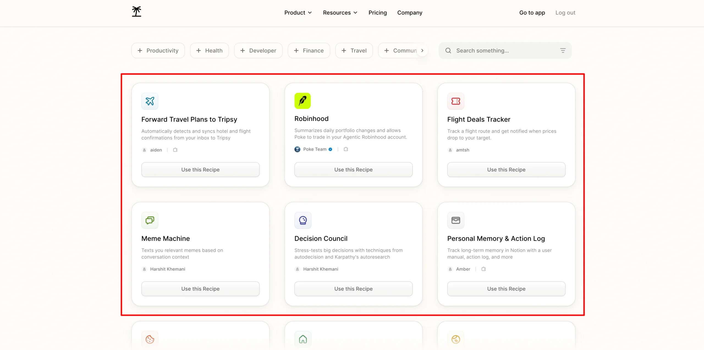

I found recipes for things I hadn’t even thought to ask for, like a flight deals tracker.

### Step 6: Send Your First Request

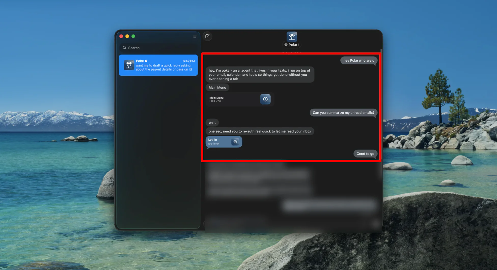

Text Poke something simple, like asking it to summarize your unread emails or check tomorrow’s calendar. This is the fastest way to get a feel for how it responds.

### Step 7: Set Up an Automation

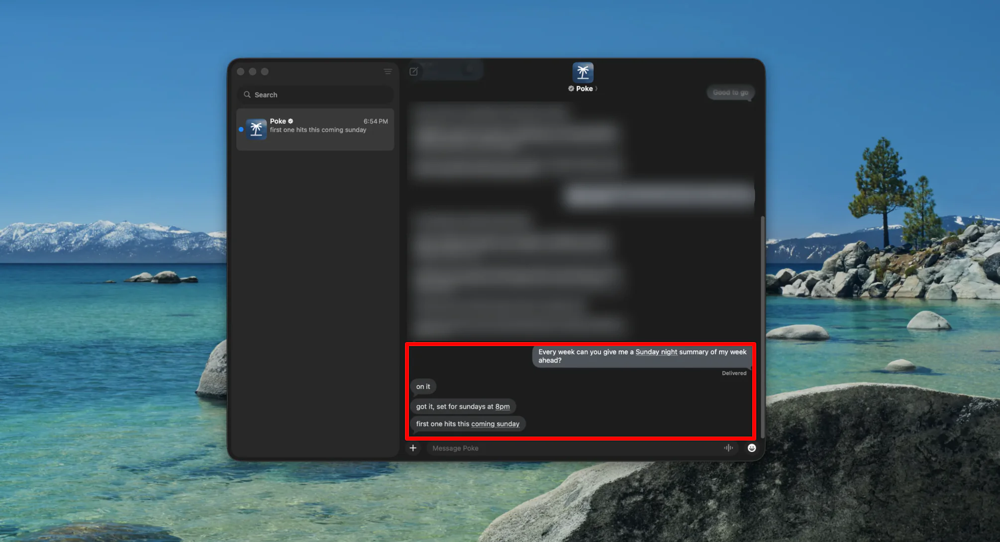

Ask Poke to handle something on a recurring basis, like a Sunday-night summary of your week ahead. This is where the “assistant” framing starts to feel real instead of just a gimmick.

### Step 8: Try Sending a Voice Memo

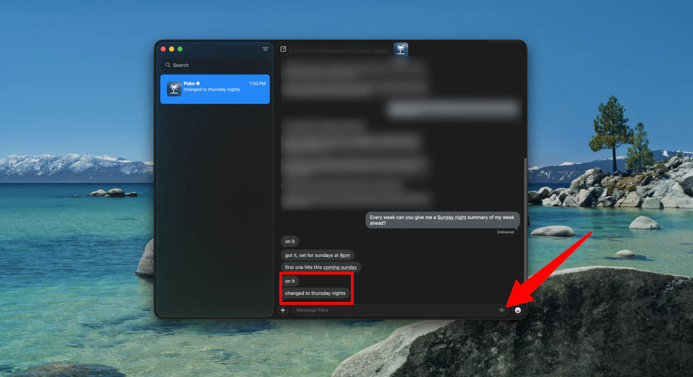

Instead of typing, record a quick voice memo with your request. Poke processes it the same way it would a text, which comes in handy when you’re driving or your hands are full.

### Step 9: Connect Additional Integrations

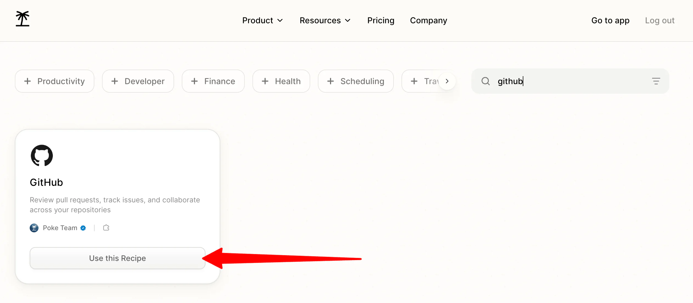

Link tools like [Notion](https://www.unite.ai/notion-review/), GitHub, or your smart home devices to widen what Poke can actually do. The more you connect, the more useful it becomes. You can even handoff “human” tasks for you like booking a table at a restaurant that doesn’t take online reservations.

Overall, Poke impressed me with how naturally it fits into something I already use every day: texting. The combination of email and calendar access, automations, voice memos, and integrations were genuinely useful.

## Top 3 Poke Alternatives

Here are the best Poke alternatives I’ve tried that I’d recommend.

### [ChatGPT](https://chatgpt.com/)

ChatGPT is probably already open in a browser tab for most people, and it handles an unusually wide range of tasks (from writing and coding to research and [image generation](https://www.unite.ai/ai-art-generators/)) all in one place.

Both tools can connect to your calendar and inbox, but the experience is fundamentally different.

On the one hand, Poke lives quietly inside your texts and nudges you proactively. Meanwhile, ChatGPT is something you actively open and drive yourself, whether through the app, browser, or its own Work mode. ChatGPT’s depth on general reasoning, coding, and image generation is in a different league than Poke’s, which is built for lightweight task automation rather than heavy knowledge work.

Choose Poke if you want a low-effort assistant that meets you in your messages. Otherwise, choose ChatGPT for one powerful tool for research, writing, and problem-solving that you’re comfortable opening directly.

### [Google Gemini](https://gemini.google.com/)

Gemini is Google’s multimodal assistant, and its biggest advantage is how deeply it’s woven into Gmail, Docs, Calendar, and the rest of Google Workspace. If you already live in that ecosystem, Gemini can work directly with your emails, documents, calendar, and other Google apps with very little setup.

Both Gemini and Poke can summarize your inbox and manage your schedule. However, Gemini only supports Google’s own services, while Poke spans Gmail, Outlook, Notion, GitHub, and dozens of others from one text thread. Plus, Gemini’s multimodal reasoning (handling documents, images, and video within the same conversation) goes well beyond what Poke is designed to do.

Choose Poke if your tools are spread across more than just Google’s ecosystem. Otherwise, choose Gemini if you’re fully invested in Workspace and want an assistant that understands your files as deeply as your schedule.

### [Anthropic Claude](https://claude.ai/)

Claude is the one I tend to reach for when I’m working with a lot of information. It’s especially good at writing, digging through long documents, and helping make sense of complicated research without losing the details.

Both Claude and Poke can be connected to other tools and asked to complete tasks involving multiple steps. However, Claude is built as a workspace you open and [collaborate in](https://www.unite.ai/best-ai-collaboration-tools/), not a background presence that texts you first. Meanwhile, Poke’s main selling point is that it comes to you proactively through messaging, whereas Claude waits for you to start the conversation.

Choose Poke if you want simple automations that keep you on track throughout the day. Otherwise, choose Claude if your priority is high-quality writing, analysis, and reasoning over raw convenience.

## Poke Review: The Right Tool For You?

Overall, I was impressed by how naturally Poke fits into something I already use every day: texting. Being able to manage emails, check my calendar, set up recurring tasks, send voice memos, and connect other tools without opening another app was a breath of fresh air.

If you like the idea of an AI assistant that lives in your messages and can handle everyday tasks for you, Poke is worth trying especially since there’s a free option. But if you want a more traditional AI assistant that you can open directly and use for a wider range of work, one of these might be a better fit:

- [ChatGPT](https://chatgpt.com/) is best for general knowledge work, coding, and research in one place
- [Google Gemini](https://gemini.google.com/) is best for anyone deeply embedded in Google Workspace
- [Anthropic Claude](https://claude.ai/) is best for high-quality writing and analysis of complex information

Thanks for reading my Poke review! I hope you found it helpful. If you want to try Poke for yourself, you can visit [poke.com](https://poke.com/) and get started for free with no credit card required.

## Frequently Asked Questions

### Is Poke free to use?

Yes, most of Poke’s core features are free with no credit card required.

### What messaging apps does Poke work with?

Poke works through Apple Messages, SMS, WhatsApp, and Telegram, so there’s no separate app to download.

### Which email providers does Poke support?

Poke currently supports Gmail and Outlook only. iCloud, Yahoo Mail, and Google Workspace accounts aren’t supported yet.

### What is Poke Human?

Poke Human is a feature included with the Ultra plan that dispatches a real person to complete tasks that need a human in the loop, like restaurant reservations or phone calls.

### Is Poke reliable for scheduling?

Yes, Poke is reliable for scheduling. In the past, it made time zone and date errors and occasionally sent reminders late, but [those issues have been resolved](https://poke.com/docs/release-notes).

### Who owns Poke now?

Poke was built by The Interaction Company of California and was acquired by Cognition, the company behind the AI coding agent Devin in 2026.
