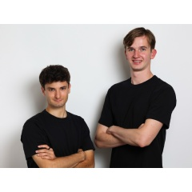



**收录说明**：The Interaction Company 通过新闻稿分发平台 WebWire 发布的新闻稿，旧笔记 learning-ai-agent 引用过。页面是 Windows-1252 编码，转为 UTF-8 后抽取；删去了 WebWire 的导航、相关关键词、分发服务推广与页脚。已翻译。

**内容摘要**：The Interaction Company of California 于 2025 年 9 月 8 日公开发布 Poke.com，这是一个住在 iMessage 和 SMS 中、在用户开口前预判需求的 AI 助手。Poke 连接用户的邮件、日历和文件，通过文字对话代为起草回复、管理发票、改期会议、订票等。同时宣布由 General Catalyst 领投的 1500 万美元种子轮，Village Global、Earlybird VC 及 PayPal 创始人和高管等天使投资人参与。稿中称最初几千名 beta 用户与 Poke 交换了超过 75 万条消息，留存“近乎完美”；并称具备 SOC 2 Type II 和 CASA Tier 2 认证，定期做渗透测试，定价因用户需求而异。“关于 Interaction”一节称 Poke 住在 iMessage、WhatsApp 和 SMS 中，天使包括来自 Stripe、Dropbox、Vercel、Cognition 的创始人。

**保留理由**：这是 Poke 公开发布与种子轮金额、估值、投资方的一手公告，并给出 beta 消息量和安全认证的最早官方说法，可作为时间线起点。

---

## Interaction 发布 Poke——一款直接接入消息平台的 AI 助手，同时宣布 1500 万美元种子轮融资、估值 1 亿美元

加州帕洛阿尔托 – [WEBWIRE](https://www.webwire.com/) – 2025 年 9 月 8 日，星期一

Poke 的创始人：Marvin von Hagen（CEO）与 Felix Schlegel（CTO）

The Interaction Company of California 今日公开发布 [Poke.com](http://Poke.com)，这是一款住在消息平台（iMessage 和 SMS）中、在用户开口之前就预判其需求的 AI 助手。Poke 连接用户的邮件、日历和文件，然后通过简单的文字对话代表用户行动——起草回复、管理发票、重新安排会议、预订行程等。Interaction 同时宣布完成 1500 万美元种子轮融资，由 General Catalyst 领投，Village Global、Earlybird VC，以及包括 PayPal、CoinBase、Dropbox、Vercel 和 Google 的创始人及高管在内的天使投资人参与。用户现在即可在 [Poke.com](https://poke.com/) 注册。

**当今助手的问题**

如今的 AI 助手住在自己的应用里，对你的真实生活几乎一无所知。它们看不到真正驱动你一天的邮件、短信、收据和日历变更。所以它们只能给出抽象的答案，而不是结合上下文的答案。而当它们真的帮上忙时，你又被迫在应用之间复制粘贴、管理新的登录账号、再学一套界面。与此同时，重要的任务藏在嘈杂的收件箱里：未付的发票、航班变更、续费通知、改期请求。聊天机器人会漏掉它们，或者太晚才把它们找出来。它们也很少能跨工具采取行动，结果活还是得你自己干。最终是更多的提示词、更多的标签页、更多的精神负担，而没有哪个单一的地方既懂你的工作又懂你的个人生活。

**[Poke.com](http://Poke.com) 的解法：一个触手可及的 AI 助手**

Poke 以对话的形式运行在你已有的消息应用中，留意已连接账户中的可行动信号，并以简洁、相关的消息回应。最初几千名 beta 用户已与 Poke 交换了超过 75 万条消息，留存近乎完美。该平台采用业界领先的安全标准，包括 SOC 2 Type II 和 CASA Tier 2 认证，并由网络安全公司定期进行渗透测试。定价根据个人用户需求而定。

「用户不想要又一个应用。他们想用给伴侣、朋友和同事发短信的同样方式，给 AI 发消息，」Interaction 联合创始人兼 CEO Marvin von Hagen 解释说。「Poke 把这种体验做对了——短消息、一键操作，并以隐私为基础。」

创始人 Marvin von Hagen 和 Felix Schlegel 在德国的一场中学黑客松上相识，此前共同创办了 TUM Boring，带领一支 65 人的团队造出一台 12 米长、22 吨重的隧道掘进机，并赢得 Elon Musk 的 2021 年 Not-a-Boring Competition。团队成员曾获 IOI 奖牌，来自 Jane Street、Citadel、Apple、Tesla、MIT 和 Stanford 等机构

「有时你会发现一种用户体验，感觉像揭开了一个隐藏的秘密，」General Catalyst 董事总经理 Yuri Sagalov 说。「Marvin 和 Felix 正是如此。通过 iMessage 与 Poke 互动的体验非常神奇。就像你最好的助理就在你每天都在用的界面里陪着你。它会找出重要的邮件，代表你执行操作，并在提供帮助时不断带来惊喜与愉悦。」

立即在 <https://poke.com/> 注册。

**关于 Interaction**

The Interaction Company of California 是 [Poke.com](http://Poke.com) 的创建者。Poke 是一款以消息为先的助手，住在 iMessage、WhatsApp 和 SMS 中，并作为智能层横跨你来自邮件和日历事件等来源的上下文。Interaction 已融资 1500 万美元种子轮，由 General Catalyst 领投，天使投资人包括来自 Stripe、Dropbox、Vercel 和 Cognition 的创始人。欲了解更多，请访问 [interaction.co](http://interaction.co)，或在 [Poke.com](https://poke.com/) 申请使用。

（新闻稿图片：<https://photos.webwire.com/prmedia/81468/343533/343533-1.jpg>）

相关链接
:   <https://poke.com/>
:   <https://interaction.co/about>

WebWireID343533

联系信息
:   Riley Munks
:   公关顾问
:   Activate PR - https://www.activate-pr.com/
:   [riley@activate-pr.com](mailto:riley@activate-pr.com)
