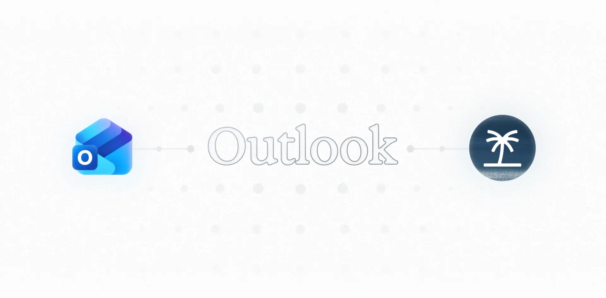
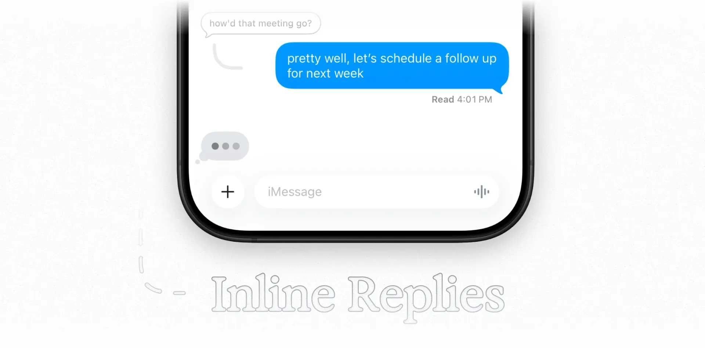
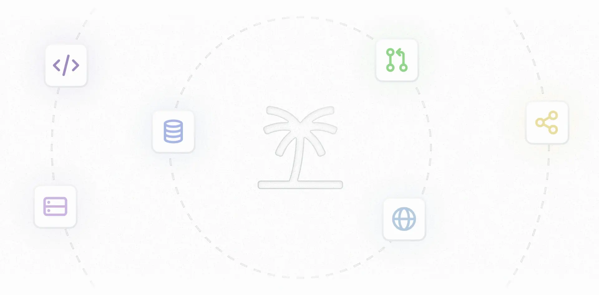



**收录说明**：Poke 帮助文档中的发布说明，直接下载后抽取。页面自述只记录主要更新，不是完整的部署日志。已翻译。

**内容摘要**：页面按日期倒序列出更新，最新为 2026 年 7 月 23 日 “Poke is joining Cognition”，称 Poke 照常工作。此前包括：2026-06-25 Poke Human（含在 Ultra $199/月，现实开销按成本价计）；2026-06-18 Poke Ultra 上线与网站搭建；2026-06-08 @poke.com 邮箱地址；2026-06-04 Poke 成为 Apple Messages 上“首个也是唯一”通过验证的 AI 产品；2026-03-19 Poke Recipes 并取消 bouncer/waitlist、全面开放，同时改为只发布重大更新。更早条目有 2026-02-02 的 Telegram 备用渠道（WhatsApp 暂不可用）、2025-12-12 的 Microsoft Outlook 支持、2025-11-17 的 iMessage inline replies、2025-11-03 的集成库（Linear、Todoist、Notion、Asana、GitHub 等）及大量修复。页首声明 Poke 可能出错，不能提供医疗、财务或法律建议。

**保留理由**：给出 2025-11 至 2026-07 的官方功能时间线（Apple Messages、Recipes 全面开放、Ultra、Poke Human、Cognition），可交叉验证媒体报道的日期。

---

发布说明

和我们人类一样，Poke 有时也会犯错。你应当核实任何重要信息，而且 Poke 没有资格提供医疗、财务或法律建议。

请查看 [status.poke.com](https://status.poke.com/) 获取实时更新。

---

## 2026 年 7 月 23 日

### Poke 加入 Cognition

Poke 的打造者 The Interaction Company of California 正在加入 Devin 的打造者 [Cognition](https://cognition.com)。阅读 [Cognition 的公告](https://cognition.com/blog/interaction)。

Poke 照常工作，你无需做任何事。随着时间推移，Cognition 的模型和基础设施会让 Poke 更快、更可靠。

---

## 2026 年 6 月 25 日

### Poke Human

Poke 现在可以引入真人来承担需要人情味的任务——餐厅预订、打电话、下单、叫车等等。只要让 Poke 接手一项特别难的任务，就会有真人介入完成。看看我们的 [Twitter 发布视频](https://x.com/interaction/status/2070186007299772700)。

Poke Human 包含在 [Poke Ultra](https://poke.com/pricing)（$199/月）中。任何代你支付的现实开销均按成本价收取（不加价）。

---

## 2026 年 6 月 18 日

### Poke Ultra

Poke Ultra 现已推出——终极 Poke 体验，前沿智能驱动每一个动作。详情见我们的[定价方案](https://poke.com/pricing)。

### 网站搭建

从今天起，Poke 还能在 [yourname.poke.com](https://yourname.poke.com) 为你创建和部署网站。看看我们的 [Twitter 发布视频](https://x.com/interaction/status/2067677017101996290)。

---

## 2026 年 6 月 8 日

### Poke.com 邮箱

你现在可以设置一个 @poke.com 地址，在 Poke 中与你的主邮箱账户一起使用。前往 [poke.com/claim](https://poke.com/claim) 认领你的用户名。看看我们的 [Twitter 发布视频](https://x.com/interaction/status/2064025168276840895)。

---

## 2026 年 6 月 4 日

### Poke 登陆 Apple Messages

Poke 现已在 Apple Messages 上线，是首个也是唯一在该平台上通过验证的 AI 产品。看看我们的 [Twitter 发布视频](https://x.com/interaction/status/2062575428213285352)。

---

## 2026 年 3 月 19 日

### Poke Recipes

Poke 现已全面开放，无需 bouncer 或排队等候。所有新老用户都可以用 Poke Recipes 轻松设置自动化和集成，并与他人分享自己的配置。看看我们的官方 [recipe 目录](https://poke.com/recipes)或 [Twitter 发布视频](https://x.com/interaction/status/2034713714415608123)。

### 关于发布说明的说明

在无限期内，我们会把发布说明改为只记录重大更新，以便专注于把 Poke 做到尽可能好。我们仍会在此发布所有重要的功能更新，并在 [Twitter](https://x.com/interaction) 上分享。

---

## 2026 年 2 月 2 日

**改进**

- 在 WhatsApp 暂时不可用期间（意大利和巴西除外），Poke 现在可使用 Telegram 作为替代。前往设置中的 [Messaging](https://poke.com/settings/messaging)，选择 Telegram 作为你的消息渠道即可开始。
- Poke 现在可以创建表格和图表，帮助你可视化数据。描述你想看到的内容，或分享现有数据（如电子表格）的图片，让 Poke 提取并可视化。
- 我们的营销网站现在支持更多语言，包括西班牙语、日语、中文、法语、德语、葡萄牙语和意大利语

**修复**

- 修复了在回复指定了主要收件人的邮件时，抄送收件人会被丢弃的 bug
- 修复了日历事件草稿以错误时区显示时间的 bug
- 修复了未提供用户时区时，日历事件以错误时间创建的 bug
- 修复了 Outlook 邮件订阅同步失败的 bug

---

## 2026 年 1 月 12 日

---

**改进**

- 你现在可以通过我们 web app 设置页中的「Reconnect Account」按钮，轻松重新连接主邮箱账户
- Poke 现在改进了地图和路线方面的网页搜索结果
- Poke 现在有第一方 TripIt 自动化，用于导入旅行计划。在 [poke.com/automations/gallery](https://poke.com/automations/gallery) 添加它。

**修复**

- 修复了部分用户收到重复入门邮件的 bug
- 修复了 Todoist 集成会意外断开的 bug

---

## 2025 年 12 月 22 日

**改进**

- Poke 现在支持 WhatsApp 中的已读回执、输入状态提示和行内回复
- 对于 Gmail 账户，Poke 现在更可靠地转发邮件并对会话中的消息进行回复

**修复**

- 修复了部分用户在日历邀请中收到系统消息的 bug
- 修复了 Poke 偶尔在邮件搜索时超时的 bug

---

## 2025 年 12 月 12 日

### 支持 Microsoft Outlook

我们在 Poke 中新增了对 Microsoft Outlook 的完整支持。你现在可以同时连接 Microsoft 和 Google 账户，在一个地方管理你所有的收件箱、日历和联系人。

#### 功能

在 Poke 中连接 Outlook 后，你可以：

- 撰写新邮件并回复会话，包括带附件的会话
- 通过实时邮件同步搜索和管理收件箱
- 创建和管理日历事件
- 同步和搜索联系人

#### 如何连接

新用户可以在 [poke.com](https://poke.com) 使用其 Microsoft 账户邮箱注册，现有用户则可前往设置中的 [Integrations](https://poke.com/integrations)，点击「Add Account」按钮添加新的 Microsoft 账户。

---

**改进**

- Poke 现在可以生成和编辑带 LaTeX 格式的 PDF

**修复**

- 修复了即使账户已连接，Poke 也会暂时无法访问邮件的 bug

---

## 2025 年 12 月 5 日

**改进**

- 我们现在有了用例页面（[poke.com/explore](https://poke.com/explore)）。浏览开发者、健康与健身、旅行等分类，为使用 Poke 寻找灵感。

**修复**

- 修复了 Poke 在起草草稿时会使用占位邮箱地址而非用户邮箱地址的 bug

---

## 2025 年 12 月 1 日

**改进**

- Poke 现在会主动用多个来源核实用户时区
- Poke 现在会核实网页搜索的来源（在可用时），让你获得最新信息
- Poke 现在可以在发送前预览和更新附件（例如图片和 PDF）
- Poke 现在可以提醒用户检查尚未执行的重复自动化

**修复**

- 修复了 Poke 在某些场景下会向日历事件添加错误参与者的 bug
- 修复了 Poke 会以太平洋时间而非用户时区创建提醒的 bug
- 修复了部分用户会被意外退回 bouncer 模式的 bug

---

## 2025 年 11 月 17 日

### 支持 iMessage 行内回复

Poke 现在能看到你在 iMessage 聊天中行内回复。试着在一则你想直接回复的消息上向右滑动来体验。

由于 Poke 现在知道你后续回应的是哪条消息，你可以更轻松地回顾过去的对话。如果你喜欢，甚至可以回复自己的消息！

---

**改进**

- 我们现在有了常见问题（FAQ）页面（[poke.com/faq](https://poke.com/faq)）
- Poke 现在更了解我们的 web app 和用户资源。需要帮忙找东西？问它就行。
- Poke 现在更可靠地进行自动时区更改
- Poke 现在可以创建和管理重复日历事件

**修复**

- 修复了部分用户会把来自 gallery 的定时自动化收成一条长消息的 bug
- 修复了 Poke 在自动化中偶尔混淆时区和星期的 bug

---

## 2025 年 11 月 3 日

### 更新后的库设计与集成

我们更新了[集成库](https://poke.com/integrations/library)的设计，以支持几个类别下的新第一方集成：

- 生产力：Linear、Todoist、Notion 和 Asana
- 开发者：GitHub、DeepWiki、Sentry、Vercel、Netlify 和 Supabase
- 商业：Ramp、Webflow

借助新设计，你只需点击「Add」按钮，就能直接从库中轻松添加集成。

如果你遇到任何问题或想请求更多集成，请通过 [poke@interaction.co](mailto:poke@interaction.co) 联系我们。

---

**改进**

- Poke 的回复现在更简洁，使用更少的 emoji

**修复**

- 修复了部分用户在让 Poke 起草邮件时陷入反复批准循环的 bug
- 修复了部分用户无法收到 Poke 回复的 bug
- 修复了 Poke 在某些场景下无法完成网页搜索的 bug
