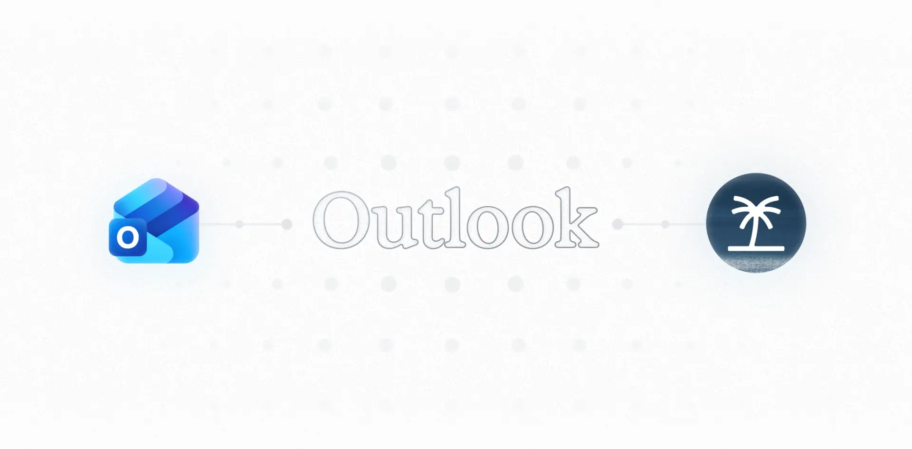
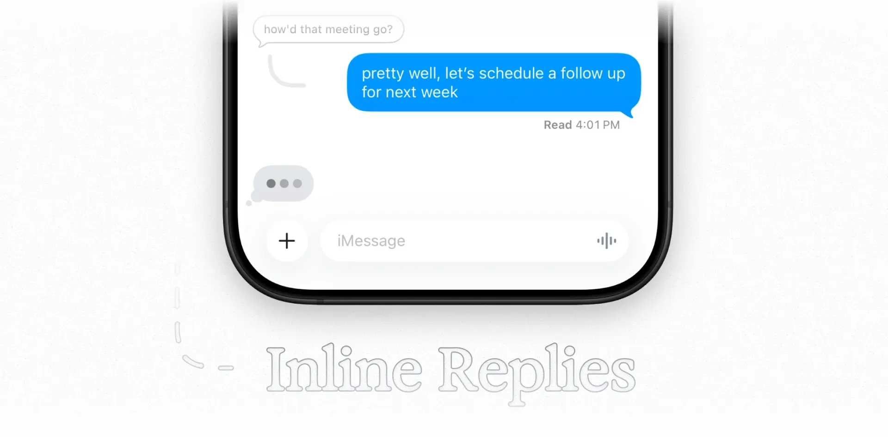
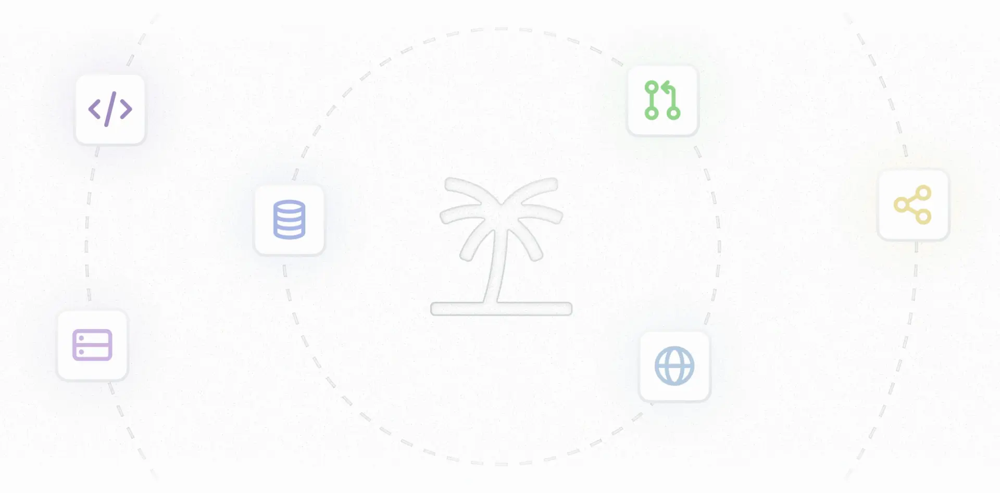

来源：https://poke.com/docs/release-notes
取文：2026-11-09，直接下载

Release Notes

Just like us humans, Poke can sometimes make mistakes. You should verify any
important information, and Poke is not qualified to give medical, financial,
or legal advice.

Please check [status.poke.com](https://status.poke.com/) for real-time
updates.

---

## July 23, 2026

### Poke is joining Cognition

The Interaction Company of California, the makers of Poke, is joining [Cognition](https://cognition.com), the makers of Devin. Read the [announcement from Cognition](https://cognition.com/blog/interaction).

Poke works exactly as before, and there's nothing you need to do. Over time, Cognition's models and infrastructure will make Poke even faster and more reliable.

---

## June 25, 2026

### Poke Human

Poke can now bring in real people to take on tasks with a human touch - restaurant reservations, phone calls, placing orders, booking rides, and more. Just ask Poke to take on an extra-hard task, and a real person will step in to get it done. Check out our [launch video on Twitter](https://x.com/interaction/status/2070186007299772700).

Poke Human is included with [Poke Ultra](https://poke.com/pricing) ($199/month). Any real-world expenses paid on your behalf are charged at-cost (without markup).

---

## June 18, 2026

### Poke Ultra

Poke Ultra is now available - the ultimate Poke experience, with frontier intelligence powering every action. See our [pricing plans](https://poke.com/pricing) for details.

### Website building

Starting today, Poke can also create and deploy websites for you at [yourname.poke.com](https://yourname.poke.com). Check out our [launch video on Twitter](https://x.com/interaction/status/2067677017101996290).

---

## June 8, 2026

### Poke.com Emails

You can now set up a @poke.com address to use with your primary email account in Poke. Claim your username by going to [poke.com/claim](https://poke.com/claim). Check out our [launch video on Twitter](https://x.com/interaction/status/2064025168276840895).

---

## June 4, 2026

### Poke on Apple Messages

Poke is now available on Apple Messages as the first and only AI product to be verified on the platform. Check out our [launch video on Twitter](https://x.com/interaction/status/2062575428213285352).

---

## March 19, 2026

### Poke Recipes

Poke is now generally available without a bouncer or waitlist. All new and existing users can use Poke Recipes to easily set up automations and integrations, as well as share their set-ups with others. Check out our official [directory of recipes](https://poke.com/recipes) or the [launch video on Twitter](https://x.com/interaction/status/2034713714415608123).

### A note on release notes

We're switching to major updates only for release notes for an indefinite period of time while we focus on making Poke as good as possible. We'll continue to post all significant feature updates here, and share them on [Twitter](https://x.com/interaction).

---

## February 2, 2026

**Improvements**

- Poke now works with Telegram as an alternative to WhatsApp while it is temporarily unavailable (except in Italy and Brazil). Go to [Messaging](https://poke.com/settings/messaging) in Settings and select Telegram as your messaging channel to get started.
- Poke can now create tables and charts to help you visualize data. Describe what you want to see, or share images of existing data (like spreadsheets) for Poke to extract and visualize.
- Our marketing website is now available in more languages, including Spanish, Japanese, Chinese, French, German, Portuguese, and Italian

**Fixes**

- Fixed a bug where CC recipients were being dropped when replying to emails with specified main recipients
- Fixed a bug where calendar event drafts displayed times in the wrong timezone
- Fixed a bug where calendar events were created with incorrect times when user timezone was not provided
- Fixed a bug where Outlook email subscriptions would fail to sync

---

## January 12, 2026

---

**Improvements**

- You can now easily reconnect your primary email account with the "Reconnect Account" button in the settings page of our web app
- Poke now has improved web search results for maps and directions
- Poke now has a first-party TripIt automation for importing travel plans. Add it on [poke.com/automations/gallery](https://poke.com/automations/gallery).

**Fixes**

- Fixed a bug where some users received duplicate onboarding emails
- Fixed a bug where the Todoist integration would disconnect unexpectedly

---

## December 22, 2025

**Improvements**

- Poke now supports read receipts, typing indicators, and inline replies in WhatsApp
- Poke now more reliably forwards emails and replies to messages in thread for Gmail accounts

**Fixes**

- Fixed a bug where several users received system messages in calendar invites
- Fixed a bug where Poke would occasionally time out on email searches

---

## December 12, 2025

### Support for Microsoft Outlook

We've added full support for Microsoft Outlook within Poke. You can now connect both Microsoft and Google accounts to manage all of your inboxes, calendars, and contacts in one place.

#### Functionality

With an Outlook connection in Poke, you can:

- Compose new emails and reply to threads, including those with attachments
- Search and manage your inbox with real-time email sync
- Create and manage calendar events
- Sync and search contacts

#### How to connect

New users can sign up using their Microsoft account email on [poke.com](https://poke.com), and existing users can add a new Microsoft account by going to [Integrations](https://poke.com/integrations) in Settings and clicking the "Add Account" button.

---

**Improvements**

- Poke can now generate and edit PDFs with LaTeX formatting

**Fixes**

- Fixed a bug where Poke was temporarily unable to access emails even if an account had been connected

---

## December 5, 2025

**Improvements**

- We now have a Use Cases page ([poke.com/explore](https://poke.com/explore)). Browse categories, like Developers, Health & Fitness, or Travel, to get inspiration for ways to use Poke.

**Fixes**

- Fixed a bug where Poke would use placeholder email addresses instead of user email addresses when composing drafts

---

## December 1, 2025

**Improvements**

- Poke now proactively verifies user time zones with multiple sources
- Poke now verifies sources from web searches (when available), so you can get up-to-date information
- Poke can now preview and update attachments (e.g., images and PDFs) before sending
- Poke can now encourage users to review recurring automations that haven't been acted upon

**Fixes**

- Fixed a bug where Poke would add incorrect attendees to calendar events in some scenarios
- Fixed a bug where Poke would create reminders in Pacific time instead of the user's time zone
- Fixed a bug where several users were reverted back to bouncer mode unexpectedly

---

## November 17, 2025

### Support for iMessage inline replies

Poke can now see when you reply inline in iMessage chats. Try it out by swiping right on a message you want to reply to directly.

Since Poke now knows which message you're addressing in the follow-up, you can more easily revisit past conversations. You can even reply to your own messages if that's your thing!

---

**Improvements**

- We now have a Frequently Asked Questions (FAQ) page ([poke.com/faq](https://poke.com/faq))
- Poke now has a better understanding of our web app and user resources. Need help finding something? Just ask.
- Poke now makes automatic time zone changes more reliably
- Poke can now create and manage recurring calendar events

**Fixes**

- Fixed a bug where some users received scheduled automations from the gallery in one long message
- Fixed a bug where Poke occasionally mixed up time zones and days of the week in automations

---

## November 3, 2025

### Updated library design and integrations

We've refreshed the design of the [integration library](https://poke.com/integrations/library) to support new first-party integrations across several categories:

- Productivity: Linear, Todoist, Notion, and Asana
- Developer: GitHub, DeepWiki, Sentry, Vercel, Netlify, and Supabase
- Business: Ramp, Webflow

With the new design, you can easily add integrations directly from the library simply by clicking the "Add" button.

If you encounter any issues or want to request more integrations, reach out to us at [poke@interaction.co](mailto:poke@interaction.co).

---

**Improvements**

- Pokes are now more concise and use fewer emojis

**Fixes**

- Fixed a bug where some users got caught in approval loops when drafting emails with Poke
- Fixed a bug where some users were unable to receive a reply from Poke
- Fixed a bug where Poke was unable to complete web searches in some scenarios
