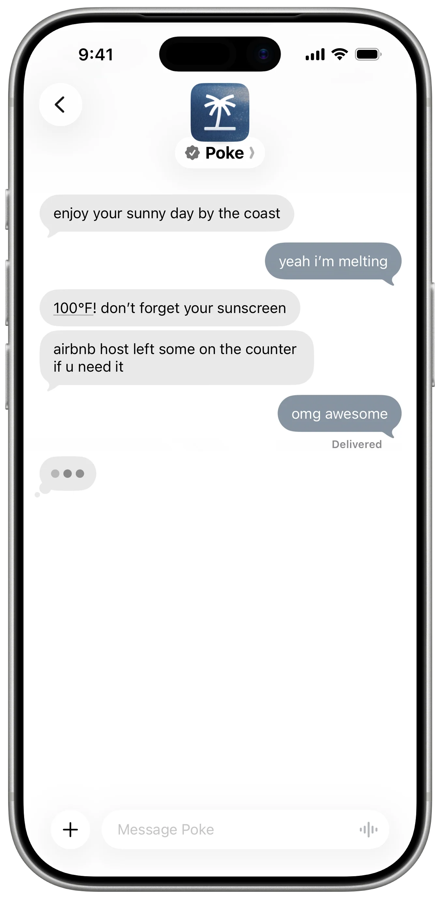
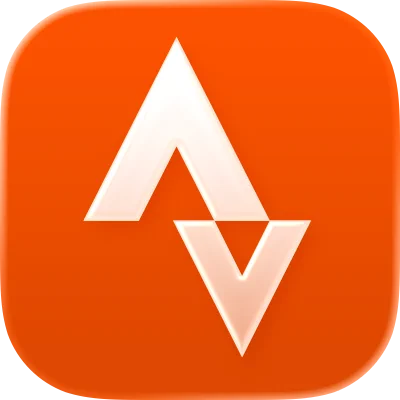
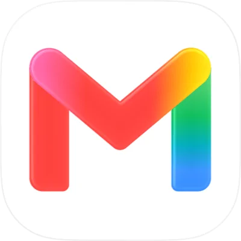
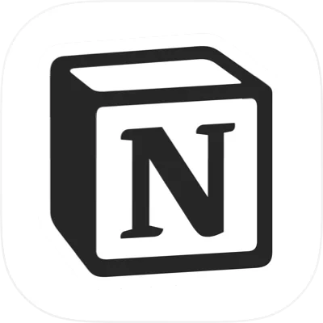
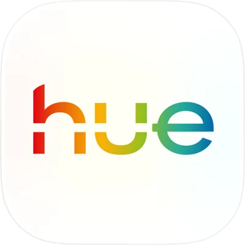
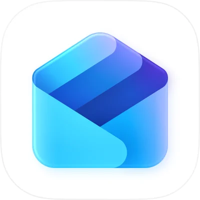
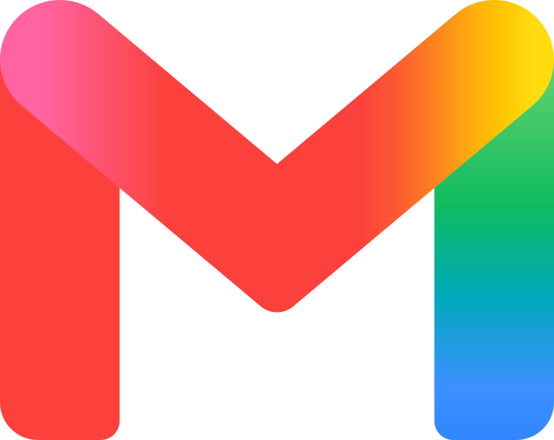
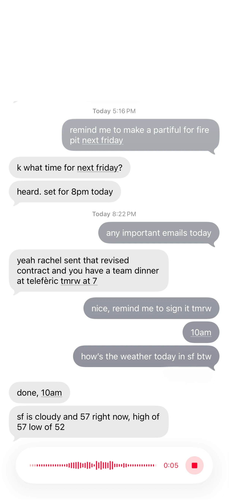
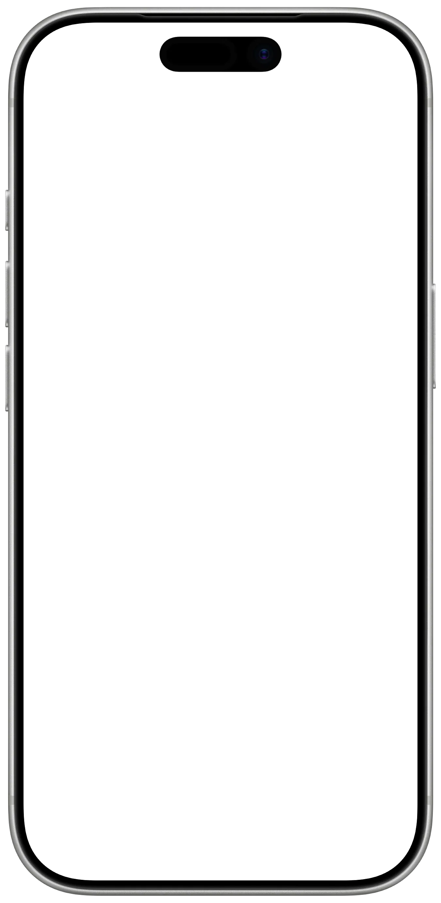
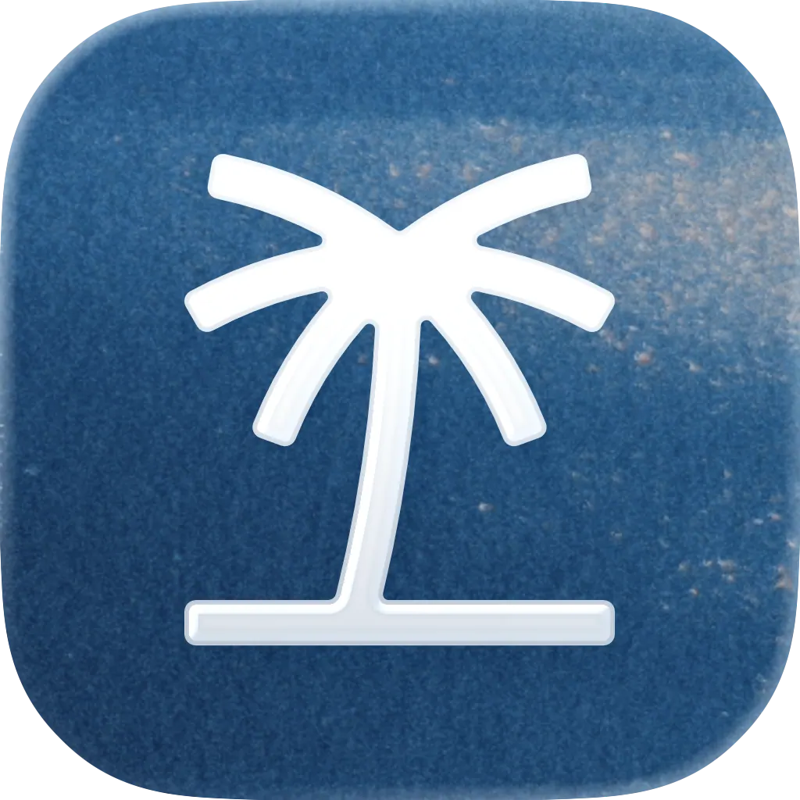



**收录说明**：poke.com 首页，直接下载后抽取。页面的桌面版与手机版各有一套头图区块，用户推文轮播也重复了一遍，存档时各保留一份；界面演示动画只剩零散文字，照录。首页「Community」一节是官方挑选的用户推文，属宣传材料，不能当作实测证据。已翻译。

**内容摘要**：首页标语为 “Meet Poke, your new favorite contact”，副标题称其 proactive、private、personal，就在你的短信里。页面称 Poke 通过 Messages、WhatsApp、Telegram 整合用户的应用和服务；Recipes 用于设置集成、创建自动化并分享配置；可通过文字或语音消息创建提醒并提前着手任务；会自动使用已集成服务及其 memory 在恰当时机提供帮助；开发者可用 Poke Kitchen 创建带自定义集成的 recipe。页面顶部有 “Poke is joining Cognition” 横幅，并复列 Free（$0）、Pro（$19/月）、Ultra（$199/月）三档方案，其后大段为用户推文（Community 区），属宣传材料。

**保留理由**：给出官方对产品定位与功能叙事的自我表述，以及 2026-11 时仍展示的 Cognition 加入横幅；推文只能当作官方挑选的宣传，不是独立评价。

---

[New Poke 加入 Cognition](https://cognition.com/blog/interaction)

## 认识 Poke，你的新宠联系人

主动、私密、个性化，就在你的短信里

[开始使用](https://poke.com/get-started)

### Poke 融入你的生活 (1)，而不是反过来

(1)

用一个熟悉的界面（Messages、WhatsApp、Telegram），加上一个像朋友那样实在的个性，整合你所有的 app 和服务。

[Notion](https://poke.com/recipes/notion)

#### Notion

从短信中访问和整理你的页面、数据库和文档

Poke Team

[Oura](https://poke.com/recipes/oura)

#### Oura

从你的戒指追踪睡眠阶段、准备度评分（readiness scores）和日常活动洞察

Poke Team

[Gmail](https://poke.com/recipes/gmail)

#### Gmail

搜索、起草和发送邮件，并具备标签管理和收件箱整理功能

Poke Team

(2)

#### 用 Poke Recipes 适应你的需求

Poke 用 recipe 设置集成、创建自动化，并帮助你分享自己的配置

[了解更多了解更多](https://x.com/interaction/status/2034713714415608123)

(3)

#### 按你的日程处理任务

Poke 可以创建提醒并提前着手任务——只需发一条文字或语音消息

Mars

Claudia

Andrew

Poke

(4)

#### 主动让你随时了解情况

Poke 还会自动使用你已集成的服务及其 memory，在恰当的时候提供帮助

把 Granola 的行动项添加到日历

集成

⌘ Enter

创建

(5)

#### 为更高级的用例做扩展

开发者可以用 Poke Kitchen 创建带自定义集成的强大 recipe

[了解更多了解更多](https://poke.com/docs/creating-recipes)

### 选择一个方案开始

每个方案都能用上 Poke 的全部功能。免费开始，随着它成为你日常生活的一部分，再升级以获得更多智能和余量

##### 免费

开始使用，探索 Poke 能为你做什么

$0/月

永久免费

包含：

- 无需信用卡
- 连接你所有常用的 app
- 连接你的邮件和日历

[开始使用](https://poke.com/get-started?plan=free&billingPeriod=monthly)

##### Pro

前沿模型与在后台工作的主动自动化

$19/月

按月计费

包含免费版全部内容，外加：

- 用于复杂任务的前沿模型
- 后台运行的实时自动化
- 更高频率限制，适合更重的使用
- 优先支持

[获取 Pro](https://poke.com/get-started?plan=pro&billingPeriod=monthly)

##### Ultra

前沿智能驱动每一个动作，让你的生活自动运行

$199/月

按月计费

包含 Pro 全部内容，外加：

- 前沿模型驱动每一个动作
- 实时自动化的最高频率限制
- 最高优先级支持
- 永不撞墙，积分用完后按量付费

[获取 Ultra](https://poke.com/get-started?plan=ultra&billingPeriod=monthly)

### 社区

[探索用户故事](https://poke.com/explore)

[

Adonis Cyril | Te...

@adonisautomates

活跃使用：
- @claudeai 处理一切
- @NanoBanana 做图像生成
- @comet 用于浏览与顶级浏览器内工作流
- @NotebookLM 用于从有限来源学习（我备考医学院预科时它在哪儿？）
- @interaction 的 Poke 作为个人助手（不得不](https://x.com/adonisautomates/status/2031561433402814741)[

Bryn Kerslake

@brynkerslake

MILI（man i love @interaction）](https://x.com/brynkerslake/status/2030680666761757121)[

𝔄𝔫𝔱𝔬𝔫𝔦𝔬

@madebylipsum

被 @interaction 震撼到了](https://x.com/madebylipsum/status/2030506290557145505)[

Brock

@brockandru

对我来说 Poke 肯定是终身订阅 @interaction](https://x.com/brockandru/status/2030321129869451301)[

Paarug Sethi

@paarugsethi

我觉得 @interaction（poke）是迄今最好的一版 AI 助手——绝对是每一分钱都值的订阅（你可以跟它砍价，还能砍到挺低）
我一直在用它管理健康、饮食、邮件等等。很快会写一篇详细的文章。](https://x.com/paarugsethi/status/2030265250663346214)[

Balaji jayakmar

@killswiitchh

@interaction 有些地方让它与其他个人机器人截然不同！我喜欢它](https://x.com/killswiitchh/status/2030125599273144777)[

Geoffrey Litt

@geoffreylitt

我最喜欢的 AI 用例是，我真的再也不看我的邮件收件箱了。
我只会在那里出现重要内容时收到短信（通过 @CoraComputer 和 @interaction 的 Poke 之间一套绕来绕去、可能还冗余的组合——Cora 做摘要，Poke 发短信](https://x.com/geoffreylitt/status/2028265100097036426)[

antonia

@antwomanjjj

openclaw 这个，openclaw 那个，@interaction 在这一切之前就已经为我们存在了 😭](https://x.com/antwomanjjj/status/2027379716110327839)[

Trisolaris

@TrisolarisCap

@interaction 我爱 Poke 💟](https://x.com/TrisolarisCap/status/2027203567963250941)[

Morgan

@morganlinton

现在正通过短信和 Poke 聊天，太疯狂了，确实令人印象深刻。
我觉得 @interaction 远远领先，而大多数人甚至不知道他们存在。
完全疯狂。](https://x.com/morganlinton/status/2023627422281679044)[

Morgan

@morganlinton

现在立下我的预测：Poke 会成为独角兽。
注：我不是投资人，也不认识公司里任何人。
我只是非常确信他们正在做的事是当今最大的市场机会之一，而且我不知道还有谁领先这么多。](https://x.com/morganlinton/status/2023625855390392604)[

Robert Scoble

@Scobleizer

昨天当评委时我立刻就注册了。喜欢 @interaction 的 Poke。](https://x.com/Scobleizer/status/2023467431361212896)[

Dylan

@dilllxd

我在自己的网站上给 poke 留了个位置，用来全天发布笔记，几乎像日记。真是个酷助手（：
@interaction](https://x.com/dilllxd/status/2023385979558429030)[

Caleb

@calebdotdev

@interaction 的 Poke 配上 @posthog mcp 是游戏规则改变者 😭🙏](https://x.com/calebdotdev/status/2023098419196359026)[

Connor Loi

@connortbot

我朋友开始给 poke 发邮件，好让它给我发短信
恐怕 @interaction 已经找到了 PMF](https://x.com/connortbot/status/2022006270463815988)[

dylan

@dpshde

对 99% 的人来说，@interaction 的 Poke 比 OpenClaw 更好](https://x.com/dpshde/status/2021745870056611930)[

David Coven | Sch...

@mrcoven94

好吧。这太搞笑了。@interaction 太搞笑了。](https://x.com/mrcoven94/status/2020418452008436019)[

Uxsshann

@Uxsshann

上帝保佑 @interaction 打造了 Poke](https://x.com/Uxsshann/status/2019406352196776055)[

janina

@janinaparker\_

第一次看我的新纹身！
手工刺和电动刺的混合。
颜色不是最好的，因为还在流血哈哈
去年真正改变我的公司们。绝对值得在我皮肤上留个永久纪念。
蓝色——@interaction 的 poke。踏入 vibecoding 的第一只脚。](https://x.com/janinaparker_/status/2019379817087660553)

[探索用户故事](https://poke.com/explore)

#### 只需一条短信即可开始

[开始使用](https://poke.com/get-started)[探索 Recipe](https://poke.com/recipes)

[开始使用](https://poke.com/get-started)[探索](https://poke.com/recipes)
