

**收录说明**：poke.com 首页，直接下载后抽取。页面的桌面版与手机版各有一套头图区块，用户推文轮播也重复了一遍，存档时各保留一份；界面演示动画只剩零散文字，照录。首页「Community」一节是官方挑选的用户推文，属宣传材料，不能当作实测证据。2026-11-28 原文更新后重存，新增的 Devin Bots 卡片是一个整体链到 poke.com/bots 的卡片，内含 5 张 Devin Bots 阵容图（无替代文本），照录。已翻译。

**内容摘要**：首页标语为 “Meet Poke, your new favorite contact”，副标题称其 proactive、private、personal，就在你的短信里。页面称 Poke 通过 Messages、WhatsApp、Telegram 整合用户的应用和服务；Recipes 用于设置集成、创建自动化并分享配置；可通过文字或语音消息创建提醒并提前着手任务；会自动使用已集成服务及其 memory 在恰当时机提供帮助；开发者可用 Poke Kitchen 创建带自定义集成的 recipe。页面顶部横幅为 “Introducing Devin Bots”，头图之后有 Devin Bots 推广卡片（“Pitch your idea, get a free Devin Bot to build it”，“Convince Poke how many free credits you deserve”），并复列 Free（$0）、Pro（$19/月）、Ultra（$199/月）三档方案，其后大段为用户推文（Community 区），属宣传材料。

**保留理由**：给出官方对产品定位与功能叙事的自我表述，以及 2026-11 下旬首页从 Cognition 加入横幅换成 Devin Bots 推广的变化；推文只能当作官方挑选的宣传，不是独立评价。

---

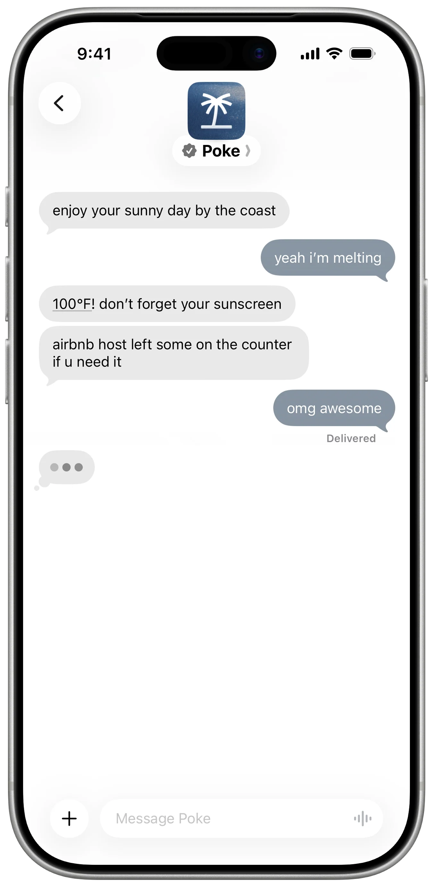

[新：Devin Bots 登场](https://poke.com/bots)

## 认识 Poke，你最爱的那个新联系人

主动、私密、贴心，而且就在你的短信里

[开始使用](https://poke.com/get-started)

[新

### 说出你的想法，免费获得一个 Devin Bot 来把它做出来

说服 Poke，你该得到多少免费额度

认识 Devin Bots

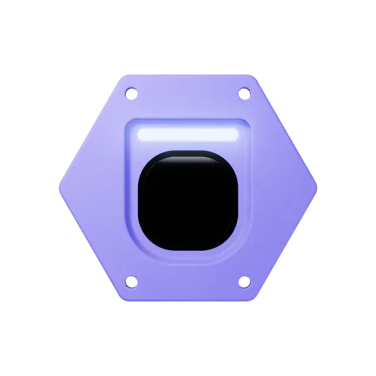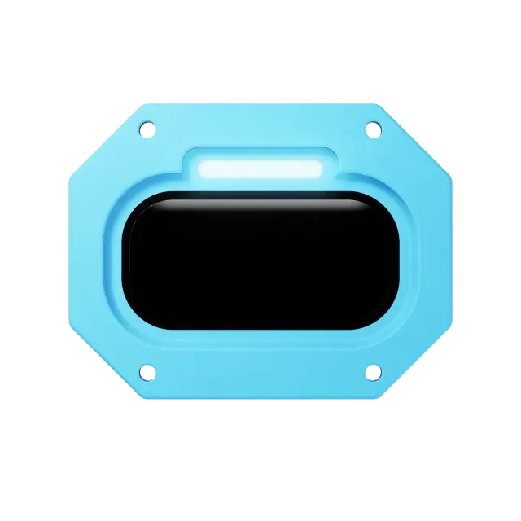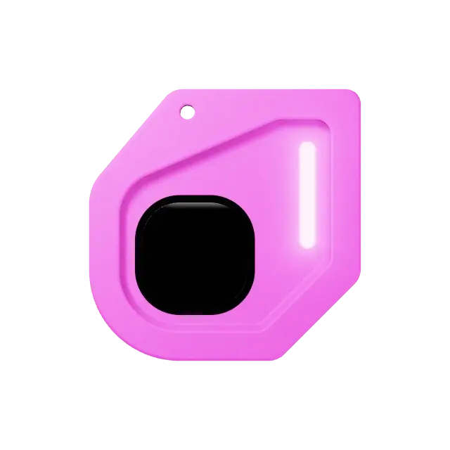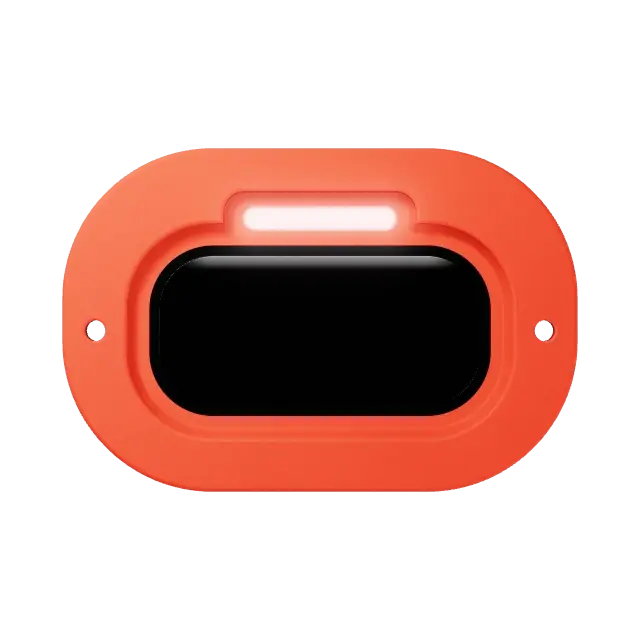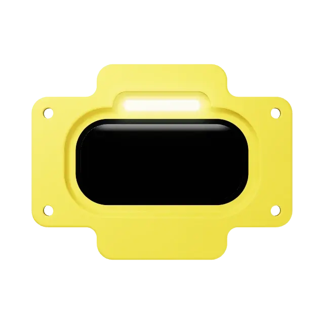](https://poke.com/bots)

### Poke 融入你的生活（1），而不是让你去适应它

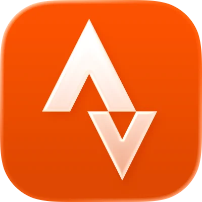

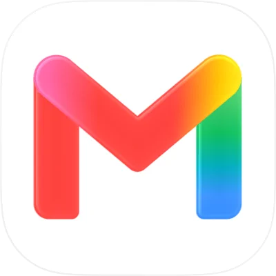

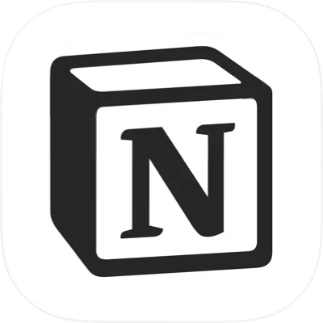

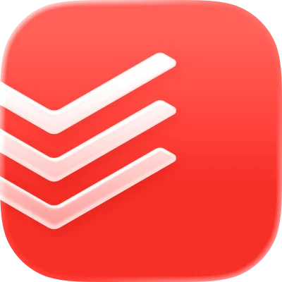

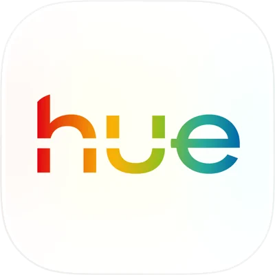

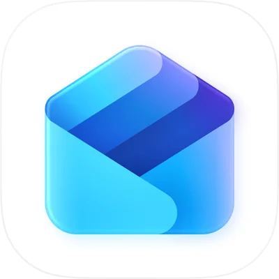

(1)

用熟悉的界面（Messages、WhatsApp、Telegram）整合你所有的应用和服务，还有一个像朋友一样把事情聊得实实在在的性格。

[Notion](https://poke.com/recipes/notion)

#### Notion

在短信里访问和整理你的页面、数据库和文档

Poke 团队

[Oura](https://poke.com/recipes/oura)

#### Oura

从你的戒指追踪睡眠阶段、准备度评分和每日活动洞察

Poke 团队

[Gmail](https://poke.com/recipes/gmail)

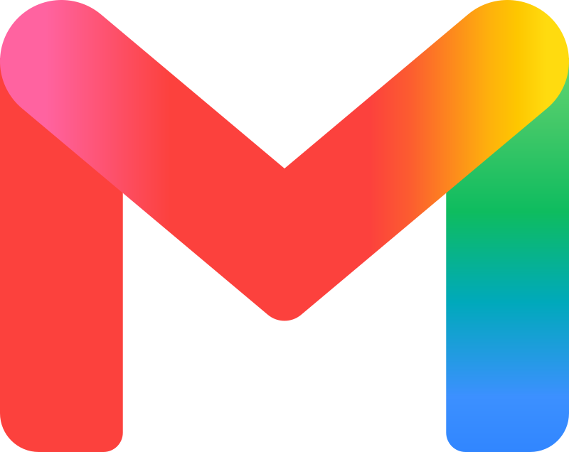

#### Gmail

搜索、起草和发送邮件，支持标签管理和收件箱整理

Poke 团队

(2)

#### 用 Poke Recipes 适应你的需求

Poke 使用 recipes（配方）来设置集成、创建自动化，并帮你分享自己的配置

[进一步了解](https://x.com/interaction/status/2034713714415608123)

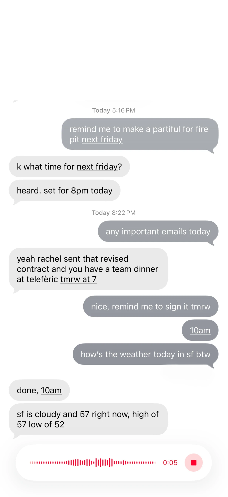

(3)

#### 按你的日程处理任务

Poke 可以创建提醒并提前着手任务——只需发一条短信或语音消息

Mars

Claudia

Andrew

Poke

(4)

#### 主动让你随时了解进展

Poke 还会自动使用你已集成的服务及其记忆，在恰当的时间提供帮助

把 Granola 中的待办事项添加到日历

集成

⌘ Enter

创建

(5)

#### 扩展到更高级的用例

开发者可以使用 Poke Kitchen 创建带有自定义集成的强大配方

[进一步了解](https://poke.com/docs/creating-recipes)

### 选择一个方案开始使用

每个方案都能用上 Poke 的全部功能。先免费开始，等它成为你日常生活的一部分后，再升级以获得更强的智能和更多余量

##### Free

开始使用，探索 Poke 能为你做什么

$0/ 月

永久免费

包含：

- 无需信用卡
- 连接你所有喜爱的应用
- 连接你的电子邮件和日历

[开始使用](https://poke.com/get-started?plan=free&billingPeriod=monthly)

##### Pro

前沿模型和主动式自动化在后台工作

$19/ 月

按月计费

包含 Free 的全部内容，另加：

- 用于复杂任务的前沿模型
- 在后台运行的实时自动化
- 更高频次上限，支持更重的使用
- 优先支持

[获取 Pro](https://poke.com/get-started?plan=pro&billingPeriod=monthly)

##### Ultra

前沿智能驱动每一个动作，让你的生活自动运转

$199/ 月

按月计费

包含 Pro 的全部内容，另加：

- 前沿模型驱动每一个动作
- 面向实时自动化的最高频次上限
- 最高优先级的支持
- 永远不会撞上上限，超出额度后按用量计费

[获取 Ultra](https://poke.com/get-started?plan=ultra&billingPeriod=monthly)

### 社区

[浏览用户故事](https://poke.com/explore)

[

Adonis Cyril | Te...

@adonisautomates

常用：
- @claudeai 用来做一切
- @NanoBanana 用来生成图片
- @comet 用来浏览，以及顶级的浏览器内工作流
- @NotebookLM 用来从有限的资料中学习（我医学院预科考试的时候它在哪儿？）
- @interaction 的 Poke 当个人助手（不得不](https://x.com/adonisautomates/status/2031561433402814741)[

Bryn Kerslake

@brynkerslake

MILI（man i love @interaction，意为「我爱 @interaction」）](https://x.com/brynkerslake/status/2030680666761757121)[

𝔄𝔫𝔱𝔬𝔫𝔦𝔬

@madebylipsum

被 @interaction 惊艳到了](https://x.com/madebylipsum/status/2030506290557145505)[

Brock

@brockandru

@interaction 的 Poke 对我来说肯定是终身订阅](https://x.com/brockandru/status/2030321129869451301)[

Paarug Sethi

@paarugsethi

我觉得 @interaction（poke）是目前为止最好的 AI 助手形态——真的是每一分钱都值（你可以跟它讨价还价，还能谈成不少）
我用它来管健康、饮食、邮件，还有更多。回头会写一篇详细的文章。](https://x.com/paarugsethi/status/2030265250663346214)[

Balaji jayakmar

@killswiitchh

@interaction 身上有种东西，让它和其他个人机器人截然不同！我很喜欢](https://x.com/killswiitchh/status/2030125599273144777)[

Geoffrey Litt

@geoffreylitt

我最喜欢的 AI 用法是，我真的再也不看邮箱收件箱了。
凡是那里出现的重要事情，我都会收到短信（靠 @CoraComputer 和 @interaction 的 Poke 一个绕来绕去、大概还重复的组合——Cora 做摘要，Poke 发短信](https://x.com/geoffreylitt/status/2028265100097036426)[

antonia

@antwomanjjj

openclaw 这个、openclaw 那个，@interaction 在这些之前就一直在为我们服务了 😭](https://x.com/antwomanjjj/status/2027379716110327839)[

Trisolaris

@TrisolarisCap

@interaction 我爱 Poke 💟](https://x.com/TrisolarisCap/status/2027203567963250941)[

Morgan

@morganlinton

现在正通过短信跟 Poke 聊天，太野了，真的令人印象深刻。
我觉得 @interaction 远远领先，而大多数人甚至不知道他们的存在。
太野了。](https://x.com/morganlinton/status/2023627422281679044)[

Morgan

@morganlinton

现在就把我的预测放这儿：Poke 会成为独角兽。
注：我不是投资人，也不认识这家公司的任何人。
我只是非常确信，他们正在做的事是当今最大的市场机会之一，而且我不知道还有谁领先这么多。](https://x.com/morganlinton/status/2023625855390392604)[

Robert Scoble

@Scobleizer

昨天我当评委时立刻就注册了。爱 @interaction 的 Poke。](https://x.com/Scobleizer/status/2023467431361212896)[

Dylan

@dilllxd

我在自己的网站上给 poke 留了个位置，用来随时发布笔记，几乎像个日志。这么酷的助手 (:
@interaction](https://x.com/dilllxd/status/2023385979558429030)[

Caleb

@calebdotdev

@interaction 的 Poke 配上 @posthog 的 mcp 简直改变游戏规则 😭🙏](https://x.com/calebdotdev/status/2023098419196359026)[

Connor Loi

@connortbot

我朋友开始给 poke 发邮件，就为了让它给我发短信
我怕 @interaction 已经有 PMF（product-market fit，产品与市场契合）了](https://x.com/connortbot/status/2022006270463815988)[

dylan

@dpshde

对 99% 的人来说，@interaction 的 Poke 比 OpenClaw 更好](https://x.com/dpshde/status/2021745870056611930)[

David Coven | Sch...

@mrcoven94

好吧。这太好笑了。@interaction 太好笑了。](https://x.com/mrcoven94/status/2020418452008436019)[

Uxsshann

@Uxsshann

感谢上帝让 @interaction 做出了 Poke](https://x.com/Uxsshann/status/2019406352196776055)[

janina

@janinaparker\_

第一次看我的新纹身！
手工点刺和电针的混合。
颜色不太好，因为还在渗血哈哈
去年真正改变我的那些公司。绝对值得在我皮肤上留个永久的提醒。
蓝色——@interaction 的 poke。迈入 vibecoding 的第一只脚。](https://x.com/janinaparker_/status/2019379817087660553)

[浏览用户故事](https://poke.com/explore)

#### 只需一条短信即可开始

[开始使用](https://poke.com/get-started)[浏览 Recipes](https://poke.com/recipes)

[开始使用](https://poke.com/get-started)[浏览](https://poke.com/recipes)
