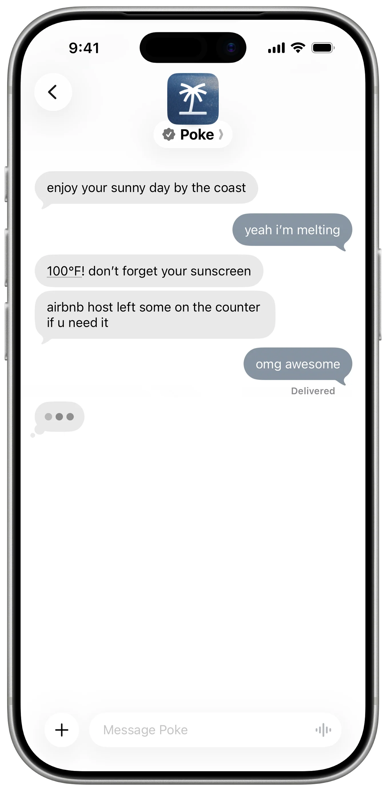
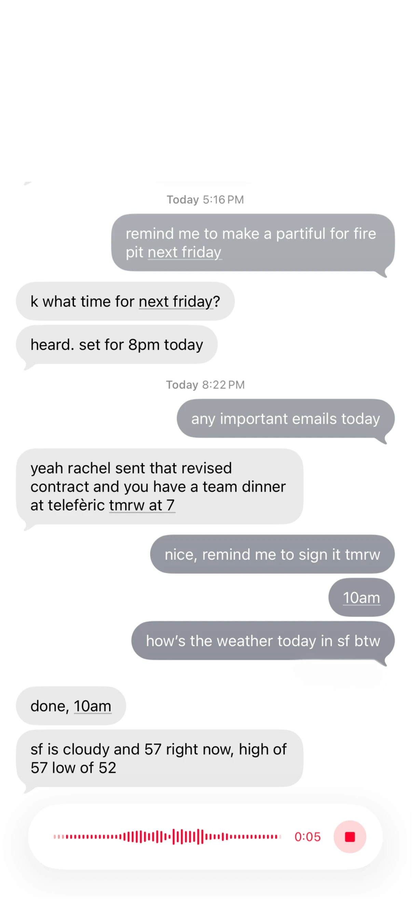

来源：https://poke.com/
取文：2026-11-09，直接下载

[NewPoke is joining Cognition](https://cognition.com/blog/interaction)

## Meet Poke, your new favorite contact

Proactive, private, personal, and right in your texts

[Get Started](https://poke.com/get-started)

### Poke fits into your life (1),not the other way around

(1)

Integrate all of your apps and services with a familiar interface (Messages, WhatsApp, Telegram) and a personality who keeps things as real as a friend.

[Notion](https://poke.com/recipes/notion)

#### Notion

Access and organize your pages, databases, and docs from your texts

Poke Team

[Oura](https://poke.com/recipes/oura)

#### Oura

Track sleep stages, readiness scores, and daily activity insights from your ring

Poke Team

[Gmail](https://poke.com/recipes/gmail)

#### Gmail

Search, draft, and send emails with label management and inbox organization

Poke Team

(2)

#### Adapts to your needs with Poke Recipes

Poke uses recipes to set up integrations, create automations, and help you share your setup

[Learn moreLearn more](https://x.com/interaction/status/2034713714415608123)

(3)

#### Handles tasks according to your schedule

Poke can create reminders and get a head start on tasks - just send a text or voice message

Mars

Claudia

Andrew

Poke

(4)

#### Proactively keeps you in the loop

Poke also automatically uses your integrated services and its memory to help out right on time

Add action items from Granola to calendar

Integrations

⌘ Enter

Create

(5)

#### Extends for more advanced use cases

Developers can use the Poke Kitchen to create powerful recipes with custom integrations

[Learn moreLearn more](https://poke.com/docs/creating-recipes)

### Choose a plan to get started

Every plan gets all of Poke. Start free, then step up for more intelligence and headroom as it becomes part of your day

##### Free

Get started and explore what Poke can do for you

$0/ month

Free Forever

Includes:

- No credit card required
- Connect all your favorite apps
- Connect to your email & calendar

[Get Started](https://poke.com/get-started?plan=free&billingPeriod=monthly)

##### Pro

Frontier models and proactive automations working in the background

$19/ month

Billed Monthly

Everything in Free, plus:

- Frontier models for complex tasks
- Real-time automations running in the background
- Higher rate limits for heavier use
- Priority support

[Get Pro](https://poke.com/get-started?plan=pro&billingPeriod=monthly)

##### Ultra

Frontier intelligence powering every action, running your life on autopilot

$199/ month

Billed Monthly

Everything in Pro, plus:

- Frontier models powering every action
- Highest rate limits for real-time automations
- Highest-priority support
- Never hit a wall, with pay-as-you-go usage beyond your credits

[Get Ultra](https://poke.com/get-started?plan=ultra&billingPeriod=monthly)

### Community

[Explore user stories](https://poke.com/explore)

[

Adonis Cyril | Te...

@adonisautomates

Actively using:
- @claudeai for everything
- @NanoBanana for image generation
- @comet for browsing and top tier in-browser workflows
- @NotebookLM for learning from limited sources (where was this during my pre med exams?)
- Poke by @interaction for personal assistant (had to](https://x.com/adonisautomates/status/2031561433402814741)[

Bryn Kerslake

@brynkerslake

MILI (man i love @interaction)](https://x.com/brynkerslake/status/2030680666761757121)[

𝔄𝔫𝔱𝔬𝔫𝔦𝔬

@madebylipsum

blown away by @interaction](https://x.com/madebylipsum/status/2030506290557145505)[

Brock

@brockandru

Poke is a life time sub for me for sure @interaction](https://x.com/brockandru/status/2030321129869451301)[

Paarug Sethi

@paarugsethi

i think @interaction (poke) is by far the best iteration of an AI assistant out there — truly a sub absolutely worth every penny (you can haggle with it and go pretty far)
i have been using it for my health, diet, emails and so much more. will write a detailed piece soon.](https://x.com/paarugsethi/status/2030265250663346214)[

Balaji jayakmar

@killswiitchh

Something about @interaction makes it way different than other personal bots! I love it](https://x.com/killswiitchh/status/2030125599273144777)[

Geoffrey Litt

@geoffreylitt

My favorite AI use case is that I literally never look at my email inbox anymore.
I just get texts about anything important that shows up there (through a convoluted and probably redundant combination of @CoraComputer and Poke by @interaction — Cora does digests and Poke texts](https://x.com/geoffreylitt/status/2028265100097036426)[

antonia

@antwomanjjj

openclaw this, openclaw that, @interaction was there for us before all that 😭](https://x.com/antwomanjjj/status/2027379716110327839)[

Trisolaris

@TrisolarisCap

@interaction I love Poke 💟](https://x.com/TrisolarisCap/status/2027203567963250941)[

Morgan

@morganlinton

Chatting with Poke now, via text, and it’s wild, seriously impressive stuff.
I think @interaction is way ahead of the game, and most people don’t even know they exist.
Totally wild.](https://x.com/morganlinton/status/2023627422281679044)[

Morgan

@morganlinton

Putting in my prediction now, Poke will become a unicorn.
Note: I am not an investor, and know nobody at the company.
I just have such strong conviction that what they’re working on is one of the biggest market opps today, and I don’t know anyone else this far ahead.](https://x.com/morganlinton/status/2023625855390392604)[

Robert Scoble

@Scobleizer

I signed up instantly when I was a judge yesterday. Love Poke from @interaction.](https://x.com/Scobleizer/status/2023467431361212896)[

Dylan

@dilllxd

I gave poke a place on my website to publish notes throughout the day, almost like a journal. Such a cool assistant (:
@interaction](https://x.com/dilllxd/status/2023385979558429030)[

Caleb

@calebdotdev

@interaction’s Poke is a game changer with the @posthog mcp 😭🙏](https://x.com/calebdotdev/status/2023098419196359026)[

Connor Loi

@connortbot

my friend starting emailing poke so that it would text me
im afraid @interaction has PMF](https://x.com/connortbot/status/2022006270463815988)[

dylan

@dpshde

.@interaction’s Poke is better than OpenClaw for 99% of people](https://x.com/dpshde/status/2021745870056611930)[

David Coven | Sch...

@mrcoven94

Okay. This is hilarious. @interaction is hilarious.](https://x.com/mrcoven94/status/2020418452008436019)[

Uxsshann

@Uxsshann

God bless @interaction for building Poke](https://x.com/Uxsshann/status/2019406352196776055)[

janina

@janinaparker\_

first look at my new tattoo!
a mix and of handpoked and electric.
colors are not the best as it’s still bloody lol
companies the truly changed me last year. definitely deserves a permanent reminder on my skin.
blue - @interaction’s poke. first foot in the door for vibecoding.](https://x.com/janinaparker_/status/2019379817087660553)

[Explore user stories](https://poke.com/explore)

#### Get started with just a text

[Get Started](https://poke.com/get-started)[Explore Recipes](https://poke.com/recipes)

[Get Started](https://poke.com/get-started)[Explore](https://poke.com/recipes)
