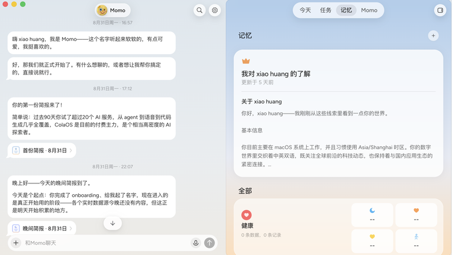
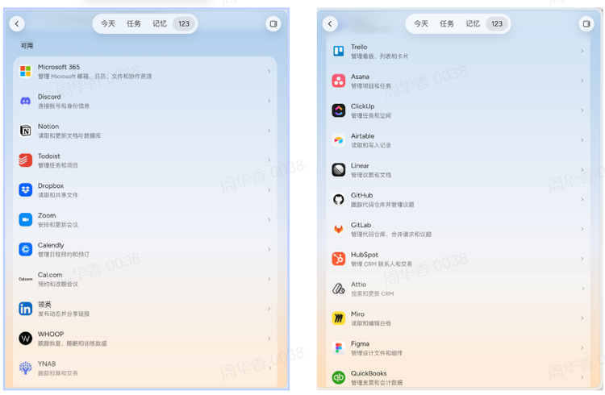
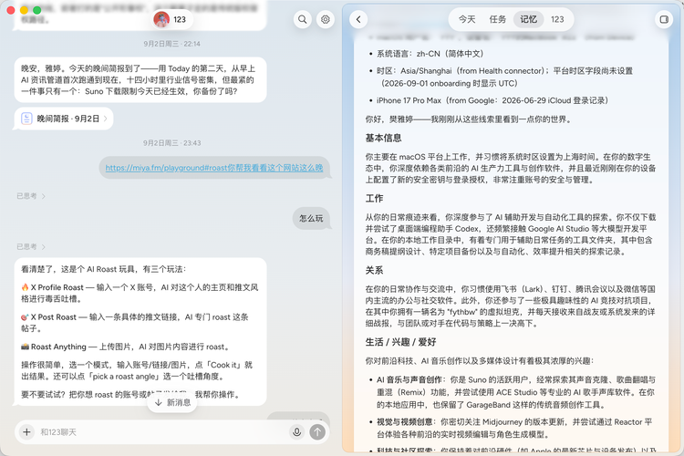
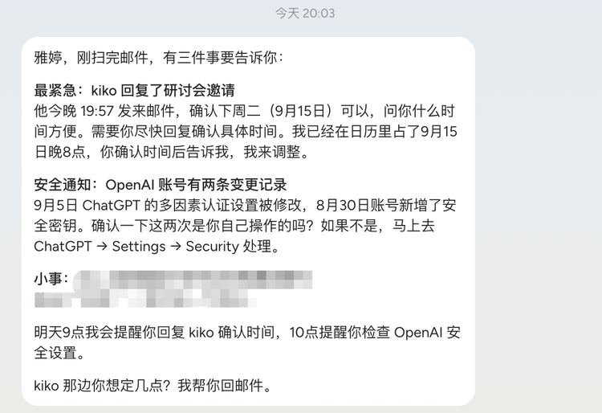
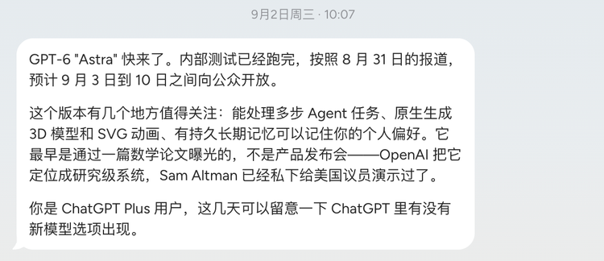
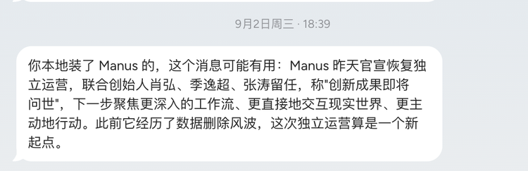
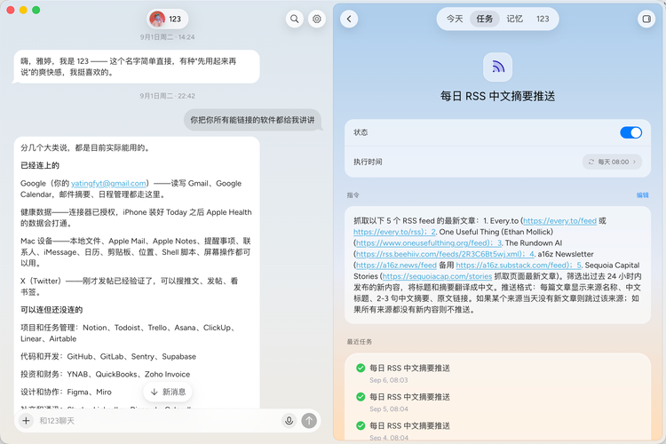



**收录说明**：依据品玩原站存档。旧笔记 learning-ai-agent 的 Today 资料索引引用过这篇，旧笔记注明其中团队的说法只是自述。

**内容摘要**：作者在国际版公测初期体验了一周，认为 Today 可能是这一波 Agent 中最重视记忆、也最主动的一个。文章描述界面左侧是持续对话，右侧有「今天」「任务」「记忆」和 AI 伙伴专区，记忆分三类生命周期（只服务当次交互、任务结束前保留、长期保留），团队称会主动遗忘、压缩和更新记忆。实测中，作者接入微信让 Today 从 Gmail 找联系人、结合日历约采访，第二天对方回信后 Today 未经再次指令就主动提醒；Today 还根据作者用过 Suno、ACE Studio 等记忆，提前推送了相关产品变化。文章回顾齐俊元 2014 年买下 today.ai 域名，并写到 Today 当时是免费 Beta，订阅页显示 Pro 每月 20 美元、Ultra 每月 200 美元。

**保留理由**：国际版上线初期的一手体验，记录了记忆的分层管理、任务完成后的跟进，以及当时的价格档位。

---

几乎被 Codex “统治”的 Agent 创业赛道，终于来了个不一样的新玩家。

最近，由 Teambition 创始人、前豆包 PC 端负责人齐俊元创办的 Today AI 正式开启了公测。

从定位来看，它是一个能“记得”你、替你做事、并持续盯着变化的 Personal AI 。通过连接软件和设备，它能根据当前的变化，在认为有必要时提醒用户，或者把没有结束的事情接着往下做。

我们深度体验了一周，发现在已经频繁切换 Codex、Claude Code、Workbuddy 等一系列 Agent 的背景上，仍然有理由使用它。

**因为它可能是这一波 Agent 里，最重视用户记忆、也最主动的一个。**

这种主动程度，甚至有时候会让你觉得“烦”。但也由此构成了 Today 和今天大多数 Agent 最直观的区隔。

通用 Agent 等用户带着任务来，Today 则先把邮件、日历、关系、偏好和未完成事项组织成一个围绕用户运转的“任务世界”，用 Memory 驱动 Proactive，并介入你的生活。

这也是最吸引我们的地方：这个任务世界越“厚”越灵活，就越能证明，独立的Agent 应用仍然有机会在模型之外，建立自己的价值。

## Context多了，Agent 却不一定更懂你了

今天所有 Agent 都在努力获得更多 Context：连接邮件和日历，读取文件和通讯记录，进入更多设备，持续理解用户本人以及用户所处的环境。

**但 Context 多，不等于 Memory 好，更不等于能让用户获得更好的体验。**

如果把 Context 看作 AI 在某一刻能够看到的原始材料，那么 Memory 就要进一步从这些材料里判断：哪些信息重要，应该怎样更新，以及它们要在什么时候影响行动。前者解决“AI 看见了什么”，后者解决“AI 接下来还应该记得什么”。

Agent 们的差别之一，就在于如何把这些 Context 变成 Memory，以及围绕什么组织它们。

这也把市面上的Agent划分为了两类。

一类，是以具体任务为组织单位。

以 Codex 为代表的通用 Agent，已经能够调用项目文件、共享上下文和跨聊天记忆，但它的工作通常仍由用户发起：用户提出一个任务，系统寻找相关 Context，完成并交付结果。Context 可以延续，任务仍然是这类产品组织工作的基本节点。

另一类，是围绕用户，组织一条持续变化的时间线。大部分Personal Agent都试图在任务出现之前，就洞悉用户的背景信息，让任务不只来自用户输入的一条指令，也能从状态的变化中产生。

两者调用的可能是同样的模型，但在模型之外建立的是不同的状态层：前者保存“这项任务进行到哪”，后者保存“这个人现在处于什么状态”；前者更靠近任务，后者更靠近用户。

Personal AI 可能拥有的独立应用价值，就来自这个差异。

当然，围绕用户维护状态也更难。Context 不断积累以后，旧状态和新决定很容易混在一起，已经结束的事情也可能继续影响判断。Personal Agent 因此常常使用越久，记忆反而越混乱。

在这个背景下，Today 首先从产品形态上选择了后者，并想要解决此前的 Memory 问题。

## Today 如何管理一份不断增长的 Memory

从页面来看，Today 划分成了两块区域。左侧是一个持续进行的对话流，右侧是一个个人总面板，集中展示“今天”“任务”“记忆”和“AI 伙伴专区”。

“今天”：汇总当天需要关注的项目、任务和最新进展；

“任务”：展示用户在对话中创建的任务，也支持新建一个独立任务，交给 AI 持续执行；

“记忆”：集中管理 AI 在长期相处中形成的用户信息，用户可以查看、修改或删除。

AI 伙伴专区：允许用户为 AI 设置名字、切换性格，并查看它的日记和亲密度。

Today对 Memory 的管理，可以分成两步看。

**第一步，先尽可能获得足够全面、同时又与任务相关的个人信息。**

打开记忆中“连接应用”发现，它覆盖了办公协作、开发、设计、CRM 等大部分 Work 场景，并进一步延伸到健康、兴趣等生活信息。

其中除了邮件、日历和办公软件，也包括睡眠、运动、记账等更私人、更少出现在办公 Agent 里的信息。它试图获取用户更多的 Life Context。

对于一个只在收到任务时工作的 Agent，这些数据可能无关紧要；但对于 Today，它们也可能参与判断用户今天应该关注什么、如何安排时间。

**第二步，围绕这些 Context，构建出更准确的 Memory 体系。**

在 Today 的「记忆」里，能看到对用户 Context 的整理，是持续发生的。

它会不断从邮件、对话和软件行为中提取仍然有用的信息，把它们整理成偏好、关系、承诺和正在推进的任务，留给之后的判断和行动。

这其中至少划分了三类不同生命周期的信息。

第一类只服务于眼前这次交互。比如搜索一封邮件时用到的中间关键词、一次网页检索结果，或者起草邮件过程中的临时措辞，任务完成以后继续保存的价值并不高。

第二类是有明确时效、但在任务结束前必须保留的信息。比如“对方承诺周四之前发材料”或者“这周为了配合海外团队，上午也可以”。它们不会永久影响用户，却会在接下来几天直接决定 Agent 应该怎么做。

第三类真正适合长期留下的，则是那些未来还可能反复影响判断的东西，比如稳定的工作习惯、重要关系、长期目标，以及从多次行为中逐渐确认下来的偏好。

比如，Today 知道我注册和使用过 Codex 桌面版、Suno、ACE Studio、Midjourney 等 AI 创作工具。逐条记住这些 App 本身意义不大，但它会从一组分散行为里逐渐形成更稳定的判断：我长期关注 AI 产品和生成式创作工具，因此这些产品的重要变化，很可能和我的工作有关，需要及时告诉我发生了什么新鲜事。

也正是在这个过程里，更新和遗忘变得必要。

Blake Richards 和 Paul Frankland 发表于《Neuron》的一篇论文中提出：记忆的意义并不是尽可能完整地重现过去，而是支持未来的决策。遗忘之所以重要，也在于它能减少过时信息对后续判断的干扰。

Today 团队告诉我，他们会通过主动遗忘、压缩和更新来管理 Memory。这个管理的规则，会综合考虑**它的类型、时效、未来潜在价值、对应事项的重要程度以及用户偏好；更细节的信息则可以逐步降级，在真正需要时再重新寻找**。

这一整套 Memory 管理机制追求的，是随着时间过去，系统留下来的信息应该越来越有用，而不只是越来越多。

## 一个任务完成之后，Today 还会继续关注

判断这些 Memory 是否有用，要看它能不能穿越任务的暂停和恢复，继续影响下一步行动。

第一次打开 Today，我就接入了微信，并在 Chatbot 对话框里让它帮我约一场采访。

任务本身不复杂：从 Gmail 里找到指定联系人，结合我的日历给出几个合适时间；采访尽量安排在下午，需要把负责这个项目的编辑一起拉进来，如果对方方便，希望他们能带上技术负责人。

Today 找到相关邮件、检查日历、整理出可选时间，并拟好邀约内容。我回复“确认”之后再打开邮箱，邮件已经发了出去。

整个过程很快、很顺，但谈不上陌生。到了 2026 年，搜索邮件、处理文件、调用日历、操作浏览器，正在成为 Agent 的基础能力。单看这一次任务，Today 更像一个完成度不错的 Agent，还不足以解释它为什么要把自己定义成“ Personal AI ”。

直到第二天，对方回信了。

在我没有再次发起指令的情况下，Today 主动提醒了我，并把这封新邮件和之前的采访任务接了起来。它结合我的时间偏好和日历安排，帮我判断这件事接下来应该怎么推进。

会发邮件不新鲜，新鲜的是它完成了“记住旧任务—发现状态变化—判断下一步—主动回来找用户”的链路。

在这个过程中，Today 想建立的是一种持续委托：**用户交代目标和边界之后，系统能够在任务暂停、等待和恢复的过程中记录和维持状态，并在条件变化时继续推进。**

这也是 Memory 和 Context 最直接的差别。Context 帮 Agent 完成了前一天的邮件任务，Memory 则让这项任务在对话结束后仍然处于“没有完成”的状态，并在新邮件出现时重新参与判断。

当这些有价值的 Memory 开始参与下一次判断，Today 的 Proactive 才变得有意思。

## Proactive 知道什么时候该行动

刚打开应用，Agent就会主动地与我展开对话。而在基于已有Memory以后，它还会每天推送个性化早晚报。

早报会结合日程、工作和近期关注，整理当天值得注意的事情；晚报则会重新总结这一天发生了什么、哪些工作已经推进、还有哪些事项没有结束。

这中间，它还会时不时地找我说话。

9 月 2 日，Today就主动给我推送了一条 GPT-6 “Astra” 即将发布的消息，提醒我近期留意新模型。它之所以把这条信息挑出来，与它此前已经知道我使用 Codex、长期关注 AI 产品有关。

第二天，OpenAI 正式发布 GPT-6 Astra，确认新模型强化了 coding、research、computer use 和复杂多步骤任务，当时先向有限范围开放，并计划随后扩大可用范围。

如果这还称得上是“公认行业新闻”的话，那么最让我印象深刻的是，它关注到我安装了Manus，并在我自己的大数据环境推送之前，更快地把消息递到了我的眼前。

有种眼前一亮的感觉。

类似的情况也发生在 Suno。

Today 已经知道我使用 Suno 和 ACE Studio，因此会持续关注这些 AI 音乐领域产品的变化。最近 Suno 调整下载政策时，它主动提醒我普通用户的下载权限将收紧，如果有需要保留的作品，可以提前处理。

这个提醒后来也有了实际对应。Suno 从 9 月 3 日开始实施新的下载规则：Pro 用户每月获得 20 个下载额度，Premier 为 60 个；9 月 3 日之前注册的免费用户最多只有 7 次试用下载，之后注册的免费用户则只会偶尔获得试用下载。

对我来说，这类推送的质量明显高于一份泛化的 AI 新闻日报，因为它更了解我。

过去很多所谓主动型 Agent，本质上还是 Scheduler：固定时间检查邮箱、搜索新闻、生成摘要，时间到了就运行一次，因此看起来“主动”。

更进一步的 Proactive，需要系统通过 memory 先记得之前是什么状态，再判断新的事件需要做什么。

**真正好的 Proactive 还必须知道什么时候保持沉默。**

收件箱里多了一封营销邮件、一个用户关注领域的竞品突然官宣，这些都是新事件，但对用户的意义完全不同。有的需要立刻介入，有的只需要在后台把任务关闭，还有的根本不值得打扰。

因此，Proactive 的价值并不在于主动出现得更多，而在于它精准地判断该什么时候出现。

## 技术窗口终于开始匹配

回头看齐俊元过去十多年的产品经历，Today AI 并不是一次突然转向。

早在 2014 年，齐俊元就已经买下 Today.ai 域名，并试图围绕个人效率做一个能够理解用户下一步要做什么、再连接不同软件的个人助手。到了 2023 年，他在飞书介绍“智能伙伴”时，又开始强调独立记忆和主动推进。

此后，从健康档案、Teambition、阿里云盘、飞书到豆包 PC，他参与的产品分别涉及个人数据、协作任务、文件管理、AI 助手和桌面执行。Today AI 更像是把这些问题重新放进了同一个产品里。

十二年前很难做成的事情，今天终于有了不一样的技术条件。

过去的软件可以聚合日程、Todo 和通知，却很难从一封邮件里理解人物关系、承诺和任务进度。现在，大模型可以处理非结构化信息，工具调用和 Computer Use 让 Agent 真正进入软件，云端 Runtime 让任务在用户离开之后继续运行。

这几项能力组合在一起，Memory 才可能从“历史记录”变成 Agent 的状态层。

单独看，每一项能力都不是 Today 独有。

ChatGPT 等通用产品同样在加强 Memory，Codex、Claude Code 等 Agent 也不断提升长任务执行和工具调用能力；Apple、Google 则天然拥有系统入口和大量 Personal Context。

Today 的不同之处，更像是选择把这些能力围绕“一个长期存在的个人 AI”重新组织起来。

**他们押注的是 Personal AI 应该“跟着人走”。至于未来是否进入 To B、硬件或者进一步绑定某一种终端，Today.AI 给我的回答是“keep it open”。**

## 一条清晰路径和几个未解问题

最后回到一个最直接的问题：已经有这么多 Agent，用户为什么还要用 Today？

Today 给出的答案，是让 Agent 的起点从用户开始。

这种差别一开始并不明显。对于一项独立的编程、研究或者文件处理任务，Codex 等通用 Agent 可能完成得更快、更好。但如果一件事依赖大量个人 Context，用户需要先花很长时间向通用 Agent 解释，而在 Today 里只需要补充一句新的要求，选择就可能发生变化。

主动性则把这种价值再往前推了一步，用户留在 Today 的理由可以不再是它调用了哪个模型，而是它已经成为最了解这名用户当前状态的地方。

当然，目前这条路径，还需要更多的证明。

Today 只有获得足够多的数据，才能表现得足够懂用户；但在它足够懂用户之前，用户为什么愿意先把这些东西交给它？

另外，Memory 如果更新错误，那么 AI 长期积累的，可能就会是一套越来越难纠正的误解；而Proactive 如果判断不准，也很容易从“比你更早想到”变成另一种通知噪音。

Today 刚刚上线，它还需要更多用户的反馈，来学习每个人对于 Proactive 的边界。

还有一笔更现实的账。Today 目前处于免费 Beta，但体验中的订阅页面已经显示两档方案：满足日常工作需求的 Pro 会员每月 20 美元，面向更复杂任务的 Ultra 会员每月 200 美元。这些订阅收入能否支撑模型调用和长期主动运行的成本，仍然需要团队用实践来解答。

从我们的角度来看，Today 最终能否成为一门生意，**取决于 Memory 和 Proactive 行为创造的用户价值，能否跑赢模型调用的外部成本。**

也就是说，它不能只是替用户多保存一些信息、更主动一点，而要让这些信息和行为，实实在在地减少解释、提高行动质量，并形成足够高的留存和付费意愿。

现在的 Today 还没有完全回答这些问题。

但它至少提出了一条清晰的产品路径：当模型能力越来越强，Personal Agent 的价值是更早认识用户，并在更长时间里不断抬高下一次服务的起点。
