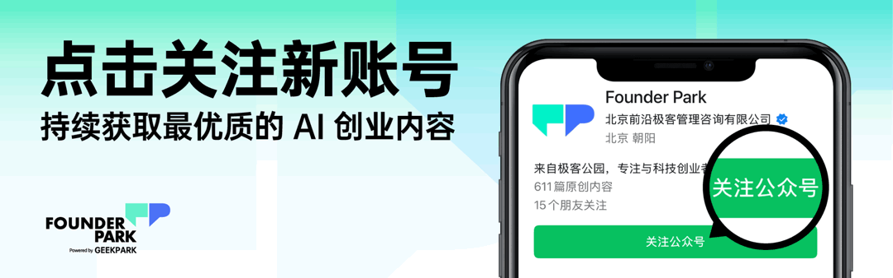
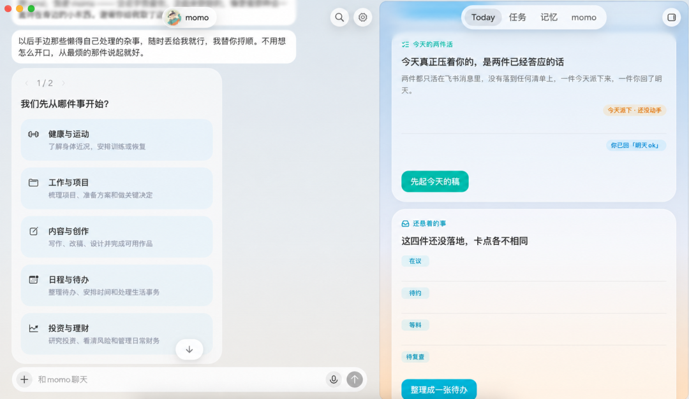
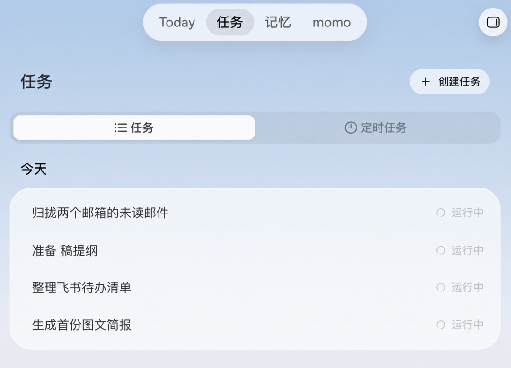
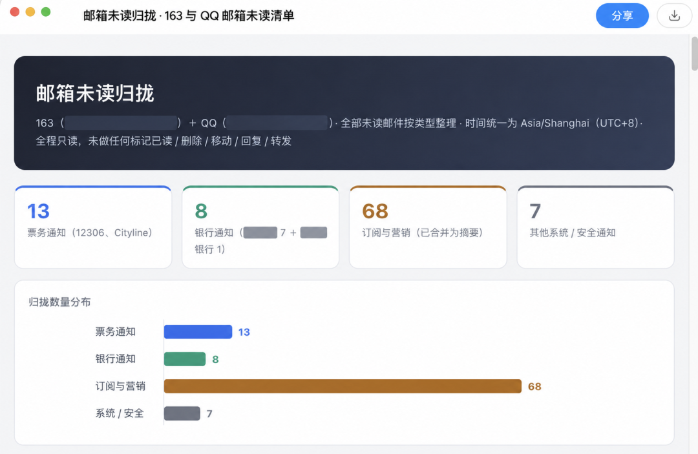
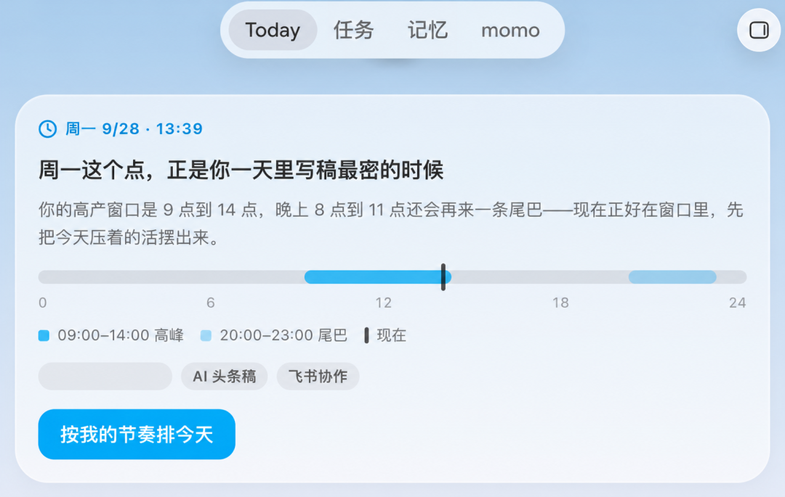



**收录说明**：原文在微信公众号，依据智源社区的转载存档。文中 Founder Park 的关注提示、「寻找 AI 团队」推广块，以及文末的「更多阅读」与两张推广图片未收入，删除处在正文中注明。

**内容摘要**：文章报道 Today 国内版（todayai.cn）上线，定位「懂你所想，为你先行的个人 AI 助理」，支持 macOS、Windows、Linux 和 iOS，基础版永久免费，新用户注册送 1 亿 Tokens 和 1 个月 Pro 会员。作者把它与 Muse 对照试用：两者都是长对话产品，Today 把归拢 163 与 QQ 邮箱未读邮件等几件事拆成可以点开看过程的任务；Today 面板会根据连上的邮箱、飞书自己推断出工作节奏卡片，比 Muse 更积极地主动给出简报和建议。作者也指出 Today 对个人情况的一些归纳并不准确，纠正记忆后建议会不会跟着变还待检验。文中列出国内版已接入邮箱、飞书、钉钉、腾讯文档，国际版提供 Gmail、Google Calendar、Notion、Slack 等。

**保留理由**：国内版上线时的一手试用，记录了国内版的平台、免费额度和国内连接器，以及记忆推断出错的观察。

---

Manus 给 Personal Agent 赛道再加了把火。

9 月 28 日，Manus 发布 2.0 版本，同时推出独立的个人 Agent 应用 Cue。每个 Agent 都有自己的邮箱、电话、钱包和电脑，可以替你接电话、发消息，在设定的预算内付款。

海外，这条赛道已经很热闹了。Meta 的 Muse 上线 10 天，在美国拿到 73 万次下载，冲上 App Store 免费榜第一。GrokBot 带着 X 的分发能力进场，Town 从邮箱和日历切入，Instinct 住进了 iMessage。产品形态各有不同，几个创业公司也都拿到了大额融资。

国内一直不缺带 Agent 能力的产品，但一个明确以 Personal Agent 为核心定位、又有一定声量的独立产品，此前还没有出现。最近上线的 Today AI，是一个新的尝试。

Today AI 的创始人是齐俊元。2011 年还在读大三时，他创办了 Teambition。这是国内最早一批团队协作工具，2019 年被阿里以 1 亿美元收购。之后，齐俊元先后负责阿里云盘，担任飞书产品副总裁、豆包 PC 端负责人。2025 年 11 月离开字节后，他再次创业，这次做的是一个 Personal Agent。

最近，Today 国内版正式上线（todayai.cn），定位是「懂你所想，为你先行的个人 AI 助理」。目前支持 macOS、Windows、Linux 和 iOS，基础版永久免费，新用户注册送 1 亿 Tokens 和 1 个月 Pro 会员。

Today 想改变的，是打开 AI 之后的第一步。大多数产品先给你一个空白输入框，等你想好要问什么。Today 会先替你准备好「今天」，哪些事值得关注，哪些还没做完，接下来可以先推进什么。你还没开口，它先试着替你想了一遍。

我们试用了 Today，它和 Muse 一样是长对话产品，但更积极地把建议摆到你面前。当 Personal Agent 开始先开口，它怎样让你看见自己正在做什么？又凭什么判断，今天有哪些事值得提醒你？

（收录说明：此处原有 Founder Park 的关注提示与「寻找 AI 团队」推广，未收入。）

01

## 同样是长对话，

## Today 比 Muse 做得更彻底

第一次打开 Today，最直观的感受是，它长得很像 Muse。当然，两者几乎是同一时间发布，应该不存在谁借鉴谁的问题。

两者都是典型的长对话产品。你和它之间是一段持续的对话，不再被切成一轮轮的独立问答。想到几件事，可以接连交代，不用等上一件有了结果再开口。它对你的了解，也能在后续交流中继续派上用场。

不过，Muse 在早期测试中发现，有些用户还是希望把复杂项目的上下文单独放开，所以后来加入了侧边的分支对话。目前的 Today 更彻底地维持着单一长对话，界面左侧只有一个对话页，看不到会话列表，也没有用于分开话题的侧边对话。

只有一段对话，几件事一起做时会不会乱？Today 把一部分管理工作放到了右侧面板，这里有「Today」「任务」「记忆」等几个入口。今天有哪些值得看、哪些任务正在运行、它记住了什么，都有对应的位置。

试用时，我们在同一个对话框里先后交代了几件事：归拢 163 和 QQ 邮箱的未读邮件、准备一份稿件提纲、整理飞书待办、生成图文简报。Today 把每件事拆成一个独立任务，扔到后台同时跑。任务栏里，四件事并排显示「运行中」，对话没有被其中一项卡住，我们还可以接着聊别的事。

任务过程也是透明的。点开「邮箱归拢任务」，能看到 Today 给自己写的一份执行说明，哪些邮件要单独列出，哪些合并成摘要。如果连接器拿不到准确的未读状态，就应当明确标出来，不能硬凑数字。

如果 Agent 在后台忙了十分钟，回来只说一句「做好了」，用户很难判断它看了什么、按什么标准筛选。Today 让任务状态和部分执行过程可见。Muse 则采取了另一种呈现方式，在形象下方简要显示它正在做什么，点开能查看完整的活动记录。

交付结果也不一定要塞回聊天框。Muse 会生成文档、网页或仪表盘等可交互的 Artifacts，Today 则能把整理好的内容做成 HTML 页面，并支持一键分享。这次的邮箱归拢结果，就是一份按票务、银行、订阅与营销、系统与安全通知分类的页面，点开就能浏览各组内容。

两个产品还都允许用户给助理取名、设置形象和对话风格。Muse 团队曾解释，长期与 Agent 对话时，一直面对一个公司标志会显得奇怪。有了名字、形象和自己的风格，它才更像一个属于你的助理。

这些设计背后想解决的是同一个问题。一问一答的聊天框，可以装下一个回答问题的 AI。但当 Agent 开始同时处理几件事，还要长期记住你，用户就需要看见它知道什么、正在做什么，事情推进到了哪一步。

对话仍然是交代事情的地方，但 Personal Agent 的工作不能全留在聊天框里。任务、记忆和交付物也要有各自的位置，共同构成 Personal Agent 的工作界面。

## 02

## 比你先开口，

## 还把下一步规划也摆了出来

Today 更鲜明的产品选择，是在用户想好要交代什么之前，先主动把建议摆出来。

打开 Today 面板，我们能看到一张关于工作节奏的卡片。它会根据你的工作习惯，判断出一天里哪几个小时最高效，再结合当前时间，建议你先把「今天压着的活」摊开。卡片下面有一个「按我的节奏排今天」的按钮，点一下，这条建议就变成了接下来要做的任务。

卡片上的这些信息，都不是我们主动告诉 Today 的，是它从连上的邮箱、飞书里自己归纳出来的。以飞书为例，它会先把飞书里的信息过一遍，理出具体的任务和待办，不用等你开口问「我飞书里还有什么没处理」。

这种先开口的设计，首先解决的是所有 Personal Agent 都会遇到的冷启动问题：用户不知道从哪里开始。一个产品能查邮件、看协作信息、写文档、跑长期任务，能力越多，面对空白的输入框，用户反而越难回答「我现在该让它做什么」。

Muse 团队也遇到过类似的情况。早期用户不知道该从哪里开始，于是他们做了「想法」标签页，根据用户的目标、行为模式和对话内容，持续提出它能帮忙做的事。

Today 的建议离首页更近，也更集中地围绕「今天」组织。早间简报挑出当天值得关注的日程和变化，晚间简报回顾推进了什么、还有什么没结束。使用过程中，卡片会把对用户的判断变成可以直接点击的行动入口。用户不必从一整张能力清单里挑功能，就能看到今天有哪些事、下一步可以让它做什么。

对一个能力很宽的 Agent 来说，空白输入框本身就是门槛。Today 用卡片替用户迈出了第一步。

主动越多，分寸越重要。Muse 团队为主动发消息设了较高门槛，只有进展确实值得打断用户，或需要用户参与时，才发出通知。

Today 更积极一些。它会更早、更多地把简报、卡片和建议摆到你面前，让「今天该做什么」成为打开产品就能看到的内容。这些内容大多放在右侧面板和早晚报里，不会频繁弹窗打扰。

这是 Today 比 Muse「更主动」的地方，也是接下来值得观察的地方。当主动的内容变多，它们能否说到点子上，还是会逐渐被用户习惯性地忽略。

## 03

## Personal AI 靠什么懂你：

## 记忆，以及记忆背后的 Context

使用 Today 时，一个有意思、也容易出错的问题是，它的判断从何而来？为什么会认为某些事应该先做？

答案首先落在 Memory。Today 把自己的记忆系统称为 Living Memory，它会持续整理重要的人、项目、偏好和目标，也会记住那些还没结束的事。用户可以查看、修改或删除这些记忆。下次再谈起同一个项目，不必重新解释来龙去脉。出现相关的新信息时，Agent 也有机会接着往下推进。

但「记住了」不等于「理解对了」。这次试用中，Today 对我们个人情况的一些归纳并不完全准确。看起来贴身的工作节奏卡片，也可能只是它根据有限信息作出的推断。用户纠正一条记忆之后，后续建议会不会跟着改变，还需要更长时间检验。Agent 越主动，错误记忆的代价也越容易被放大。

记忆和主动性，最终都建立在 Context 上。除了从对话里了解你，Agent 还要读取你愿意开放给它的应用。日程能告诉它你什么时候有空，邮件里可能有项目的新进展，协作消息可能藏着还没收尾的工作。Agent 读到的信息越完整，记忆就越准，主动的建议也越可能说到点子上。

Today 国内版已接入邮箱、飞书、钉钉、腾讯文档等入口，国际版则提供 Gmail、Google Calendar、Notion、Slack 等连接。不过，接上多少应用是一回事，能在授权范围内读到多少有用的信息、能否正确理解，又是另一回事。

这也是为什么各家 Personal Agent 都在争取更多入口、获取更多 Context。但入口不完全由 Agent 自己决定，如果信息散在不同 App 里，它就得逐个获得接入权限，再试着把这些线索拼回同一个人正在度过的「今天」。

在国内，首先要面对的是分散的 App。工作信息散在邮箱、飞书、钉钉和文档里，各个平台的开放程度、授权方式和可用能力都不一样，平台自己也在做 AI。微信承载了大量生活与沟通信息，但目前还不是 Today 能完整接入的入口。少了这部分 Context，它对用户的理解自然更容易集中在已接入的办公场景。

海外的邮箱、日历等服务有相对成熟的接入方式，但当 Agent 再往前一步、替用户去行动，就会碰到平台的交易边界。

Muse 能通过浏览器替用户在网页上下单，亚马逊却已经限制它在自己的平台上代用户购物，理由是第三方 Agent 应当表明身份，并尊重平台是否允许它参与的决定。与此同时，亚马逊自己的购物助手照常推进。争议的背后，是一个更长远的问题，当 Agent 替用户挑选和购买商品，与用户直接打交道的那个入口，最终归谁？

对 Today 来说，目前还不太涉及购物、代下单等场景。它先做的还是长期相处中最基础的几件事，知道你手上有哪些事，记得哪些还没结束，在一天里合适的时候提醒你，下一步可以从这里开始。

眼下更具体的挑战或许是，连上的信息能不能变成可靠的记忆，记错了能不能被纠正，它主动出现的时候，是不是真的帮你省了事。这几件事做扎实了，用户才会愿意把更多事情交给它。

离 Jarvis 还有一段距离，但一个会先开口、也记得住你的 Personal Agent，已经在国内出现了。
