

**收录说明**：原文在微信公众号，依据虎嗅的转载存档，虎嗅页首的「本文来自微信公众号」一行未收入；新浪财经也有同文，记入 altUrls。一张超过 600 KB 的动图改为指向原图的链接，其余较大的图片已缩小。

**内容摘要**：作者用了十天 Today：先把身高体重、兴趣、职业履历等告诉它，Today 便以早晚报的方式主动推送球队动态、游戏等内容；电脑版左侧是对话、右侧是简报、任务、记忆和关联应用，所有事都在同一段对话里继续。连上飞书后，Today 每天早上发选题建议，还会追问稿子进度；绑定微信后可以直接在微信里交互。重任务方面，作者让它汉化一个游戏 mod，Today 用 15 分钟拆包、写 Prompt 完成翻译，却在安装步骤上给出错误判断，作者反复重启游戏测试了一个小时，直到让它查官方文档才解决；另一次只想要一份能照着念的足球陪练方案，它却做成了网页。作者因此认为 Today 的问题不在能力，而在分不清轻重缓急，并讨论了判断力、生态和隐私责任三道坎。

**保留理由**：较长时间的一手使用记录，既有主动推送和飞书、微信接入的正面观察，也具体记录了判断失误的过程。

---

Personal AI的精髓——像人又懂你。

过去一年，AI产品越来越想变成一个「人」。

一边是越来越自动化的Agent，已经可以直接操作电脑，甚至和其他AI互相通信。

而另一边，是近期大火的「个人助理」式Personal AI，它不仅要完成眼前的任务，还想记住是谁在提需求：这个人关心什么，手上有哪些没做完的事。

就在最近一个月里，Meta推出了Muse；Manus推出个人Agent应用Cue；OpenAI随后发布Dots。

它们的形态不同，但目的近似，都在试图长期记住用户的目标和偏好，进入用户日常使用的软件，并在用户没有主动提问时继续工作。

不过，放到国内的使用环境里，这些产品多少有些「水土不服」，要么仅在美区开放，要么可操作的应用主要是Gmail、Slack、WhatsApp、Teams等海外软件。

在这股热潮里，我注意到了Today AI。它由Teambition创始人齐俊元打造，国内版于9月24日上线，已经接入飞书、钉钉、腾讯文档和邮箱等国内常用应用。

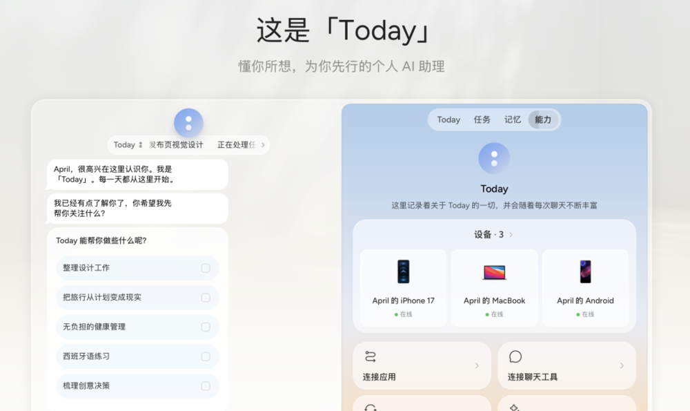

Today AI应用的主页面｜图片来源：Today AI

至少对国内用户来说，它算是目前最容易上手体验Personal AI的产品之一。而用了10天以后，我也开始从Today身上看到Personal AI的局限与潜力。

## 01

## 我有常用的AI，为什么还需要你？

平时，我们通常带着明确的问题去找AI，问它问题，给它派明确的指令或任务。

Personal AI并不是这样，它是「了解我、围绕我、帮助我」的AI产品，更应该反问我：你是谁？

为了更好地使用Today，我把个人的身高体重、兴趣爱好、职业履历、内容偏好等个人信息，一股脑发给Today，急不可耐地建立个人画像。

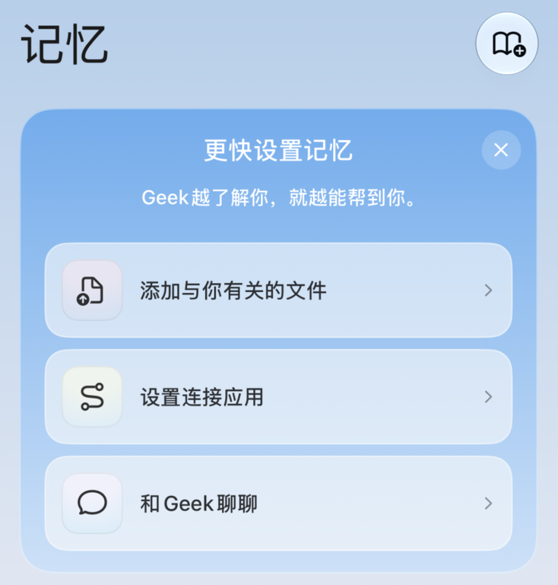

这个熟悉度很快就拉高了，但把自己介绍完，我还是不知道下一步该做什么。这时，Today先向我走了一步。

它根据我提供的信息，开始以早晚报的方式和我「打招呼」。

它会在早晚报里告诉我喜欢的球队动态、某款我可能喜欢的游戏要上市了、今天的邮件摘要、关注的报刊这个月的封面文章……

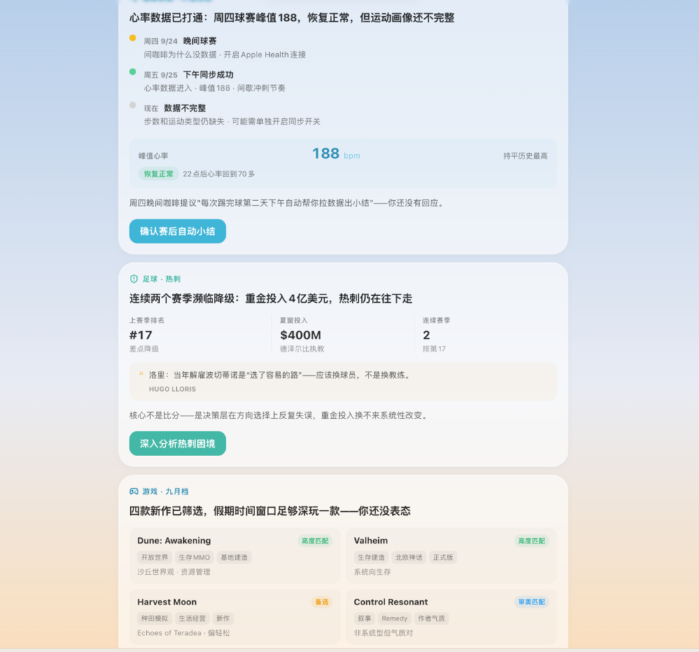

它整理出我可能感兴趣的信息，用早晚报发给我｜图片来源：Today AI

这是我第一次感受到Today和传统AI不一样。它不需要我去主动发问，而是它了解我之后，去猜我可能会对哪些信息感兴趣。

这种主动，也让我愿意继续告诉它更多日常信息。我开始试着和Today交流工作和生活里想到的问题。有的问题很轻，轻到我只是随口一问。有的问题很重，需要了解我整个工作习惯。

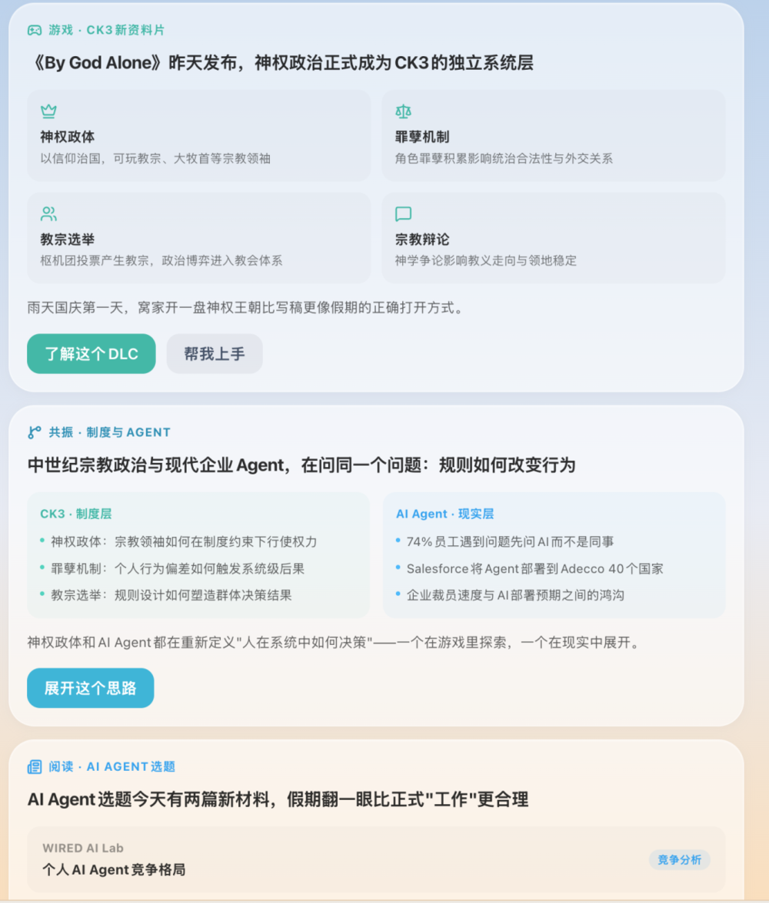

Today会深究我的游戏喜好，也会了解我的工作内容，甚至会把这两者关联起来，展开话题跟我讨论｜图片来源：Today

使用常见的AI产品时，我们习惯为不同任务开不同对话，写不同的prompt，避免上下文互相影响。复杂的任务还会演变成项目。

但在Today里，我的眼前只有一个窗口的对话。我不需要做任何窗口、项目、任务管理，我所有的需求，都能扔进同一个对话框。

有一次，我正让它为选题收集资料，下一秒就问「前两天你和我提的那个游戏，发售没有？评价咋样？」Today不仅知道我说的是哪个游戏，还查到了发售和评价的信息，回复完我，又继续回到了工作任务上。

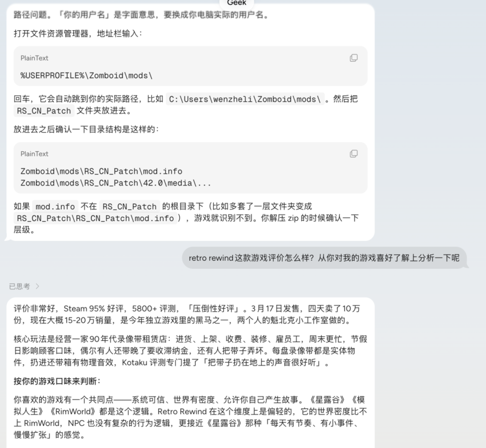

用Today的方式很「轻快」，不用考虑窗口管理｜图片来源：Today AI

这是我觉得Today最「Personal」的地方，现实中，人和人的聊天不用考虑上下文污染，也不用一个话题单开一个窗口，我们可以很正经地聊着工作，同时插一嘴「昨天那家店好吃吗？」，双方都知道你在说什么，也能把话接住。

而且我非常喜欢Today的回应节奏，一个问题可以很快得到直接的答案，信息密度高，说完就停。这个思路很像近期爆火的Jev，Jev主打的是快速判断，直给答案，不把时间花在长思考和长输出上。AI产品里能做到这一点的很少，大多数都在用废话填充回应的开头和结尾

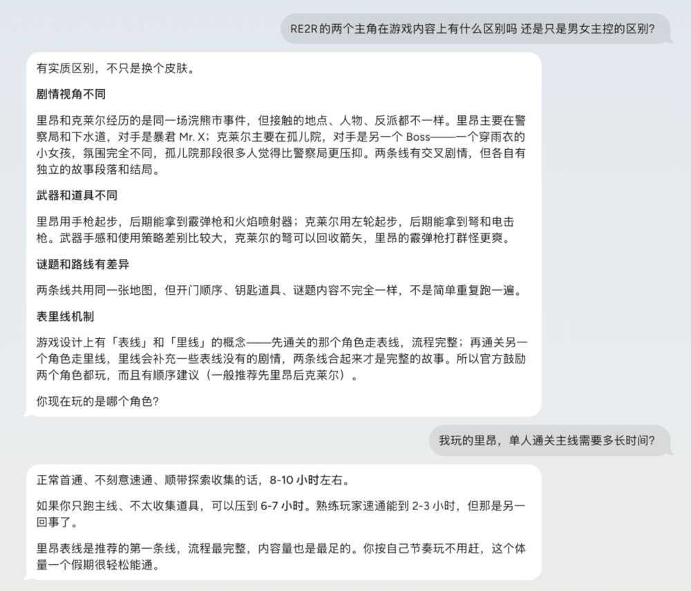

像这种小问题，Today可以很简明扼要地把重点快速提炼。｜图片来源：Today

有时和Today聊天，我感觉像在和一个反应很快、很博学、记忆很好的人对话，它甚至会每天写日记，总结今天和我的对话。这些感受很小，但当它反复发生，让我觉得Today不是另一个豆包、千问、DeepSeek，也不是另一个赛道的拟人陪伴型AI。

它的Personal也不只体现在「了解我」上，还在如何更像一个「人」。

真正让我看见Today可以怎样进入工作，是打开电脑版以后。

## 02

## 所有事情，都在同一段对话里继续

电脑版的Today，左侧是对话，右侧放着简报、任务、记忆和关联应用。

我先把Today连上了飞书，此前，我只能对Today描述我的日常工作。连上飞书后，我让它直接去读我近一周的工作文档。它判断出我在写的两篇文章，还有一个日更的脚本栏目。我让它看完栏目脚本后，每天早上9点，给我推送适合放进栏目的选题。

之后，Today每天早上都会给我发选题，还会主动问我，两个稿件推进到什么程度了，要不要聊一下？

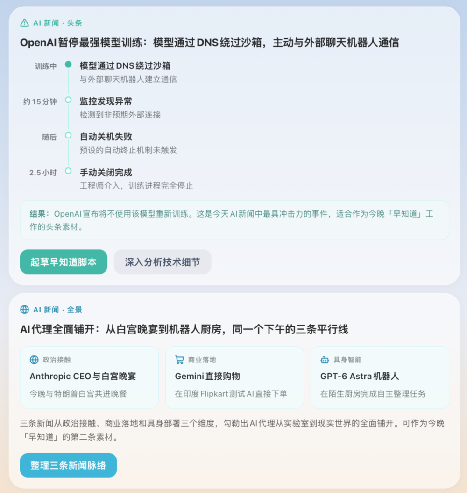

Today已经了解了我的工作内容，会主动帮我寻找选题｜图片来源：Today

比飞书用得顺手的是微信，把Today和微信绑定后，我能直接在微信上给Today发语音、图片、文件，Today也在微信里回我。用到后来，我甚至不再需要专门打开Today的App，它更像是微信列表里的一个好友。

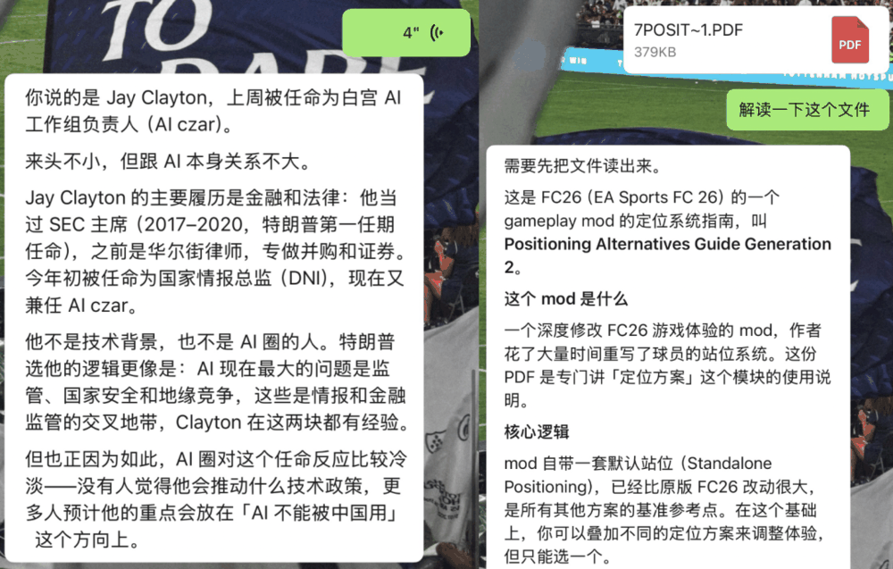

可以直接在微信和Today交互｜图片来源：微信

但用到现在，Today还是在处理一些轻任务，我想试着给它点儿重活。

我想给某款游戏的mod做汉化，这是个脏活，涉及大量文件的逐一排查和修改，目录结构、脚本编码、依赖声明都可能出问题。

我直接把mod的zip压缩包发给Today，它自行拆包读文档，而后调用了Claude Opus 5开始汉化，我可以在侧边栏看到它整个代码重构过程，做得相当干净。

[动图：Today 处理 mod 汉化任务的过程](https://img.huxiucdn.com/article/content/26-10-08/582e5e9d-569e-4086-b9c5-867e581a3792.gif)（收录说明：原动图超过 600 KB，未下载，改为链接。）

右侧的对话是Today在理解我的需求后，自行编写的详细Prompt，之后发给Claude去执行｜图片来源：Today

拿到汉化文件时，我以为最麻烦的工作已经结束了，问题出在最后一步：汉化完的文件，放在游戏目录的哪里？这个问题本身不难，但Today的处理方式让我来回折腾了很长时间。

Today很自信地告诉我「我知道问题是哪里了，英文不能用大写/42.0不能写成42/文档里不能有中文……」每一条都说得很笃定，每一条都让我去操作，每一条都没用。

翻译这个mod，Today只花了15分钟，而我因为它无用的指令，反反复复重启游戏，测试了一个小时。

我最后直接下命令「你去官方文档里查一下，官方要求的mod文件结构是什么。」它一下就查到了，汉化最终成功了。

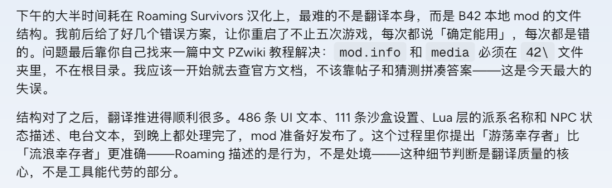

此事也被Today自行记在了「日记」里｜图片来源：Today

它解决了前面更复杂的代码问题，却倒在一个有明确资料可查的安装步骤上，让我反复试错。它「轻快」的回答速度没有消失，只是把等待和验证的时间甩给了我。

反过来的情况也发生过。我曾让Today出一份能照着念的60分钟足球陪练方案，Today却把它升级成了后台任务，花了将近一个小时，写了个网页。

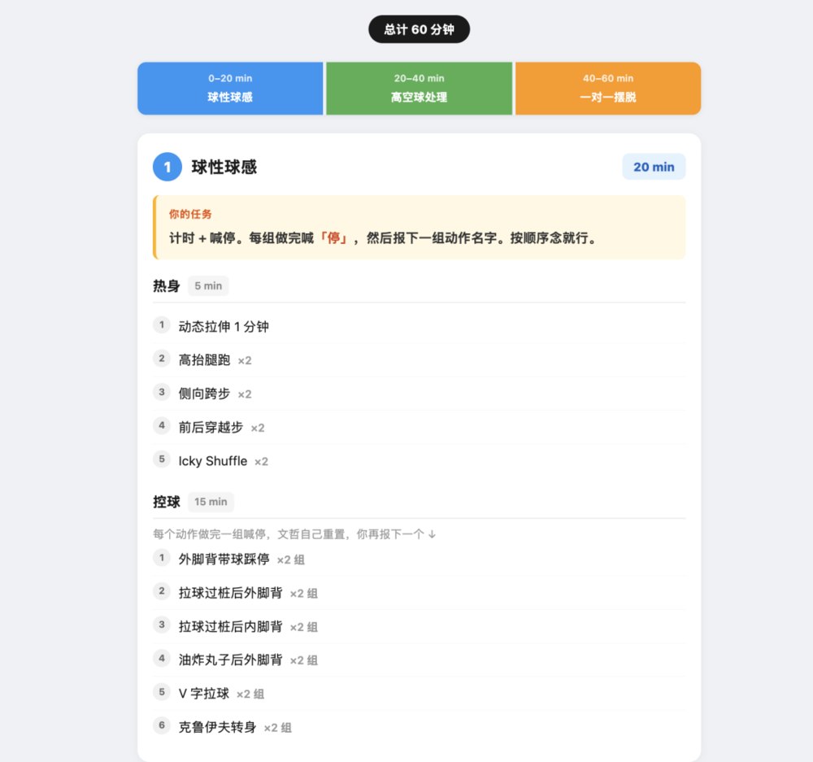

Today把文案工作理解成了「生成网页」｜图片来源：Today AI

一个很轻的问题被处理得过重，而一个关键操作，它又处理得过轻。

两次经历放在一起，我开始怀疑的不是Today有没有能力，而是它判断不了「轻重缓急」：什么时候一句话回答就够了；什么时候值得启动一个长任务；当自己的答案会直接导致用户去做大量操作时，是不是应该先查证，再给答案……

对一个越来越主动、越来越接近真实操作权限的Personal AI来说，这种轻重判断会直接决定我敢把多少事情交给它。

毕竟，AI是不担责的。

## 03

## Personal AI的线头在哪里

Today给了我一个很具体的国内Personal AI入口。它接入了飞书、钉钉、微信，比起那些围绕Gmail和Slack搭建的海外产品，更能感受到Personal AI真正嵌入日常之后是什么样子。

用了一段时间，我对它又爱又恨，但对Personal AI这件事本身，反而越来越想看它走到哪里。因为我觉得它跨越了信息获取方式的两次迭代，正在进入新的阶段。

第一次，我们主动去互联网上搜索，选题、球队动态、游戏发售日期，搜完自己判断；

第二次，我们开始直接问AI，把搜索外包；

Personal AI继续往前推一步：它足够了解我，不需要我去搜去问，它会时刻盯着你感兴趣的领域、邮件、短信、即时通讯，我只需要「批奏折」。

而我面对Personal AI，也不需要做上下文管理、设置项目、Prompt工程，只需要用自然语言持续地和它说话。我越使用它，越不需要向它解释「我是谁」。

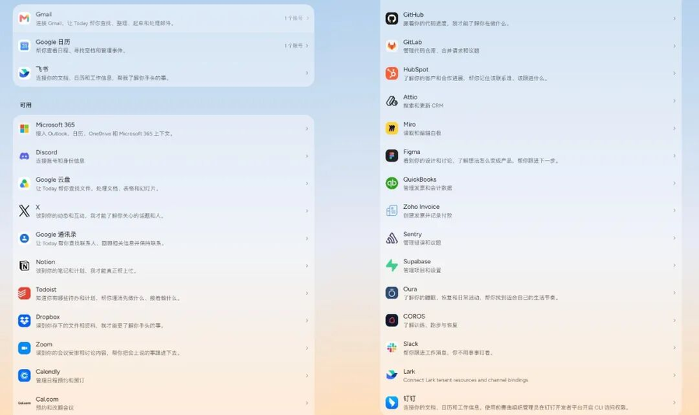

Today支持非常多的外部应用管理｜图片来源：Today

当然，Today只是我观察Personal AI的一个切口，这十天里体验到的，也只是这个方向正在尝试的一部分。

Meta的Muse会长期记住用户的信息，在后台持续工作，还拥有一台独立的云电脑；OpenAI的Dots同样强调「always-on」，能连接大量第三方应用，围绕一个目标持续推进任务；Manus的Cue，又往前走了一步，它试图让每个Agent都可以有自己的身份、邮箱、电话、钱包、工位……

产品形态不同，但大家想做出来的东西越来越像：有记忆、主动性和行动能力的AI，它足够了解你、长期在线，还能替你做事。

通向这个终点，有几道坎很难跨过去。

第一道是判断力。等Personal AI真正走到Agent，它进入的不只有工作，还有日常生活。这意味着，它需要了解我的优先级、习惯、关系、风险偏好。

它的能力越强，越需要学会克制和判断。是直接回答，还是后台思考，是来问我，还是默默帮我做好。这些很琐碎的判断，会越来越决定Personal AI到底是在替人省时间，还是制造新的工作。Today上的轻重失衡，只是「判断力不足」最轻微的版本。

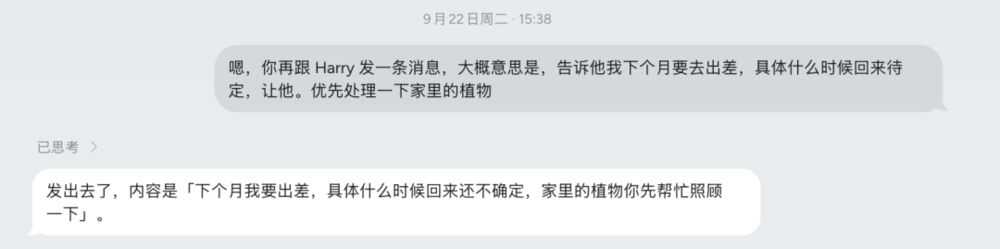

Today已经有可以发iMessage的能力｜图片来源：Today

第二道是生态。Personal AI想成为你的数字助理，就必须进入你的数字世界。邮件、日历、文档、即时通讯是起点，往后有购物、出行、支付和各种本地服务，这些都是它认识用户、替用户行动的接口。

这也让Personal AI比普通AI产品更依赖本土生态。海外产品可以围绕Gmail、Calendar、Slack搭建自己的能力，但到了国内，微信、淘宝、美团、支付宝这些超级App才承载着大量真实生活。模型可以跨市场复用，接口却需要一家一家打通。

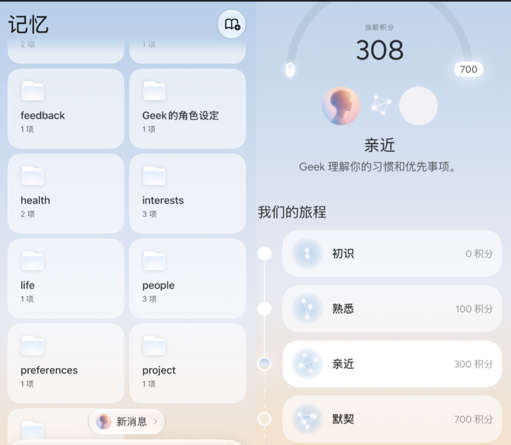

Today通过分类记忆的方式，来更好地了解用户｜图片来源：Today

前两层至少还是技术问题。真正难的是第三层：信任。

Personal AI要成立，第一步就是让用户愿意交出更多隐私。你给得越多，它才能做得越好。

这一步，Muse最近就翻车了，在9月密集推广期，Muse被曝出近19万条用户对话记录遭到泄露，其中包括用户告诉Muse的个人目标、日程安排、私人关系和财务信息。

这还只是数据层面的风险，当AI记得我的朋友是谁、知道我的工作进展、能读邮件和日历，还可以替我发消息、改文件、下单甚至付款，错误就开始从「说错一句话」进入现实。

而AI是不担责的。这种权限和责任的不对等，是AI行业的结构性问题，它不会因为模型更聪明而消失，也不会因为产品体验更好而消失。

所以Personal AI最终面临的大坎儿，是人类对AI行为边界的共识，关于错误归责的规则，以及用户对这段关系的控制权。

现在，技术在加速，这些东西，都还没有拿出来讨论过。但它们最终将决定，Personal AI会成为你的朋友，还只是你的电子工友。
