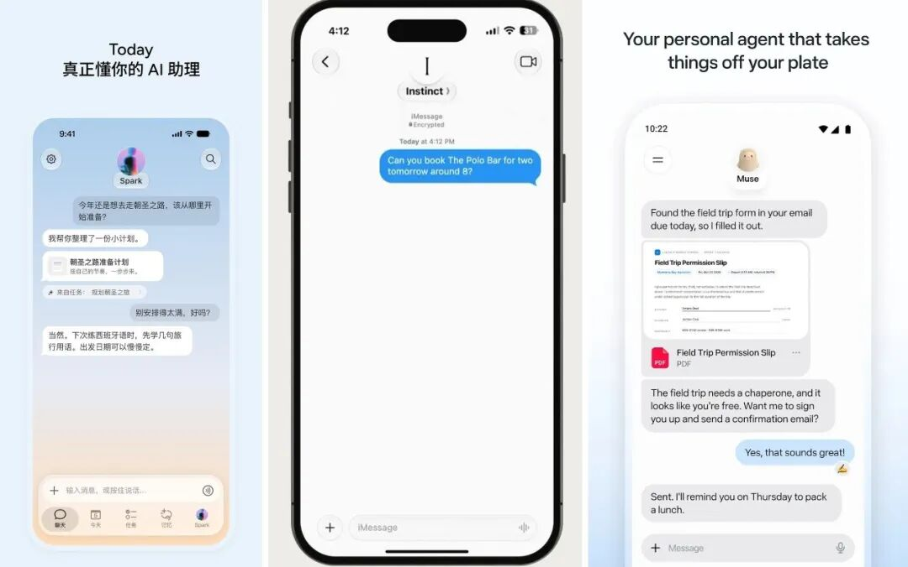
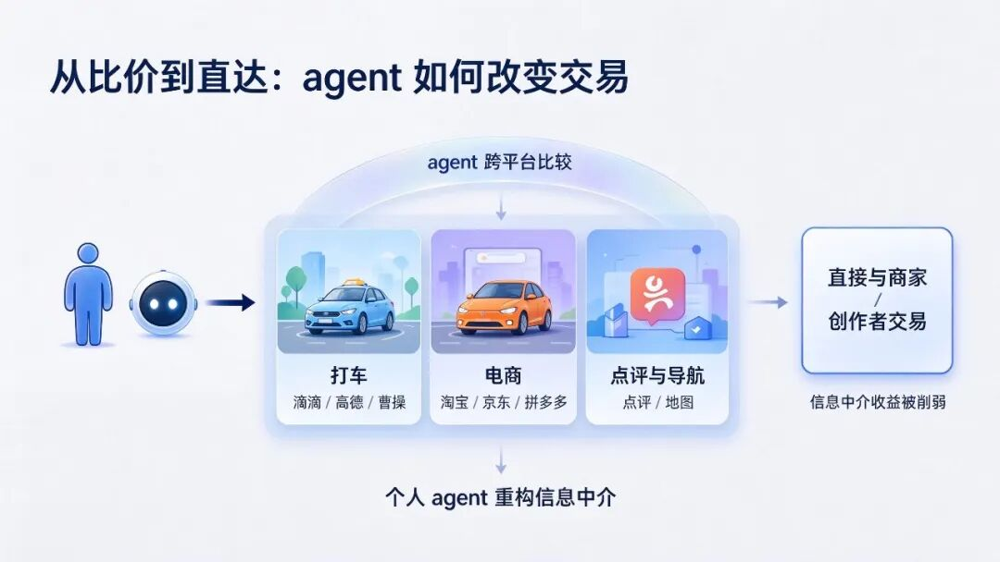



**收录说明**：用户提供链接。原文在微信公众号，用浏览器的客户端标识直接下载页面，从 `#js_content` 抽取正文，图片地址取自 `data-src`。文首「晚点」栏目横幅、文末星标引导与推荐文章卡片未收入。

**内容摘要**：晚点LatePost 对 Today AI 核心团队的访谈。Today AI 是最早推出通用个人 agent 产品的中国公司，全球版 9 月 8 日上线，中国版 9 月 24 日上线，这家公司由齐俊元创立。受访方认为个人 agent 至少有 5 个重要的竞争要素，包括模型、个性化、Infra、产品定义和获客能力，并认为主动化是其最重要的特质。访谈中，Today AI 正式公测一个月后用户呈两极分化，受访者称其留存是他这么多年做过的所有产品里最好的。受访方同时认为现有的按 token 收费模式与用户目标不完全一致。

**保留理由**：核心团队的一手访谈，包含对个人 agent 竞争要素、主动化与个性化的判断，以及公测一个月后的留存与用户分化情况。

---

个人 AI 真正该回答的是：我们如何能过更有意义的人生？

**文丨程曼祺**

**编辑丨宋玮**

过去 1 个月，个人 agent 成为最火的 AI 产品新方向。

Today AI 是最早推出通用个人 agent 产品的中国公司，全球版 9 月 8 日上线，中国版 9 月 24 日上线。

这家公司由齐俊元创立。他从本科时开始创业，2012 年推出项目协作产品 Teambition。第一次创业被收购后，他先后进入阿里、字节，负责过阿里云盘、飞书 AI 改版和豆包的电脑与 Web 端，2025 年底离职创业。目前，Today AI 已累计完成数轮总计数亿美元的融资。

我们和这家公司的核心团队聊了市场关心的一些问题：个人 agent 为什么在此刻卷土重来？这次会不会重蹈覆辙、再次昙花一现？关键的竞争要素是什么？

他们分享了一些当下的核心判断：

能主动提供服务，是个人 agent 最重要的特质；而能做到主动性的前提又是个性化。

个人 agent 是一个系统工程，至少有 5 个重要的竞争要素：模型、个性化、Infra、产品定义、获客能力。

在 Today AI 内部的评测上，一些新模型的 coding 能力越来越强，交互和说人话的能力却在变差。模型层的优化目标已出现分化，这是个人 agent 新公司的机会之一。

上述判断的底层的假设是：个人 agent 的长期不仅是 “助手”，也会是一个人生伙伴。帮人约餐厅、买东西只是一小部分，它真正的价值是，有一天，和我们一起理解自己是谁、想过怎样的生活。

大部分人现在做不到这一点，原因之一是困于各种琐事和日常摩擦。而一个和你度过漫长时间的 AI，不仅能从事务中解放我们，也能给我们一些及时的提醒：一个被忽略的健康问题、一个重要的工作或家庭决定、一场错过会遗憾的演唱会或一次百年一遇的天文奇观。

“在现在的工作强度下，我的 HRV 居然比半年前还上升了 10 毫秒。”HRV 是 “心率变异性”，升高意味着身体处于放松、恢复状态，适应性变强。作为高频使用者，Today AI 团队成员的生活已在改变。

这是 AI 时代的新励志学，还是真的指向一种更好生活的可能？大部分人总认为自己需要更好的生活，也认为自己愿意为之付出代价。这是很多人开始尝试个人 agent 的原因。悬念是，有多少人会留下。

**这个市场有炒作，但仍是 “下一件最大的事”**

**晚点****：为什么个人 agent 方向突然变得这么热闹？**

**Today AI**：根本原因是，它就是 the next big thing（下一件最大的事）。AI 最终要回答：它到底只能帮少数人完成有限的任务，还是真的可以帮更多人去解决很多今天还想不到的问题。

现在已经正式上线产品的团队，肯定几个月前就开始投入了，这不是三五天就能赶出来的产品。当然，第一批产品出来后，其他人会抄得更快。

**晚点****：你们是今年初开始开发 Today AI 的，为什么想到了这个产品形态？**

**Today AI**：其实我是在 2023 年做 AI 浏览器时就在设想类似的产品。

我看到的脉络是：有一群人一直在想象，能不能有一个 AI 系统一直在那儿，帮我处理各种任务。等前两年 coding agent 变得更好用后，他们就开始用长线程任务做这种尝试，然后慢慢扩散到了科技圈的先锋用户。

**晚点****：为什么今年更多人来做这个方向了？**

**Today AI**：今年初的 OpenClaw 是一个里程碑，它吸引了很多非 AI 从业者，虽然使用难度很大，大部分人最后放弃了，但 “普通用户去试” 这件事真的发生了。

**晚点****：如何判断这一轮个人 AI 热潮真的能跨越到普通用户，而不会像过去一些个人 AI 助理产品那样昙花一现？**

**Today AI**：今天我们确实找到了把数据变成智能的方法。我记得最早时，Siri 还是用策略树来提供问答能力，这无法穷举人在生活里的各种需求，所以无法规模化。这一点上我还是很有信心的。

**晚点****：未来会有短期波折吗？目前两个最火的产品都有特殊的增长方式：Meta 为 Muse 做了大量投放，Instinct 则搞了一号难求的邀测制。**

**Today AI**：这确实是我担心的一点，就是个人 AI 助理产品今天的成熟度、商业价值和它的估值、热度不匹配。这个方向可能会经历很大的起伏和 hype（炒作）。

**晚点****：在 hype 中，你们有哪些调整？**

**Today AI**：最大的变化是提前上线了国内版。国内接下来会有很多人追这个 hype。所以我们需要尽快告诉大家：有一家公司更早就在做这件事，而且产品已经可以用了。我们是大战的引领者，不是凑热闹、跟风的人。

**晚点****：字节、阿里、腾讯等国内大型科技公司确实都在酝酿个人 agent 产品，你认为谁能做得更好？**

**Today AI**：我是真看不出来这三家谁显著地比谁好，或谁显著处于劣势。关键是，个人 AI 助理才刚开始，我们可能对核心竞争要素的思考还不完整，所以现在很难判断谁胜谁负。

**晚点****：你目前看到了哪些重要的竞争要素？**

**Today AI**：模型、个性化、Infra、产品定义、获客。另一个是硬件，但硬件的渗透速度有限，所以硬件是否会成为胜负手，我还吃不准。

**晚点****：这几个要素的重要性排序是什么？**

**Today AI**：不是排序问题，而是如果缺一个要素，这件事就不要做了。

**晚点****：所以你们也会自己训模型？**

**Today AI**：从第一天起，我们就计划自己做模型。因为模型驱动了这个产品的大部分流程和输出，如果你想定义一个不一样或更好的体验，就需要在模型里训练出相应的能力。

**晚点****：自己做是指后训练？**

**Today AI**：后训练、中训练、预训练都只是手段。重要的是，你是否有一个为自己的产品目标服务的模型。如果未来需要做到预训练，也可以获得相应的资源去做。

最近我们已经开始提前训模型了，现在已经有了一个早期的实验版本。

**晚点****：原来的计划是什么？**

**Today AI**：先软件、再硬件、再模型。现在变成了软件和模型同时做，再考虑硬件。

**晚点****：硬件也会自己做吗？**

**Today AI**：我们会和合作伙伴一起做。背后有两个核心假设：一是个人 AI 助理需要更多不同的硬件来获得更多个性化的上下文，比如从戒指和手环获得健康数据；二是硬件本身会越来越多元和个性化，同样是录音设备，耳机、手环、磁吸手机背板……不同形态对不同用户都有合理性。

从用户角度，未来更好的体验是软件、模型层是统一的大脑来处理，而硬件的形态和品牌都会很多。所以最终一定是开放合作的模式。

**晚点****：发生了什么，让你们决定提前训模型？**

**Today AI**：做产品的过程中发现，有些体验不改模型已经无法实现。一个简单的例子。最近几代模型的 coding 能力越来越强，但交互反而越来越差，越来越 “不说人话”。你让它写点东西、解释一个概念，体验可能还不如以前。在我们内部面向个人 AI 助理的评测集上，部分新模型的分数也越来越低，这是一个重要信号，说明大家正在往不同的方向优化。

**晚点****：如果 OpenAI、Anthropic 都很难平衡更高的智能和交互时的 “说人话”，你们为什么能做好？**

**Today AI**：这不完全是能力问题，而是目标问题。他们可能更注重优化其他能力，而我们更看重交互能力。

**晚点****：什么是好的交互能力？如何拆解？**

**Today AI**：我认为最重要的特征就是个性化。而这不是今天的模型天然拥有的，需要专门设计和训练。随着使用场景不断拓展，需要的能力还会越来越多，这会是一个持续发展的方向。

**晚点****：你为什么没有在竞争要素中列出算力储备？**

**Today AI**：这归根结底是一个靠市场和资源可以解决的问题。创业公司也可以获得更多资源。

**晚点****：大公司做个人 agent 的短板可能是什么？**

**Today AI**：他们不是想做这件事才来做，他们是看到了一个商业机会。而我们有非常多的产品决定是因为我们想做这件事才有的，不是因为我们抄了谁。

**晚点****：模仿不可以是一种高效的成功方式吗？**

**Today AI**：这个领域很早期，我们今天看到的产品形态可能和两年后它应有的样子完全不一样。接下来还会有很多具体的产品和技术抉择。这时，究竟是什么在驱动你就变得很关键。

**晚点****：有一种选择是做更得更垂直，可以做垂直场景，比如聚焦旅行、健康或家庭事务，如 Google 就推出了供家人协作的 agent 产品 CC；也可以做垂直人群，比如服务对生活品质有追求的高消费人群。但这都不是 Today AI 的选择，为什么？**

**Today AI**：这只能在定位和交互体验上做出一些差异；但在核心能力上，它很难和通用方案形成真正的区别，所以我认为没有太大必要。

**晚点****：产品形态更成熟后，个人 agent 的差异化会来自什么？**

**Today AI**：不会有很多差异化，最后是有限的公司提供类似的供给。

**晚点****：供给会多集中？**

**Today AI**：可能会像运营商和银行，一个大的市场里存在少数几家公司。

**晚点****：如何活成少数几家公司？**

**Today AI**：持续给一个用户提供对他来说最好的体验。

**晚点****：如果少数几家公司的供给是类似的，那么这类产品的壁垒是什么？**

**Today AI**：个人 AI 助理在服务一个用户的过程中，自然会包含用户长期使用积累的数据，这也让 agent 越来越适应这个人。经过一定时间的积累，这类产品就不太能被轻松换掉。所以我认为，当大家提供的基础能力相似时，长期使用产生的好的体验和切换成本就是最主要的壁垒。

**个人 AI 真正该回答的是：我们如何能过更有意义的人生？**

**晚点****：OpenAI 把 Dots 叫做 always-on （全天候在线）agent，Meta 称 Muse 为 personal agent，Today AI 和 Instinct 都称之为 personal assistant（助理）。不同的词语选择背后有什么不同的产品思考？**

**Today AI**：Agent 和 assistant 的区别在于，前者对大部分普通用户来说比较陌生。Meta 可能挺自信，所以直接用了 agent。Dots 则没有着力 personalizied，而更强调 “always on” 和长程对话。

**晚点****：“Personalized” 指什么？**

**Today AI**：这里要区分两个词，一是个人化，一是个性化。个人化是指 agent 进入了非生产力的场景。Instinct、Muse 和 Today AI 在这一点上都明显区别于之前的产品 。而 Dots，就我自己的使用体验来说，它还是更偏向生产力，我很难把生活信息放进去。

个性化则是，一个 AI 系统是否真的在追求给每个人提供不一样的帮助，尊重个体的偏好，也尊重它和用户共同经历过的事情，以及能洞察用户更深层的动机。我认为个性化今天还不是共识。

**晚点****：Muse、Instinct、Today AI 等不同产品目前处在个性化程度的什么位置？**

**Today AI**：现在还太早，我很难画出这个光谱。我也不知道其他公司究竟相信什么、在做什么。

我只能说我们很相信个性化，这背后的判断是：AI 最终能否普及，非常依赖它能不能主动帮用户发现和解决问题。而个性化是主动化的前提。

**晚点****：主动化为什么如此重要？**

**Today AI**：其实我认为主动化就是个人 AI 助理 最重要的特质和价值来源，其它东西，包括个性化、模型能力、Infra 的成本优化、工程能力等等都是给主动化铺路的。

如果没有主动性，它就不能帮人避免失去一些重要的东西：比如那些你后悔没做的事，如果当年有人能提醒你，结局就会不一样。这、它可能是一个健康、家庭或工作上的重要决定，也可能是一次难得的活动、展览或体育赛事。

而 AI 能精准提醒你这些事的前提是它足够了解你。它知道什么事对你真正重要，也知道什么时候该和你说。

**晚点****：你对个人 agent 或者个人 AI 助理价值的描述并不指向某种工具性的价值，它背后更完整的图景是什么？**

**Today AI**：核心是，我觉得未来有一天，至少对我们自己而言，我们想更搞清楚自己是什么样的人。

现在很多人做不到这一点，是因为有非常多精力消耗在各种摩擦和琐事里。然后 3 到 5 年后，突然有一刻你会想：我这几年都在干什么？我错过了很多人生的可能。

未来不是这样，AI 会帮我们处理大部分琐事和摩擦，让我们能在真正重要的事上花更多时间。那些曾经因为阶段性的认知和技能瓶颈，导致你没有去做、甚至都没有想到能去做的事情，都会更多地发生。

同时会发生的是，AI 能帮人处理的事务会越来越多，它所需的能力会越来越广泛。所以这个方向非常长期，我们还有很多坑，可以一个一个去填。

**晚点****：你是怎么想到这一层价值的？**

**Today AI**：可能是我创业多年后的一种体会。它也有一个前提：你要欣赏人、社会和世界的多样性。否则你做决定和坚持一件事情的动力都会很不一样。

现在大家会拼命去做一些被阶段性验证的短期路径，比如行业最关注的是个人 AI 助理如何帮人做交易，也就是订外卖、订餐厅，甚至讨论它的网络效应，和去算 GMV 数字。从商业角度和阶段性能力看，这些也是对的。但如果认为这就是个人 AI 了，我觉得还是太局限了。这离真正改变人的生活、工作、学习和体验人生的方式，还差十万八千里。所以我也不倾向于这么早就去定义什么是这个方向的胜负手。

**晚点****：现在我们看到的形态是助手，而你描述的未来是 “人生导师”。**

**Today AI**：你想，大模型在预训练阶段几乎压缩了人类所有已经数字化的知识。同时，它的信息处理带宽远高于人类 20 瓦的大脑。所以在知识广度和信息处理能力上，它可以给每个人提供更多帮助。

我们应该让 AI 帮人去体会更有意义、更丰富、更精彩的人生，这才是个人 AI 应该回答的长期问题。

**有人两分钟卸载，有人离不开**

**晚点****：回到当前的个人 AI 助理的产品形态，有哪些已经验证的价值和设计？**

**Today AI**：第一是它会有一个长程记忆系统，用户和它的对话也都发生在一个长程对话里：你不再需要为每一个新任务去新开一个对话，或回到某个历史对话，或去思考如何选择一个合适的工作空间。

从左到右，依次是 Today AI、Instinct 和 Muse 的用户界面。Instinct 的主要交互界面是用户的 iMessage，它没有独立的 App。而 Muse 和 Today AI 有移动端、电脑端等各端的应用。

长程对话＋记忆档案成为个人 AI 助理产品的主流交互方式，而之前的 ChatBot 和办公 agent 产品更多是为每个任务单开对话。

今天 agent 也已经可以连接你的多个信息源，主动提醒你可能错过的洞察。它还可以操作浏览器和电脑，执行那些用户觉得麻烦的任务。

然后在技术架构上也有了一定共识，就是让 agent 在云端有自己的执行空间。这样，用户在手机等不同终端上也能发起复杂任务。

**晚点****：Today AI 正式公测一个月后，你更想清楚了哪些事？**

**Today AI**：首先是验证了个性化非常重要：对一个用户来说完全没用，甚至非常糟糕的的功能，对另一个用户来说可能最重要。

**晚点****：比如呢？**

**Today AI**：一个典型的例子是 Today 的助手有自己的档案页，包含它是谁以及每天和用户交流后留下的记录。档案页里有个小彩蛋，如果用户像刮彩票一样刮开隐藏区域，会看到 agent 当天送给他的一句金句或祝福。

很多用户觉得这没什么用，但也有一些用户非常喜欢，他们会从这句话里得到莫大的支持，甚至关键启发。

类似的差异还有很多。比如用户喜欢怎样的对话风格，任务应该完成得多详细，agent 应该主动讨论哪些话题、怎样主动沟通，以及是把所有事情放在一个对话里，还是专事专用，有不同的对话……所以我觉得，好的解决方案还是个性化。

另外，我发现用户群体和行为都很发散，说明这种产品形态能触达比想象中更广泛的用户，他们创造了很多我们完全没有想到的用法。所以接下来我们会着重优化成本。降本以后，我们也可以运行更多主动化策略。我还是相信，主动提供服务会创造很大的价值。

**晚点****：有用户提到，试用 Today AI 后，会把越来越多的生活事务交给它，也有用户下载手机端后两分钟就卸载了，他不习惯的地方，就是你前面提到的个人 AI 助理的新体验：比如所有互动都在一个长对话里，不需要为了不同任务选择不同对话，可这反而让用惯了 ChatGPT 的人很不适应。**

**Today AI**：这也是我前面提到的不同偏好的一部分。所以我们也上线了 multi-task（多任务）系统，但绝大多数用户还是会通过主对话交互。Today 也会主动识别复杂任务，把它移到独立的任务里，后续消息也会同步到主对话。如果用户想针对某项任务继续下达指令，也可以进入那个专门的任务里去交互，只是这样用的人比较少。

但你说的现象确实存在。Today 有一个很明显的特点：用户要么粘性非常高，要么用不起来、很快放弃，集中分布在两端。现在前一种用户的占比更高。

**晚点****：那你们公测一个月的整体留存如何？你满意吗？**

**Today AI**：Today 是我这么多年做过的所有产品里留存最好的。而且留存曲线会出现明显的翘尾，就是进入一种不再持续衰减的状态。有些用户可能某几天用得少一点，但遇到新的事情又会回来，使用频率会迅速恢复，惯性很强。

接下来我们会研究这样一个课题：怎样引导一个新用户尽快找到和 agent 一起做一件事的体验。

**晚点****：某种意义上，两极分化的用户行为也算是个好反馈。**

**Today AI**：是的，大家都一样差，或者都一样 “还行”，是最差的结果。

**从疲于奔命到用意生活**

**晚点****：你认为个人 AI 助理未来的合理商业模式是什么？Today AI 现在有免费版，使用达到一定额度后，可选每月 20 美元或 200 美元的订阅方案，Muse 也是类似的免费版加订阅，而 Instinct 现阶段完全免费。**

**Today AI**：首先说明一下，我们的订阅是面向海外的，国内版现阶段不准备收费。

我觉得现在的商业模式都不够好，因为和用户的目标不完全一致。比如按 token 收费，平台希望用户消耗更多 token，但用户希望用越少的 token 解决问题越好。

我更希望赚的钱是：用户需要一个东西，我们用市场上最高的效率帮他获得，即使加上合理的服务费，结果还是比其他方式更好。这时我们和用户的目标是一致的。

**晚点****：你说的这种服务费，适用于你帮用户完成一项具体任务。你前面还描述了个人 AI 助理的另一种 “导师” 般的价值，是主动提醒用户不错过一些洞察、事件和可能性。这部分如何被商业化？**

**Today AI**：我也没有想清楚。因为它的收益非常个性化，最后也许会变成一种基础服务费。

**晚点****：看上去这需要接入电商、本地生活等既有平台和 app，而他们不一定愿意开放，比如亚马逊刚刚封禁了 Muse。**

**Today AI**：现阶段，我们会尽最大的努力，一家家去谈合作。生态不是一成不变的。如果新的技术、体验和用户价值客观存在，而旧生态无法适应和满足新需求时，就会出现新的解决方案。谁来做都有可能，包括我们自己，所以不用着急。

**晚点****：你认为对个人 AI 助理来说，更健康的商业生态是什么样的？**

**Today AI**：我认为任何依靠用户习惯、懒惰和不知情形成的平台优势，都会被打破。因为有了 agent 以后，信息不对称会减少，用户也不再需要亲自完成大量比较和操作。最后比的还是，谁能真正向社会交付价值，谁能为某一类用户提供最好的商品或服务。

**晚点****：具体来说，哪些平台、哪些服务可能会受影响？**

**Today AI**：比如打车，无论是滴滴、高德还是曹操，在我准备回家的时刻，理论上一定有一个性价比最高的选择，但大部分人不会同时操作三个平台。电商也是一样，我很难同时比较淘宝、京东、拼多多，以及同一个平台上的自营和非自营商品。还有一些时候，我们没有能力判断哪件商品最适合自己，就会选择广告最多、品牌最响、看起来最不容易出错的那个。

这时，如果个人 AI 助理能充分理解我的具体处境和偏好，也能同时比较不同平台和产品，它就可以帮我判断应该怎么选。平台过去因为用户的操作不便和信息不完整产生的额外收益，就会被削弱。

**晚点****：按照你的推演，双边网络效应未来还存在吗？**

**Today AI**：会有很大的变化。比如一个创作者有自己的店，卖的就是某个品类里最适合某类用户的东西。用户就可以直接让自己的 agent 和他交易，双方不需要再付钱给中间的信息平台，整个过程甚至可以没有固定的软件平台和界面。

**晚点****：但物流、线下服务等比较重的环节应该还会存在。**

**Today AI**：这里要把平台的不同价值分开。物流等履约有真实的服务成本，所以履约能力仍有价值。除非 AI 或机器人也能替代一部分人的成本，创造了新的生产力，商业结构才会进一步变化。但今天很多平台获得的不仅是履约收益，还有大量信息中介收益，这部分价值会受很大冲击。履约本身也可能变得更加分散，因为 agent 可以把分散的服务供给重新组织起来。

我自己现在已经有一个很明显的感受：我越来越不需要点评和导航类网站。因为 agent 可以在某个时刻，根据我的个性化上下文给出足够好的结果。以前看起来完全合理的产品形态和服务模式，现在对我已经没有那么大用处。

个人 AI 助理重构信息中介，可能会减少中间撮合环节基于消费者和服务/产品提供者的信息不对等的获利。

**晚点****：你觉得什么时候，会有更多普通用户产生这样的感受？**

**Today AI**：以今天的模型和产品发展程度，我还没信心说一年内就能大规模泛化。它可能是一个逐渐加快的过程。

首先，我本身是非常先锋的用户，很喜欢尝试各种用法，也更能接受失败，而这样的用户动机肯定是少数。

第二，从系统主动了解和适应用户的角度看，我们今天的主动性仍只有二三十分。如果还是得主要依靠用户自己学习怎么使用，普及速度天然会慢；这也是主动性为什么重要的原因之一。

**晚点****：作为高频用户，Today AI 现在怎样改变了你的每一天？**

**Today AI**：以前我需要先花时间搞清楚大家在邮件、日历、Slack 等各种协作工具里讨论的内容，现在这部分时间少了很多。这让我能从很多组织性、琐碎的事务转向更重要的问题。

但我也在修正一件事。我很喜欢动手，时间变多以后，有时会过度执行一些本来应该让团队去做的事。

健康上也有变化。在现在的工作强度下，我的 HRV 居然比半年前还上升了 10 毫秒，这很不容易。

Today 也提升了我的社交质量。它能帮我完成面试、见投资人和合作伙伴前的准备，我的沟通质量高了很多。

**晚点****：你从 3 月之后就开始使用早期版本，你是用到什么时候明显感受到了这些变化？**

**Today AI**：大概是用到 4、5 月的一个版本时。当时发生的一件事是，团队希望我把自己的账号从外部环境迁到内部环境里，但一直没成功。每当我觉得新 agent 已经被我养到七八十分了，偶尔遇到一件事没处理好，我就又会切回原来的 agent，因为旧 agent 就是更了解我的偏好，哪怕只多一点点，体验差别都会非常大。这就是我前面提到的，个人 AI 助理的切换成本也很高。

**晚点****：如果更多人像你一样，让个人 AI 助理解决了琐事和摩擦，他们能把大量时间投入到哪些事情上了？那时的生活会是怎么样了？**

**Today AI**：很多。人的生活主要是休息、工作、社交和兴趣，其中每一件事都有显著变好的可能：你可能体会更有趣的工作过程，发现新的工作机会，提前看到过去被忽略的健康问题，及时照顾家人、朋友……

一个疲于奔命的人和一个用意生活的人，身体、心理和生活状态天差地别，现在我看到大部分人都是前者。这是每个人都可以变好的地方。

题图来源：GPT 生成。原图为《荒岛余生》中，Chuck Noland 的伙伴 Wilson。

**-****FIN -**
