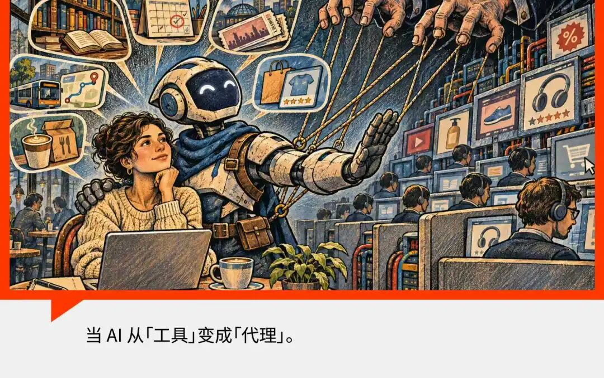
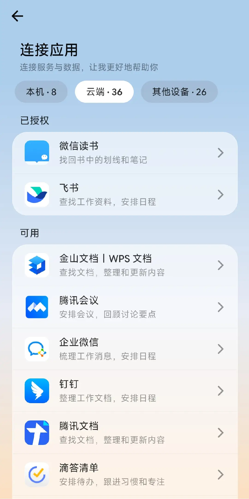
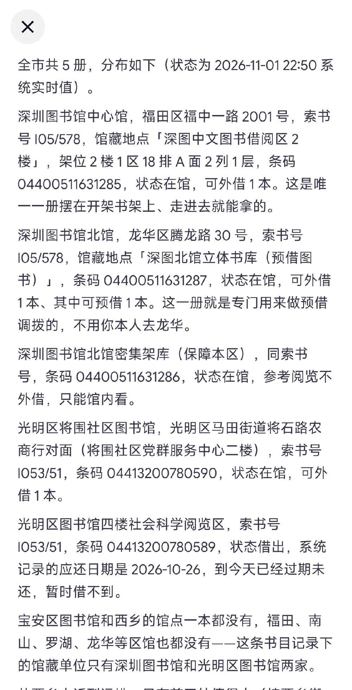
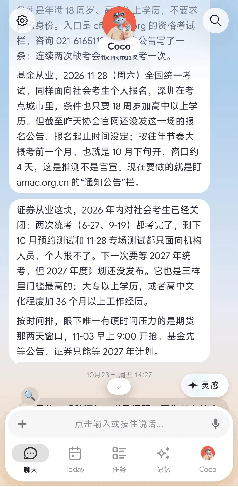
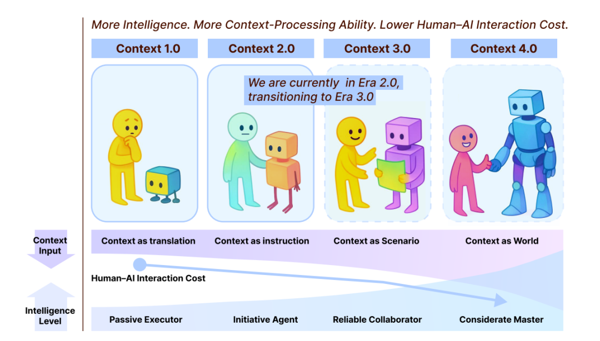



**收录说明**：用户提供链接。原文在微信公众号，用浏览器的客户端标识直接下载页面，从 `#js_content` 抽取正文，图片地址取自 `data-src`。二阶变量与汽车之心、星河频率等同属一个媒体矩阵；文末矩阵推广图未收入。

**内容摘要**：作者深度体验 Today AI：应用接入列表分为本机、云端、其他设备三类，主要上下文来自云端一类，包括飞书、钉钉、企业微信、腾讯会议，另有 QQ 邮箱和微信读书。作者让它推荐手账时，它明确不支持淘宝和天猫，转而搜索当当、孔网、京东及海外文具零售商。其他实测包括：金融从业资格考试报名通知一出就发提醒；检索深圳市图书馆系统，「细到某个馆书架第几排的编号」；每逢周五推荐周末活动；从飞书读到作者的选题与截稿日期后，建议去腾讯全球数字生态大会现场看看。文章后半讨论普通人可用的上下文来源与上下文工程。

**保留理由**：Today AI 的中文一手长期实测，记录了提醒、检索、主动推荐等具体场景，以及它不支持淘宝和天猫的情况。

---

作者 | 孙然

近两个月以来，Personal Agent 已成为新一轮 AI 产品和融资浪潮的「当红炸子鸡」。

各地机场广告屏上，腾讯、阿里、字节和百度的 AI 办公产品广告还没撤下，新的 PA 产品已经发布或迅速推进，Today AI、Manus 这样的明星初创公司也在这一波行情热度中，再次分别拿到 2 亿、5 亿美元的融资。

但有一个问题，到底什么是 Personal Agent？是继编程、办公赛道后下一波 AI 商业化落地的真实风口，还是冷饭新炒的产品营销概念？

或者说，究竟是普通人需要 AI，还是 AI 需要普通人？

在我深度体验完国内的产品 Today AI 后，这个问题似乎有了答案。

## 01

## 普通人可用的上下文，来源于哪里？

只要理解智能体的基本组成=模型＋上下文＋Harness，就不难定位这一轮 PA 产品热潮的核心增量：个人上下文。

一般来说，无论是各种点外卖、打车、订票、约体检的案例中，还是在扎克伯格「muse 如何让我当一个好爸爸」的故事里，这种上下文都有两种核心含义：**一是生活的而非工作的；二是私人的而非公共的。**

越使用 PA 产品，我越发察觉到这两种定义里的悖谬之处。

**一是嘴上说不搞工作，当生活助手，但大量的有效上下文仍然来自协同办公软件**，不然也是滴答清单这种 Todo 软件，充满班味。

打开 Today AI，虽然它的应用接入列表分为本机、云端、其他设备三类，其实一和三都属于对自己设备的调用，给那些要在苹果和安卓、移动端和电脑端切换的人。

主要的上下文数据在第二类，但最上头仍然是飞书、钉钉、企业微信、腾讯会议这些熟悉的名字，不仅和 BAT 的 AI 办公产品拉不开差距，甚至也没有对方原生。

稍微可能和个人生活沾边的，有 QQ 邮箱和微信读书，但对于使用频率低的人来说，聊胜于无。

固然，Today 可以在飞书上读到我的选题内容、截稿日期，主动给我推相关讯息。有时确实让人惊喜，比如最近腾讯全球数字生态大会在深圳召开，宣布要把 WorkBuddy 和腾讯办公全家桶合一，而我的定位恰好在深圳。

因为我过去写了不少这类选题，Today 就主动建议我可以去线下看看，抓住这个热点。当时各个媒体基本上还没有对此事的大面积报道，这种时效性和理解深度，让我感到它确实有点懂「我想要什么」。

但这也是 Today 为数不多的功能增量之一。飞书内嵌的豆包可以左右开弓，一边写文档一边查资料，上下文无损，在工作上很难取代，PA 产品即便真的有什么好用的小功能，也完全在大厂射程范围之内。

**二是我们并不掌控自己的私人消费数据。**我们的生活很大程度上分散外包给了各个 APP 的，衣食住行有阿里和美团，社交有微信，娱乐有字节系、小红书等等，但这些统统难以对生态外开放。

豆包手机二代背靠字节尚且被 100 多款应用拒之门外，何况是初创公司呢？

我也尝试让 Today 给我推荐一些手账，它明确不支持淘宝和天猫，搜索了当当、孔网、京东、台湾及海外文具零售商，包括 lovenotebooks 这样的独立站。

如果一定要找「塞翁失马，焉知非福」的亮点，就是因为它真的上不了主流购物网站，所以能挖掘到一些非常小众而精美的物品，可以说很利好独立站了。

从这一点，也可以看出中外 Personal Agent 为什么热度不同，因为海外生态确实有大量品牌建设独立站，连上邮箱、信用卡这一套成熟的基础设施，个人能获取自己的数据并授权给智能体，而在中国，主要是各大平台说了算。

最后，出乎我的意料，Today 对我来说最有用一些案例是什么呢？几乎都和教育相关（一生爱学习的东亚人）。

Today 的产品经理 Suki 在一场访谈中谈到，**国内最有价值的场景之一是教育**，也和我的感受相印证。

除了大模型本身便内化了一些基本的学科知识、便于定制学习计划和教材之外，各种考试培训、图书馆服务也已经成为重要的社会基础设施。

一是我想参加金融从业资格考试，这类考试一年好几场，但不全对社会考生开放，考位少，甚至有黄牛把代报名服务炒到近千元。我在用 Today 的第一天就让它留意，通知一出它就给我发送了提醒，并让我先在文档里准备好信息，终于让我成功报上名了。

二是我想读一本书，Today 为我检索深圳市图书馆系统中的信息，完全准确，细到某个馆书架第几排的编号，是否可外借，完全准确且全面，并且给出了距离信息。

三是在地性的活动，自从我让它留意深圳最近的文化展览、培训和免费活动，它往往会在周五给我推荐周末的活动，周末我赶完某一场坐在地铁上时，它会突然发一条消息告诉我现在几个小时后，哪里有个大会，可以去看看，于是我可以继续在城市里溜达。

**这三个案例，显然都得益于信息的公共性质。**

考试公告和活动资讯的信息经常出现在各种门户信息网站上，而门户网站是 PC 互联网时代的产物，不像移动互联网时代的 APP 端那样封闭。

同时，深圳号称「图书馆之城」，建设了全国领先的公共 API 查询系统，其他城市就不一定能查到一本书的馆藏信息。

但如果只盯着这些静态的「上下文来源」看，其实会错过这一轮 PA 产品真正踩中技术赛点的地方。

## 02

## 上下文工程的进化：长记忆、主动性

其实在 AI 高速发展的这几年，产品构想很多时候是一个轮回，很多产品没跑出来，就因为差了一点「天时地利人和」。

拿这一轮个人助理产品来说，云端虚拟机，24×7 运行这些特点人人都有，并不是什么新技术，往前看，龙虾也有不少厂做了云端版。

如果讲产品定位，很多老人每天和豆包在手机上聊几个小时，什么掏心窝子的话都说，也咨询看病、交通、教育的事，怎么就不算个人助手？

**技术准备成熟时，可能是 Token 成本、市场接受度、渠道推广力度等因素决定了一个产品的生死。**智能体的主动性和长程记忆，技术已经酝酿一段时间了，赛点已至，就等一个划时代的产品，最先是 Meta 的 Muse 跑了出来。

上一部分我列举了使用 Today 的过程中，几种上下文的来源——协同办公软件没 BAT 原生，日常 APP 数据难以突破商业壁垒，互联网上的公共数据则是谁都有，不免给人以一种产品在互联网世界很难大展身手的狭窄感。

如果仅仅看上下文的来源，就忽略了 Today 这一波个人助理智能体产品真正的创新点：主动性和长程记忆，我觉得它们同属于「上下文工程」发展到这个节点出现的东西。

上下文并不是静止的资源，Karpathy 在 25 年 6 月就提出了「上下文工程」的概念，如果将大语言模型（LLM）类比为中央处理器（CPU），将上下文窗口类比为内存（RAM），那么上下文工程就相当于操作系统（OS）。

**静态的上下文其实就是世界中的实体（entity）和客观知识（semantics)**，例如：深圳图书馆的某个书架上有某本书；我昨天下午点了一顿饺子外卖；雅思考试将要在 11 月份举行。

**而动态的上下文则包含了意图、状态、行动、结果等信息**，例如：我是一个科技媒体人，长期关注 AI 科技、产品、商业世界和人物，学习并追踪前沿进展，寻求与业界人士的交流切口，最近我已经完成了一篇分析 Personal Agent 的稿件，下周一我要报新选题。

时间要素对动态上下文和长程记忆非常重要，知道用户的状态和计划，也是主动性的前提——通过对比，知道该提醒用户做什么了。

我在用 Today 的第一天，就告诉它我要去报名金融从业资格的考试，让它帮我留意考位，过了几个星期，它也还记得这回事，公告一发就主动提醒了我。

上下文工程，如果从获取、处理、存取、调用和消费的全周期来看，聊天产品依赖用户的提示词输入和窗口历史对话，RAG、A2A、MCP 等方式把上下文的范围扩展文档、智能体和其他程序，但起点可还在用户给出的指令。

论文《Context Engineering 2.0: The Context of Context Engineering》把上下文工程的历史追溯到了 LLM 之前，把上下文放在人机交互历史的视角来看，分出了四个阶段：

- Context 1.0：Context as translation。上下文作为**「翻译」**。人把意图翻译成机器可处理的结构化输入。机器是「被动执行者」。
- Context 2.0：Context as instruction。上下文作为**「****指令****」**。智能体能理解自然语言和一定歧义。机器是「主动发起者」。
- Context 3.0：Context as Scenario。上下文作为**「场景」**。人类水平智能能感知社会线索、情绪、环境动态。机器是「可靠协作者」。
- Context 4.0：Context as World。上下文作为**「世界」**。超人类智能主动构建上下文、揭示隐藏需求。机器是「周到的管家/大师」。

图源《Context Engineering 2.0: The Context of Context Engineering》

尼葛洛庞帝在《数字化生存》一书中，早早地预见了「后信息时代」的来临。PC 互联网时代消除了信息与人之间的物理距离，移动互联网时代用推荐算法制造了一个数字生存环境，但它们的主动性还不够强，甚至是隐式的。

AI 时代，智能将作为一种「代理」的角色在人们生活中出现，其实长久以来，Agent 更多被翻译为指涉能力水平的「智能体」，而「代理」是它更久远的含义。

**这是一种关系视角，无论是个人助手、数字员工还是电脑管家，根本上谈论的都是产品和人之间的关系。**

它将成为察言观色的秘书和管家——尽管很多人对此提出质疑。比如，以务实风格闻名的投资人朱啸虎就在一场活动上说：「你有秘书吗？可能绝大部分人没有，也不需要。根本不需要，没这个需求。我自己有秘书，但也几乎不用。所以场景到底在哪里？」

在现实生活中，确实不是所有人都日理万机，许多对个人助理产品的质疑，也集中在几个具体场景：哪个普通人会一天到晚需要订机票，去全球各地旅游和出差呢？这种产品无非是上流人士和技术人员们的自嗨。

**但如果把目光放长远，「代理」的底层逻辑不是帮办几个具体事务，而是机器将会对齐乃至于超越人类的智能，能够主动、提前地提出服务。**

人没想到的，AI 替你想到了，这就是产品使用的「Aha Moment」。

但光惊叹一下是不够的，「代理」解决的显然是旧需求，PA 的产品设计更近似于深度工程整合，而不是像 iphone 或者 ChatGPT 那样本身就代表着颠覆性的技术，产品体验是全新的。

**解决旧需求有两种创业锚点。**

一种是**小众群体**，比如一开始只做水果品类的拼多多，和为了解决「沙发客」临时住宿需求诞生的 airbnb，它们解决了小众群体的精准痛点后，又通过运营扩张，覆盖了更大的用户群体。

另一种是**大众群体**，比如外卖、网约车行业，这类产品的诞生通常是源于新技术给旧需求带来了全新的解决方案，且这个解决方案的用户体验远远超过旧方案。

PA 产品的主动性是一个增量，从一些社交媒体的用例来看，它可能打在了 OPC（一人公司）这种小众人群的痛点上，但不是谁都会去创业、做超级个体。

如果要去切入大众场景，生态越是开放，PA 主动整合的空间才越大，正所谓一站式服务。

可即便真的开放了，现在我们的在线教育、出行、外卖等场景也已经非常便利——用手在屏幕点几下就行了，难道还等智能体跑个五分钟？想找到一些精准的场景，创造出高五倍、十倍的产品体验，绝对不容易。

PA 可能会演变为一个划时代的产品，但目前还为时尚早。

## 03

## 「代理」可能仍在传统互联网模式中打转

目前 Today 仍然更像信息助手，和 Manus 的 Cue 或者 Muse，乃至阿里生态内的千问 Go 相比，它更像是一个很聪明，但无法执行和跑腿的秘书。

我们总觉得这种「不能打通全生态、不能帮你跑腿闭环」是它最大的短板，但反过来想：商业生态丰富、能一站式帮你把事办完的大厂，这种优势就一定是纯粹的好事吗？

这就要回到「代理」这个角色本身天生带有的立场张力上来了。**今天的大厂超级平台虽然用足了便利，但它却很像一套换壳的广告推荐系统。**

在推荐过程中向商家抽取佣金，显然是比纯工具订阅更容易跑通的商业模式，Meta 的 Muse 已经在做了。

双边平台天然要向商家抽取佣金，一端是商业合作伙伴，一端是用户需求，这种利益结构让其很难保持公正。

现实里的个人代理要遵从《代理法》的约束，对委托人负忠实与信义义务，把委托人的利益放在第一位。

但在平台的全局目标函数里，更可能出现的情况是平台站中间但两头通吃，把自身的利益摆在最高优先级。

信息差的存在，天然就意味着可以被收割的利益空间，A/B 测试、漏斗转化率、算法推荐这些我们熟悉的运营手段，是互联网平台赚钱的看家本领。

但 AI 本身却是一种穿透力极强、能够抹除大量信息差的工具。

当这种穿透力极强的判断能力接在一个要向商家抽佣的双边平台上时，它过去藏在推荐列表里的广告，就会变成藏在「为你好」的代理建议里，更难被用户察觉。

也正因为这样，这波 AI 创业里确实长出了一批专门做「中立第三方」的产品。

这类产品能跑通的品类往往有几个共同特点：**客单价足够高，产品本身的事实逻辑复杂，但最终存在可被验证的清晰客观标准，比如美容护肤和商业保险。**

前者有层层叠叠的成分表、被营销话术包裹的功效宣传，后者有复杂的成本结构、绕人的报销规则和条款陷阱，但它们终究不是完全主观的混沌。

某款产品的实际含量如何、有没有致敏的不良成分，某类疾病在何种条款下符合报销条件，最终都有可核对的硬标准。

消费者本来就愿意在这类高决策权重的事情上花时间和精力筛选，也确实需要一个靠谱的中间人提供不偏不倚的信息判断，这就是大厂生态之外，独立的垂类 Agent 的创业可行性来源。

但这种中立创业的空间是有明确边界的：如果是买奶茶这种低决策成本的场景，就算平台代理偷偷偏袒某几家合作商家，消费者也根本没有精力去计较，够便利就足够了。

就算初创团队真的能保持公正中立，消费者在这类低权重决策上，未必真的愿意为这份「公正」买单。

**今天 Agent 能力的 Benchmark 大多还在围绕任务完成率搭建，真正衡量「AI 能否贯彻对用户的忠诚度」的测试标准还比较稀少。**

我们今天围绕 PA 搭建的许多 Benchmark，从工具调用成功率、任务完成准确率到长程任务的规划能力，本质上都还把 AI 当作更高效的工具。

但 Agent 完全有可能把一项任务按流程走得滴水不漏，却从根上违背了你的本意，比如你让它发邮件让邻居不要吵架了，它能完成发邮件的任务，礼貌直白的措辞却激怒了邻居。

还有一种可能是「泄露」，移动互联网时代，一个 APP 即使收集了非常多的用户隐私信息，也有比较明确的边界隔离，至少数据主要跑在公司机房里。

但伴随可调研、可办事的 Agent 生态发展起来，信息在不同服务商、智能体之间流动，范围将远远打破 APP 边界。**隐私数据的保护重点，可能将从收集转移到共享和传输。**

我们把选择权交出去的这个「代理」，到底会不会在没人看见的地方，真的站在我这边，这是一个关于信任的命题，也关系到这个刚刚起步的市场，能否走出传统互联网商业模式的窠臼。
